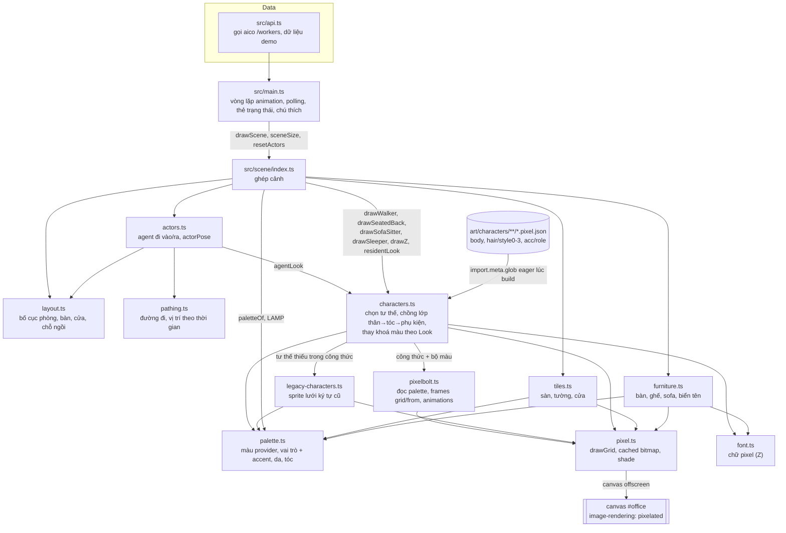

# Kiến trúc

Ứng dụng web tĩnh (Vite + TypeScript, không thư viện runtime) vẽ văn phòng pixel trên một canvas. Dữ liệu lấy từ `GET /workers` của aico hoặc kịch bản demo.

## Sprite nhân vật

`characters.ts` nạp mọi công thức trong `art/characters/` lúc build, khoá theo đường dẫn tương đối (`body`, `hair/style0`, `acc/coder`). Frame dạng `ops` của Pixelbolt được gộp thành lưới 16×22 trước khi đưa cho `pixelbolt.ts`.

Mỗi lần vẽ một tư thế (`walk_down`, `walk_up`, `walk_left`, `walk_right`, `sit_back`, `sit_side`, `lie`):

1. Nếu `body` có animation đó: vẽ chồng `body` → `hair/style{look.style}` → `acc/{look.role}` (lớp nào thiếu animation thì bỏ qua) với bộ màu dựng từ `Look`:
   `h`/`H` tóc, `s`/`S` da, `t`/`T` áo, `o` viền, `a` là `accent` của vai trò.
2. Nếu thiếu `walk_left` nhưng có `walk_right`: lật ngang `walk_right`.
3. Còn lại: dùng `legacySprite` trong `legacy-characters.ts`.

Sofa quay trái lật ngang sprite `sit_side`. Bitmap được cache hai tầng: từng lớp trong `pixelbolt.ts` (công thức, animation, frame, bộ màu) và sprite đã ghép trong `characters.ts` (tư thế, frame, kiểu tóc, màu tóc, áo, vai trò, lật).
