# T-01489c4d: GUI: làm lại thanh bên Phòng theo kiểu sidebar của Habblaud (tìm kiếm, lọc phòng, khối phòng, dòng agent)

Lần code: 1. File do aico tạo, cập nhật mỗi lần code.

## Đầu việc

| Id | Việc | Vai trò | Được sửa | Chờ | Kết quả |
| --- | --- | --- | --- | --- | --- |
| W1 | Logic thuần sidebar-model: bỏ dấu, khớp agent, thời gian chạy, thanh chỗ, lưu lọc phòng an toàn | coder | `src/ui/sidebar-model.ts`, `src/ui/sidebar-model.test.ts` | - | xong (claude) |
| W2 | CSS sidebar kiểu Habblaud và token mới | coder | `src/ui/sidebar.css`, `src/ui/tokens.css` | - | xong (codex) |
| W3 | Dựng lại DOM sidebar.ts: ô tìm, phím / và Esc, chip lọc phòng, khối phòng mới, dòng agent có thời gian chạy; test DOM | coder | `src/ui/sidebar.ts`, `src/ui/sidebar.test.ts`, `src/main.test.ts` | W1 | xong (claude) |
| W4 | Ghép nối cuối: README, CREDITS, kiểm tra trên trình duyệt và ảnh aico-shot | coder | `README.md`, `public/assets/CREDITS.md` | W2, W3 | xong (claude) |

## Kế hoạch

Tôi đã đọc AGENTS.md, docs/architecture.md, `sidebar.ts/.css`, `tokens.css`, `main.ts`, `feed.ts`, `feed.test.ts`, README. `src/main.test.ts` (53k ký tự) không đọc hết được bằng tool hiện có, nên kế hoạch có xử lý riêng cho phần đó. Giờ là kế hoạch.

# Kế hoạch T-01489c4d: làm lại thanh bên Phòng theo kiểu Habblaud

## Những gì đã có trong code

- `src/ui/sidebar.ts` dựng DOM tăng dần theo khoá (`syncChildren`, `rows: Map`) nên giữ được focus và vị trí cuộn. Thanh bên có nút « / », chú thích vai trò, ngăn kéo màn hẹp có scrim, phím `[` (`main.ts` gọi với `shortcut: false`) và Esc đóng ngăn kéo.
- `main.ts` gọi `sidebar.update(workers, needIds, selectedKey, now)` mỗi giây và sau mỗi lần poll, nên thời gian chạy tự cập nhật, không cần timer riêng. Handler phím toàn cục của `main.ts` bỏ qua khi đang gõ trong `input` (hàm `typing`), feed cũng vậy, nên **không cần sửa `main.ts`**.
- Vitest chạy trên Node, không có jsdom. Test DOM dùng node giả như `feed.test.ts` (lớp `FeedNode`, `vi.stubGlobal("document")`, mock `./avatar`).
- `src/ui/sidebar.test.ts` chưa có.

## Các bước

### 1. Logic thuần: tạo `src/ui/sidebar-model.ts` (mới)

Không DOM, không đọc giờ thật. Gồm:

- **`normalizeText(s)`**: `toLowerCase` → `normalize("NFD")` → bỏ dấu `\p{M}` → `đ/Đ` thành `d` → gộp khoảng trắng, `trim`. Giá trị không phải chuỗi thì trả `""`.
- **`agentMatches(query, fields)`**:
  - `fields = { roleLabel, role, id, ticket, activity, room }`, trường có thể `null` hoặc `undefined`.
  - `query` sau chuẩn hoá rỗng thì luôn `true`.
  - Khớp khi chuỗi con có trong bất kỳ trường nào đã chuẩn hoá.
- **`formatElapsed(startedAt, now)`**:
  - Định dạng `m:ss`; từ 1 giờ trở lên thì `h:mm:ss`.
  - Trả `null` khi: `startedAt` không phải chuỗi, `Date.parse` cho `NaN`, `now` không hữu hạn, hoặc ở tương lai (lệch âm). Không kẹp về `0:00`, giống quy ước của `time.ts`.
- **`slotFill(count, slots)`** trả `{ ratio, over, label }`:
  - `ratio` kẹp trong 0–1.
  - `slots <= 0`: có agent thì `ratio` là 1, không có thì 0.
  - `over` là `count > slots`.
  - `label` có dạng `"1/3 chỗ"`.
- **`loadHiddenRooms(storage)` / `saveHiddenRooms(storage, set)`**:
  - Khoá `aico-office.sidebar.hiddenRooms`, lưu JSON mảng chuỗi.
  - `storage` là `null` hoặc `getItem` ném lỗi: trả tập rỗng.
  - JSON hỏng hoặc không phải mảng chuỗi: từ chối, `console.warn` một lần, trả tập rỗng. Áp dụng quy tắc đọc phòng thủ trong AGENTS.md: không giữ một phần dữ liệu hỏng.
  - `setItem` ném lỗi (đầy bộ nhớ, chế độ riêng tư): `save` trả `false` và không ném ra ngoài.
- Test ở `src/ui/sidebar-model.test.ts`.

### 2. Token và CSS: `src/ui/tokens.css`, `src/ui/sidebar.css`

**Token mới trong `tokens.css`:**

| Token | Giá trị gợi ý |
| --- | --- |
| `--input-bg` | `rgba(0,0,0,.22)` |
| `--accent-soft` | accent nhạt cho dòng đang chọn |
| `--room-bg` | nền khối phòng rất nhạt |
| `--crit-softer` | nền phòng hết hạn mức/tắt, nhẹ hơn `--crit-soft` |
| `--radius-xs` | `8px` |
| `--radius-room` | `9px` |

Mã màu chỉ đặt trong `tokens.css`.

**Phần đầu thanh:**

- `.sidebar-title`: dùng font UI đậm (Pixelify thiếu dấu, chữ “Phòng” có dấu), 15px.
- `.sidebar-filtering`: nhãn nhỏ “đang lọc”.

**Ô tìm kiếm (`.sidebar-search`):**

- Cao 34px, bo `--radius-xs`, nền `--input-bg`, viền `--line-strong`.
- `:focus-within` thì viền `--accent`.
- Icon kính lúp, `input`, và `kbd.sidebar-kbd`. `kbd` ẩn khi `:focus-within`.

**Chip lọc phòng (`.sidebar-chips`):**

- Hàng chip `flex-wrap`, không cuộn ngang.
- Mỗi `.room-chip` cao 26px, bo 7px.
- `[aria-pressed=false]`: `opacity: .45`, chữ cái phòng chuyển xám, tên gạch ngang.

**Khối phòng (`.room`):**

- Bo 9px, nền `--room-bg`, viền `--line`.
- `.room-head`: vạch 3px màu phòng ở mép trái (`--room-color` đặt bằng style inline), bố cục 3 dòng:
  - dòng 1: `.room-letter` (chip nhỏ), `.room-name` (650, 13.5px), `.room-count` (nền mờ, 10.5px, tabular-nums), `.room-alert`;
  - dòng 2: `.room-state` (11px, mờ);
  - dòng 3: `.room-slots` gồm `.room-slots-bar > i` (cao 3px, `width` theo ratio) và `.room-slots-text` (10.5px). Có `.over` thì dùng màu cảnh báo.
- `limited` và `offline` dùng nền `--crit-softer`.
- `.room-empty.is-nomatch`: dòng mờ.

**Dòng agent (`.agent-row`):**

- Lưới `32px 1fr auto`.
- `.agent-top`: `.agent-role` (650) và `.agent-ticket` (mono, mờ, canh phải).
- `.agent-text`: 12px, cắt bằng ellipsis. `.agent-elapsed` nằm trong cùng dòng.
- `.status-dot`: ô vuông 8px, bo 2px.
- Các trạng thái:
  - hover: `--hover`, bo 8px;
  - `.selected`: nền `--accent-soft`, `box-shadow: inset 2px 0 0 var(--accent)`;
  - `.need`: nền `--need-soft`;
  - `.need.selected`: vạch `--st-need`;
  - `.offline`: `opacity: .58`.

**Màn hẹp:**

- Không có `overflow-x`; chip xuống dòng; ô tìm rộng 100%.
- Khi thu gọn thì ẩn `.sidebar-tools` (vùng tìm và chip).

### 3. DOM và hành vi: `src/ui/sidebar.ts` (dùng bước 1)

**Phần đầu:**

- `head` gồm tiêu đề, nhãn “đang lọc” và nút toggle. Bên dưới là `.sidebar-tools` chứa ô tìm (`input type="search"`, `aria-label="Tìm agent"`, placeholder `Tìm agent, ticket, việc…`, `kbd "/"`) và `.sidebar-chips`.
- `.sidebar-tools` đặt `inert` khi thu gọn, giống `scroll` và `legend`.

**Phím `/` và Esc:**

- Handler `keydown` cho `/` đăng ký trên `document`, **không phụ thuộc** `options.shortcut` (tuỳ chọn đó chỉ dành cho `[`).
- `/` chỉ xử lý khi không có Ctrl/Meta/Alt, không phải `repeat` và không đang gõ (`isEditable`). Khi đó `preventDefault`; nếu thanh đang thu gọn thì `setCollapsed(false)` (màn hẹp là mở ngăn kéo), rồi `input.focus()`.
- Esc trong ô: `stopPropagation` để không đóng ngăn kéo hay ngăn chi tiết, xoá chữ, render lại, rồi `blur()`.
  - Quyết định: một lần Esc làm cả hai việc.

**Lọc theo từ khoá:**

- Mỗi `input` gọi render lại từ `workers/needIds/selectedKey/now` cuối cùng đã lưu, không chờ poll.
- `renderRoom` nhận thêm `query`:
  - Map `rows` vẫn giữ mọi agent đang có trong dữ liệu. Chỉ `syncChildren` các dòng khớp, nên xoá từ khoá thì dòng cũ quay lại mà không phải dựng lại.
  - Có từ khoá mà phòng không có agent khớp: hiện đầu phòng, ẩn danh sách, `room.empty` thêm class `is-nomatch` với chữ “Không có agent khớp”.
- Từ khoá khác rỗng mà không có agent nào khớp trong mọi phòng đang hiện: ẩn mọi khối phòng, hiện `sidebar-empty` với chữ `Không tìm thấy “<từ khoá>”`.
  - Đây là cách đọc ticket: khi có ít nhất một agent khớp thì phòng không khớp vẫn hiện đầu phòng; khi không có gì khớp thì chỉ còn một dòng.

**Chip lọc phòng:**

- Mỗi phòng một chip theo thứ tự `workers`, cập nhật tăng dần theo tên phòng.
- `aria-pressed` là `true` khi phòng đang hiện. Bấm chip thì đảo trạng thái, gọi `saveHiddenRooms`, render lại.
- Khối phòng đang ẩn thì không đưa vào `rooms`.
- Lưu tên phòng ẩn kể cả khi phòng tạm vắng trong dữ liệu, để phòng xuất hiện lại vẫn ẩn.
- Ẩn hết phòng thì hiện “Đã ẩn mọi phòng”.
- `storage` lấy từ `globalThis.localStorage` trong `try/catch`. Lỗi thì dùng tập trong bộ nhớ của phiên.
- Nhãn “đang lọc” hiện khi có phòng bị ẩn **hoặc** có từ khoá.

**Khối phòng:**

- Bỏ ô chữ cái lớn; chữ cái thành chip nhỏ cạnh tên.
- Đặt `--room-color` bằng `paletteOf(worker).shirt`.
- `.room-count` hiện số agent. Thanh chỗ dùng `slotFill(shown.length, slots)`.
- Giữ nguyên `alert`, `ROOM_STATE`, thứ tự phòng, `try/catch` theo từng phòng.

**Dòng agent:**

- Thêm `.agent-elapsed` với nội dung `" · " + formatElapsed(agent.started_at, now)`; ẩn khi kết quả là `null`.
- `title` của dòng chứa toàn bộ hoạt động.
- `root.classList.toggle("offline", status.state === "offline")`.
- Giữ `need`, `selected`, `aria-current`, `aria-label`, và bấm dòng gọi `onSelect`.
- Agent đang chọn bị lọc mất: giữ `selectedKey`, chỉ ẩn dòng. Ngăn chi tiết vẫn mở.

**Test:** `src/ui/sidebar.test.ts` dùng DOM giả theo mẫu `feed.test.ts`, mock `./avatar`, stub `localStorage`.

**`main.test.ts`:** nếu file này dùng `sidebar` thật với DOM giả và bị vỡ do phần tử mới (`input`, `localStorage`), chỉ được bổ sung stub. Không đổi kỳ vọng hành vi.

### 4. Ghép nối, tài liệu, ảnh (sau bước 2 và 3)

- **README:**
  - mục Ghi công: thêm “sidebar” vào dòng Habblaud;
  - bảng Cấu trúc: thêm `src/ui/sidebar-model.ts`, `src/ui/sidebar-model.test.ts`, `src/ui/sidebar.test.ts`, và đổi mô tả `sidebar.ts`;
  - đoạn Bố cục: thêm phím `/` và chip lọc.
- **`public/assets/CREDITS.md`:** thêm một dòng cho kiểu sidebar (học kiểu dáng, không chép code).
- **Chạy và chụp:**
  - chạy `npm run build` và `npm test`;
  - chạy `npm run dev` ở chế độ demo, chụp bằng aico-shot: 1440x900; 390x844 sau khi bấm »; một ảnh đang gõ tìm kiếm (ví dụ “coder” hoặc “thiet ke” không dấu);
  - xem lại: màn hẹp không cuộn ngang, chip bấm được.

## Cách kiểm tra

- `npm run build`: `tsc` strict, `noUnused*`.
- `npm test`: mọi test cũ và test mới.
- Xem chế độ demo trong 48 giây có đủ trạng thái phòng (đang làm, hết hạn mức, mất kết nối). Gõ tìm trong lúc agent vào và ra phòng.
- Ảnh aico-shot: 1440x900, 390x844 với thanh đã mở, một ảnh đang tìm.

## Đầu việc và phụ thuộc

| ID | Phụ thuộc | Chạy song song với |
| --- | --- | --- |
| W1 | — | W2 |
| W2 | — (theo bảng class ở bước 2) | W1 |
| W3 | W1 | — |
| W4 | W2, W3 | — |

```json
{"items": [
  {"id": "W1", "title": "Logic thuần sidebar-model: bỏ dấu, khớp agent, thời gian chạy, thanh chỗ, lưu lọc phòng an toàn", "role": "coder", "owns": ["src/ui/sidebar-model.ts", "src/ui/sidebar-model.test.ts"], "depends_on": [], "acceptance": "Xuất normalizeText, agentMatches, formatElapsed, slotFill, loadHiddenRooms, saveHiddenRooms đúng chữ ký trong kế hoạch, không DOM, không đọc giờ thật. Test: hoa thường; bỏ dấu (Thiết kế→thiet ke, đ→d); khớp theo nhãn vai trò, role, id, ticket, hoạt động, tên phòng; trường null hoặc undefined; từ khoá rỗng hoặc chỉ khoảng trắng luôn khớp. formatElapsed: 0:05, 3:03, 59:59, 1:00:00, 2:05:09; started_at null, chuỗi hỏng, tương lai, now NaN cho null. slotFill: 1/3, 3/3, 4/3 over, slots 0 có và không có agent, ratio kẹp 0–1. Lưu lọc: lưu rồi đọc lại; JSON hỏng hoặc không phải mảng chuỗi bị từ chối và warn một lần; getItem hoặc setItem ném lỗi không lan ra; storage null. npm test qua."},
  {"id": "W2", "title": "CSS sidebar kiểu Habblaud và token mới", "role": "coder", "owns": ["src/ui/sidebar.css", "src/ui/tokens.css"], "depends_on": [], "acceptance": "Dùng đúng bảng class ở bước 2 (.sidebar-tools, .sidebar-search, .sidebar-kbd, .sidebar-chips, .room-chip[aria-pressed], .sidebar-filtering, .room-head có vạch --room-color, .room-letter chip nhỏ, .room-count, .room-slots/.room-slots-bar/.room-slots-text/.over, .room-empty.is-nomatch, .agent-row lưới 32px|1fr|auto, .agent-elapsed, .status-dot vuông 8px, .selected/.need/.need.selected/.offline 58%). Mã màu mới chỉ thêm vào tokens.css. Không đổi CSS của topbar, drawer, feed, cảnh. Màn hẹp dưới 900px: không overflow-x, chip xuống dòng; khi thu gọn ẩn .sidebar-tools; giữ dải » và scrim. Kích thước theo ticket: ô tìm 34px bo 8px, chip 26px bo 7px, khối phòng bo 9px, thanh chỗ 3px. npm run build qua."},
  {"id": "W3", "title": "Dựng lại DOM sidebar.ts: ô tìm, phím / và Esc, chip lọc phòng, khối phòng mới, dòng agent có thời gian chạy; test DOM", "role": "coder", "owns": ["src/ui/sidebar.ts", "src/ui/sidebar.test.ts", "src/main.test.ts"], "depends_on": ["W1"], "acceptance": "Giữ nguyên interface Sidebar, thứ tự phòng, nút « / », chú thích vai trò, dải » và Esc đóng ngăn kéo màn hẹp, bấm dòng gọi onSelect; không sửa main.ts. Chỉ sửa main.test.ts để bổ sung stub nếu DOM mới làm nó vỡ, không đổi kỳ vọng. Test DOM giả trong sidebar.test.ts:\n(a) lọc theo vai trò, ticket, hoạt động, phòng, không dấu, chữ hoa; phòng không khớp còn đầu phòng kèm dòng 'Không có agent khớp'; không khớp gì cả thì chỉ còn dòng 'Không tìm thấy “q”'; xoá từ khoá thì dòng cũ quay lại đúng node (không dựng lại).\n(b) phím '/' focus ô và mở thanh khi đang thu gọn (rộng và hẹp); bỏ qua khi đang gõ trong input hoặc có Ctrl/Meta/Alt; vẫn chạy khi shortcut:false. Esc trong ô xoá chữ, blur, không đóng ngăn kéo màn hẹp.\n(c) chip lọc: ẩn và hiện phòng, aria-pressed đổi, nhãn 'đang lọc'; nhớ qua localStorage khi tạo lại sidebar; localStorage ném lỗi thì vẫn lọc được trong phiên.\n(d) thời gian chạy ' · 3:03', '1:00:00'; started_at hỏng hoặc tương lai thì không có hậu tố; cập nhật theo now giữa hai lần update.\n(e) class selected, need, need+selected, offline; thanh chỗ ratio, nhãn '1/3 chỗ', class over khi vượt slots.\nKịch bản dữ liệu đổi giữa chừng (bắt buộc):\n- agent khớp từ khoá mất rồi xuất hiện lại khi đang lọc;\n- số agent trong phòng đổi (0→2→1, vượt slots rồi hạ xuống) khi đang lọc: số đếm, thanh chỗ và over cập nhật;\n- phòng chuyển offline hoặc limited rồi online lại khi đang lọc hoặc đang ẩn bằng chip;\n- phòng đang ẩn bằng chip biến khỏi dữ liệu rồi trở lại: vẫn ẩn;\n- agent đang chọn bị lọc mất rồi khớp lại: vẫn có class selected;\n- đổi need giữa chừng;\n- focus ở ô tìm không mất khi update() chạy mỗi giây.\nnpm run build và npm test qua."},
  {"id": "W4", "title": "Ghép nối cuối: README, CREDITS, kiểm tra trên trình duyệt và ảnh aico-shot", "role": "coder", "owns": ["README.md", "public/assets/CREDITS.md"], "depends_on": ["W2", "W3"], "acceptance": "README: mục Ghi công thêm 'sidebar'; bảng Cấu trúc có sidebar-model.ts, sidebar-model.test.ts, sidebar.test.ts và mô tả sidebar.ts mới; đoạn Bố cục nhắc phím / và chip lọc phòng. CREDITS thêm dòng kiểu sidebar Habblaud (MIT, học kiểu dáng, không chép code). Chạy npm run build và npm test, cả hai qua (ghi lệnh và kết quả). Ảnh aico-shot ở chế độ demo: 1440x900; 390x844 sau khi bấm »; một ảnh đang gõ tìm kiếm. Xác nhận màn hẹp không cuộn ngang, chip bấm được, topbar, cảnh, ngăn phải và feed không đổi. Bước nào không chạy được thì ghi lý do."}
]}
```

```mermaid
flowchart TD
  subgraph Data["Dữ liệu và logic thuần hiện có"]
    API["src/api.ts<br/>workers, snapshot tickets đầy đủ, actions<br/>demoWorkers 48 giây"]
    TK["src/tickets.ts<br/>parseTickets, needsYou, NEED_LABEL, actions, MR, preview<br/>latestScreenshots: bộ ảnh mới nhất, tối đa 16<br/>demoNeedTickets kèm ảnh demo"]
    ACTV["src/activity.ts<br/>activity, screenFor, bubbles, progress"]
    USG["src/usage.ts"]
    TIME["src/time.ts"]
    LATEST["src/latest.ts<br/>createLatestGate"]
    ATT["src/attention.ts"]
  end
  API --> TK
  ACTV --> USG

  SHOTS["public/demo-shots/ + art/demo-shots/<br/>ảnh pixel demo theo thời điểm/file.png"]
  SHOTS -.->|url tuyệt đối theo BASE_URL| TK

  COL["src/needs-column.ts + CSS<br/>gate chấp nhận snapshot<br/>lọc items cho panel, giữ xác nhận/ghi chú<br/>hàng ảnh thu nhỏ, ảnh lỗi thành link"]
  VIEWER["src/shot-viewer.ts + CSS<br/>lightbox trên body: ←/→, Esc, trả focus"]
  API -->|cùng request tickets| COL
  LATEST --> COL
  COL --> TK
  COL -->|mở ảnh, đóng khi thẻ mất/đổi nguồn| VIEWER
  COL -->|actions| API
  COL -->|snapshot đầy đủ đã chấp nhận| MAIN
  COL -->|NeedItem đã lọc| MAIN

  MAIN["src/main.ts<br/>poll, nguồn, giờ địa phương hoặc hour<br/>reduced motion, vòng animation, chọn agent<br/>showNeeds dùng chung cho feed, toast, drawer<br/>ghi --feed-left/--feed-room<br/>update sidebar mỗi giây và sau poll"]
  API --> MAIN
  LATEST --> MAIN
  ATT --> MAIN
  MAIN -->|demo assetBase| TK

  subgraph UI["Khung UI"]
    VP["ui/viewport.ts<br/>computeInsets, fitScene<br/>feedBox: left/bề rộng feed theo sidebar, drawer"]
    FM["ui/feed-model.ts<br/>FeedLine: ticket, tone<br/>dòng hết hạn mức theo chuyển trạng thái phòng"]
    SEL["ui/selection.ts"]
    FMT["ui/format.ts<br/>agentStatus, providerLetter, tokenStatsRows<br/>tokenStatsLines cho tooltip"]
    TOK["ui/tokens.css<br/>--feed-max, --input-bg, --accent-soft<br/>--room-bg, --crit-softer, --radius-xs/room"]
    TOP["ui/topbar.ts + CSS"]
    SIDEM["ui/sidebar-model.ts<br/>thuần: normalizeText bỏ dấu, agentMatches<br/>formatElapsed m:ss/h:mm:ss, slotFill<br/>load/saveHiddenRooms an toàn"]
    SIDE["ui/sidebar.ts + CSS<br/>kiểu Habblaud: ô tìm, phím / và Esc<br/>chip lọc phòng aria-pressed, nhãn đang lọc<br/>khối phòng vạch màu, đếm, thanh chỗ/over<br/>dòng agent: avatar, vai trò, ticket, hoạt động · thời gian chạy<br/>selected/need/offline; thu gọn [, ngăn kéo hẹp"]
    LS[("localStorage<br/>hiddenRooms")]
    AV["ui/avatar.ts"]
    DRWM["ui/drawer-model.ts<br/>thuần: statusView tone/nhãn/thời gian<br/>+ ticketId, needKind; nhãn 'Chờ bạn …' theo NEED_LABEL<br/>nowCardTitle theo tone<br/>roomStateLabel, taskChecklist, recentRows"]
    DRW["ui/drawer.ts + CSS<br/>tab Agent kiểu Habblaud: hero avatar 64px/48px<br/>chip phòng, ticket; hộp nhiệm vụ + MR/Xem trước<br/>dòng trạng thái: nhãn need là nút mở Cần bạn<br/>thẻ hoạt động: tiêu đề theo tone<br/>checklist task, timeline Gần đây, bảng số liệu"]
    FEED["ui/feed.ts + CSS<br/>khung nổi góc dưới trái, ticker khi thu gọn<br/>dòng lưới: giờ, avatar, tên, chip phòng, ticket, icon, nội dung<br/>dòng ticket is-ticket: ô ticket rỗng, title không lặp<br/>màn hẹp: cột tên fit-content, mã ticket đủ<br/>tự cuộn, viên N mới, phím ]"]
    NEEDS["#needs trong drawer"]
    TOAST["toasts.ts + CSS"]
  end
  MAIN --> VP
  MAIN --> FM
  MAIN --> SEL
  MAIN --> TOP
  MAIN -->|workers, needIds, selectedKey, now| SIDE
  SIDE -->|onSelect key → selectAgent| MAIN
  MAIN -->|view, agent + needItems, now| DRW
  DRW -->|onTicket id → showNeeds| MAIN
  MAIN -->|lines + workers| FEED
  FEED -->|onAgent phòng+id → selectAgent<br/>onTicket → showNeeds| MAIN
  MAIN --> TOAST
  TOAST -->|onOpen → showNeeds| MAIN
  TOP --> FMT
  SIDE --> SIDEM
  SIDE --> FMT
  SIDE --> AV
  SIDE --> ACTV
  SIDE --> PAL
  SIDE <-->|try/catch, lỗi thì chỉ trong phiên| LS
  FEED --> AV
  FEED --> FMT
  FEED --> PAL
  FMT --> USG
  FMT --> ACTV
  FM --> ACTV
  DRW --> DRWM
  DRW --> AV
  DRW --> FMT
  DRW --> PAL
  DRW --> TK
  DRWM --> ACTV
  DRWM --> TIME
  DRWM --> FMT
  DRWM -->|NEED_LABEL, NeedKind| TK
  DRW --> NEEDS
  COL --> NEEDS
  TOK -.-> TOP
  TOK -.-> SIDE
  TOK -.-> DRW
  TOK -.-> FEED
  TOK -.-> COL
  TOK -.-> VIEWER

  DEMO["scene/demo-events.ts<br/>snapshot định kỳ, cùng bộ phát hiện"]
  EVENTS["scene/room-events.ts<br/>so snapshot, MR mới/done/escalated<br/>nhớ ticket-provider, dedup, TTL 10 giây"]
  DEMO --> MAIN
  MAIN -->|snapshot và liên hệ agent.ticket_id| EVENTS
  EVENTS -->|banner đang sống| MAIN

  IDX["scene/index.ts<br/>ghép cảnh, SceneFigure và dữ liệu biển phòng"]
  MAIN -->|workers, thời gian, reduced motion| IDX
  LAYOUT["scene/layout.ts<br/>thuần: phòng/bàn/ghế, ngoại cảnh, sceneSize"]
  OUT["scene/outdoor.ts<br/>seed thuần, cây/đèn/lối đi/đường<br/>vẽ ngoại cảnh và xe"]
  CACHE["Canvas cache nền tĩnh<br/>khóa hình học, palette, seed"]
  TILES["scene/tiles.ts<br/>tường, sàn, cửa"]
  ACT["scene/actors.ts<br/>seated chỉ khi cuối path đúng ghế hiện tại"]
  PATH["scene/pathing.ts<br/>thuần"]
  FURN["scene/furniture.ts<br/>đồ đạc, đồng hồ, màn hình"]
  BOARD["scene/usage-board.ts"]
  CHAR["scene/characters.ts"]
  PB["scene/pixelbolt.ts"]
  LEG["scene/legacy-characters.ts"]
  ART["art/characters/*.pixel.json"]
  PAL["scene/palette.ts<br/>màu chung, ngoại cảnh, ánh sáng, banner"]
  PIX["scene/pixel.ts"]
  LIGHT["scene/lighting.ts<br/>độ sáng thuần và lightmap canvas cache<br/>bucket 5 phút, hình học, nguồn sáng"]

  IDX --> LAYOUT
  IDX --> OUT
  IDX --> CACHE
  CACHE --> OUT
  CACHE --> TILES
  IDX --> ACT
  ACT --> LAYOUT
  ACT --> PATH
  IDX --> FURN
  IDX --> BOARD
  BOARD --> USG
  IDX --> ACTV
  IDX --> CHAR
  AV --> CHAR
  ART --> CHAR
  CHAR --> PB
  CHAR --> LEG
  CHAR --> PAL
  OUT --> PAL
  LIGHT --> PAL
  FURN --> PAL
  TILES --> PIX
  OUT --> PIX
  FURN --> PIX
  PB --> PIX
  IDX -->|phút địa phương, layout, nguồn sáng| LIGHT

  CANVAS["canvas #office<br/>nền cache → phần động → lightmap multiply"]
  CACHE -->|drawImage mỗi frame| CANVAS
  IDX -->|đồ đạc, nhân vật, xe| CANVAS
  LIGHT -->|drawImage multiply mỗi frame| CANVAS
  VP -->|vùng trống, focus, vị trí feed| MAIN

  OVL["src/overlay.ts<br/>chữ DPR: hoạt động, progress<br/>biển phòng, banner và confetti hữu hạn"]
  TIP["src/agent-tooltip.ts + CSS<br/>hit-test và xem nhanh<br/>tokenStatsLines"]
  MAIN -->|figures, biển phòng, banner| OVL
  MAIN -->|figures và chọn agent| TIP
  OVL --> ACTV
  OVL --> PAL
  TIP --> ACTV
  TIP --> FMT
  OVL --> SCREEN["Lớp chữ trên cảnh"]
  CANVAS --> SCREEN

  TEST["Vitest<br/>outdoor, lighting, room-events, demo-events<br/>snapshot gate, overlay, renderer, main, viewport + feedBox<br/>feed-model, feed DOM, latestScreenshots, shot-viewer<br/>format, drawer-model, drawer DOM<br/>sidebar-model: bỏ dấu, khớp, m:ss/h:mm:ss, slotFill, localStorage lỗi<br/>sidebar DOM: tìm, phím / Esc, chip lọc, thanh chỗ/over<br/>class selected/need/offline; dữ liệu đổi giữa chừng khi đang lọc<br/>giữ actors và mọi test cũ"]
  TEST -.-> OUT
  TEST -.-> LIGHT
  TEST -.-> EVENTS
  TEST -.-> COL
  TEST -.-> TK
  TEST -.-> VIEWER
  TEST -.-> OVL
  TEST -.-> IDX
  TEST -.-> MAIN
  TEST -.-> ACT
  TEST -.-> VP
  TEST -.-> FM
  TEST -.-> FEED
  TEST -.-> FMT
  TEST -.-> DRWM
  TEST -.-> DRW
  TEST -.-> SIDEM
  TEST -.-> SIDE
```


