# T-0a0a01eb: GUI: favicon và apple-touch-icon có nền tối để thấy được trên tab sáng

Lần code: 1. File do aico tạo, cập nhật mỗi lần code.

## Đầu việc

| Id | Việc | Vai trò | Được sửa | Chờ | Kết quả |
| --- | --- | --- | --- | --- | --- |
| W1 | Tách pipeline icon nền tối và xuất ba PNG | coder | `scripts/export-brand.py`, `public/brand/favicon-16.png`, `public/brand/favicon-32.png`, `public/brand/apple-touch-icon.png` | - | xong (codex) |
| W2 | Chuyển khai báo favicon sang tên mới | coder | `index.html` | - | xong (codex) |
| W3 | Ghép nối, kiểm nghiệm và cập nhật hướng dẫn | coder | `README.md` | W1, W2 | xong (codex) |

## Kế hoạch

Kế hoạch T-0a0a01eb dựa trên `AGENTS.md`, `docs/architecture.md`, README, `scripts/export-brand.py`, `index.html`, `package.json` và hai kế hoạch trước `T-de61a515`, `T-8d17b253`. Tool `read_file` không liệt kê được thư mục `docs/plans/`; đã đọc các kế hoạch theo liên kết tìm được. Chưa sửa code hay chạy build/test.

Hiện script xuất cả logo trong suốt và apple-touch-icon qua cùng một nhánh, với kiểm tra bắt buộc viền ngoài trong suốt. Cần tách nhánh xuất icon nền tối và kiểm tra alpha tương ứng. HTML đã dùng `%BASE_URL%`, nên chỉ cần đổi tên hai favicon.

Logo AX là ảnh mượt có sẵn; không cần vẽ sprite mới hay giao designer tạo `.pixel.json`.

**Các bước và file cần sửa**

1. **W1 — Pipeline và ảnh, chạy song song W2.**
   - Sửa `scripts/export-brand.py`; thêm `public/brand/favicon-16.png`, `public/brand/favicon-32.png`; thay nội dung `public/brand/apple-touch-icon.png`.
   - Giữ nguyên byte các `logo-ax-*.png`. Dùng `logo-ax-512.png` làm nguồn icon để tránh thay đổi nhánh xuất logo cũ.
   - Crop theo alpha của logo, giữ tỉ lệ, căn giữa; cạnh dài phần logo khoảng 80% khung: 13, 26 và 144px.
   - Nền `#0e1016`; favicon bo nhẹ, đề xuất bán kính 2px ở 16px và 4px ở 32px. Ngoài góc bo trong suốt, mép có khử răng cưa. Apple 180px phủ nền kín, alpha 255 toàn ảnh, không bo.
   - Resize với alpha nhân trước rồi ghép nền để tránh quầng. Tách kiểm tra logo trong suốt khỏi kiểm tra favicon và apple.
   - Nếu thiếu Pillow, vẫn hoàn chỉnh script; tạo ảnh bằng công cụ PNG cài tạm ngoài repo/dependencies app. Bàn giao chính xác lệnh, phiên bản và nguồn đã dùng; không khẳng định script đã chạy nếu chưa chạy.

2. **W2 — Khai báo icon.**
   - Chỉ sửa `index.html`: chuyển hai favicon sang `%BASE_URL%brand/favicon-16.png` và `favicon-32.png`; giữ `sizes`, MIME PNG và tên apple-touch-icon.
   - Giữ nguyên đường dẫn logo thanh trên và code TypeScript.

3. **W3 — Ghép nối, kiểm chứng và README, phụ thuộc W1/W2.**
   - Sửa `README.md`: cập nhật bảng Cấu trúc, phân biệt logo trong suốt với icon nền tối; mô tả thuật toán, lệnh tái xuất, yêu cầu Pillow và cách tạo ảnh thực tế nếu dùng phương án khác.
   - Giữ nguyên ghi chép kiểm chứng ticket trước; thêm kết quả ticket này với lệnh và giới hạn kiểm tra rõ ràng.
   - Đối chiếu sơ đồ cuối với code. Hệ thống tự ghi `docs/architecture.md` và `docs/plans/`; agent không sửa hai nơi này.
   - Ảnh bằng chứng gắn vào ticket theo ghi chú duyệt trước, không thêm `art/brand-review/`.
   - Lỗi thuộc file của W1/W2 chuyển lại đúng agent, không sửa vượt `owns`.

**Kiểm tra và tiêu chí nghiệm thu**

- **AC1 — Ảnh:** đúng kích thước 16×16, 32×32, 180×180; nền phẳng đúng `#0e1016`, logo cân giữa, không méo/cắt nét. Favicon chỉ trong suốt ngoài góc bo; apple đục toàn bộ, kể cả bốn góc. Các logo trong suốt cũ giữ nguyên checksum.
- **AC2 — Trực quan:** ghép favicon lên nền trắng và tối, xem ở kích thước thật và phóng lớn; nhận ra AX, không có viền sáng/đen lạ, nhiễu hoặc mép bo răng cưa rõ. Xem apple tương tự.
- **AC3 — Build/test:** chạy `npm ci`, `npm run build`, `npm test`; tất cả phải qua. Chạy thêm `npm run build -- --base=/preview/T-0a0a01eb/`. Không thêm dependency app, không sửa lockfile.
- **AC4 — URL:** phục vụ build root và subpath với Vite preview/base tương ứng; mở trực tiếp và reload. Cả ba icon trả PNG đúng MIME, kích thước và nội dung, không nhận HTML từ SPA fallback. Dùng hồ sơ trình duyệt mới để kiểm favicon thực trên tab sáng; ảnh viewport không đủ chứng minh thanh tab.
- **AC5 — Hồi quy khi dữ liệu đổi:** xem demo ít nhất 48 giây. Khi agent mất rồi xuất hiện lại, số agent tăng/giảm/về 0, phòng offline rồi online, favicon và logo thanh trên vẫn ổn định; bộ đếm/trạng thái tiếp tục cập nhật. Ticket không thêm animation hay logic chuyển trạng thái nên dùng kiểm thử hiện có và quan sát demo, không thêm test TypeScript chỉ để lặp lại khai báo HTML.
- **AC6 — Bàn giao:** README khớp file thực tế; báo từng lệnh và kết quả, phương án tạo ảnh thực tế, kiểm tra chưa chạy cùng lý do. Nếu thiếu thiết bị iOS, ghi “không thử được” cho thao tác thêm màn hình chính; kiểm alpha/tải PNG vẫn bắt buộc. Không commit, push, tạo branch hoặc đụng `.cursor/`.

```json
{
  "items": [
    {
      "id": "W1",
      "title": "Tách pipeline icon nền tối và xuất ba PNG",
      "role": "coder",
      "owns": [
        "scripts/export-brand.py",
        "public/brand/favicon-16.png",
        "public/brand/favicon-32.png",
        "public/brand/apple-touch-icon.png"
      ],
      "depends_on": [],
      "acceptance": "AC1–AC2: xuất favicon 16/32 nền #0e1016 bo nhẹ, ngoài góc bo trong suốt; apple 180 nền kín alpha 255, không bo. Logo giữ tỉ lệ, căn giữa, cạnh dài khoảng 80%. Script có nhánh và kiểm tra riêng cho icon; không ghi thay đổi logo-ax-*.png. Xem ảnh trên nền trắng/tối ở kích thước thật và phóng lớn, AX nhận ra được, không quầng hoặc viền lạ. Nếu thiếu Pillow, hoàn chỉnh script và tạo PNG bằng công cụ ngoài dependencies app; bàn giao lệnh, phiên bản, nguồn và phần chưa chạy cho W3."
    },
    {
      "id": "W2",
      "title": "Chuyển khai báo favicon sang tên mới",
      "role": "coder",
      "owns": [
        "index.html"
      ],
      "depends_on": [],
      "acceptance": "Phần HTML của AC4: hai favicon dùng %BASE_URL%brand/favicon-16.png và favicon-32.png, đúng sizes và type image/png; apple-touch-icon giữ tên và base hiện có. Giữ nguyên phần HTML khác; đường dẫn được kiểm tổng thể sau khi W1 hoàn tất."
    },
    {
      "id": "W3",
      "title": "Ghép nối, kiểm nghiệm và cập nhật hướng dẫn",
      "role": "coder",
      "owns": [
        "README.md"
      ],
      "depends_on": [
        "W1",
        "W2"
      ],
      "acceptance": "AC1–AC6: cập nhật Cấu trúc và hướng dẫn tái xuất đúng script/ảnh thực tế; npm ci, npm run build, npm test và build base /preview/T-0a0a01eb/ qua. Kiểm root/subpath trực tiếp và reload, PNG đúng MIME/kích thước/nội dung; kiểm favicon thực trên tab sáng bằng hồ sơ sạch. Xem demo tối thiểu 48 giây: agent mất/trở lại, số lượng tăng/giảm/về 0, offline/online không làm đổi icon hay logo thanh trên. Đối chiếu checksum logo cũ và sơ đồ với code; ảnh bằng chứng gắn ticket, không commit vào repo. Báo lệnh/kết quả, cách tạo ảnh và kiểm tra chưa chạy kèm lý do. Không sửa ngoài owns; lỗi chuyển lại agent phụ trách. Hệ thống tự ghi docs/architecture.md và docs/plans/."
    }
  ]
}
```

```mermaid
flowchart TD
  SOURCE["art/brand/logo-ax-source-black.png<br/>Nguồn chính, chỉ đọc"]
  RAW["art/brand/logo-ax-source-alpha-raw.png<br/>Chỉ tham khảo"]
  EXPORT["scripts/export-brand.py<br/>Pillow ngoài build/runtime"]
  LOGOS["public/brand/logo-ax-{512,192,64,32,16}.png<br/>Logo trong suốt giữ nguyên"]
  ICONS["public/brand/favicon-16.png, favicon-32.png<br/>Nền #0e1016, bo nhẹ<br/>apple-touch-icon.png 180: nền kín, không bo"]
  SOURCE -->|extract, crop, resize như trước| EXPORT
  EXPORT -->|nhánh logo cũ| LOGOS
  LOGOS -->|logo-ax-512.png làm nguồn icon| EXPORT
  EXPORT -->|logo khoảng 80%, ghép nền| ICONS

  BASE["Vite BASE_URL<br/>/ hoặc /preview/T-0a0a01eb/"]
  HTML["index.html<br/>settings, canvas, vùng UI<br/>khai báo icon"]
  TAB["Tab trình duyệt / màn hình chính"]
  BASE -->|%BASE_URL%| HTML
  ICONS -->|PNG| HTML
  HTML --> TAB

  API["src/api.ts<br/>workers, tickets, actions, demo 48 giây"]
  TK["src/tickets.ts"]
  LATEST["src/latest.ts"]
  ATT["src/attention.ts"]
  ACTV["src/activity.ts"]
  USG["src/usage.ts"]
  TIME["src/time.ts"]
  CONFIG["window.location + localStorage aico-office.api"]
  MAIN["src/main.ts<br/>poll, animation, selection, cập nhật UI"]
  API --> TK
  API --> MAIN
  LATEST --> MAIN
  ATT --> MAIN
  CONFIG --> MAIN
  MAIN -->|giá trị form| HTML
  HTML -->|submit| MAIN
  ACTV --> USG

  SHOTS["art/demo-shots/ + public/demo-shots/"]
  COL["src/needs-column.ts + CSS"]
  VIEWER["src/shot-viewer.ts + CSS"]
  SHOTS -->|assetBase theo BASE_URL| TK
  MAIN -->|demo assetBase| TK
  API --> COL
  LATEST --> COL
  COL --> TK
  COL --> VIEWER
  COL -->|actions| API
  COL -->|snapshot, NeedItem| MAIN

  subgraph UI["Khung UI hiện có"]
    TOP["ui/topbar.ts + CSS<br/>AX trong suốt, cao 20px"]
    VP["ui/viewport.ts"]
    FM["ui/feed-model.ts"]
    SEL["ui/selection.ts"]
    FMT["ui/format.ts"]
    TOK["ui/tokens.css"]
    SIDE["ui/sidebar.ts + CSS"]
    SIDEM["ui/sidebar-model.ts"]
    HIDDEN["localStorage hiddenRooms"]
    AV["ui/avatar.ts"]
    DRW["ui/drawer.ts + CSS"]
    DRWM["ui/drawer-model.ts"]
    FEED["ui/feed.ts + CSS"]
    NEEDS["#needs trong drawer"]
    TOAST["src/toasts.ts + CSS"]
  end
  BASE -->|import.meta.env.BASE_URL| TOP
  LOGOS -->|logo-ax-64.png| TOP
  HTML -->|settings form| TOP
  MAIN --> TOP
  TOP -->|submit, Demo| MAIN
  TOP --> FMT
  MAIN --> VP
  VP --> MAIN
  MAIN --> FM
  MAIN --> SEL
  MAIN --> SIDE
  SIDE -->|onSelect| MAIN
  SIDE --> SIDEM
  SIDE <--> HIDDEN
  SIDE --> AV
  SIDE --> FMT
  SIDE --> ACTV
  MAIN --> DRW
  DRW -->|onTicket| MAIN
  DRW --> DRWM
  DRW --> AV
  DRW --> FMT
  DRW --> TK
  DRWM --> ACTV
  DRWM --> TIME
  DRWM --> FMT
  DRWM --> TK
  DRW --> NEEDS
  COL --> NEEDS
  MAIN --> FEED
  FEED -->|onAgent, onTicket| MAIN
  FEED --> AV
  FEED --> FMT
  FM --> ACTV
  FMT --> USG
  FMT --> ACTV
  MAIN --> TOAST
  TOAST -->|onOpen| MAIN
  TOK -.-> TOP
  TOK -.-> SIDE
  TOK -.-> DRW
  TOK -.-> FEED
  TOK -.-> COL
  TOK -.-> VIEWER

  DEMO["scene/demo-events.ts"]
  EVENTS["scene/room-events.ts"]
  DEMO --> MAIN
  MAIN -->|snapshot| EVENTS
  EVENTS -->|banner| MAIN

  subgraph SCENE["Cảnh pixel hiện có"]
    IDX["scene/index.ts"]
    LAYOUT["scene/layout.ts: thuần"]
    ACT["scene/actors.ts"]
    PATH["scene/pathing.ts: thuần"]
    OUT["scene/outdoor.ts"]
    CACHE["Cache nền tĩnh"]
    TILES["scene/tiles.ts"]
    FURN["scene/furniture.ts"]
    BOARD["scene/usage-board.ts"]
    CHAR["scene/characters.ts"]
    PB["scene/pixelbolt.ts"]
    LEG["scene/legacy-characters.ts"]
    ART["art/characters/*.pixel.json"]
    PAL["scene/palette.ts"]
    PIX["scene/pixel.ts"]
    LIGHT["scene/lighting.ts"]
  end
  MAIN -->|workers, thời gian, reduced motion| IDX
  IDX --> LAYOUT
  IDX --> ACT
  ACT --> LAYOUT
  ACT --> PATH
  ACT --> CHAR
  IDX --> OUT
  IDX --> CACHE
  CACHE --> OUT
  CACHE --> TILES
  IDX --> FURN
  IDX --> BOARD
  BOARD --> USG
  IDX --> ACTV
  IDX --> CHAR
  IDX --> LIGHT
  AV --> CHAR
  ART --> CHAR
  CHAR --> PB
  CHAR --> LEG
  CHAR --> PAL
  LEG --> PAL
  OUT --> PAL
  LIGHT --> PAL
  FURN --> PAL
  SIDE --> PAL
  AV --> PAL
  FEED --> PAL
  DRW --> PAL
  TILES --> PIX
  OUT --> PIX
  FURN --> PIX
  PB --> PIX
  LEG --> PIX

  CANVAS["canvas #office"]
  CACHE --> CANVAS
  IDX --> CANVAS
  LIGHT --> CANVAS
  OVL["src/overlay.ts"]
  TIP["src/agent-tooltip.ts + CSS"]
  SCREEN["Lớp chữ trên cảnh"]
  MAIN --> OVL
  MAIN --> TIP
  OVL --> ACTV
  OVL --> PAL
  TIP --> ACTV
  TIP --> FMT
  TIP --> PAL
  OVL --> SCREEN
  CANVAS --> SCREEN

  TEST["Vitest hiện có<br/>API, UI, scene, công thức art"]
  TEST -.-> API
  TEST -.-> MAIN
  TEST -.-> TOP
  TEST -.-> ACT
  TEST -.-> SIDE
  TEST -.-> DRW
  TEST -.-> FEED
  TEST -.-> ART
  CHECK["Kiểm build/test, root/subpath, demo<br/>kích thước, alpha, nền, favicon tab sáng"]
  CHECK -.-> ICONS
  CHECK -.-> LOGOS
  CHECK -.-> HTML
  CHECK -.-> TOP
  CHECK --> EVIDENCE["Bằng chứng gắn ticket<br/>không lưu art/brand-review/"]
  README["README.md<br/>Cấu trúc, tái xuất và kết quả kiểm tra"]
  README -.-> EXPORT
  README -.-> LOGOS
  README -.-> ICONS
```


