```mermaid
flowchart TD
  subgraph Data["Dữ liệu và logic thuần hiện có"]
    API["src/api.ts<br/>workers, snapshot tickets đầy đủ, actions<br/>demoWorkers 48 giây"]
    TK["src/tickets.ts<br/>parseTickets, needsYou, actions, MR, preview<br/>latestScreenshots: bộ ảnh mới nhất, tối đa 16<br/>demoNeedTickets kèm ảnh demo"]
    ACTV["src/activity.ts<br/>activity, screenFor, bubbles, progress"]
    USG["src/usage.ts"]
    TIME["src/time.ts"]
    LATEST["src/latest.ts<br/>createLatestGate"]
    ATT["src/attention.ts"]
  end
  API --> TK
  ACTV --> USG

  SHOTS["public/demo-shots/ + art/demo-shots/<br/>ảnh pixel demo theo thời điểm/file.png"]
  SHOTS -.->|url tuyệt đối theo BASE_URL| TK

  COL["src/needs-column.ts + CSS<br/>gate chấp nhận snapshot<br/>lọc items cho panel, giữ xác nhận/ghi chú<br/>hàng ảnh thu nhỏ, ảnh lỗi thành link"]
  VIEWER["src/shot-viewer.ts + CSS<br/>lightbox trên body: ←/→, Esc, trả focus"]
  API -->|cùng request tickets| COL
  LATEST --> COL
  COL --> TK
  COL -->|mở ảnh, đóng khi thẻ mất/đổi nguồn| VIEWER
  COL -->|actions| API
  COL -->|snapshot đầy đủ đã chấp nhận| MAIN
  COL -->|NeedItem đã lọc| MAIN

  MAIN["src/main.ts<br/>poll, nguồn, giờ địa phương hoặc hour<br/>reduced motion, vòng animation, chọn agent<br/>ghi --feed-left/--feed-room"]
  API --> MAIN
  LATEST --> MAIN
  ATT --> MAIN
  MAIN -->|demo assetBase| TK

  subgraph UI["Khung UI"]
    VP["ui/viewport.ts<br/>computeInsets, fitScene<br/>feedBox: left/bề rộng feed theo sidebar, drawer"]
    FM["ui/feed-model.ts<br/>FeedLine: ticket, tone<br/>dòng hết hạn mức theo chuyển trạng thái phòng"]
    SEL["ui/selection.ts"]
    FMT["ui/format.ts<br/>tokenStatsRows label/value/cache/level<br/>tokenStatsLines dựng từ rows cho tooltip"]
    TOK["ui/tokens.css<br/>--feed-max"]
    TOP["ui/topbar.ts + CSS"]
    SIDE["ui/sidebar.ts + CSS"]
    AV["ui/avatar.ts"]
    DRWM["ui/drawer-model.ts<br/>thuần: statusView tone/nhãn/thời gian<br/>roomStateLabel, taskChecklist, recentRows"]
    DRW["ui/drawer.ts + CSS<br/>tab Agent kiểu Habblaud: hero avatar 64px/48px<br/>chip phòng, ticket; hộp nhiệm vụ + MR/Xem trước<br/>dòng trạng thái, thẻ Đang làm, checklist task<br/>timeline Gần đây, bảng số liệu"]
    FEED["ui/feed.ts + CSS<br/>khung nổi góc dưới trái, ticker khi thu gọn<br/>dòng lưới: giờ, avatar, tên, chip phòng, ticket, icon, nội dung<br/>dòng ticket is-ticket: ô ticket rỗng, title không lặp<br/>màn hẹp: cột tên fit-content, mã ticket đủ<br/>tự cuộn, viên N mới, phím ]"]
    NEEDS["#needs trong drawer"]
    TOAST["toasts.ts + CSS"]
  end
  MAIN --> VP
  MAIN --> FM
  MAIN --> SEL
  MAIN --> TOP
  MAIN --> SIDE
  MAIN -->|view, agent + needItems, now| DRW
  MAIN -->|lines + workers| FEED
  FEED -->|onAgent phòng+id → selectAgent<br/>onTicket → showNeeds| MAIN
  MAIN --> TOAST
  TOP --> FMT
  SIDE --> FMT
  SIDE --> AV
  FEED --> AV
  FEED --> FMT
  FEED --> PAL
  FMT --> USG
  FMT --> ACTV
  FM --> ACTV
  DRW --> DRWM
  DRW --> AV
  DRW --> FMT
  DRW --> PAL
  DRW --> TK
  DRWM --> ACTV
  DRWM --> TIME
  DRWM --> FMT
  DRW --> NEEDS
  COL --> NEEDS
  TOK -.-> TOP
  TOK -.-> SIDE
  TOK -.-> DRW
  TOK -.-> FEED
  TOK -.-> COL
  TOK -.-> VIEWER

  DEMO["scene/demo-events.ts<br/>snapshot định kỳ, cùng bộ phát hiện"]
  EVENTS["scene/room-events.ts<br/>so snapshot, MR mới/done/escalated<br/>nhớ ticket-provider, dedup, TTL 10 giây"]
  DEMO --> MAIN
  MAIN -->|snapshot và liên hệ agent.ticket_id| EVENTS
  EVENTS -->|banner đang sống| MAIN

  IDX["scene/index.ts<br/>ghép cảnh, SceneFigure và dữ liệu biển phòng"]
  MAIN -->|workers, thời gian, reduced motion| IDX
  LAYOUT["scene/layout.ts<br/>thuần: phòng/bàn/ghế, ngoại cảnh, sceneSize"]
  OUT["scene/outdoor.ts<br/>seed thuần, cây/đèn/lối đi/đường<br/>vẽ ngoại cảnh và xe"]
  CACHE["Canvas cache nền tĩnh<br/>khóa hình học, palette, seed"]
  TILES["scene/tiles.ts<br/>tường, sàn, cửa"]
  ACT["scene/actors.ts<br/>seated chỉ khi cuối path đúng ghế hiện tại"]
  PATH["scene/pathing.ts<br/>thuần"]
  FURN["scene/furniture.ts<br/>đồ đạc, đồng hồ, màn hình"]
  BOARD["scene/usage-board.ts"]
  CHAR["scene/characters.ts"]
  PB["scene/pixelbolt.ts"]
  LEG["scene/legacy-characters.ts"]
  ART["art/characters/*.pixel.json"]
  PAL["scene/palette.ts<br/>màu chung, ngoại cảnh, ánh sáng, banner"]
  PIX["scene/pixel.ts"]
  LIGHT["scene/lighting.ts<br/>độ sáng thuần và lightmap canvas cache<br/>bucket 5 phút, hình học, nguồn sáng"]

  IDX --> LAYOUT
  IDX --> OUT
  IDX --> CACHE
  CACHE --> OUT
  CACHE --> TILES
  IDX --> ACT
  ACT --> LAYOUT
  ACT --> PATH
  IDX --> FURN
  IDX --> BOARD
  BOARD --> USG
  IDX --> ACTV
  IDX --> CHAR
  AV --> CHAR
  ART --> CHAR
  CHAR --> PB
  CHAR --> LEG
  CHAR --> PAL
  OUT --> PAL
  LIGHT --> PAL
  FURN --> PAL
  TILES --> PIX
  OUT --> PIX
  FURN --> PIX
  PB --> PIX
  IDX -->|phút địa phương, layout, nguồn sáng| LIGHT

  CANVAS["canvas #office<br/>nền cache → phần động → lightmap multiply"]
  CACHE -->|drawImage mỗi frame| CANVAS
  IDX -->|đồ đạc, nhân vật, xe| CANVAS
  LIGHT -->|drawImage multiply mỗi frame| CANVAS
  VP -->|vùng trống, focus, vị trí feed| MAIN

  OVL["src/overlay.ts<br/>chữ DPR: hoạt động, progress<br/>biển phòng, banner và confetti hữu hạn"]
  TIP["src/agent-tooltip.ts + CSS<br/>hit-test và xem nhanh<br/>tokenStatsLines"]
  MAIN -->|figures, biển phòng, banner| OVL
  MAIN -->|figures và chọn agent| TIP
  OVL --> ACTV
  OVL --> PAL
  TIP --> ACTV
  TIP --> FMT
  OVL --> SCREEN["Lớp chữ trên cảnh"]
  CANVAS --> SCREEN

  TEST["Vitest<br/>outdoor, lighting, room-events, demo-events<br/>snapshot gate, overlay, renderer, main, viewport + feedBox<br/>feed-model ticket/tone/hết hạn mức, feed DOM<br/>latestScreenshots, shot-viewer, hàng ảnh thẻ<br/>format: tokenStatsRows + tokenStatsLines cũ<br/>drawer-model: tone, phòng, checklist, timeline<br/>drawer DOM: hero, nhiệm vụ, trạng thái, thẻ Đang làm<br/>checklist, timeline, số liệu, dữ liệu đổi giữa chừng<br/>giữ actors và mọi test cũ"]
  TEST -.-> OUT
  TEST -.-> LIGHT
  TEST -.-> EVENTS
  TEST -.-> COL
  TEST -.-> TK
  TEST -.-> VIEWER
  TEST -.-> OVL
  TEST -.-> IDX
  TEST -.-> MAIN
  TEST -.-> ACT
  TEST -.-> VP
  TEST -.-> FM
  TEST -.-> FEED
  TEST -.-> FMT
  TEST -.-> DRWM
  TEST -.-> DRW
```

# T-17d9ab91: GUI: làm lại tab Agent trong ngăn chi tiết theo kiểu drawer của Habblaud

Lần code: 1. File do aico tạo, cập nhật mỗi lần code.

## Đầu việc

| Id | Việc | Vai trò | Được sửa | Chờ | Kết quả |
| --- | --- | --- | --- | --- | --- |
| W1 | Hàm thuần cho tab Agent: tokenStatsRows và drawer-model (trạng thái, phòng, checklist, timeline) + README | coder | `src/ui/format.ts`, `src/ui/format.test.ts`, `src/ui/drawer-model.ts`, `src/ui/drawer-model.test.ts`, `README.md` | - | xong (claude) |
| W3 | drawer.css: kiểu hero, hộp nhiệm vụ, dòng trạng thái, thẻ Đang làm, checklist, timeline, bảng số liệu | coder | `src/ui/drawer.css` | - | xong (codex) |
| W2 | drawer.ts dựng tab Agent mới + drawer.test.ts | coder | `src/ui/drawer.ts`, `src/ui/drawer.test.ts` | W1 | xong (claude) |
| W4 | Ghép nối, xem demo, chụp 1440x900 và 390x844 | coder | `src/ui/drawer.ts`, `src/ui/drawer.css` | W2, W3 | xong (claude) |

## Kế hoạch

# Kế hoạch T-17d9ab91: làm lại tab Agent của ngăn chi tiết theo kiểu drawer Habblaud

## Hiện trạng (đã đọc code)

- `src/ui/drawer.ts`: mỗi lần `render` (gọi từ `publish()` trong `main.ts`, mỗi giây và sau mỗi lần poll), tab Agent bị xoá trắng rồi dựng lại bằng `line()` và `section()`. Thứ tự hiện tại: id, vai trò · phòng, ticket kèm link, rồi các mục Đang làm, Gần đây, Task, Số liệu với `h3` xanh 18px.
- `src/ui/format.ts`: `tokenStatsLines` trả về chuỗi ghép sẵn. `src/agent-tooltip.ts` vẫn dùng hàm này, nên phải giữ. Có sẵn `agentStatus(worker, agent, needIds, now)` và `providerLetter`.
- `src/ui/avatar.ts`: `createAvatar(agent)` trả canvas 16×16 `.avatar`. Nếu vẽ lỗi thì trả span `.avatar-fallback` và gán `style.background`. Phóng CSS lên 64px (×4) hoặc 48px (×3) là số nguyên lần nên pixel vẫn sắc. **Không cần sửa avatar.ts.**
- Chip phòng ở feed: chữ `providerLetter(worker.name)` trên nền `paletteOf(worker).shirt`, dùng font pixel.
- **Mâu thuẫn với ticket:** `tokens.css` ghi rõ Pixelify Sans không có dấu tiếng Việt. Các tiêu đề "Đang làm", "Gần đây", "Số liệu" mà dùng font pixel sẽ vỡ chữ. Cách xử lý: tiêu đề mục dùng `--font-ui` 700, 12–13px, `letter-spacing` nhẹ, màu `--text`. Chỉ phần ASCII (số đếm `0/7`, `12`, chữ cái chip phòng) mới dùng `--font-pixel`. Sẽ ghi lý do này trong phần tóm tắt.
- `src/ui/drawer.test.ts` dùng DOM giả `DrawerNode`, không có `style` hay `getContext`. Khi `createAvatar` đi vào nhánh fallback và gán `node.style.background` thì test sẽ ném lỗi. Stub cần thêm `style = {}`.

## Thiết kế

**Thứ tự trong tab Agent:** hero → hộp nhiệm vụ → dòng trạng thái → thẻ Đang làm → Task → Gần đây → Số liệu.

**Hàm thuần mới** (logic tách khỏi DOM để test được):
- `src/ui/format.ts`
  - `tokenStatsRows(stats): TokenStatsRow[]` với `{ label, value, cacheSuffix, level }`. Logic chuyển nguyên từ `tokenStatsLines` sang.
  - `tokenStatsLines` sửa thành `rows.map(r => ({ text: \`${r.label}: ${r.value}\`, cacheSuffix, level }))`. Kết quả phải giống hệt cũ (test format cũ giữ nguyên).
- `src/ui/drawer-model.ts` (mới):
  - `statusView(worker, agent, needIds, now)` → `{ tone: "working"|"need"|"error"|"idle"|"offline"|"limited", label, ago }`.
    - Thứ tự ưu tiên: offline/limited → lỗi (`agentStatus().error`) → need ("Chờ") → working ("Đang làm") → idle ("Rảnh").
    - `ago` lấy `relativeTime(activity.at)`. Không có activity thì lấy `started_at`. Không có cả hai thì `null`.
  - `roomStateLabel(state)`: working "đang làm", idle "rảnh", limited "hết hạn mức", offline "mất kết nối". Trạng thái lạ trả "?".
  - `taskChecklist(agent)` → `{ items: {id, title, status}[], done, total } | null`. Dùng `readAgentActivity` và `taskProgress` (tin `tasks_done`).
  - `recentRows(agent, key, now)` → `{ icon, text, ago, at }[]`, sắp mới nhất trước. Giới hạn vẫn như hiện tại (≤20 theo `readAgentActivity`).

**Class CSS thống nhất giữa W2 và W3** (W2 dựng DOM, W3 viết CSS, chạy song song):

```
.drawer-hero > .drawer-hero-avatar (bọc .avatar) + .drawer-hero-body
  .drawer-hero-name (> .drawer-role, .drawer-agent-id.mono)
  .drawer-hero-room (> .drawer-room-chip, .drawer-room-name, .drawer-room-state)
  .drawer-hero-ticket (> .drawer-ticket-label "Ticket", .drawer-ticket-id.mono)
.drawer-mission[.is-empty] > .drawer-mission-title + .drawer-mission-links > a.drawer-link ("MR ↗", "Xem trước ↗")
.drawer-status.tone-{working|need|error|idle|offline|limited} > .drawer-status-dot, .drawer-status-label, .drawer-status-ago
.drawer-now[.is-error] > .drawer-now-title, .drawer-now-main (.drawer-now-icon, .drawer-now-text), .drawer-now-detail
section.drawer-section > h3.drawer-section-head (> .drawer-section-title, .drawer-section-count)
.drawer-progress (div có .drawer-progress-fill, width %, role=progressbar, aria-valuenow/max)
ul.drawer-checklist > li.drawer-check.{pending|in_progress|completed} (> .drawer-check-mark ○/◐/✓, .drawer-check-title)
ol.drawer-timeline > li.drawer-tl-row (> .drawer-tl-icon, .drawer-tl-text[title], time.drawer-tl-ago[datetime])
dl.drawer-stats > div.drawer-stat (> dt, dd > .drawer-stat-value + span.drawer-cache.{ok|warn|crit})
.drawer-muted (giữ)
```

Thanh tiến độ dùng `div` chứ không dùng `<progress>`, để tự định cao 3–4px và màu accent đồng nhất trên mọi trình duyệt.

**Màu** chỉ dùng biến sẵn có trong `tokens.css`:
- Trạng thái: `--st-working`, `--st-need`, `--lvl-crit`, `--st-idle`, `--st-offline`.
- Nền pha của thẻ Đang làm: `color-mix(in srgb, var(--accent) 10%, transparent)`, khi lỗi đổi sang `var(--crit-soft)`.
- Task xong: `--lvl-ok`.

Không sửa `tokens.css` (nằm ngoài vùng sửa, topbar/feed dùng chung).

## Các bước

1. **W1, hàm thuần.** Thêm `tokenStatsRows` vào `format.ts` và tạo `drawer-model.ts`, kèm test cho cả hai. Cập nhật README: bảng Cấu trúc thêm `src/ui/drawer-model.ts` và `src/ui/drawer-model.test.ts`, sửa mô tả dòng `drawer.ts`/`drawer.test.ts`; mục Ghi công sửa thành "Kiểu feed hoạt động và ngăn chi tiết (drawer) học theo Habblaud (MIT), không chép code". `CREDITS.md` đã ghi `drawer.ts` nên không sửa.
2. **W3, CSS** (song song với W1). Viết lại phần tab Agent trong `drawer.css` theo class ở trên.
   - Giữ nguyên `.drawer`, header, tab, `.drawer-needs #needs` và toàn bộ khối `@media (max-width: 899px)` hiện có (vị trí, `--feed-reserve`, chiều cao).
   - Màn hẹp chỉ thêm: avatar 48px, `.drawer-content { overflow-x: hidden }`, mọi ô chữ có `min-width: 0` và cắt `…`.
3. **W2, DOM** (chờ W1). Viết lại phần `info !== null` trong `drawer.ts`. Giữ API `createDrawer` và `render(view, info, now)`, phần tab, Esc và `onLayout`. Viết lại `drawer.test.ts`.
4. **W4, ghép nối và kiểm tra** (chờ W2, W3). Chạy `npm run build` và `npm test`. Xem chế độ demo, chỉnh CSS/DOM nếu lệch. Chụp aico-shot 1440×900 và 390×844 với ngăn Agent đang mở: ở chế độ demo, bấm một agent trên thanh bên; màn hẹp thì mở ngăn kéo thanh bên bằng phím `[` trước. Nếu aico-shot không bấm được thì ghi rõ là chưa chụp, không tự thêm tham số URL (việc đó phải sửa `main.ts`, nằm ngoài phạm vi).

Không sửa `main.ts`, `selection.ts`, `avatar.ts`, `feed.*`, `sidebar.*`, `topbar.*`, `needs-column.*`, `tokens.css`, `agent-tooltip.ts`.

## Cách kiểm tra

- `npm run build`: tsc strict và vite build không lỗi.
- `npm test`: toàn bộ test qua, trong đó test cũ của `format.test.ts` và `agent-tooltip.test.ts` giữ nguyên không sửa.
- Tự xem bằng `npm run dev`, chế độ demo (kịch bản 48 giây):
  - chọn agent claude đầu tiên: có lỗi ở bước "Build lỗi" và stale từ giây 36;
  - agent cursor: thiếu cache;
  - một agent có ticket nằm trong Cần bạn: có link MR/Xem trước.
- Chụp 1440×900 và 390×844. Ở 390×844 không có thanh cuộn ngang, ngăn vẫn là tấm dưới đứng trên feed.

### Kịch bản dữ liệu đổi giữa chừng (ngăn đang mở, gọi `render` liên tiếp trên cùng một drawer)

- **Ticket:** có trong needItems → biến mất → xuất hiện lại. Tiêu đề và link mất rồi hiện lại, không còn link cũ. `ticket_id` đổi sang mã khác thì hero và hộp đổi theo. `ticket_id` thành null thì hiện "Chưa có ticket" và ẩn dòng 3 của hero.
- **Activity:** null → thường → lỗi → thường. Thẻ bỏ `.is-error`, dòng trạng thái đổi về đúng màu. `detail` có → mất thì dòng detail biến mất.
- **Trạng thái:** working → need (ticket vào Cần bạn) → idle → working. Tone và nhãn đổi đúng, không giữ class cũ.
- **Task:** 3 → 7 → 0 (hoặc `tasks` bị mất). Số đếm, độ rộng thanh và danh sách cập nhật. Khi rỗng thì hiện "Chưa có task" và không còn thanh. `tasks_done` hỏng thì tự đếm.
- **Recent:** 12 → 3 → rỗng → 5. Số đếm và số dòng khớp, rỗng thì hiện "Chưa có hoạt động".
- **Stats:** cache có → mất → có, stats hỏng/null. Không giữ dòng Token mới hay màu cũ (chuyển các kịch bản test hiện có sang cấu trúc bảng).
- **Đổi agent:** A → B (khác vai trò). Avatar, tên, id và chip phòng là của B, không còn nút nào của A.
- **Offline/limited:** room state đổi ở dòng 2. Khi `render(view, null)` (main đóng ngăn vì offline) thì chỉ còn dòng "Chọn một agent…", không sót hero.
- **Thời gian tương đối:** gọi `render` lại sau 61 giây với dữ liệu giữ nguyên thì "giây trước" chuyển thành "1 phút trước".

```json
{"items": [
  {"id": "W1", "title": "Hàm thuần cho tab Agent: tokenStatsRows và drawer-model (trạng thái, phòng, checklist, timeline) + README", "role": "coder",
   "owns": ["src/ui/format.ts", "src/ui/format.test.ts", "src/ui/drawer-model.ts", "src/ui/drawer-model.test.ts", "README.md"],
   "depends_on": [],
   "acceptance": "tokenStatsRows(stats) trả {label, value, cacheSuffix, level}[] (Lần gọi tool, Token vào + hậu tố % từ cache với level ok/warn/crit, Token mới chỉ khi có cache, Token ra); tokenStatsLines được dựng từ rows và mọi test cũ trong format.test.ts qua mà không sửa; agent-tooltip không đổi. drawer-model.ts thuần (không DOM, không Date.now): statusView ưu tiên offline/limited > lỗi > need ('Chờ') > working ('Đang làm') > idle ('Rảnh'), ago từ activity.at, không có thì started_at, không có cả hai thì null; roomStateLabel cho working/idle/limited/offline và trạng thái lạ ('?'); taskChecklist dùng taskProgress (tasks_done hợp lệ thì tin, hỏng thì tự đếm), null khi không có task; recentRows sắp mới nhất trước, giữ giới hạn 20. Test gồm từng tone, cờ lỗi cũ vẫn đỏ, thời gian tương lai/hỏng, dữ liệu sai kiểu bị từ chối (warn một lần, không ném), task 3→7→0, tasks_done hỏng, recent rỗng/đủ 20, tokenStatsRows có/thiếu/hỏng cache và biên 40%/70%. README: bảng Cấu trúc thêm drawer-model.ts/.test.ts và mô tả mới cho drawer.ts/drawer.test.ts; Ghi công ghi kiểu feed và ngăn chi tiết (drawer) học theo Habblaud (MIT), không chép code. npm run build và npm test qua."},
  {"id": "W3", "title": "drawer.css: kiểu hero, hộp nhiệm vụ, dòng trạng thái, thẻ Đang làm, checklist, timeline, bảng số liệu", "role": "coder",
   "owns": ["src/ui/drawer.css"],
   "depends_on": [],
   "acceptance": "Viết đúng các class đã thống nhất trong kế hoạch (.drawer-hero*, .drawer-mission*, .drawer-status.tone-*, .drawer-now[.is-error], .drawer-section-head/-title/-count, .drawer-progress(-fill), .drawer-checklist/.drawer-check.{pending|in_progress|completed}, .drawer-timeline/.drawer-tl-*, .drawer-stats/.drawer-stat, .drawer-cache.{ok|warn|crit}). Avatar 64px (48px khi max-width 899px), image-rendering: pixelated, khung bo góc nền tối có viền --line-strong; .avatar-fallback cùng kích thước. Tên vai trò ~21px đậm; id agent và mã ticket dùng --font-mono, cắt …; mã ticket màu --accent. Hộp nhiệm vụ bo góc nền var(--hover), nút link nhỏ viền mảnh; .is-empty chữ mờ. Chấm trạng thái: working --st-working, need --st-need, error --lvl-crit, idle --st-idle, offline --st-offline. Thẻ Đang làm có viền và nền pha accent nhạt (color-mix), lỗi dùng --crit-soft và viền --lvl-crit. Tiêu đề mục --font-ui 700 12–13px màu --text (không dùng Pixelify cho chữ có dấu vì font thiếu dấu tiếng Việt, theo ghi chú trong tokens.css), số đếm --font-pixel canh phải; các mục ngăn bằng 1px var(--line), khoảng cách gọn. Thanh tiến độ cao 3–4px màu accent. Task xong màu --lvl-ok chữ mờ, đang làm đậm hơn. Hàng timeline ~24px dạng lưới icon | chữ (cắt …) | thời gian canh phải mờ, cỡ nhỏ. Bảng số liệu: nhãn mờ bên trái, giá trị canh phải tabular-nums. Chỉ dùng biến trong tokens.css, không thêm mã màu. Giữ nguyên .drawer, header/tab, .drawer-needs #needs và khối @media hẹp hiện có (vị trí, --feed-reserve, chiều cao); màn hẹp không cuộn ngang. Không đổi kiểu topbar/sidebar/feed/cột Cần bạn."},
  {"id": "W2", "title": "drawer.ts dựng tab Agent mới + drawer.test.ts", "role": "coder",
   "owns": ["src/ui/drawer.ts", "src/ui/drawer.test.ts"],
   "depends_on": ["W1"],
   "acceptance": "Giữ API createDrawer/render/onLayout/destroy, tab, Esc và cách di chuyển node #needs. Tab Agent theo thứ tự hero → hộp nhiệm vụ → dòng trạng thái → thẻ Đang làm → Task → Gần đây → Số liệu, dùng đúng class đã thống nhất. Hero dùng createAvatar(agent), roleStyle().label, agent.id (title đủ), chip providerLetter trên nền paletteOf(worker).shirt + tên phòng + roomStateLabel, dòng 'Ticket' + mã (ẩn khi không có ticket_id). Hộp nhiệm vụ: tiêu đề ticket từ needItems, link 'MR ↗'/'Xem trước ↗' (target _blank, rel noopener noreferrer) chỉ khi có url; có ticket_id mà thiếu tiêu đề thì hiện mã mờ; không có ticket thì 'Chưa có ticket' với .is-empty. Dòng trạng thái lấy từ statusView với needIds từ needItems. Thẻ Đang làm: icon, text, detail nếu có, .is-error khi lỗi; không có activity thì 'Chưa có hoạt động'. Task: số đếm done/total, thanh role=progressbar, checklist ○/◐/✓. Gần đây: số đếm, ô thời gian time[datetime], text có title đủ. Số liệu: dl từ tokenStatsRows, hậu tố cache có class drawer-cache level. Test (DOM giả, thêm style={} vào stub) phủ: hero (avatar hoặc fallback, vai trò, id, chip, ticket); hộp có/không ticket, có/không link; dòng trạng thái từng tone; thẻ Đang làm thường/lỗi/không activity; checklist 3 trạng thái và số đếm; timeline có ô thời gian; bảng số liệu và màu cache (chuyển các kịch bản cache cũ sang cấu trúc bảng). Kịch bản dữ liệu đổi giữa chừng trên cùng drawer: ticket có → mất → có lại (link theo); ticket_id đổi/null; activity null → thường → lỗi → thường (bỏ .is-error); working → need → idle → working; task 3 → 7 → 0; recent 12 → 3 → rỗng → 5; cache có → mất → có, stats hỏng; đổi agent A → B không sót nút cũ; worker offline/limited đổi nhãn phòng; render(view, null) không sót hero; now +61 giây thì thời gian tương đối cập nhật. npm run build và npm test qua."},
  {"id": "W4", "title": "Ghép nối, xem demo, chụp 1440x900 và 390x844", "role": "coder",
   "owns": ["src/ui/drawer.ts", "src/ui/drawer.css"],
   "depends_on": ["W2", "W3"],
   "acceptance": "npm run build và npm test qua (ghi lệnh và kết quả). Ở chế độ demo, chọn một agent có ticket trong Cần bạn và agent claude đầu tiên (lỗi, stale): class DOM khớp CSS, không có phần nào thiếu kiểu. Ở 390x844: avatar 48px, không cuộn ngang, ngăn vẫn là tấm dưới đứng trên feed, tab Cần bạn không đổi. Chụp aico-shot 1440x900 và 390x844 với ngăn Agent đang mở; nếu không thao tác chọn agent được thì ghi rõ là chưa chụp, không sửa main.ts. Chỉ chỉnh drawer.ts/drawer.css khi cần cho khớp; mọi thay đổi phải giữ test W2 qua."}
]}
```


