# T-18f08263: GUI: làm lại khung giao diện theo kiểu Habblaud (canvas toàn màn hình, panel kính, thanh bên, ngăn chi tiết, feed, token)

Lần code: 1. File do aico tạo, cập nhật mỗi lần code.

## Đầu việc

| Id | Việc | Vai trò | Được sửa | Chờ | Kết quả |
| --- | --- | --- | --- | --- | --- |
| W1 | Token CSS, font Pixelify Sans, chuyển CSS cũ sang biến, CREDITS | coder | `src/ui/tokens.css`, `src/style.css`, `src/needs-column.css`, `src/toasts.css`, `src/agent-tooltip.css`, `package.json`, `package-lock.json`, `public/assets/CREDITS.md` | - | xong (claude) |
| W2 | Hàm thuần: vùng trống/fitScene, gom feed, chọn agent/ngăn chi tiết, định dạng + test | coder | `src/ui/viewport.ts`, `src/ui/viewport.test.ts`, `src/ui/feed-model.ts`, `src/ui/feed-model.test.ts`, `src/ui/selection.ts`, `src/ui/selection.test.ts`, `src/ui/format.ts`, `src/ui/format.test.ts` | - | xong (codex) |
| W3 | Thanh trên (ô số, hạn mức, cài đặt popover) và thanh bên (phòng → agent, avatar, phím [) | coder | `src/ui/topbar.ts`, `src/ui/topbar.css`, `src/ui/sidebar.ts`, `src/ui/sidebar.css`, `src/ui/avatar.ts` | W2 | xong (claude) |
| W4 | Ngăn chi tiết (tab Agent / Cần bạn, Esc) và feed hoạt động (phím ]) | coder | `src/ui/drawer.ts`, `src/ui/drawer.css`, `src/ui/feed.ts`, `src/ui/feed.css` | W2 | xong (codex) |
| W5 | Demo đủ trạng thái: nhiều agent, cần bạn gắn agent, có lỗi phòng | coder | `src/api.ts`, `src/tickets.ts`, `src/tickets.test.ts`, `src/activity.ts`, `src/activity.test.ts` | - | xong (cursor) |
| W6 | Ghép nối: index.html, main.ts (insets, fitScene, chọn agent, feed, phím), main.test, README | coder | `index.html`, `src/main.ts`, `src/main.test.ts`, `README.md` | W1, W2, W3, W4, W5 | xong (cursor) |

## Kế hoạch

Đã đọc xong AGENTS.md, kiến trúc, ghi chép Habblaud và code liên quan. Kế hoạch ở dưới.

# Kế hoạch T-18f08263: làm lại khung giao diện theo kiểu Habblaud

Tôi chỉ đọc được file theo đường dẫn nên không liệt kê được `docs/plans/`. Kế hoạch dựa vào `docs/architecture.md` (cập nhật lần cuối ở T-8ea8f203) và code hiện có trên `main`. Tôi không xem được ảnh PNG trong `docs/references/habblaud-ui/`, nên phần giao diện dựa vào mục 6 và 6b của `habblaud.md`, nơi đã ghi đủ số đo và màu.

## Hiện trạng và những điểm ảnh hưởng tới cách làm

- `index.html` đang theo bố cục dọc: `header.top`, rồi `.workspace` (gồm `.stage` với canvas và `#toasts`, cạnh đó là `aside#needs`), rồi `#legend` và `#cards`. Hàm `renderCards()` trong `main.ts` vẽ thẻ phòng mỗi giây. Ticket yêu cầu bỏ phần này.
- `frame()` tính `k = ceil(clientWidth*dpr/sceneW)`, nghĩa là canvas đang co theo bề ngang. `overlay.ts` và `agent-tooltip.ts` tính tỉ lệ theo `canvas.clientWidth/offsetLeft`. Vì vậy, nếu giữ canvas đúng bằng kích thước cảnh × hệ số rồi đặt tuyệt đối trong một `.stage` phủ toàn màn hình, thì **overlay và tooltip không phải sửa**, và `src/scene` cũng không phải động tới. Màn tối quanh cảnh là nền của `.stage`.
- `main.test.ts` giả DOM theo id: `#needs`, `#needs-count`, `#tickets-error`, `#agents-count`, `#demo`, `.workspace` (class `has-needs`). Nên **giữ nguyên các id**, chỉ đổi phần assertion về bố cục (`has-needs`, chuỗi bộ đếm) và giữ đủ mọi kịch bản.
- `needs-column.ts` tự đặt `root.hidden` khi danh sách rỗng và có `focus(id)`. Ngăn chi tiết chỉ cần nhận `#needs` làm nội dung tab "Cần bạn", logic giữ nguyên. Toast giữ nguyên `toasts.ts` và `attention.ts`, chỉ đổi CSS.
- `src/time.ts` (`relativeTime`) đang được dùng nhưng chưa có trong bảng Cấu trúc của README, nên bổ sung luôn khi sửa README.

## Quy ước chung để các đầu việc chạy song song

Tên biến CSS, chốt ngay từ đầu (W1 định nghĩa, các đầu việc khác dùng luôn mà không phải chờ):

| Nhóm | Biến |
| --- | --- |
| Nền, chữ | `--bg` (#0e1016), `--panel` rgba(18,21,29,.85), `--panel-solid` rgba(20,24,33,.97), `--line` rgba(160,176,210,.13), `--text` #e8ecf5, `--text-dim` #9aa4b8, `--accent` #7cc8ff |
| Trạng thái | `--st-working` #4fd18b, `--st-need` #ffb547, `--st-idle` #8b98b3, `--st-done` #6aa8ff, `--st-offline` #6b7280, `--st-limited` = `var(--lvl-crit)` |
| Mức hạn mức | `--lvl-ok` #4fd18b, `--lvl-warn` #ffb547, `--lvl-crit` #ff6b6b |
| Hình khối | `--radius` 10px, `--radius-sm` 7px, `--gap` 10px, `--ease` cubic-bezier(.22,.8,.24,1), `--glass` (blur(14px) saturate(1.25)), `--shadow` |
| Font | `--font-pixel` "Pixelify Sans", `--font-ui` system-ui…, `--font-mono` ui-monospace… |
| Kích thước | `--topbar-h` 64px, `--sidebar-w` 304px, `--drawer-w` 380px, `--feed-h` 200px, `--feed-h-min` 38px |
| Vùng trống (main ghi lúc chạy) | `--free-top/right/bottom/left` |

- Lớp kính dùng chung là `.glass` (W1 định nghĩa). Mỗi panel có file `.css` riêng đi kèm `.ts`, giống quy ước sẵn có (`toasts.ts` + `toasts.css`).
- Các id DOM trong `index.html` sau thay đổi: `#topbar`, `#sidebar`, `#drawer`, `#feed`, `#stage`, `#office`, `#toasts`, `#needs` (nằm trong drawer), `#needs-count`, `#agents-count`, `#tickets-error`, `#conn`, `#settings`, `#demo`.

## Các bước

### W1: Token, font, chuyển CSS cũ (coder)
1. Thêm `@fontsource/pixelify-sans` (OFL) vào `package.json` và `package-lock.json`, cài bằng `npm install`.
2. Tạo `src/ui/tokens.css` với các biến ở bảng trên, `@import` font Pixelify Sans 400/600, cùng lớp `.glass`, `.title-pixel` và `.mono`.
3. `src/style.css`: dòng đầu `@import "./ui/tokens.css";`. Bỏ các biến màu cũ (`--working: #f5c26b`…) và mọi CSS của `.cards`, `.card*`, `.legend`, `.workspace`, `main {max-width}`. Thêm phần khung: `html, body` cao 100%, `overflow: hidden`, `#stage` cố định phủ toàn màn hình với nền `--bg`, `#office` đặt tuyệt đối và `image-rendering: pixelated`.
4. Chuyển `needs-column.css`, `toasts.css` và `agent-tooltip.css` sang dùng biến. Không còn mã màu cứng nào ngoài `tokens.css`.
   - Toast: `position: fixed; right: var(--free-right); bottom: var(--free-bottom)`, nền `--panel-solid`, `box-shadow: inset 3px 0 0 var(--st-need)`, nút "Xử lý" màu nhấn. Màn hẹp thì toast chiếm hết bề ngang vùng trống.
   - Thẻ "Cần bạn" đổi kiểu để nằm gọn trong ngăn 380px.
5. `public/assets/CREDITS.md`: thêm dòng cho Pixelify Sans (OFL 1.1, npm `@fontsource/pixelify-sans`) và dòng "ý tưởng/token giao diện từ Habblaud `client/src/ui/*`, MIT, Copyright (c) 2026 Márcio Junior". Nếu chép nguyên đoạn code thì còn phải giữ chú thích bản quyền ngay trong file đó.

### W2: Hàm thuần cho khung giao diện, kèm test (coder)
Không dùng DOM, không đọc giờ thật. `now` do nơi gọi truyền vào.
- `src/ui/viewport.ts`
  - `computeInsets(view, panels, opts)`: `panels` gồm các rect hoặc `null` (ẩn/đóng) của topbar, sidebar, drawer, feed; `opts` gồm `{gap, narrow, minFree}`; trả `{top,right,bottom,left}`.
    - Màn hẹp: sidebar là ngăn kéo phủ lên cảnh nên không tính; drawer là tấm từ dưới lên nên tính vào `bottom`, và tấm cao tối đa 55% màn.
    - Không bao giờ để vùng trống âm. Nếu thiếu chỗ thì bỏ dần inset của drawer, rồi tới sidebar, cho tới khi đạt `minFree`.
  - `fitScene(free, scene, dpr, focus?)`: trả `{k (hệ số thiết bị, số nguyên ≥1), cssW, cssH, left, top, crisp}`.
    - Chọn `k` nguyên lớn nhất sao cho cảnh lọt vùng trống. Cảnh lọt thì căn giữa vùng trống.
    - Chiều nào tràn thì căn theo `focus` (toạ độ nhân vật đang chọn), có kẹp mép.
    - `k=1` mà vẫn tràn, như ở màn rất nhỏ, thì co không nguyên để cả phòng vẫn hiện, khi đó `crisp=false`.
- `src/ui/feed-model.ts`
  - `createFeedState()`, `reduceFeed(state, workers, needItems, now, max=100)`.
  - Nguồn 1: phần tử `recent` mới của mọi agent, đọc qua `readAgentActivity`, khử trùng theo `room|agentId|at|text`.
  - Nguồn 2: ticket cần người xuất hiện, đổi loại, hoặc biến mất ("đã xử lý").
  - Dòng xếp theo `at` tăng dần (mới nhất ở cuối), cắt còn `max` dòng. Khoá khử trùng chỉ giữ cho `at` mới hơn hoặc bằng dòng cũ nhất còn giữ, để bộ nhớ không phình ra.
  - Lần đầu nạp cả `recent` sẵn có. `resetFeed()` dùng khi đổi nguồn.
- `src/ui/selection.ts`
  - `agentKey(room, agent)` (gồm cả `started_at`).
  - `resolveSelection(sel, workers)`: trả agent hoặc `null` (khi agent biến mất, phòng offline, hoặc `started_at` đổi).
  - `drawerView({selected, needsCount, needsDismissed, narrow})`: trả `{open, tab: "agent" | "needs"}`.
  - Quy tắc: agent biến mất thì đóng và không tự mở lại khi agent xuất hiện lại. Không chọn agent mà có ticket cần người thì mở tab "Cần bạn", trừ khi người dùng đã đóng; khi có ticket mới, hoặc khi bấm bộ đếm / P / toast, thì bỏ cờ đã đóng.
- `src/ui/format.ts`
  - Chuyển `fmtNumber` và `fmtAgo` từ `main.ts` sang đây.
  - Thêm `clock(iso)` dạng `HH:MM`, `providerLetter(name)` (claude C, codex X, cursor U, tên lạ lấy chữ đầu), `usageTile(worker, now)` (2 dòng `5h`/`Wk` gồm %, mức, giờ reset; không có cửa sổ thì trả gói, không có cả gói thì `?`), `agentStatus(worker, agent, needIds, now)` (offline / limited / need / working / idle, cộng cờ `error` theo activity).
- Test: `viewport.test.ts`, `feed-model.test.ts`, `selection.test.ts`, `format.test.ts`.

### W3: Thanh trên và thanh bên (coder, chờ W2)
- `src/ui/topbar.ts` + `.css`: dùng DOM sẵn có trong `#topbar`, giữ id.
  - Logo và tên dùng font pixel, kèm `#conn`.
  - Các ô số `#agents-count` và `#needs-count`, mỗi ô có số to (`.tile-value`) và nhãn nhỏ. Ô cần bạn đổi màu `--st-need` khi lớn hơn 0.
  - Thẻ hạn mức mỗi phòng lấy từ `usageTile`.
  - Nút cài đặt mở popover chứa `#settings`. Nút Demo nằm ngoài popover.
  - API: `createTopbar(root, {onSettings})` và `update(workers, needCount, now)`. DOM cập nhật tăng dần, giữ node, chỉ gán khi text đổi.
- `src/ui/sidebar.ts` + `.css` và `src/ui/avatar.ts`.
  - Mỗi phòng là một khối: tên, nhãn trạng thái, `agents/slots`, kèm dấu `!` khi `last_error`.
  - Mỗi agent là một dòng có avatar, vai trò, ticket, `activity.text` (cắt ngắn) và chấm màu theo `agentStatus`.
  - `avatar.ts` vẽ một frame `drawWalker` vào canvas nhỏ, dùng `agentLook` có sẵn và chỉ đọc từ `scene`. Kết quả cache theo `id+role`. Nếu lỗi thì dùng ô màu vai trò.
  - Phím `[` thu gọn hoặc mở thanh bên, không chạy khi đang nhập chữ.
  - Cuối thanh bên có chú thích vai trò (thay cho `#legend` cũ).
  - API: `createSidebar(root, {onSelect(key)})`, `update(workers, needIds, selectedKey, now)`, `setCollapsed()`, `onLayout(cb)`.

### W4: Ngăn chi tiết và feed (coder, chờ W2)
- `src/ui/drawer.ts` + `.css`
  - Hai tab "Agent" và "Cần bạn (N)". Tab "Cần bạn" chứa `#needs` truyền vào, chỉ chuyển chỗ chứ không dựng lại.
  - Tab Agent gồm: tiêu đề, vai trò, ticket (link MR/xem trước lấy từ `mergeRequest`/`previewLink` khi ticket nằm trong `needItems`), các khối "Đang làm", "Gần đây" (dùng `relativeTime`), "Task" (`taskProgress` kèm danh sách) và "Số liệu". Tiêu đề khối dùng font pixel.
  - Có nút X và phím Esc. Màn hẹp thì ngăn thành tấm từ dưới lên.
  - API: `createDrawer(root, needsRoot, {onClose, onTab})`, `render(view, agentInfo | null, now)`.
- `src/ui/feed.ts` + `.css`
  - Mỗi dòng gồm giờ (monospace), tên agent/phòng, icon và text. Thêm dòng vào cuối. Đang ở cuối thì tự cuộn theo; người dùng đã cuộn lên thì giữ nguyên vị trí.
  - Phím `]` thu gọn còn 38px. Màn hẹp chỉ hiện một dòng.
  - API: `createFeed(root)`, `render(lines)`, `onLayout(cb)`.

### W5: Dữ liệu demo cho đủ trạng thái (coder, chạy song song từ đầu)
- `demoWorkers` (`src/api.ts`): giữ chu kỳ 48 giây và các pha sẵn có (codex chạm hạn mức, cursor limited rồi offline rồi idle, claude số liệu cũ).
  - Tăng số agent: claude lên 3/3 trong khoảng 16–32 giây và có lúc +1 vượt chỗ.
  - Cursor có 1 agent trong pha idle 40–48 giây, để màn hình lúc nào cũng có agent.
  - Codex có `last_error` khác hạn mức trong khoảng 0–28 giây.
- `demoNeedTickets` (`src/tickets.ts`): giữ đúng 4 ticket và đủ 3 loại (`main.test` cần), nhưng đổi id hoặc tiêu đề để ít nhất một ticket trùng `ticket_id` của agent demo. Nhờ đó sidebar có agent chấm cam.
- Cập nhật `tickets.test.ts`, `activity.test.ts` và các test có dùng `demoWorkers` nếu kỳ vọng đổi.
- Chạy toàn bộ `actors.test.ts`. Không sửa `src/scene`.

### W6: Ghép nối (coder, chờ W1–W5)
1. `index.html`: dựng lại khung gồm `#stage` (canvas `#office`), `#topbar.glass`, `#sidebar.glass`, `#drawer.glass` (chứa `aside#needs`), `#feed.glass`, `#toasts`, cùng popover cài đặt chứa `#settings`. Bỏ `.workspace`, `#legend` và `#cards`.
2. `src/main.ts`
   - Bỏ `renderCards`, `renderLegend`, `STATE_LABEL`, `fmt*` và `row`. Dùng `format.ts` thay thế.
   - Nối topbar, sidebar, drawer và feed. Mỗi giây gọi `update` một lần. `reduceFeed` chạy sau mỗi lần poll worker và mỗi lần `onItems` của needs.
   - Một hàm `relayout()` đo các panel bằng `getBoundingClientRect`, gọi khi có `ResizeObserver`, khi thu gọn hoặc mở panel, và khi `matchMedia("(max-width: 899px)")` đổi. Hàm này gọi `computeInsets`, ghi `--free-*` lên `:root`, rồi lưu kết quả.
   - `frame()` dùng `fitScene(free, sceneSize, dpr, focusOfSelected)` để đặt `canvas.width/height = size*k` và `style.left/top/width/height`. `focus` lấy từ `figures` của frame trước, theo `key` agent đang chọn. Các lệnh vẽ cảnh giữ nguyên.
   - Chọn agent theo hai cách: bấm dòng trong sidebar, hoặc bấm nhân vật trên canvas (dùng `hitFigure` có sẵn). Agent biến mất thì gọi `resolveSelection` và đóng ngăn.
   - Bấm bộ đếm cần bạn, phím P hoặc "Xử lý" trên toast thì mở tab "Cần bạn" rồi mới gọi `panel.focus(id)`.
   - `changeSource()` reset thêm lựa chọn agent, feed và cờ đã đóng ngăn.
   - Phím `[`, `]` và Esc đi qua cùng kiểu kiểm tra `editable` như phím P.
3. `src/main.test.ts`: giữ mọi kịch bản. Đổi assertion `.workspace has-needs` thành trạng thái `#drawer` (mở, tab needs), và chuỗi `Cần bạn: 1` thành số trong ô. Thêm mock `./ui/*` DOM khi cần. Thêm kịch bản ghép nối: chọn agent rồi agent biến mất thì ngăn đóng, đổi nguồn thì feed và lựa chọn bị xoá.
4. README: sửa đoạn "Thẻ trạng thái dưới canvas" và "chú thích dưới canvas" cho đúng bố cục mới. Mô tả phím `[`, `]`, Esc. Cập nhật bảng Cấu trúc (thêm `src/ui/*`, `src/time.ts`). Rà `grep` các file không còn được import; nếu có thì xoá và ghi lại trong README.
5. Tự xem bằng `npm run dev` ở chế độ demo, ở 1440×900, 1280×720 và 390×844, rồi mô tả kết quả trong phần tóm tắt.

## Kiểm tra

- `npm ci && npm run build && npm test` phải qua hết, gồm toàn bộ test cũ (needs-column, tickets, actors, latest, attention…) và test mới của W2.
- Test thuần (W2):
  - **Vùng trống**: đủ các tổ hợp mở/đóng của sidebar, drawer và feed thu gọn; màn hẹp (sidebar không tính, sheet tính vào bottom); màn rất nhỏ (320×480, vùng trống không âm, `minFree` đạt được); `fitScene` cho `k` nguyên, căn giữa, căn theo `focus` có kẹp mép, `crisp=false` khi bắt buộc co.
  - **Feed**: khử trùng, thứ tự theo `at`, giới hạn `max`, `at` cũ hơn cửa sổ thì bỏ.
  - **Chọn agent**: agent biến mất thì đóng ngăn; `started_at` đổi thì coi là agent khác.
  - **Định dạng**: `usageTile` khi có cửa sổ, chỉ có gói, `null` hoặc hỏng; `providerLetter`; `clock`; `agentStatus`.
- Tự xem trên trình duyệt ở 3 kích thước, đủ 48 giây demo:
  - không phần nào của phòng (biển tên, bảng hạn mức Cursor) bị panel che;
  - toast nằm trong vùng trống;
  - thu gọn hoặc mở `[`, `]` thì cảnh tự căn lại;
  - ở 390×844, ngăn kéo có nền mờ, tấm từ dưới lên hoạt động, feed chỉ một dòng.

## Tiêu chí nghiệm thu: các kịch bản dữ liệu đổi giữa chừng phải test

1. Agent đang chọn biến mất (xong việc hoặc đi ra) thì ngăn đóng ngay trong frame hoặc poll đó. Agent cùng id xuất hiện lại thì ngăn không tự mở. Cùng id mà `started_at` mới thì coi là agent khác.
2. Phòng của agent đang chọn chuyển offline hoặc limited thì ngăn đóng. Sidebar hiện phòng xám hoặc đỏ, không còn agent con. Khi online lại, feed không lặp các dòng `recent` cũ.
3. Số agent trong phòng đổi (0→1→3→+1 vượt chỗ→0) khi đang chọn một agent khác: lựa chọn và vị trí cuộn của sidebar giữ nguyên, node DOM không bị dựng lại.
4. Số ticket cần người đổi khi tab "Cần bạn" đang mở:
   - về 0 khi không chọn agent thì ngăn đóng;
   - từ 0 lên 1 sau khi người dùng đã đóng thì mở lại;
   - ticket đổi loại (plan sang merge) thì có thêm dòng feed, không trùng.
5. Đổi nguồn (demo ↔ thật) thì xoá lựa chọn, feed, cờ đóng ngăn và toast. Lỗi trả về muộn từ nguồn cũ không ghi đè (giữ test sẵn có).
6. Mất mạng một lượt poll (fetch lỗi): feed không thêm dòng, sidebar giữ dữ liệu cũ, `#conn` báo lỗi, ngăn đang mở không đóng.
7. Đổi kích thước qua mốc 900px khi ngăn đang mở: ngăn chuyển thành tấm từ dưới lên, vùng trống tính lại, cảnh không bị che. Thu gọn hoặc mở `[`, `]` khi cảnh đang căn theo agent thì cảnh tính lại theo `focus`.
8. `usage` thành `null` hoặc hỏng giữa chừng thì thẻ hạn mức hiện gói hoặc `?`, không làm hỏng topbar.

```json
{"items": [
  {"id": "W1", "title": "Token CSS, font Pixelify Sans, chuyển CSS cũ sang biến, CREDITS", "role": "coder",
   "owns": ["src/ui/tokens.css", "src/style.css", "src/needs-column.css", "src/toasts.css", "src/agent-tooltip.css", "package.json", "package-lock.json", "public/assets/CREDITS.md"],
   "depends_on": [],
   "acceptance": "tokens.css có đủ biến theo bảng trong kế hoạch (--panel, --panel-solid, --line, --text, --text-dim, --accent, --st-*, --lvl-*, --radius, --radius-sm, --gap, --ease, --font-*, --topbar-h, --sidebar-w, --drawer-w, --feed-h, --feed-h-min) và lớp .glass (backdrop-filter blur(14px) saturate(1.25)); style.css @import tokens.css, không còn mã màu cứng ngoài tokens.css; bỏ CSS .cards/.card/.legend/.workspace; #stage phủ toàn màn, #office absolute + pixelated; toast fixed theo --free-right/--free-bottom, nền đặc, viền trái inset 3px --st-need; @fontsource/pixelify-sans có trong package.json + package-lock.json; CREDITS.md có dòng Pixelify Sans (OFL) và Habblaud UI (MIT, Copyright (c) 2026 Márcio Junior); npm run build và npm test qua."},
  {"id": "W2", "title": "Hàm thuần: vùng trống/fitScene, gom feed, chọn agent/ngăn chi tiết, định dạng + test", "role": "coder",
   "owns": ["src/ui/viewport.ts", "src/ui/viewport.test.ts", "src/ui/feed-model.ts", "src/ui/feed-model.test.ts", "src/ui/selection.ts", "src/ui/selection.test.ts", "src/ui/format.ts", "src/ui/format.test.ts"],
   "depends_on": [],
   "acceptance": "Không DOM, không đọc giờ thật. computeInsets: test panel mở/đóng, feed thu gọn, màn hẹp (sidebar không tính, sheet tính bottom ≤55%), màn rất nhỏ (vùng trống không âm, đạt minFree). fitScene: k nguyên lớn nhất, căn giữa, căn theo focus có kẹp, crisp=false khi phải co. reduceFeed: khử trùng room|agent|at|text, thứ tự theo at, giới hạn max, bỏ at cũ hơn cửa sổ, ticket xuất hiện/đổi loại/biến mất, reset; kịch bản agent mất rồi xuất hiện lại và phòng offline rồi online không lặp dòng. resolveSelection/drawerView: agent biến mất hoặc started_at đổi → null; không tự mở lại khi agent quay lại; needs 0→đóng, 0→1 sau khi đã đóng→mở lại. format: usageTile (cửa sổ, chỉ gói, null/hỏng), providerLetter C/X/U, clock, agentStatus, fmtNumber/fmtAgo. npm test qua."},
  {"id": "W3", "title": "Thanh trên (ô số, hạn mức, cài đặt popover) và thanh bên (phòng → agent, avatar, phím [)", "role": "coder",
   "owns": ["src/ui/topbar.ts", "src/ui/topbar.css", "src/ui/sidebar.ts", "src/ui/sidebar.css", "src/ui/avatar.ts"],
   "depends_on": ["W2"],
   "acceptance": "createTopbar giữ các id #conn, #agents-count, #needs-count, #tickets-error, #settings, #demo; ô số to + nhãn nhỏ, cần bạn màu --st-need khi >0; thẻ hạn mức mỗi phòng có ô chữ cái màu provider, 2 dòng 5h/Wk có thanh nhỏ, %, giờ reset, Cursor ghi gói; màn <900px chỉ giữ cần bạn, đang làm, hạn mức gọn. createSidebar: khối phòng (tên, trạng thái, agents/slots, ! khi lỗi), dòng agent (avatar vẽ từ drawWalker/agentLook, cache; lỗi thì ô màu vai trò; vai trò, ticket, activity.text, chấm màu agentStatus), bấm dòng gọi onSelect, phím [ thu gọn (bỏ qua khi đang nhập chữ), chú thích vai trò ở cuối; màn hẹp thành ngăn kéo có nền mờ. Cập nhật DOM tăng dần: số agent đổi không dựng lại dòng khác, không mất lựa chọn và vị trí cuộn. Không sửa src/scene. npm run build qua."},
  {"id": "W4", "title": "Ngăn chi tiết (tab Agent / Cần bạn, Esc) và feed hoạt động (phím ])", "role": "coder",
   "owns": ["src/ui/drawer.ts", "src/ui/drawer.css", "src/ui/feed.ts", "src/ui/feed.css"],
   "depends_on": ["W2"],
   "acceptance": "createDrawer nhận #needs và chuyển vào tab Cần bạn, không dựng lại (needs-column.ts và test của nó không đổi); tab Agent có tiêu đề, vai trò, ticket (link MR/xem trước nếu có), khối Đang làm / Gần đây (relativeTime) / Task (tiến độ + danh sách) / Số liệu, tiêu đề khối dùng font pixel; nút X và Esc gọi onClose; ~380px, màn <900px thành tấm từ dưới lên. createFeed: dòng gồm giờ monospace, tên agent/phòng, icon + text, mới nhất ở cuối, tự cuộn chỉ khi đang ở cuối; phím ] thu gọn 38px; màn hẹp một dòng; có onLayout để báo đo lại. npm run build qua."},
  {"id": "W5", "title": "Demo đủ trạng thái: nhiều agent, cần bạn gắn agent, có lỗi phòng", "role": "coder",
   "owns": ["src/api.ts", "src/tickets.ts", "src/tickets.test.ts", "src/activity.ts", "src/activity.test.ts"],
   "depends_on": [],
   "acceptance": "Giữ chu kỳ 48 giây và các pha cũ (codex chạm 100% → limited, cursor limited → offline → idle, claude số liệu cũ); claude có lúc 3/3 và +1 vượt chỗ; cursor có agent trong pha idle cuối chu kỳ; codex có last_error khác hạn mức trong 0–28 giây; demoNeedTickets vẫn đủ 4 ticket và 3 loại, ít nhất một ticket trùng ticket_id của agent demo. Không sửa src/scene; actors.test.ts, tickets.test.ts, activity.test.ts và main.test.ts (demo 4 ticket) đều qua."},
  {"id": "W6", "title": "Ghép nối: index.html, main.ts (insets, fitScene, chọn agent, feed, phím), main.test, README", "role": "coder",
   "owns": ["index.html", "src/main.ts", "src/main.test.ts", "README.md"],
   "depends_on": ["W1", "W2", "W3", "W4", "W5"],
   "acceptance": "Canvas trong #stage toàn màn hình, đặt theo fitScene vào vùng trống (computeInsets, ghi --free-*), vẽ cảnh không đổi; ResizeObserver, matchMedia 900px, phím [ ] gọi relayout; bỏ renderCards/legend/#cards. Chọn agent qua sidebar hoặc bấm nhân vật (hitFigure) thì mở ngăn và căn cảnh theo nhân vật; agent biến mất hoặc phòng offline/limited thì đóng; Esc đóng. Bộ đếm/P/Xử lý mở tab Cần bạn rồi focus thẻ. Feed lấy từ reduceFeed sau poll worker và onItems. changeSource xoá lựa chọn, feed, cờ đóng ngăn, toast. main.test.ts giữ mọi kịch bản cũ (assertion đổi theo bố cục mới) và thêm: agent đang chọn biến mất → đóng; xuất hiện lại không tự mở; needs 1→0 đóng ngăn; đổi nguồn xoá feed/lựa chọn; lỗi poll giữ ngăn và feed. README cập nhật mô tả giao diện, phím [ ] Esc, bảng Cấu trúc (src/ui/*, src/time.ts, file đã xoá). npm run build và npm test qua; tóm tắt mô tả kết quả xem demo ở 1440x900, 1280x720, 390x844 hoặc ghi rõ lý do chưa xem được."}
]}
```

```mermaid
flowchart TD
  subgraph Data
    API["src/api.ts<br/>gọi aico /workers, /tickets, events,<br/>needAction; demo 48s nhiều agent, lỗi phòng"]
    USG["src/usage.ts<br/>parseUsage, usageLevel, shortCountdown, isStale (thuần)"]
    TK["src/tickets.ts<br/>needKind, needsYou, actionsFor, needsConfirmation,<br/>mergeRequest, previewLink, demoNeedTickets (thuần)"]
    ACTV["src/activity.ts<br/>readAgentActivity, screenFor, bubbleFor,<br/>taskProgress, withDemoActivity (thuần)"]
    TIME["src/time.ts<br/>relativeTime (thuần)"]
    LATEST["src/latest.ts<br/>createLatestGate (thuần)"]
    ATT["src/attention.ts<br/>tabTitle, isShortcut P, toast state (thuần)"]
  end
  API --> TK
  ACTV -->|isIso| USG

  subgraph UIPure["src/ui hàm thuần (có test)"]
    VP["viewport.ts<br/>computeInsets → --free-*,<br/>fitScene: k nguyên, căn vùng trống / theo agent"]
    FM["feed-model.ts<br/>reduceFeed: recent mới + ticket cần người,<br/>khử trùng, thứ tự, giới hạn"]
    SEL["selection.ts<br/>agentKey, resolveSelection, drawerView"]
    FMT["format.ts<br/>usageTile, providerLetter, clock,<br/>agentStatus, fmtNumber, fmtAgo"]
  end
  FM --> ACTV
  FMT --> USG
  FMT --> ACTV

  subgraph UIDom["src/ui panel DOM (+ .css, dùng tokens.css)"]
    TOK["tokens.css<br/>màu trạng thái, mức, kính, font Pixelify Sans"]
    TOP["topbar.ts<br/>ô số agent/đang làm/cần bạn,<br/>thẻ hạn mức C/X/U, cài đặt popover, Demo"]
    SIDE["sidebar.ts + avatar.ts<br/>phòng → agent con, chấm trạng thái, phím ["]
    DRW["drawer.ts<br/>tab Agent (Đang làm/Gần đây/Task/Số liệu)<br/>tab Cần bạn chứa #needs; X/Esc; sheet khi hẹp"]
    FEED["feed.ts<br/>dòng giờ · agent · icon text, phím ]"]
  end
  TOP --> FMT
  SIDE --> FMT
  SIDE -->|agentLook, drawWalker| CHAR
  DRW --> TIME
  DRW --> TK
  DRW --> ACTV

  MAIN["src/main.ts<br/>vòng lặp animation, polling worker + ticket,<br/>relayout → insets → fitScene, chọn agent,<br/>phím P [ ] Esc, nguồn demo/thật"]
  API --> MAIN
  LATEST --> MAIN
  ATT --> MAIN
  MAIN --> VP
  MAIN --> FM
  MAIN --> SEL
  MAIN -->|update mỗi giây| TOP
  MAIN -->|update, onSelect| SIDE
  MAIN -->|render view + agent| DRW
  MAIN -->|lines| FEED
  MAIN -->|refresh, setSource, focus, tick| COL["src/needs-column.ts (+ .css)<br/>thẻ plan/merge/escalated, ghi chú, xác nhận"]
  COL --> TK
  COL --> LATEST
  COL -->|NeedSource.act| API
  COL --> NEEDS[["#needs trong #drawer (tab Cần bạn)"]]
  DRW --> NEEDS
  MAIN -->|ticket mới cần người| TOAST["src/toasts.ts (+ .css)<br/>toast nền đặc, viền trái màu mức, Xử lý"]
  MAIN -->|drawScene, sceneSize, resetActors| IDX["src/scene/index.ts<br/>ghép cảnh, trả SceneFigure[]"]
  IDX --> ACTV
  MAIN -->|figures mỗi frame| OVL["src/overlay.ts<br/>bong bóng, tiến độ task"]
  OVL --> ACTV
  MAIN -->|figures, hitFigure chọn agent| TIP["src/agent-tooltip.ts (+ .css)<br/>tooltip xem nhanh"]
  TIP --> ACTV

  IDX --> LAYOUT["layout.ts (thuần)"]
  IDX --> BOARD["usage-board.ts"]
  BOARD --> USG
  IDX --> ACT["actors.ts<br/>bất biến: seated ⇔ cuối path = ghế hiện tại"]
  ACT --> LAYOUT
  ACT --> PATH["pathing.ts (thuần)"]
  IDX --> TILES["tiles.ts"]
  IDX --> FURN["furniture.ts"]
  IDX --> CHAR["characters.ts"]
  ART[("art/characters/*.pixel.json")] -->|import.meta.glob| CHAR
  CHAR --> PB["pixelbolt.ts"]
  CHAR --> LEG["legacy-characters.ts"]
  CHAR --> PAL["palette.ts"]
  PB --> PIX["pixel.ts"]
  TILES --> PIX
  FURN --> PIX
  PIX --> CANVAS[["canvas #office trong #stage toàn màn,<br/>đặt theo vùng trống"]]

  subgraph Tests["npm test (vitest) cùng npm run build"]
    T_UI["ui/viewport, feed-model, selection, format .test.ts"]
    T_MAIN["main.test.ts<br/>ghép nối, chọn agent biến mất, đổi nguồn"]
    T_COL["needs-column.test.ts / tickets.test.ts"]
    T_OTHER["actors/pathing/layout/pixelbolt/characters/<br/>usage/activity/agent-tooltip/latest/attention/font"]
  end
  T_UI -.-> UIPure
  T_MAIN -.-> MAIN
  T_COL -.-> COL
  T_OTHER -.-> ACT
```


