```mermaid
flowchart TD
  subgraph Data["Dữ liệu và logic thuần hiện có"]
    API["src/api.ts<br/>workers, snapshot tickets đầy đủ, actions<br/>demoWorkers 48 giây"]
    TK["src/tickets.ts<br/>parseTickets, needsYou, actions, MR, preview<br/>latestScreenshots: bộ ảnh mới nhất, tối đa 16<br/>demoNeedTickets kèm ảnh demo"]
    ACTV["src/activity.ts<br/>activity, screenFor, bubbles, progress"]
    USG["src/usage.ts"]
    TIME["src/time.ts"]
    LATEST["src/latest.ts<br/>createLatestGate"]
    ATT["src/attention.ts"]
  end
  API --> TK
  ACTV --> USG

  SHOTS["public/demo-shots/ + art/demo-shots/<br/>ảnh pixel demo theo thời điểm/file.png"]
  SHOTS -.->|url tuyệt đối theo BASE_URL| TK

  COL["src/needs-column.ts + CSS<br/>gate chấp nhận snapshot<br/>lọc items cho panel, giữ xác nhận/ghi chú<br/>hàng ảnh thu nhỏ, ảnh lỗi thành link"]
  VIEWER["src/shot-viewer.ts + CSS<br/>lightbox trên body: ←/→, Esc, trả focus"]
  API -->|cùng request tickets| COL
  LATEST --> COL
  COL --> TK
  COL -->|mở ảnh, đóng khi thẻ mất/đổi nguồn| VIEWER
  COL -->|actions| API
  COL -->|snapshot đầy đủ đã chấp nhận| MAIN
  COL -->|NeedItem đã lọc| MAIN

  MAIN["src/main.ts<br/>poll, nguồn, giờ địa phương hoặc hour<br/>reduced motion, vòng animation, chọn agent<br/>ghi --feed-left/--feed-room"]
  API --> MAIN
  LATEST --> MAIN
  ATT --> MAIN
  MAIN -->|demo assetBase| TK

  subgraph UI["Khung UI"]
    VP["ui/viewport.ts<br/>computeInsets, fitScene<br/>feedBox: left/bề rộng feed theo sidebar, drawer"]
    FM["ui/feed-model.ts<br/>FeedLine: ticket, tone<br/>dòng hết hạn mức theo chuyển trạng thái phòng"]
    SEL["ui/selection.ts"]
    FMT["ui/format.ts"]
    TOK["ui/tokens.css<br/>--feed-max"]
    TOP["ui/topbar.ts + CSS"]
    SIDE["ui/sidebar.ts + CSS"]
    AV["ui/avatar.ts"]
    DRW["ui/drawer.ts + CSS"]
    FEED["ui/feed.ts + CSS<br/>khung nổi góc dưới trái, ticker khi thu gọn<br/>dòng lưới: giờ, avatar, tên, chip phòng, ticket, icon, nội dung<br/>dòng ticket is-ticket: ô ticket rỗng, title không lặp<br/>màn hẹp: cột tên fit-content, mã ticket đủ<br/>tự cuộn, viên N mới, phím ]"]
    NEEDS["#needs trong drawer"]
    TOAST["toasts.ts + CSS"]
  end
  MAIN --> VP
  MAIN --> FM
  MAIN --> SEL
  MAIN --> TOP
  MAIN --> SIDE
  MAIN --> DRW
  MAIN -->|lines + workers| FEED
  FEED -->|onAgent phòng+id → selectAgent<br/>onTicket → showNeeds| MAIN
  MAIN --> TOAST
  TOP --> FMT
  SIDE --> FMT
  SIDE --> AV
  FEED --> AV
  FEED --> FMT
  FEED --> PAL
  FMT --> USG
  FMT --> ACTV
  FM --> ACTV
  DRW --> TK
  DRW --> ACTV
  DRW --> TIME
  DRW --> NEEDS
  COL --> NEEDS
  TOK -.-> TOP
  TOK -.-> SIDE
  TOK -.-> DRW
  TOK -.-> FEED
  TOK -.-> COL
  TOK -.-> VIEWER

  DEMO["scene/demo-events.ts<br/>snapshot định kỳ, cùng bộ phát hiện"]
  EVENTS["scene/room-events.ts<br/>so snapshot, MR mới/done/escalated<br/>nhớ ticket-provider, dedup, TTL 10 giây"]
  DEMO --> MAIN
  MAIN -->|snapshot và liên hệ agent.ticket_id| EVENTS
  EVENTS -->|banner đang sống| MAIN

  IDX["scene/index.ts<br/>ghép cảnh, SceneFigure và dữ liệu biển phòng"]
  MAIN -->|workers, thời gian, reduced motion| IDX
  LAYOUT["scene/layout.ts<br/>thuần: phòng/bàn/ghế, ngoại cảnh, sceneSize"]
  OUT["scene/outdoor.ts<br/>seed thuần, cây/đèn/lối đi/đường<br/>vẽ ngoại cảnh và xe"]
  CACHE["Canvas cache nền tĩnh<br/>khóa hình học, palette, seed"]
  TILES["scene/tiles.ts<br/>tường, sàn, cửa"]
  ACT["scene/actors.ts<br/>seated chỉ khi cuối path đúng ghế hiện tại"]
  PATH["scene/pathing.ts<br/>thuần"]
  FURN["scene/furniture.ts<br/>đồ đạc, đồng hồ, màn hình"]
  BOARD["scene/usage-board.ts"]
  CHAR["scene/characters.ts"]
  PB["scene/pixelbolt.ts"]
  LEG["scene/legacy-characters.ts"]
  ART["art/characters/*.pixel.json"]
  PAL["scene/palette.ts<br/>màu chung, ngoại cảnh, ánh sáng, banner"]
  PIX["scene/pixel.ts"]
  LIGHT["scene/lighting.ts<br/>độ sáng thuần và lightmap canvas cache<br/>bucket 5 phút, hình học, nguồn sáng"]

  IDX --> LAYOUT
  IDX --> OUT
  IDX --> CACHE
  CACHE --> OUT
  CACHE --> TILES
  IDX --> ACT
  ACT --> LAYOUT
  ACT --> PATH
  IDX --> FURN
  IDX --> BOARD
  BOARD --> USG
  IDX --> ACTV
  IDX --> CHAR
  AV --> CHAR
  ART --> CHAR
  CHAR --> PB
  CHAR --> LEG
  CHAR --> PAL
  OUT --> PAL
  LIGHT --> PAL
  FURN --> PAL
  TILES --> PIX
  OUT --> PIX
  FURN --> PIX
  PB --> PIX
  IDX -->|phút địa phương, layout, nguồn sáng| LIGHT

  CANVAS["canvas #office<br/>nền cache → phần động → lightmap multiply"]
  CACHE -->|drawImage mỗi frame| CANVAS
  IDX -->|đồ đạc, nhân vật, xe| CANVAS
  LIGHT -->|drawImage multiply mỗi frame| CANVAS
  VP -->|vùng trống, focus, vị trí feed| MAIN

  OVL["src/overlay.ts<br/>chữ DPR: hoạt động, progress<br/>biển phòng, banner và confetti hữu hạn"]
  TIP["src/agent-tooltip.ts + CSS<br/>hit-test và xem nhanh"]
  MAIN -->|figures, biển phòng, banner| OVL
  MAIN -->|figures và chọn agent| TIP
  OVL --> ACTV
  OVL --> PAL
  TIP --> ACTV
  OVL --> SCREEN["Lớp chữ trên cảnh"]
  CANVAS --> SCREEN

  TEST["Vitest<br/>outdoor, lighting, room-events, demo-events<br/>snapshot gate, overlay, renderer, main, viewport + feedBox<br/>feed-model ticket/tone/hết hạn mức, feed DOM<br/>feed: dòng ticket không lặp mã, dòng agent giữ mã<br/>latestScreenshots, shot-viewer, hàng ảnh thẻ<br/>giữ actors và mọi test cũ"]
  TEST -.-> OUT
  TEST -.-> LIGHT
  TEST -.-> EVENTS
  TEST -.-> COL
  TEST -.-> TK
  TEST -.-> VIEWER
  TEST -.-> OVL
  TEST -.-> IDX
  TEST -.-> MAIN
  TEST -.-> ACT
  TEST -.-> VP
  TEST -.-> FM
  TEST -.-> FEED
```

# T-2536d85d: GUI: khung Hoạt động — bỏ mã ticket lặp và không cắt mã ticket ở màn hẹp

Lần code: 1. File do aico tạo, cập nhật mỗi lần code.

## Đầu việc

| Id | Việc | Vai trò | Được sửa | Chờ | Kết quả |
| --- | --- | --- | --- | --- | --- |
| W1 | Khung Hoạt động: bỏ mã ticket lặp ở dòng ticket, hiện đủ mã ticket ở màn hẹp | coder | `src/ui/feed.ts`, `src/ui/feed.css`, `src/ui/feed.test.ts` | - | xong (claude) |

## Kế hoạch

# Kế hoạch T-2536d85d: khung Hoạt động bỏ mã ticket lặp và hiện đủ mã ticket ở màn hẹp

## Hiện trạng

- **Dòng ticket** do `src/ui/feed-model.ts` tạo trong `ticketLine` có `agentId: null`, và `name` cùng `ticket` đều bằng `item.ticket.id`.
  - Trong `src/ui/feed.ts` (vòng `content.forEach`), ô `feed-name` và ô `feed-ticket` vì vậy hiện cùng một mã.
  - `row.title` ghép `[clock, name, room, ticket, text]`, nên mã cũng lặp ở title.
- **Dòng hết hạn mức** có `agentId: null`, `ticket: null`, và `name` là tên phòng. Dòng này không bị lặp và không được coi là dòng ticket.
- **Màn hẹp** (`src/ui/feed.css`, `@media (max-width: 899px)`): lưới có 5 cột `36px 18px minmax(45px, 70px) 18px 1fr`, ô room và ô ticket bị ẩn. Ô tên tối đa 70px nên `T-demo-review` bị cắt thành `T-demo-r…`.

## Các bước

1. **`src/ui/feed.ts`**: trong `render`, tính `const dup = !!line.ticket && line.ticket === line.name;`.
   - Ô thứ 4 (`feed-ticket`) lấy `dup ? "" : line.ticket ?? ""`. Ô vẫn được tạo để lưới bảy cột thẳng hàng.
   - `row.title` lấy `[clock, name, room, dup ? null : ticket, text]`.
   - Thêm class `is-ticket` vào `row.className` khi `dup`, cạnh `tone-*` và `is-gone`.
   - Signature đã gồm `line`, nên đổi dữ liệu thì class và ô được dựng lại, không cần thêm khoá.
   - Dòng agent không đổi gì.
2. **`src/ui/feed.css`**: chỉ sửa trong `@media (max-width: 899px)`. Thêm:
   ```css
   .feed-line.is-ticket { grid-template-columns: 36px 18px fit-content(140px) 18px minmax(0, 1fr); }
   ```
   - Ô tên của dòng ticket co giãn theo nội dung, tối đa 140px. `T-demo-review` cần khoảng 90px nên hiện đủ.
   - `feed-text` vẫn là `minmax(0, 1fr)` và vẫn cắt bằng `…` trên một dòng.
   - Dòng agent giữ `minmax(45px, 70px)`, nên tên vai trò dài vẫn bị cắt.
   - Ở 390px, phần cố định khoảng 182px, nội dung còn khoảng 150px, nên không cuộn ngang (`.feed-lines` đã có `overflow-x: hidden`).
   - Màn rộng không đổi: không có rule `is-ticket` ngoài media query.
   - Ở màn hẹp, cột icon và nội dung của dòng ticket lệch với dòng agent vài px. Mức lệch này chấp nhận được để mã ticket hiện đủ.
3. **`src/ui/feed.test.ts`**: thêm test và giữ các test cũ.
   - Dòng ticket `{ ...line("t"), agentId: null, room: "", name: "T-1", ticket: "T-1" }`:
     - có đủ 7 ô;
     - `cells[4].textContent === ""`, ô không bị bỏ;
     - `cells[2]` là `T-1`;
     - `row.title` không chứa `T-1` hai lần (đếm số lần xuất hiện);
     - class có `is-ticket`.
   - Dòng agent: `cells[4]` vẫn là `T-1`, title vẫn như test đầu, không có `is-ticket`.
   - Dòng hết hạn mức (`ticket: null`, `name: "codex"`): không có `is-ticket` và ô ticket rỗng.
   - Kịch bản dữ liệu đổi giữa chừng (xem mục "Kiểm tra").

## Kiểm tra

- `npm run build` và `npm test` đều phải qua.
- **Test dữ liệu đổi giữa chừng** trong `feed.test.ts`:
  - **Mất rồi xuất hiện lại:** render dòng ticket, rồi render `[]`, rồi render lại cùng dòng. Ô ticket vẫn rỗng, vẫn có `is-ticket` và title không lặp. Tương tự cho dòng agent: mất khỏi danh sách rồi quay lại thì vẫn có mã ticket.
  - **Số lượng đổi:**
    - Render xen kẽ dòng agent, dòng ticket và dòng hết hạn mức, rồi thêm và bớt dòng (cắt đầu). Mỗi dòng giữ đúng ô và class, dòng agent không bị gắn `is-ticket`.
    - Cùng key nhưng `ticket` đổi từ trùng `name` sang khác `name`: ô và class phải cập nhật.
  - **Offline/limited:** khi `workers` lần lượt là offline, limited, `[]` rồi working, dòng ticket không bị `is-gone`, ô ticket vẫn rỗng và vẫn có `is-ticket`. Dòng agent bật và tắt `is-gone` mà vẫn giữ mã ticket.
- **Chụp bằng aico-shot** ở chế độ demo, khung Hoạt động mở (ở màn hẹp bấm `]` hoặc nút tiêu đề vì mặc định đang thu gọn):
  - **1440x900:** bố cục y như trước, dòng ticket có ô ticket trống và cột vẫn thẳng hàng.
  - **390x844:** thấy đủ `T-demo-review` và `T-d36e23da` ở dòng ticket, nội dung cắt bằng `…`, không có thanh cuộn ngang.

Việc nhỏ và cả ba file thuộc cùng một vùng, nên chỉ cần một đầu việc. Không thêm hay đổi tên file, nên không phải sửa README.

```json
{"items": [{"id": "W1", "title": "Khung Hoạt động: bỏ mã ticket lặp ở dòng ticket, hiện đủ mã ticket ở màn hẹp", "role": "coder", "owns": ["src/ui/feed.ts", "src/ui/feed.css", "src/ui/feed.test.ts"], "depends_on": [], "acceptance": "Dòng ticket (line.ticket trùng line.name): vẫn đủ 7 ô, ô feed-ticket rỗng, row.title không lặp mã ticket, row có class is-ticket. Dòng agent giữ mã ở ô feed-ticket và trong title, không có is-ticket. Dòng hết hạn mức (ticket null) không có is-ticket. Ở @media max-width 899px, .feed-line.is-ticket dùng cột tên fit-content(140px) nên hiện đủ 'T-demo-review' và 'T-d36e23da'; feed-text vẫn cắt bằng … một dòng; tên vai trò dài ở dòng agent vẫn cắt; không cuộn ngang; màn rộng không đổi. Test vitest có các kịch bản dữ liệu đổi giữa chừng: dòng mất rồi xuất hiện lại (render [] rồi render lại) vẫn đúng ô/class/title; số dòng đổi (thêm, cắt đầu, trộn agent/ticket/hết hạn mức; cùng key đổi ticket từ trùng sang khác name thì cập nhật); workers offline/limited/[]/working thì dòng ticket không is-gone, ô ticket vẫn rỗng, dòng agent bật/tắt is-gone mà vẫn giữ mã ticket. npm run build và npm test qua; ảnh aico-shot 1440x900 và 390x844 với khung Hoạt động mở cho thấy mã ticket đủ. Tóm tắt ghi rõ lệnh đã chạy và kết quả."}]}
```


