# T-30755290: GUI: hiện tỉ lệ token đọc từ cache trong ngăn chi tiết và tooltip

Lần code: 1. File do aico tạo, cập nhật mỗi lần code.

## Đầu việc

| Id | Việc | Vai trò | Được sửa | Chờ | Kết quả |
| --- | --- | --- | --- | --- | --- |
| W1 | Đọc tokens_cached phòng thủ, cacheRatio và dữ liệu demo | coder | `src/activity.ts`, `src/activity.test.ts` | - | xong (codex) |
| W2 | Định dạng token và mô hình dòng số liệu dùng chung | coder | `src/ui/format.ts`, `src/ui/format.test.ts` | - | xong (cursor) |
| W3 | Ghép số liệu cache vào ngăn chi tiết và kiểm thử DOM | coder | `src/ui/drawer.ts`, `src/ui/drawer.css`, `src/ui/drawer.test.ts` | W1, W2 | xong (codex) |
| W4 | Ghép số liệu cache vào tooltip và kiểm thử cập nhật | coder | `src/agent-tooltip.ts`, `src/agent-tooltip.css`, `src/agent-tooltip.test.ts` | W1, W2 | xong (codex) |
| W5 | Kiểm tra ghép nối, vòng đời dữ liệu và tài liệu sản phẩm | coder | `src/main.test.ts`, `README.md` | W1, W2, W3, W4 | xong (codex) |

## Kế hoạch

Kế hoạch T-30755290 dựa trên `AGENTS.md`, `README.md`, `docs/architecture.md`, kế hoạch trước `docs/plans/T-18f08263.md` và code liên quan trên `main`. Tool chỉ đọc từng file, không liệt kê được thư mục `docs/plans/`; đã đọc kế hoạch được kiến trúc hiện tại tham chiếu. Chưa sửa code hoặc chạy build/test.

Hiện tại, `activity.ts` đọc từng trường stats độc lập và warn một lần; demo cũng tạo stats tại đây. Drawer và tooltip đang tự định dạng số riêng. `fmtNumber()` đã có nhưng dùng compact mặc định, chưa bảo đảm cách viết “1,12 triệu”. Tooltip làm mới tối đa mỗi giây; hành vi chọn agent khi mất/offline đã có test trong `main.test.ts`.

Các bước thực hiện:

1. **Chốt hợp đồng dùng chung, triển khai dữ liệu và định dạng song song.**
   - `AgentStats.tokens_cached: number | null`; đọc qua cùng bộ kiểm tra số hữu hạn không âm hiện có. Thiếu/null không warn; sai kiểu chỉ vô hiệu trường đó và warn một lần.
   - `cacheRatio(stats: AgentStats | null | undefined): number | null`: thiếu đầu vào hoặc `tokens_in <= 0` trả null; còn lại kẹp thương vào `[0, 1]`. Cache bằng 0 với đầu vào dương trả 0.
   - Giữ `fmtNumber()` để tránh đổi giao diện khác. Thêm `fmtTokenCount()` cho token: số dưới nghìn giữ dạng số; nghìn/triệu tối đa hai chữ số thập phân, dấu phẩy tiếng Việt, bỏ số 0 cuối.
   - Thêm `tokenStatsLines()` thuần trong `format.ts`, trả các dòng `{ text, cacheSuffix, level }`. Hai nơi hiển thị dùng chung nội dung và ngưỡng; chỉ phần hậu tố cache nhận màu.
   - “Token mới” dùng `max(0, tokens_in - tokens_cached)` khi cả hai trường có số; không tính từ phần trăm đã làm tròn.

2. **Ghép vào drawer và tooltip sau khi hợp đồng trên hoàn tất; hai phần UI chạy song song.**
   - Có cache: hiện `Token vào: … (N% từ cache)`, `Token mới: …`, `Token ra: …`; giữ dòng lần gọi tool.
   - Không có cache: giữ các dòng và cách trình bày số cũ, không thêm hậu tố hoặc Token mới.
   - Đầu vào bằng 0: không hiện phần trăm; Token mới vẫn bằng 0 nếu cache hợp lệ.
   - Màu xét theo tỉ lệ thực trước khi làm tròn: `>= 0,7` dùng `--lvl-ok`, `>= 0,4` dùng `--lvl-warn`, còn lại `--lvl-crit`.
   - Chỉ thêm selector màu trong CSS của từng component; giữ bố cục hiện có. Dùng `textContent`, không chèn dữ liệu API bằng HTML.

3. **Ghép nối, kiểm tra và cập nhật tài liệu do hệ thống quản lý.**
   - Demo có agent cache 70–95%, cùng một agent thực sự thiếu khóa `tokens_cached`; không sửa kịch bản 48 giây.
   - Thêm test drawer bằng DOM giả theo cách test hiện có, không thêm dependency. Cập nhật README vì có file test mới và trường dữ liệu mới.
   - Hệ thống ghi kế hoạch và Mermaid vào `docs/plans/`, `docs/architecture.md` theo phần đã hoàn tất; agent không trực tiếp sửa hai nơi này.
   - Tuân thủ TypeScript strict, giữ LF, chữ tiếng Việt; không commit/push/tạo branch. Ticket này không cần sprite nên không giao việc designer.

Cách kiểm tra và tiêu chí nghiệm thu:

- **Đọc phòng thủ:** thiếu, null, 0, số hợp lệ, chuỗi, boolean, object, số âm, NaN, Infinity; đọc lặp dữ liệu hỏng chỉ warn một lần; các stats hợp lệ khác vẫn còn.
- **Tỉ lệ và số:** cache 0, thiếu stats/đầu vào/cache, đầu vào 0, bằng đầu vào, vượt đầu vào kẹp 1; kiểm biên 40% và 70%. Định dạng có assertion trực tiếp cho `1.120.000 → 1,12 triệu`, `87.000 → 87 nghìn`, số 0, biên nghìn/triệu và làm tròn.
- **Nội dung thực tế ở cả hai component:** kiểm nhãn, hậu tố, Token mới, fallback bản cũ, lớp màu và không có dòng trùng. Ví dụ đầu vào 1.120.000, cache 1.033.000 phải hiện 92% và Token mới 87 nghìn.
- **Dữ liệu đổi giữa chừng khi đang mở:** cache có → mất → xuất hiện lại; hợp lệ → sai kiểu → hồi phục; token tăng/giảm/reset về 0; tỉ lệ đi qua hai ngưỡng màu; cache tạm vượt đầu vào. Không giữ hậu tố, Token mới hoặc màu từ dữ liệu trước; tooltip cập nhật trong chu kỳ một giây.
- **Vòng đời agent và kết nối:** số agent 1 → 2 → 1 không trộn stats; agent mất rồi xuất hiện lại không tự mở ngăn/tooltip; offline/limited đóng lựa chọn theo hành vi hiện tại. Poll lỗi giữ snapshot cuối, kết nối lại nhận số mới; đổi nguồn không hiện dữ liệu nguồn cũ.
- Chạy `npm ci`, test Vitest liên quan, sau đó bắt buộc `npm run build` và `npm test` đều qua. Chạy `npm run dev`, xem demo đủ 48 giây trên màn rộng/hẹp, cả hover và chạm. Báo rõ lệnh/kết quả và phần kiểm tra chưa thực hiện được.

```json
{
  "items": [
    {
      "id": "W1",
      "title": "Đọc tokens_cached phòng thủ, cacheRatio và dữ liệu demo",
      "role": "coder",
      "owns": ["src/activity.ts", "src/activity.test.ts"],
      "depends_on": [],
      "acceptance": "AgentStats có tokens_cached nullable; thiếu/null im lặng, sai kiểu trả null và warn một lần, không loại stats khác. cacheRatio thuần trả null khi thiếu hoặc tokens_in bằng 0, trả 0 cho cache 0, kẹp tối đa 1. Demo có cache 70–95% và một agent thiếu hẳn khóa này. Test dữ liệu có→mất→có, hỏng→hồi phục, số tăng/giảm/reset và cache vượt đầu vào; cập nhật các expectation stats cũ."
    },
    {
      "id": "W2",
      "title": "Định dạng token và mô hình dòng số liệu dùng chung",
      "role": "coder",
      "owns": ["src/ui/format.ts", "src/ui/format.test.ts"],
      "depends_on": [],
      "acceptance": "Giữ fmtNumber hiện có; thêm fmtTokenCount và tokenStatsLines thuần theo hợp đồng kế hoạch, nhận stats có tokens_cached nullable bằng kiểu cấu trúc để phát triển song song W1. Có cache dùng nghìn/triệu tối đa hai số lẻ, phần trăm làm tròn và Token mới không âm; thiếu cache giữ nội dung số cũ. Mức màu theo tỉ lệ chưa làm tròn: >=70% ok, >=40% warn, còn lại crit. Test chuỗi cụ thể, biên làm tròn, đầu vào 0/thiếu và mọi ngưỡng màu."
    },
    {
      "id": "W3",
      "title": "Ghép số liệu cache vào ngăn chi tiết và kiểm thử DOM",
      "role": "coder",
      "owns": ["src/ui/drawer.ts", "src/ui/drawer.css", "src/ui/drawer.test.ts"],
      "depends_on": ["W1", "W2"],
      "acceptance": "Drawer dùng tokenStatsLines, tô riêng hậu tố cache bằng --lvl-*, giữ bố cục và các khối khác. Test DOM giả xác nhận nội dung thật, Token mới, fallback, màu và chuỗi cập nhật đang mở: có→mất→có, hỏng→hồi phục, token tăng/giảm/reset, vượt đầu vào và đổi ngưỡng; không giữ dòng hoặc màu cũ. Không thêm dependency."
    },
    {
      "id": "W4",
      "title": "Ghép số liệu cache vào tooltip và kiểm thử cập nhật",
      "role": "coder",
      "owns": ["src/agent-tooltip.ts", "src/agent-tooltip.css", "src/agent-tooltip.test.ts"],
      "depends_on": ["W1", "W2"],
      "acceptance": "Tooltip dùng cùng mô hình số liệu với drawer, tô hậu tố bằng --lvl-* và giữ cơ chế hover/chạm, định vị, làm mới mỗi giây. Test nội dung thật và các chuỗi cache có→mất→có, token đổi/reset, hỏng→hồi phục, vượt đầu vào, qua ngưỡng màu; figure mất rồi xuất hiện lại không tự mở, đổi agent/nguồn không lẫn stats."
    },
    {
      "id": "W5",
      "title": "Kiểm tra ghép nối, vòng đời dữ liệu và tài liệu sản phẩm",
      "role": "coder",
      "owns": ["src/main.test.ts", "README.md"],
      "depends_on": ["W1", "W2", "W3", "W4"],
      "acceptance": "Bổ sung hoặc tận dụng test ghép nối có assertion cho stats truyền tới UI khi poll đổi số liệu, số agent 1→2→1, agent mất→trở lại, offline/limited, poll lỗi→hồi phục và đổi nguồn; giữ quy tắc không tự mở lại lựa chọn. README ghi tokens_cached, hành vi cache và file drawer.test.ts mới. npm run build và npm test đều qua; xem demo 48 giây trên màn rộng/hẹp bằng hover/chạm, báo rõ kiểm tra đã chạy và chưa chạy. Hệ thống tự cập nhật architecture và plans theo kết quả."
    }
  ]
}
```

```mermaid
flowchart TD
  subgraph Data["Dữ liệu và logic thuần"]
    API["src/api.ts<br/>GET /workers, tickets, events, needAction<br/>demo phòng 48 giây"]
    ACTV["src/activity.ts<br/>readAgentActivity, cacheRatio<br/>screenFor, bubbleFor, taskProgress<br/>withDemoActivity: cache 70–95% và agent thiếu cache"]
    USG["src/usage.ts<br/>parseUsage, usageLevel, countdown, isStale"]
    TK["src/tickets.ts<br/>phân loại, hành động, request, demo ticket"]
    TIME["src/time.ts<br/>relativeTime"]
    LATEST["src/latest.ts<br/>createLatestGate"]
    ATT["src/attention.ts<br/>tiêu đề tab, phím P, toast state"]
  end
  API --> TK
  ACTV -->|isIso| USG

  subgraph UIPure["src/ui — hàm thuần"]
    VP["viewport.ts<br/>computeInsets, fitScene"]
    FM["feed-model.ts<br/>reduceFeed"]
    SEL["selection.ts<br/>agentKey, resolveSelection, drawerView"]
    FMT["format.ts<br/>fmtNumber, fmtAgo, usageTile, agentStatus<br/>fmtTokenCount, tokenStatsLines<br/>nội dung cache và mức ok/warn/crit"]
  end
  FM --> ACTV
  FMT --> USG
  FMT --> ACTV

  subgraph UIDom["Panel DOM và CSS"]
    TOK["ui/tokens.css<br/>--lvl-ok, --lvl-warn, --lvl-crit"]
    TOP["ui/topbar.ts"]
    SIDE["ui/sidebar.ts + avatar.ts"]
    DRW["ui/drawer.ts + drawer.css<br/>Agent / Cần bạn<br/>Số liệu cache, token mới, fallback cũ"]
    FEED["ui/feed.ts"]
    TIP["agent-tooltip.ts + .css<br/>xem nhanh và số liệu cache<br/>làm mới mỗi giây"]
  end
  TOP --> FMT
  SIDE --> FMT
  SIDE --> CHAR
  DRW --> ACTV
  DRW --> FMT
  DRW --> TIME
  DRW --> TK
  TIP --> ACTV
  TIP --> FMT
  TIP --> TIME
  TOK -.-> DRW
  TOK -.-> TIP

  MAIN["src/main.ts<br/>polling, animation, chọn agent, đổi nguồn<br/>relayout, insets, fitScene"]
  API -->|workers giữ nguyên trường mở rộng| MAIN
  ACTV -->|bổ sung dữ liệu demo| MAIN
  LATEST --> MAIN
  ATT --> MAIN
  MAIN --> VP
  MAIN --> FM
  MAIN --> SEL
  MAIN --> TOP
  MAIN --> SIDE
  MAIN -->|render agent hiện tại| DRW
  MAIN --> FEED
  MAIN --> COL["needs-column.ts + .css"]
  COL --> TK
  COL --> LATEST
  COL -->|NeedSource.act| API
  COL --> NEEDS["#needs trong tab Cần bạn"]
  DRW --> NEEDS
  MAIN --> TOAST["toasts.ts + .css"]
  MAIN --> IDX["scene/index.ts<br/>drawScene, sceneSize, resetActors<br/>trả SceneFigure[]"]
  IDX --> ACTV
  MAIN --> OVL["overlay.ts<br/>bong bóng, tiến độ task"]
  OVL --> ACTV
  MAIN -->|figures, hitFigure, update| TIP

  subgraph Scene["Canvas và pixel art"]
    LAYOUT["layout.ts — thuần"]
    BOARD["usage-board.ts"]
    ACT["actors.ts<br/>seated khi cuối path bằng ghế hiện tại"]
    PATH["pathing.ts — thuần"]
    TILES["tiles.ts"]
    FURN["furniture.ts"]
    CHAR["characters.ts"]
    ART["art/characters/*.pixel.json"]
    PB["pixelbolt.ts"]
    LEG["legacy-characters.ts"]
    PAL["palette.ts"]
    PIX["pixel.ts"]
    CANVAS["canvas #office trong #stage"]
  end
  IDX --> LAYOUT
  IDX --> BOARD
  BOARD --> USG
  IDX --> ACT
  ACT --> LAYOUT
  ACT --> PATH
  IDX --> TILES
  IDX --> FURN
  IDX --> CHAR
  ART -->|import.meta.glob| CHAR
  CHAR --> PB
  CHAR --> LEG
  CHAR --> PAL
  PB --> PIX
  TILES --> PIX
  FURN --> PIX
  PIX --> CANVAS

  subgraph Tests["Vitest và build"]
    TA["activity.test.ts<br/>đọc phòng thủ, cacheRatio, demo"]
    TF["ui/format.test.ts<br/>định dạng, fallback, ngưỡng màu"]
    TD["ui/drawer.test.ts<br/>DOM số liệu và dữ liệu đổi giữa chừng"]
    TT["agent-tooltip.test.ts<br/>DOM, cập nhật, mất và trở lại"]
    TM["main.test.ts<br/>poll, lựa chọn, offline, đổi nguồn"]
    OTHER["test hiện có<br/>UI thuần, tickets, needs, scene, art"]
    CHECK["npm run build + npm test"]
  end
  TA -.-> ACTV
  TF -.-> FMT
  TD -.-> DRW
  TT -.-> TIP
  TM -.-> MAIN
  OTHER -.-> Scene
  CHECK -.-> Tests
```


