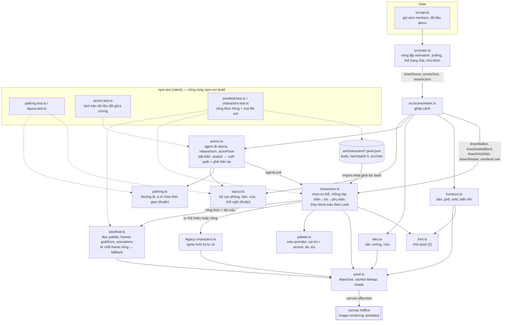

# T-422fe82f: Hồi cứu các ticket đã chạy

Lần code: 2. File do aico tạo, cập nhật mỗi lần code.

## Đầu việc

| Id | Việc | Vai trò | Được sửa | Chờ | Kết quả |
| --- | --- | --- | --- | --- | --- |
| W1 | Thêm vitest, script npm test và test cho hàm thuần pathing/layout | coder | `package.json`, `package-lock.json`, `vitest.config.ts`, `src/scene/pathing.test.ts`, `src/scene/layout.test.ts` | - | chưa chạy |
| W2 | Test kịch bản chuyển trạng thái của actors | coder | `src/scene/actors.test.ts`, `src/scene/actors.ts` | W1 | chưa chạy |
| W3 | Test bộ đọc công thức Pixelbolt và mọi file art/ | coder | `src/scene/pixelbolt.test.ts`, `src/scene/characters.test.ts`, `src/scene/pixelbolt.ts`, `src/scene/characters.ts` | W1 | chưa chạy |
| W4 | Cập nhật AGENTS.md và README theo bài học hồi cứu | coder | `AGENTS.md`, `README.md` | W1, W2, W3 | chưa chạy |
| FIX | Sửa theo góp ý: [review bởi codex] | coder | `**` | - | xong |

## Kế hoạch

# Hồi cứu ticket: VX-Anh/aico-office (T-422fe82f)

Tôi đã đọc AGENTS.md, README.md, docs/architecture.md, cùng `package.json`, `src/scene/actors.ts` và `src/scene/pixelbolt.ts` để kiểm tra lại các lỗi nêu trong góp ý. Lịch sử và ticket không có câu nào trông như lệnh gửi tôi, nên không có gì phải bỏ qua.

## 1. Số liệu

| Chỉ số | Giá trị |
| --- | --- |
| Tổng ticket | 5 (4 done, 1 failed) |
| Phải sửa lại (lần code > 1) | 2/5 = **40%**; nếu chỉ tính ticket done thì 2/4 = 50% (T-cff2d329: 2 lần, T-44ffcd99: 3 lần) |
| Escalate | 0 |
| Thời gian trung bình | 21,8 phút tính cả ticket failed; **27,3 phút** chỉ tính ticket done |
| Số vòng góp ý | 3 (T-cff2d329: 1, T-44ffcd99: 2) |

Dữ liệu có ba điểm bất thường:
- T-ffef0788 và T-f727430f đều có `lần code = 0` dù đã merge PR #2 và #1. Có thể số liệu không được ghi, nên tỷ lệ sửa lại ở trên có thể chưa chính xác.
- T-e19b9dab failed, chạy 0 phút, không có góp ý hay log. **Không đủ dữ liệu để biết nguyên nhân**, nên tôi không rút bài học từ ticket này.
- Ticket tốn nhất là T-44ffcd99 với 33 phút và 2 vòng trả lại.

## 2. Bài học

### B1 (lặp lại, tốn nhất): code chuyển trạng thái không xử lý trường hợp dữ liệu đổi khi nhân vật đang đi
Lỗi này xảy ra 2 lần liên tiếp trong T-44ffcd99, gây ra cả 2 vòng sửa của ticket.
- Lần 2: *"Khi agent đang đi vào, biến mất khỏi dữ liệu rồi xuất hiện lại… `reverseFrom()` chỉ đưa nhân vật về điểm đã quay đầu, không tới bàn… nhân vật nhảy từ phòng nghỉ vào ghế."*
- Lần 3: *"Đường đi của nhân vật không được cập nhật khi bố cục đổi nhưng chỉ số ghế vẫn giữ nguyên… đích đường đi vẫn là `(51,70)` trong khi ghế đã chuyển sang `(33,70)`."*

Hai lỗi cùng một nguyên nhân gốc: **điểm cuối của path không được buộc bằng tọa độ ghế hiện tại** trước khi chuyển sang `seated`. Coder sửa đúng trường hợp được báo nhưng không quét các trường hợp khác cùng loại. Reviewer cũng chỉ báo một trường hợp mỗi vòng. Code hiện tại đã có `rebase`/`turn` (`src/scene/actors.ts:57`, `src/scene/actors.ts:69`), nhưng không có test nào giữ các kịch bản này.

### B2 (lặp lại): chỉ có `npm run build` làm cổng kiểm tra, nên lỗi logic chỉ lộ ra khi reviewer tự viết mã thử
Cả 3 lần review đều ghi *"Repo không có script test"*. Cả 3 lỗi đều do reviewer phát hiện bằng cách tự viết mã chạy:
- T-cff2d329: *"Đã tái hiện bằng chính hàm chuẩn hóa"*
- T-44ffcd99: *"đã kiểm tra thêm tình huống chuyển trạng thái nêu trên bằng mã chạy trực tiếp"*

Các kiểm tra đó (9 công thức, kế thừa `from`, chặn vòng lặp, chu kỳ demo 48 giây) đều bị bỏ đi sau review. Lần sau agent lại phải viết lại từ đầu.

### B3 (quan sát, mới gặp 1 lần): bộ đọc biến dữ liệu hỏng thành dữ liệu "hợp lệ rỗng", làm fallback không chạy
T-cff2d329: *"`flattenFrame()` biến `ops: []` hoặc `rows: [42]` thành lưới trong suốt 16×22… `has("body", anim)` trả `true` và bỏ qua fallback: nhân vật biến mất… Lưới vượt kích thước cũng bị cắt âm thầm."*

Lỗi này mới gặp một lần, nhưng cùng tinh thần với quy tắc "đọc phòng thủ" đã có trong AGENTS.md. Quy tắc cũ chưa nói rõ: đọc phòng thủ nghĩa là **từ chối** dữ liệu hỏng để fallback chạy, không phải "nuốt" nó. Tôi chỉ đề xuất làm rõ câu cũ và thêm test, không tạo quy tắc mới.

### B4 (lặp lại, ít tốn): chưa kiểm được phần hình ảnh và công thức sprite
- T-cff2d329, cả 2 lần review: *"Chưa xác minh demo trực quan hoặc chạy `pixel_validate`/`pixel_inspect` vì môi trường không có các tool đó."*
- T-44ffcd99: *"Chưa kiểm chứng hình ảnh trực tiếp trên trình duyệt."*

README đang yêu cầu "Tự kiểm bằng `pixel_validate`/`pixel_inspect`", nhưng coder và reviewer đều không có các tool này. Hiện chưa có cách kiểm thay thế nào được ghi lại.

### Quan sát khác (chưa thành quy tắc)
- Cả hai reviewer đều phải cài dependency trước khi build. AGENTS.md ghi `npm ci`, nhưng mục "Chạy" của README lại ghi `npm install`. Hai chỗ không khớp nhau.

## 3. Kế hoạch sửa repo

**A. Thêm test runner** (giải quyết B2). Thêm `vitest` vào devDependencies: chạy được `import.meta.glob` giống Vite, nên test được cả `characters.ts`. Thêm script `"test": "vitest run"`. Đây là lý do rõ ràng để thêm dependency, đúng với quy tắc đang có.

**B. Thêm test giữ các lỗi đã gặp:**
- `src/scene/actors.test.ts` (B1). Một bảng kịch bản, mỗi kịch bản kiểm: lúc `phase` chuyển sang `seated` thì điểm cuối path trùng tọa độ ghế theo layout **hiện tại**; agent đi ra thì kết thúc ở phòng nghỉ. Các kịch bản:
  - agent mất rồi xuất hiện lại khi đang đi vào hoặc đi ra, đổi hướng 2 lần trở lên;
  - `slots` của phòng đổi từ 1 lên 3 khi đang đi vào hoặc đi ra;
  - số bàn của phòng phía trước đổi;
  - phòng chuyển offline rồi online, và chuyển sang limited.
- `src/scene/pathing.test.ts` và `src/scene/layout.test.ts`: test cho các hàm thuần (`alongRoute`, `reverseFrom`, `assignSeats`).
- `src/scene/pixelbolt.test.ts` và `src/scene/characters.test.ts` (B3):
  - `ops: []`, `rows: [42]`, lưới vượt 16×22, op lạ và vòng lặp `from` đều phải bị từ chối, để tư thế đó dùng sprite cũ;
  - test thêm: mọi file `art/characters/**/*.pixel.json` đều hợp lệ (frame 16×22, đủ animation bắt buộc của `body`). Đây là cách kiểm thay cho `pixel_validate` khi môi trường không có tool đó (B4).

**C. Sửa AGENTS.md** (chỉ thêm hoặc sửa, không chép lại quy tắc đã có):
- Mục Lệnh: thêm `npm test` (vitest run). Sửa câu "Repo chưa có unit test; `npm run build` là kiểm tra duy nhất" thành: "`npm run build` **và** `npm test` phải cùng qua trước khi xong việc."
- Thêm vào Quy ước code:
  - "Sửa `actors.ts`, `pathing.ts` hoặc `layout.ts` thì thêm hoặc cập nhật kịch bản trong `actors.test.ts`. Bất biến: chỉ chuyển `seated` khi điểm cuối path bằng tọa độ ghế theo layout hiện tại."
  - "Khi sửa lỗi chuyển trạng thái, kiểm cả các biến thể cùng loại (đi vào/đi ra, đổi hướng nhiều lần, đổi `slots` hoặc số phòng) và thêm test cho từng biến thể, không chỉ trường hợp được báo."
- Sửa câu "đọc phòng thủ" thành: "…đọc phòng thủ: dữ liệu sai kiểu (vd `rows` không phải mảng chuỗi, `ops` rỗng, lưới vượt kích thước) thì **từ chối** (trả null, warn một lần) để fallback chạy. Không chuẩn hóa thành giá trị rỗng 'hợp lệ'. Áp dụng cho cả `/workers` và công thức Pixelbolt."
- Thêm vào Quy tắc: "Phần tóm tắt khi xong việc ghi rõ: các kiểm tra đã chạy (lệnh và kết quả) và các kiểm tra **chưa chạy được** kèm lý do (vd thiếu `pixel_validate`, chưa xem trình duyệt)."

**D. Sửa README.md:**
- Mục "Chạy": đổi `npm install` thành `npm ci`, thêm `npm test`.
- Mục "Thêm sprite mới", dòng `pixel_validate`: thêm "không có tool thì `npm test` (kiểm mọi file trong `art/`)".
- Bảng "Cấu trúc": thêm các file test và `vitest.config.ts` nếu có tạo.

Tôi chưa kiểm được repo có CI workflow (`.github/workflows/`) hay không, nên chưa đưa vào kế hoạch. Nếu có workflow, cần thêm `npm test` vào đó ở một ticket sau.

## 4. Đề xuất cho aico (không đưa vào đầu việc)

- **reviewer**, thêm câu: *"Khi phát hiện một lỗi, liệt kê luôn các biến thể cùng loại (cùng nguyên nhân gốc, khác đầu vào hoặc hướng) mà bạn đã thử hoặc nghi ngờ, trong cùng một lần góp ý."*
  Lý do: vòng 3 của T-44ffcd99 là cùng loại lỗi với vòng 2 (path không bám ghế hiện tại). Báo một lần thì tiết kiệm được 1 vòng sửa.
- **reviewer**, thêm câu: *"Mã bạn viết để tái hiện lỗi thì đưa nguyên văn vào góp ý, dạng test có thể chép vào repo."*
  Lý do: cả 3 lần tái hiện (B2) đều bị bỏ đi sau review.
- **coder**, thêm câu: *"Trước khi báo xong, với mỗi lỗi reviewer báo, viết test tái hiện lỗi đó cùng các biến thể cùng loại; test phải fail trước khi sửa và pass sau khi sửa."*
  Lý do: B1. Coder sửa đúng một trường hợp nên lỗi cùng loại quay lại ở vòng sau.
- **tech_lead**, thêm câu: *"Ticket có animation hoặc chuyển trạng thái phụ thuộc dữ liệu thì tiêu chí nghiệm thu phải liệt kê kịch bản 'dữ liệu đổi giữa chừng' cần test."*
  Lý do: T-44ffcd99 có acceptance không nêu các kịch bản này, nên chúng chỉ lộ ra ở review.
- **Luồng ghi lịch sử**: ghi đúng `lần code` cho ticket merge ở vòng đầu, và ghi lý do cho ticket failed.
  Lý do: T-ffef0788 và T-f727430f merge nhưng ghi 0 lần code; T-e19b9dab failed mà không có dữ liệu, nên không hồi cứu được.

```json
{"items": [
  {"id": "W1", "title": "Thêm vitest, script npm test và test cho hàm thuần pathing/layout", "role": "coder", "owns": ["package.json", "package-lock.json", "vitest.config.ts", "src/scene/pathing.test.ts", "src/scene/layout.test.ts"], "depends_on": [], "acceptance": "`npm ci && npm run build && npm test` qua; vitest là devDependency duy nhất được thêm, khóa phiên bản trong package-lock.json; có test cho alongRoute, reverseFrom, pathBetween và assignSeats (giữ ghế theo id, overflow khi vượt slots)."},
  {"id": "W2", "title": "Test kịch bản chuyển trạng thái của actors", "role": "coder", "owns": ["src/scene/actors.test.ts", "src/scene/actors.ts"], "depends_on": ["W1"], "acceptance": "`npm test` có các kịch bản: agent mất rồi xuất hiện lại khi đang đi vào hoặc đi ra (đổi hướng 2 lần trở lên); slots từ 1 lên 3 và từ 3 xuống 1 khi đang đi vào hoặc đi ra; số bàn của phòng phía trước đổi; offline→online; limited. Mỗi kịch bản khẳng định: lúc phase thành seated thì điểm cuối path bằng tọa độ ghế theo layout hiện tại, agent đi ra kết thúc ở phòng nghỉ. Chỉ sửa actors.ts khi có test fail, và ghi rõ lỗi trong tóm tắt."},
  {"id": "W3", "title": "Test bộ đọc công thức Pixelbolt và mọi file art/", "role": "coder", "owns": ["src/scene/pixelbolt.test.ts", "src/scene/characters.test.ts", "src/scene/pixelbolt.ts", "src/scene/characters.ts"], "depends_on": ["W1"], "acceptance": "`npm test` khẳng định: `ops: []`, `rows: [42]`, lưới vượt 16×22, op lạ và vòng lặp `from` đều bị từ chối (has()/animFrames trả false/null, nên tư thế đó dùng sprite cũ); mọi file art/characters/**/*.pixel.json có frame 16×22 và body có đủ 7 animation trong README. Chỉ sửa pixelbolt.ts hoặc characters.ts khi có test fail."},
  {"id": "W4", "title": "Cập nhật AGENTS.md và README theo bài học hồi cứu", "role": "coder", "owns": ["AGENTS.md", "README.md"], "depends_on": ["W1", "W2", "W3"], "acceptance": "AGENTS.md: mục Lệnh có `npm test` và câu 'build và test phải cùng qua'; có quy tắc bất biến seated và quy tắc kiểm biến thể cùng loại khi sửa lỗi chuyển trạng thái; câu 'đọc phòng thủ' nói rõ là từ chối dữ liệu hỏng để fallback chạy (áp dụng cho /workers và công thức); có quy tắc ghi kiểm tra đã chạy và chưa chạy được trong tóm tắt. README: mục Chạy dùng `npm ci` và `npm test`; mục Thêm sprite mới có cách kiểm thay cho pixel_validate; bảng Cấu trúc liệt kê đúng các file test và config đã thêm. Không chép lại quy tắc đã có."}
]}
```


