# T-446cb8a0: GUI: tab Agent — dòng trạng thái 'Chờ' nói rõ chờ gì, tiêu đề thẻ theo trạng thái

Lần code: 1. File do aico tạo, cập nhật mỗi lần code.

## Đầu việc

| Id | Việc | Vai trò | Được sửa | Chờ | Kết quả |
| --- | --- | --- | --- | --- | --- |
| W1 | drawer-model: nhãn need theo NEED_LABEL, ticketId/needKind, nowCardTitle | coder | `src/ui/drawer-model.ts`, `src/ui/drawer-model.test.ts` | - | xong (claude) |
| W2 | drawer render nút nhãn need + tiêu đề thẻ, CSS, nối onTicket→showNeeds trong main, chụp ảnh | coder | `src/ui/drawer.ts`, `src/ui/drawer.css`, `src/ui/drawer.test.ts`, `src/main.ts`, `src/main.test.ts` | W1 | xong (codex) |

## Kế hoạch

# Kế hoạch T-446cb8a0: tab Agent — nhãn "Chờ" nói rõ chờ gì, tiêu đề thẻ theo trạng thái

## Hiện trạng
- `src/ui/drawer-model.ts`: `statusView()` trả về `{tone, label, ago}`. Tone `need` có nhãn cứng "Chờ" (`TONE_LABEL`). Tham số `needIds` chỉ là `Set<string>` nên không biết ticket đang chờ loại việc nào.
- `src/ui/drawer.ts`: dòng trạng thái là `span.drawer-status-label`. Tiêu đề thẻ `drawer-now-title` luôn là "Đang làm". `DrawerOptions` chỉ có `onClose` và `onTab`.
- `src/main.ts`: `showNeeds(id)` đặt tab Cần bạn và gọi `panel.focus(id)`. Đây là cách bấm dòng ticket trong khung Hoạt động đang dùng (`createFeed(..., { onTicket: showNeeds })`) và cũng là cách toast mở ticket.
- `src/tickets.ts`: `NEED_LABEL = { plan: "duyệt kế hoạch", merge: "duyệt merge", escalated: "escalated" }`. `NeedItem.kind` có sẵn trong `needItems` mà drawer nhận.
- CSS: luật `.drawer button` thêm viền và padding cho mọi nút, nên nút nhãn mới cần luật riêng để trông như liên kết chữ.

## Các bước

**1. Model thuần (`src/ui/drawer-model.ts`)**
- Tham số thứ 3 của `statusView` nhận `ReadonlyMap<string, NeedKind> | ReadonlySet<string>`. Nếu là Set thì coi như không rõ loại, nhờ vậy nơi gọi cũ vẫn chạy.
- `StatusView` thêm `ticketId: string | null` và `needKind: NeedKind | null`. Hai trường này chỉ có giá trị khi tone là `need`; các tone khác đều là `null`.
- Nhãn tone need ghép từ `NEED_LABEL`:
  - plan → "Chờ bạn duyệt kế hoạch"
  - merge → "Chờ bạn duyệt merge"
  - escalated → "Chờ bạn xử lý (escalated)"
  - Không rõ loại (không có trong Map, kind sai kiểu hoặc lạ, đọc bằng `Object.hasOwn`) → "Chờ bạn". Dữ liệu sai thì không ném lỗi, chỉ warn một lần.
- Thêm hàm thuần `nowCardTitle(tone, hasActivity)`:
  - Không có hoạt động → "Đang làm" (giữ như hiện tại).
  - working → "Đang làm"
  - need, idle, offline, limited → "Hoạt động gần nhất"
  - error → "Lỗi gần nhất"
- Nhãn của các tone khác giữ nguyên.

**2. Render và nối dây (`drawer.ts`, `drawer.css`, `main.ts`)**
- `DrawerOptions` thêm `onTicket(id: string): void`.
- drawer.ts truyền `new Map(needItems.map(i => [i.ticket.id, i.kind]))` vào `statusView`.
- Khi tone là need và có `ticketId`: nhãn là `button.drawer-status-label.drawer-status-link` (type=button, `title`/`aria-label` "Mở T-x trong Cần bạn"), bấm thì gọi `options.onTicket(ticketId)`. Các tone khác vẫn là `span` như cũ.
- Tiêu đề thẻ lấy từ `nowCardTitle(status.tone, !!activity)`. Lớp `is-error` giữ nguyên theo `activity.error` để nền vẫn pha đỏ.
- CSS: thêm luật `.drawer .drawer-status-link` để bỏ viền, nền và padding của nút, giữ đậm 700 và màu chữ hiện tại, gạch chân chấm. Khi hover hoặc focus-visible thì gạch liền; vòng focus đã có sẵn. Không đổi màu các tone.
- main.ts: `createDrawer(..., { onTicket: showNeeds })`, dùng lại đúng hàm mà feed và toast đang gọi.

**3. Test và kiểm tra**
- `drawer-model.test.ts`:
  - Sửa các `toEqual` cũ cho thêm `ticketId` và `needKind`.
  - Nhãn need theo từng loại plan/merge/escalated.
  - Map thiếu id, kind lạ hoặc sai kiểu, truyền Set → "Chờ bạn".
  - `nowCardTitle` cho đủ 6 tone, cả có và không có hoạt động.
  - Các tone khác giữ nhãn cũ.
- `drawer.test.ts`:
  - `DrawerNode` ghi lại listener và có `click()`.
  - Bấm nhãn need gọi `onTicket` với đúng ticket id.
  - Tone khác không có nút và không gọi `onTicket`.
  - Tiêu đề thẻ đúng cho từng tone.
  - Sửa các kỳ vọng cũ đang là "Chờ".
- `main.test.ts`: nếu file đã có harness cho drawer hoặc feed thì thêm kịch bản "bấm nhãn need → tab Cần bạn + `panel.focus(id)`". Nếu không có harness thì ghi rõ trong tóm tắt.
- `npm run build` và `npm test` phải qua.
- Chụp bằng aico-shot ở hai cỡ 1440x900 và 390x844: chế độ demo, chọn agent claude có `ticket_id` T-demo00 (bấm trên sidebar), mở tab Agent. Kết quả cần thấy nhãn "Chờ bạn duyệt kế hoạch" và tiêu đề thẻ "Hoạt động gần nhất".

## Kịch bản dữ liệu đổi giữa chừng phải test (trên cùng một drawer)
- Ticket của agent vào Cần bạn → rời đi → vào lại: nhãn đổi "Đang làm" → "Chờ bạn …" → "Đang làm" → "Chờ bạn …"; nút chỉ có khi đang need, không sót nút cũ; tiêu đề thẻ đổi theo.
- Loại đổi trên cùng ticket plan → merge → escalated → kind lạ: nhãn đổi theo từng loại rồi về "Chờ bạn".
- Số mục Cần bạn đổi (0 → 3 → 1, ticket của agent ở vị trí khác nhau): nhãn vẫn khớp đúng ticket của agent.
- `ticket_id` đổi T-1 → T-2 → null: bấm gọi đúng id mới; null thì không có nút.
- Đang need thì phòng offline hoặc limited rồi trở lại: nhãn "Mất kết nối"/"Hết hạn mức" không có nút, tiêu đề "Hoạt động gần nhất"; trở lại thì về "Chờ bạn …".
- need kèm activity lỗi: tone error, nhãn "Lỗi", tiêu đề "Lỗi gần nhất", nền đỏ, không có nút.
- activity có → null → có: khi null thì tiêu đề về "Đang làm" + "Chưa có hoạt động".

```json
{"items": [
  {"id": "W1", "title": "drawer-model: nhãn need theo NEED_LABEL, ticketId/needKind, nowCardTitle", "role": "coder",
   "owns": ["src/ui/drawer-model.ts", "src/ui/drawer-model.test.ts"], "depends_on": [],
   "acceptance": "statusView nhận Map<id, NeedKind> hoặc Set (tương thích ngược) và trả thêm ticketId/needKind (null khi không phải need). Nhãn need: 'Chờ bạn duyệt kế hoạch' / 'Chờ bạn duyệt merge' / 'Chờ bạn xử lý (escalated)', ghép từ NEED_LABEL; Map thiếu id, kind lạ/sai kiểu hoặc truyền Set thì 'Chờ bạn', không ném, warn một lần. Nhãn các tone khác không đổi. nowCardTitle(tone, hasActivity): working 'Đang làm'; need/idle/offline/limited 'Hoạt động gần nhất'; error 'Lỗi gần nhất'; không có hoạt động thì 'Đang làm'. Test: từng loại need, các trường hợp không rõ loại, đủ 6 tone x có/không hoạt động, kind đổi plan→merge→escalated→lạ, need→offline→limited→need, need kèm lỗi ra error, sửa các toEqual cũ. Hàm vẫn thuần (không DOM, không đọc giờ thật). npm run build và npm test qua."},
  {"id": "W2", "title": "drawer render nút nhãn need + tiêu đề thẻ, CSS, nối onTicket→showNeeds trong main, chụp ảnh", "role": "coder",
   "owns": ["src/ui/drawer.ts", "src/ui/drawer.css", "src/ui/drawer.test.ts", "src/main.ts", "src/main.test.ts"], "depends_on": ["W1"],
   "acceptance": "drawer.ts chỉ render từ statusView/nowCardTitle. Tone need có ticketId thì nhãn là button.drawer-status-label.drawer-status-link, bấm gọi options.onTicket(ticketId); tone khác vẫn là span, không có nút. main.ts truyền onTicket: showNeeds (mở tab Cần bạn và focus thẻ). Tiêu đề drawer-now-title theo tone; is-error vẫn theo activity.error; màu tone không đổi. CSS bỏ viền/nền/padding của nút để trông như liên kết chữ (gạch chân chấm, focus-visible có vòng); phần khác của giao diện không đổi. Test DOM: bấm nhãn need gọi onTicket đúng id; tiêu đề cho từng tone; dữ liệu đổi giữa chừng trên cùng drawer: ticket vào→rời→vào lại Cần bạn (nút xuất hiện/mất, không sót), kind đổi giữa plan/merge/escalated, số mục Cần bạn đổi 0→3→1, ticket_id T-1→T-2→null (bấm gọi id mới, null không có nút), need→offline/limited→need, activity có→null→có; sửa các kỳ vọng 'Chờ' cũ. Nếu main.test có harness thì thêm kịch bản bấm nhãn → tab needs + panel.focus(id), không có thì ghi lý do. npm run build và npm test qua. Chụp aico-shot 1440x900 và 390x844, chế độ demo, ngăn Agent mở trên agent có ticket T-demo00: thấy 'Chờ bạn duyệt kế hoạch' và tiêu đề 'Hoạt động gần nhất'."}
]}
```

```mermaid
flowchart TD
  subgraph Data["Dữ liệu và logic thuần hiện có"]
    API["src/api.ts<br/>workers, snapshot tickets đầy đủ, actions<br/>demoWorkers 48 giây"]
    TK["src/tickets.ts<br/>parseTickets, needsYou, NEED_LABEL, actions, MR, preview<br/>latestScreenshots: bộ ảnh mới nhất, tối đa 16<br/>demoNeedTickets kèm ảnh demo"]
    ACTV["src/activity.ts<br/>activity, screenFor, bubbles, progress"]
    USG["src/usage.ts"]
    TIME["src/time.ts"]
    LATEST["src/latest.ts<br/>createLatestGate"]
    ATT["src/attention.ts"]
  end
  API --> TK
  ACTV --> USG

  SHOTS["public/demo-shots/ + art/demo-shots/<br/>ảnh pixel demo theo thời điểm/file.png"]
  SHOTS -.->|url tuyệt đối theo BASE_URL| TK

  COL["src/needs-column.ts + CSS<br/>gate chấp nhận snapshot<br/>lọc items cho panel, giữ xác nhận/ghi chú<br/>hàng ảnh thu nhỏ, ảnh lỗi thành link"]
  VIEWER["src/shot-viewer.ts + CSS<br/>lightbox trên body: ←/→, Esc, trả focus"]
  API -->|cùng request tickets| COL
  LATEST --> COL
  COL --> TK
  COL -->|mở ảnh, đóng khi thẻ mất/đổi nguồn| VIEWER
  COL -->|actions| API
  COL -->|snapshot đầy đủ đã chấp nhận| MAIN
  COL -->|NeedItem đã lọc| MAIN

  MAIN["src/main.ts<br/>poll, nguồn, giờ địa phương hoặc hour<br/>reduced motion, vòng animation, chọn agent<br/>showNeeds dùng chung cho feed, toast, drawer<br/>ghi --feed-left/--feed-room"]
  API --> MAIN
  LATEST --> MAIN
  ATT --> MAIN
  MAIN -->|demo assetBase| TK

  subgraph UI["Khung UI"]
    VP["ui/viewport.ts<br/>computeInsets, fitScene<br/>feedBox: left/bề rộng feed theo sidebar, drawer"]
    FM["ui/feed-model.ts<br/>FeedLine: ticket, tone<br/>dòng hết hạn mức theo chuyển trạng thái phòng"]
    SEL["ui/selection.ts"]
    FMT["ui/format.ts<br/>agentStatus, tokenStatsRows label/value/cache/level<br/>tokenStatsLines dựng từ rows cho tooltip"]
    TOK["ui/tokens.css<br/>--feed-max"]
    TOP["ui/topbar.ts + CSS"]
    SIDE["ui/sidebar.ts + CSS"]
    AV["ui/avatar.ts"]
    DRWM["ui/drawer-model.ts<br/>thuần: statusView tone/nhãn/thời gian<br/>+ ticketId, needKind; nhãn 'Chờ bạn …' theo NEED_LABEL<br/>nowCardTitle theo tone<br/>roomStateLabel, taskChecklist, recentRows"]
    DRW["ui/drawer.ts + CSS<br/>tab Agent kiểu Habblaud: hero avatar 64px/48px<br/>chip phòng, ticket; hộp nhiệm vụ + MR/Xem trước<br/>dòng trạng thái: nhãn need là nút mở Cần bạn<br/>thẻ hoạt động: tiêu đề theo tone<br/>checklist task, timeline Gần đây, bảng số liệu"]
    FEED["ui/feed.ts + CSS<br/>khung nổi góc dưới trái, ticker khi thu gọn<br/>dòng lưới: giờ, avatar, tên, chip phòng, ticket, icon, nội dung<br/>dòng ticket is-ticket: ô ticket rỗng, title không lặp<br/>màn hẹp: cột tên fit-content, mã ticket đủ<br/>tự cuộn, viên N mới, phím ]"]
    NEEDS["#needs trong drawer"]
    TOAST["toasts.ts + CSS"]
  end
  MAIN --> VP
  MAIN --> FM
  MAIN --> SEL
  MAIN --> TOP
  MAIN --> SIDE
  MAIN -->|view, agent + needItems, now| DRW
  DRW -->|onTicket id → showNeeds| MAIN
  MAIN -->|lines + workers| FEED
  FEED -->|onAgent phòng+id → selectAgent<br/>onTicket → showNeeds| MAIN
  MAIN --> TOAST
  TOAST -->|onOpen → showNeeds| MAIN
  TOP --> FMT
  SIDE --> FMT
  SIDE --> AV
  FEED --> AV
  FEED --> FMT
  FEED --> PAL
  FMT --> USG
  FMT --> ACTV
  FM --> ACTV
  DRW --> DRWM
  DRW --> AV
  DRW --> FMT
  DRW --> PAL
  DRW --> TK
  DRWM --> ACTV
  DRWM --> TIME
  DRWM --> FMT
  DRWM -->|NEED_LABEL, NeedKind| TK
  DRW --> NEEDS
  COL --> NEEDS
  TOK -.-> TOP
  TOK -.-> SIDE
  TOK -.-> DRW
  TOK -.-> FEED
  TOK -.-> COL
  TOK -.-> VIEWER

  DEMO["scene/demo-events.ts<br/>snapshot định kỳ, cùng bộ phát hiện"]
  EVENTS["scene/room-events.ts<br/>so snapshot, MR mới/done/escalated<br/>nhớ ticket-provider, dedup, TTL 10 giây"]
  DEMO --> MAIN
  MAIN -->|snapshot và liên hệ agent.ticket_id| EVENTS
  EVENTS -->|banner đang sống| MAIN

  IDX["scene/index.ts<br/>ghép cảnh, SceneFigure và dữ liệu biển phòng"]
  MAIN -->|workers, thời gian, reduced motion| IDX
  LAYOUT["scene/layout.ts<br/>thuần: phòng/bàn/ghế, ngoại cảnh, sceneSize"]
  OUT["scene/outdoor.ts<br/>seed thuần, cây/đèn/lối đi/đường<br/>vẽ ngoại cảnh và xe"]
  CACHE["Canvas cache nền tĩnh<br/>khóa hình học, palette, seed"]
  TILES["scene/tiles.ts<br/>tường, sàn, cửa"]
  ACT["scene/actors.ts<br/>seated chỉ khi cuối path đúng ghế hiện tại"]
  PATH["scene/pathing.ts<br/>thuần"]
  FURN["scene/furniture.ts<br/>đồ đạc, đồng hồ, màn hình"]
  BOARD["scene/usage-board.ts"]
  CHAR["scene/characters.ts"]
  PB["scene/pixelbolt.ts"]
  LEG["scene/legacy-characters.ts"]
  ART["art/characters/*.pixel.json"]
  PAL["scene/palette.ts<br/>màu chung, ngoại cảnh, ánh sáng, banner"]
  PIX["scene/pixel.ts"]
  LIGHT["scene/lighting.ts<br/>độ sáng thuần và lightmap canvas cache<br/>bucket 5 phút, hình học, nguồn sáng"]

  IDX --> LAYOUT
  IDX --> OUT
  IDX --> CACHE
  CACHE --> OUT
  CACHE --> TILES
  IDX --> ACT
  ACT --> LAYOUT
  ACT --> PATH
  IDX --> FURN
  IDX --> BOARD
  BOARD --> USG
  IDX --> ACTV
  IDX --> CHAR
  AV --> CHAR
  ART --> CHAR
  CHAR --> PB
  CHAR --> LEG
  CHAR --> PAL
  OUT --> PAL
  LIGHT --> PAL
  FURN --> PAL
  TILES --> PIX
  OUT --> PIX
  FURN --> PIX
  PB --> PIX
  IDX -->|phút địa phương, layout, nguồn sáng| LIGHT

  CANVAS["canvas #office<br/>nền cache → phần động → lightmap multiply"]
  CACHE -->|drawImage mỗi frame| CANVAS
  IDX -->|đồ đạc, nhân vật, xe| CANVAS
  LIGHT -->|drawImage multiply mỗi frame| CANVAS
  VP -->|vùng trống, focus, vị trí feed| MAIN

  OVL["src/overlay.ts<br/>chữ DPR: hoạt động, progress<br/>biển phòng, banner và confetti hữu hạn"]
  TIP["src/agent-tooltip.ts + CSS<br/>hit-test và xem nhanh<br/>tokenStatsLines"]
  MAIN -->|figures, biển phòng, banner| OVL
  MAIN -->|figures và chọn agent| TIP
  OVL --> ACTV
  OVL --> PAL
  TIP --> ACTV
  TIP --> FMT
  OVL --> SCREEN["Lớp chữ trên cảnh"]
  CANVAS --> SCREEN

  TEST["Vitest<br/>outdoor, lighting, room-events, demo-events<br/>snapshot gate, overlay, renderer, main, viewport + feedBox<br/>feed-model ticket/tone/hết hạn mức, feed DOM<br/>latestScreenshots, shot-viewer, hàng ảnh thẻ<br/>format: tokenStatsRows + tokenStatsLines cũ<br/>drawer-model: tone, nhãn need theo loại, nowCardTitle<br/>phòng, checklist, timeline<br/>drawer DOM: hero, nhiệm vụ, nút nhãn need → onTicket<br/>tiêu đề thẻ theo tone, checklist, timeline, số liệu<br/>dữ liệu đổi giữa chừng: need vào/rời, kind đổi, offline<br/>giữ actors và mọi test cũ"]
  TEST -.-> OUT
  TEST -.-> LIGHT
  TEST -.-> EVENTS
  TEST -.-> COL
  TEST -.-> TK
  TEST -.-> VIEWER
  TEST -.-> OVL
  TEST -.-> IDX
  TEST -.-> MAIN
  TEST -.-> ACT
  TEST -.-> VP
  TEST -.-> FM
  TEST -.-> FEED
  TEST -.-> FMT
  TEST -.-> DRWM
  TEST -.-> DRW
```


