# T-626ddd48: GUI: vùng trống và cột "Cần bạn" (duyệt kế hoạch, duyệt merge, ticket escalated) thay bảng nổi

Lần code: 1. File do aico tạo, cập nhật mỗi lần code.

## Đầu việc

| Id | Việc | Vai trò | Được sửa | Chờ | Kết quả |
| --- | --- | --- | --- | --- | --- |
| W1 | Dữ liệu ticket cần người: phân loại, hành động, request decisions, demo 3 loại, test | coder | `src/api.ts`, `src/tickets.ts`, `src/tickets.test.ts` | - | xong (claude) |
| W2 | Logic thuần cho chú ý: tiêu đề tab, ticket kế tiếp cho phím P, phím tắt, toast gộp/huỷ | coder | `src/attention.ts`, `src/attention.test.ts` | - | xong (codex) |
| W3 | Cột 'Cần bạn' (HTML) thay panel nổi: thẻ 3 loại, ghi chú bắt buộc, xác nhận trong thẻ | coder | `src/needs-column.ts`, `src/needs-column.css` | W1 | xong (claude) |
| W4 | Toast HTML 'T-xxx cần bạn' góc dưới phải canvas | coder | `src/toasts.ts`, `src/toasts.css` | W2 | xong (cursor) |
| W5 | Ghép nối: bố cục grid, thanh trên (đếm agent, Cần bạn: N), tiêu đề tab, phím P, polling, bỏ panel cũ | coder | `src/main.ts`, `index.html`, `src/style.css`, `README.md`, `src/escalation-panel.ts` | W1, W2, W3, W4 | xong (codex) |

## Kế hoạch

# Kế hoạch T-626ddd48: cột "Cần bạn" thay cho bảng nổi

## Hiện trạng

Tôi đã đọc `AGENTS.md`, `docs/architecture.md`, `docs/plans/T-87b2140f.md`, `README.md`, `index.html`, `src/style.css`, `src/main.ts`, `src/api.ts`, `src/tickets.ts`, `src/escalation-panel.ts` và `src/latest.ts`.

- `#escalations` là phần tử `position: absolute` nằm trong `.stage`, đè lên góc phải trên của canvas, đúng chỗ biển tên và thanh hạn mức của phòng Cursor. Khi không có ticket nó vẫn hiện, kèm dòng "Không có ticket cần xử lý".
- `fetchTickets` (`src/api.ts`) lọc sẵn `escalatedOnly`. Hai trạng thái `awaiting_plan_approval` và `awaiting_merge_approval` bị bỏ.
- Nhiều phần của `src/tickets.ts` dùng lại được: `parseTickets`, `latestEscalationReason`, `createReasonCache`, `mergeRequest`/`safeUrl`, `actionAvailability`, `apiUrl`/`ticketPath`, `buildEscalationRequest`. `escalationError` hiện chỉ đọc `detail` khi gặp 409/501, còn ticket yêu cầu mọi lỗi 4xx/5xx.
- `src/escalation-panel.ts` có những logic đáng giữ: cập nhật DOM theo id, khoá theo `pending`, `generation` và `createLatestGate`, xác nhận ngay trong thẻ. Cột mới làm theo cách đó.
- vitest chạy trong Node, không có DOM. Mọi thứ cần test phải đặt ở module thuần.
- Ticket không đổi phần vẽ canvas (`src/scene/**`), nên không có việc cho designer. Hàm `frame()` tính hệ số phóng từ `canvas.clientWidth`, vì vậy canvas tự co giãn khi cột hiện hoặc ẩn.

## Thiết kế

### Hợp đồng giữa các module (các đầu việc chạy song song phải theo đúng)

**`src/tickets.ts` (W1).** Thuần, mở rộng file hiện có:
- `NeedKind = "plan" | "merge" | "escalated"`. `needKind(status)` trả về một trong ba loại này hoặc `null`.
- `NEED_LABEL: Record<NeedKind, string>`: "duyệt kế hoạch", "duyệt merge", "escalated".
- `needsYou(tickets)`: giữ 3 trạng thái cần người, sắp mới nhất trước theo `updated_at`. Ticket có `updated_at` null hoặc không parse được thì xếp cuối. Bằng giờ thì xếp theo id để thứ tự ổn định qua các lần poll.
- `PlanDecision = "approved" | "revise" | "rejected"`, `MergeDecision = "approved" | "changes_requested" | "rejected"`, `NeedAction = PlanDecision | MergeDecision | EscalationAction`.
- `actionsFor(kind, reason, ticket): { action: NeedAction; enabled: boolean }[]`. Với `escalated` thì dùng lại `actionAvailability`. Với plan và merge thì mọi nút đều bật.
- `commentRequired(action)`: true với `revise`, `changes_requested`, `rejected`.
- `irreversible(action)`: true với `rejected`, `close`, `fail`, `merge`. Hàm này thay `needsConfirm`.
- `canSubmit(action, comment)`: nếu hành động bắt buộc ghi chú thì `comment.trim()` phải khác rỗng.
- `buildDecisionRequest(config, id, decision, comment)` dựng `POST /tickets/{id}/decisions`, body `{decision, actor: "owner", comment}`.
- `previewLink(ticket)`: lấy artifact `preview`, qua `safeUrl`, lấy url hợp lệ cuối cùng.
- `actionError(status, body)` thay `escalationError`:
  - 401 → "Sai API token".
  - Mọi status ≥ 400 có `detail` là chuỗi khác rỗng → trả `detail`.
  - `detail` là mảng `{msg}` (FastAPI 422) → nối các `msg` lại.
  - Còn lại → `aico trả {status}`.
- `waitedLabel(updatedAt, now)`: ví dụ "chờ 5 phút". `updatedAt` null hoặc hỏng thì trả "chưa rõ".
- Demo: `demoNeedTickets()` có ít nhất 1 ticket mỗi loại (escalated giữ 2 ticket cũ, merge có cả `merge_request` lẫn `preview`). `applyDemoAction(list, id, kind, action)` đổi status giả: plan approved → `in_progress`, revise → `planning`, rejected → `rejected`, merge approved → `done`, changes_requested → `in_progress`; các hành động escalated giữ như cũ.

**`src/api.ts` (W1).**
- `fetchTickets` trả `needsYou(parsed)`.
- Thêm `decisionAction(config, id, decision, comment)`.
- Thêm `needAction(config, kind, id, action, comment)`: kind `escalated` gọi `escalationAction`, hai kind còn lại gọi `decisionAction`.
- Lỗi đều ném `Error(actionError(...))`.

**`src/attention.ts` (W2).** Thuần, không phụ thuộc W1:
- `AttentionEntry { id; kind: string; label: string }`.
- `tabTitle(n)`: n > 0 → `"(N) AICO Office"`, ngược lại `"AICO Office"`.
- `nextAttention(ids, currentId)`: lấy id kế tiếp sau `currentId`, hết danh sách thì quay về đầu. `currentId` null hoặc không còn trong danh sách → id đầu tiên. Danh sách rỗng → null.
- `isShortcut(e: { key; ctrlKey; metaKey; altKey; editable: boolean })`: chỉ nhận `p`/`P` không kèm phím bổ trợ, và không nhận khi đang gõ trong ô nhập.
- `ToastState` gồm `toasts` (tối đa 3, mới nhất trên cùng), `known`, `dismissed` và cờ `primed`.
  - `reconcileToasts(state, entries, max = 3)`. Khoá là `id|kind`.
  - Lần đọc đầu chỉ ghi nhận, không bật toast, vì cột và bộ đếm đã hiện các ticket đó.
  - Khoá mới xuất hiện thì thêm toast, khoá trùng thì gộp.
  - Khoá rời danh sách thì gỡ toast và xoá khoá khỏi `known`/`dismissed`. Nếu ticket vào lại trạng thái đó thì toast hiện lại.
  - Quá 3 toast thì bỏ toast cũ nhất.
- `dismissToast(state, key)`: thêm khoá vào `dismissed` để toast không hiện lại khi khoá vẫn nằm trong danh sách.
- `resetToasts()`: dùng khi đổi nguồn dữ liệu.

**`src/needs-column.ts` (W3).** DOM, thay `escalation-panel.ts`:
- `NeedItem { ticket; kind: NeedKind; reason: string | null }`.
- `NeedSource { list(): Promise<NeedItem[]>; act(item, action, comment): Promise<void> }`.
- `createNeedsColumn(root, source, onItems: (items: NeedItem[]) => void)` trả `{ refresh, setSource, focus(id): boolean }`.
- `onItems` chỉ được gọi sau mỗi lần list được gate chấp nhận. Lần lỗi không gọi, để main giữ bộ đếm và toast cũ.
- Lỗi tải hiện ở dòng lỗi trong cột. Khi danh sách rỗng, cột tự `root.hidden = true`, kể cả lúc có lỗi. Lỗi khi đó vẫn hiện ở thanh trên, xem W5.

**`src/toasts.ts` (W4).** DOM:
- `createToasts(root, { onOpen(id) })` trả `{ update(entries: AttentionEntry[]), reset() }`, trạng thái lấy từ `attention.ts`.
- Toast ghi "T-xxx cần bạn: <loại>", có nút "Xử lý" (gọi `onOpen`) và nút đóng (gọi `dismissToast`).
- `role="status"`. Toast không tự tắt.

### Giao diện

- **Bố cục.** Cấu trúc trang là `header.top`, rồi `main` chứa `.workspace` (CSS grid gồm `.stage` có canvas cùng `#toasts`, và `aside#needs`), rồi `#legend`, rồi `#cards`.
  - `.workspace.has-needs` dùng `grid-template-columns: minmax(0, 1fr) minmax(300px, 360px)`. Không có class này thì chỉ còn một cột.
  - Từ `@media (max-width: 899px)` grid chỉ còn một cột và `#needs` nằm dưới canvas.
  - Nới `main` (khoảng 1480px) để canvas không bị nhỏ đi khi cột hiện.
  - `#needs` không dùng `position: absolute`. Cột có `max-height` bằng chiều cao hàng và `overflow: auto`.
- **Toast.** Stack `#toasts` đặt `position: absolute` ở góc dưới phải của `.stage` (khu phòng nghỉ), nằm trong hàng giữa nên không đè thẻ phòng hay biển tên phòng. Toast hẹp (≤ 260px) và tối đa 3 cái.
- **Thanh trên.**
  - `#agents-count` ghi "Đang làm: X agent", với X là tổng `roomAgents(w).agents.length` của các phòng không offline.
  - `button#needs-count` ghi "Cần bạn: N". Khi N > 0 thì thêm class `hot` để nổi màu, bấm vào thì tới ticket đầu tiên. Khi N = 0 thì nút bị disable.
  - Lỗi tải ticket hiện bằng `title` cùng dấu `!` cạnh bộ đếm.
- **Thẻ trong cột.**
  - Nội dung: mã, tiêu đề, nhãn loại, thời gian chờ (cập nhật mỗi giây cùng `renderCards`), lý do (chỉ với escalated), link MR và link xem trước (`target=_blank rel="noopener noreferrer"`), ô ghi chú, các nút.
  - Ghi chú bắt buộc nhưng còn trống: hiện thông báo trong thẻ, không gửi.
  - Hành động không quay lại được: hiện dòng "Xác nhận / Huỷ" trong thẻ, không dùng `window.confirm`.
  - Đang gửi thì khoá mọi nút của thẻ. Lỗi hiện `detail` trong thẻ và giữ nguyên ghi chú.
  - Thẻ khoá theo `id|kind`. Ticket đổi loại (ví dụ plan sang merge) thì dựng thẻ mới sạch, không giữ dòng xác nhận của loại cũ.
- **Tới ticket** (dùng chung cho nút Xử lý, bộ đếm và phím P): `focus(id)` gọi `scrollIntoView({block: "nearest"})`, focus ô ghi chú và nháy viền thẻ. Phím P dùng `nextAttention` với id của thẻ đang focus gần nhất.

### Dữ liệu

- `main.ts` chỉ gọi `/events` cho ticket escalated. `reasons.resolve(escalated)` cache theo `id+updated_at` như cũ; ticket plan và merge có `reason: null`.
- Vẫn poll cùng `POLL_MS` qua `Promise.allSettled([pollWorkers(), column.refresh()])`.
- `onItems(items)` cập nhật bộ đếm, `document.title`, class `has-needs` và `toasts.update`.
- Đổi nguồn dữ liệu (nút Kết nối hoặc Demo) thì gọi `column.setSource` và `toasts.reset`.

## Các bước

1. **Song song:**
   - W1: dữ liệu và logic ticket.
   - W2: logic thuần cho chú ý, toast, phím tắt và tiêu đề tab.
2. **Song song, sau bước 1:**
   - W3: cột "Cần bạn" (cần W1).
   - W4: DOM toast (cần W2).
3. **W5: ghép nối** (sau W1 đến W4).
   - Sửa `index.html`, `src/main.ts`, `src/style.css` (bố cục grid, thanh trên, bỏ rule `#escalations`).
   - Xoá `src/escalation-panel.ts`.
   - Cập nhật README: đoạn mô tả trong mục Dữ liệu và bảng "Cấu trúc". Thêm `attention.ts`, `attention.test.ts`, `needs-column.ts`, `needs-column.css`, `toasts.ts`, `toasts.css`; bỏ `escalation-panel.ts`.

W3 và W4 tự import file CSS riêng (`src/needs-column.css`, `src/toasts.css`; Vite hỗ trợ sẵn, `main.ts` cũng đang import `style.css` theo cách này). Nhờ vậy hai đầu việc không cùng sửa `style.css`. `style.css` chỉ giữ bố cục trang và thanh trên.

## Kiểm tra

- `npm run build` và `npm test` phải qua. Các test cũ (`usage`, `actors`, `pixelbolt`, `latest`…) không đổi.
- `src/tickets.test.ts` cần có:
  - phân loại 3 trạng thái và bỏ các trạng thái khác;
  - sắp mới nhất trước, có trường hợp `updated_at` null hoặc hỏng;
  - `actionsFor` cho cả 3 loại, gồm `retry_push` và `merge` bật/tắt như cũ;
  - `commentRequired` và `canSubmit` khi ghi chú trống hoặc chỉ có khoảng trắng;
  - `irreversible`;
  - URL và body của `buildDecisionRequest`, có base kết thúc bằng `/` và id cần encode;
  - `previewLink` loại link `javascript:`;
  - `actionError` với 400/404/409/422 (detail mảng)/500/501, body rỗng và 401;
  - `applyDemoAction` cho từng hành động.
- `src/attention.test.ts` cần có:
  - `tabTitle` với 0, 1 và 12;
  - `nextAttention` khi quay vòng, khi id hiện tại đã mất và khi danh sách rỗng;
  - `isShortcut` khi đang gõ hoặc có phím bổ trợ;
  - `reconcileToasts`: lần đầu không bật toast, gộp trùng, tối đa 3, gỡ khi ticket rời trạng thái, toast đã đóng không hiện lại.
- Tự xem bằng `npm run dev` ở chế độ demo, với màn ≥ 1280px và màn khoảng 600px:
  - Cột nằm cạnh canvas trên màn rộng và xuống dưới canvas trên màn hẹp.
  - Không còn gì đè biển tên hay thanh hạn mức phòng Cursor.
  - Xử lý hết ticket thì cột biến mất và canvas chiếm cả hàng.
  - Toast nằm ở góc dưới phải của canvas, không đè thẻ phòng.
  - Phím P và bộ đếm đưa tới đúng thẻ. Tiêu đề tab đổi theo N.

### Kịch bản "dữ liệu đổi giữa chừng" bắt buộc test

Phần thuần test bằng unit test, phần DOM kiểm tay trong demo.

- **Ticket mất rồi xuất hiện lại.** Trường hợp đang gõ ghi chú hoặc đang mở xác nhận: thẻ bị gỡ và toast tự huỷ. Khi ticket xuất hiện lại thì thẻ sạch và toast hiện lại, kể cả khi toast đó từng bị đóng.
- **Số lượng đổi 0 → 3 → 1 → 0.** Bộ đếm, tiêu đề tab và class `has-needs` đổi theo. Cột ẩn hoặc hiện, canvas co giãn mà không lệch tỉ lệ pixel. Khi có hơn 3 ticket mới trong một lượt poll thì chỉ còn 3 toast.
- **Ticket đổi loại** (plan sang merge, hay merge sang escalated): thẻ cũ bị gỡ, thẻ mới sạch, toast cũ huỷ và toast mới bật.
- **`updated_at` đổi:** thời gian chờ tính lại. Với escalated thì tải lại lý do và nút Đẩy lại bật/tắt theo lý do mới.
- **Artifact MR hoặc preview xuất hiện rồi mất:** link hiện rồi ẩn. Merge của escalated bật rồi tắt; nếu đang mở xác nhận Merge thì xác nhận bị huỷ.
- **Đang gửi thì có lần poll mới,** kể cả khi poll đó gỡ ticket: nút vẫn khoá, ghi chú không mất, không có lỗi trong console.
- **Offline, hoặc `/tickets` lỗi hay trả danh sách hỏng:**
  - giữ thẻ, bộ đếm và toast cũ, không bật toast mới, thanh trên báo lỗi;
  - thẻ phòng vẫn cập nhật;
  - có mạng lại thì hết báo lỗi, và chỉ ticket thật sự mới mới bật toast.
- **Đổi nguồn** (Kết nối, Demo) khi request cũ chưa về: kết quả cũ bị bỏ, toast bị xoá, lần đọc đầu của nguồn mới không bật toast.

```json
{"items": [
  {"id": "W1", "title": "Dữ liệu ticket cần người: phân loại, hành động, request decisions, demo 3 loại, test", "role": "coder",
   "owns": ["src/api.ts", "src/tickets.ts", "src/tickets.test.ts"], "depends_on": [],
   "acceptance": "tickets.ts (thuần) export NeedKind, needKind, NEED_LABEL, needsYou (3 trạng thái awaiting_plan_approval/awaiting_merge_approval/escalated, mới nhất trước theo updated_at, null/hỏng xếp cuối, bằng giờ xếp theo id), PlanDecision/MergeDecision/NeedAction, actionsFor(kind, reason, ticket) (escalated dùng lại actionAvailability), commentRequired (revise/changes_requested/rejected), canSubmit, irreversible (rejected/close/fail/merge), buildDecisionRequest (POST /tickets/{id}/decisions body {decision, actor:'owner', comment}), previewLink (artifact preview, chỉ http/https), actionError (401, mọi ≥400 có detail chuỗi, detail mảng {msg} của 422, còn lại 'aico trả N'), waitedLabel, demoNeedTickets (đủ 3 loại, merge có MR và preview), applyDemoAction(list, id, kind, action). Giữ parseTickets, createReasonCache, latestEscalationReason. api.ts: fetchTickets trả needsYou, thêm decisionAction và needAction (escalated gọi /escalation, còn lại gọi /decisions), lỗi ném Error(actionError). Test cho mọi hàm trên và kịch bản dữ liệu đổi: ticket mất rồi xuất hiện lại, đổi loại plan→merge, số ticket 0→3→1, MR/preview xuất hiện rồi mất, updated_at đổi thì lý do và Đẩy lại đổi, dữ liệu hỏng rồi lành lại. fetchWorkers/demoWorkers không đổi. npm run build và npm test qua (main.ts có thể chưa dùng hàm mới; nếu đổi tên làm main.ts lỗi build thì giữ alias cũ tới W5)."},
  {"id": "W2", "title": "Logic thuần cho chú ý: tiêu đề tab, ticket kế tiếp cho phím P, phím tắt, toast gộp/huỷ", "role": "coder",
   "owns": ["src/attention.ts", "src/attention.test.ts"], "depends_on": [],
   "acceptance": "attention.ts thuần (không DOM, không giờ thật, không import tickets.ts): AttentionEntry {id, kind, label}; tabTitle(n) trả '(N) AICO Office' khi n>0, 'AICO Office' khi n=0; nextAttention(ids, currentId) quay vòng, id mất hoặc null thì trả id đầu, danh sách rỗng thì null; isShortcut chỉ nhận p/P không kèm Ctrl/Meta/Alt và không nhận khi đang gõ trong ô nhập; ToastState cùng reconcileToasts(state, entries, max=3), dismissToast, resetToasts: khoá id|kind, lần đọc đầu chỉ ghi nhận, gộp trùng, tối đa 3 (mới nhất trên cùng), ticket rời trạng thái thì gỡ toast và quên trạng thái đã đóng để lần vào lại toast hiện lại, toast đã đóng không hiện lại khi ticket vẫn trong danh sách. Test: các trường hợp trên cộng kịch bản mất rồi xuất hiện lại, đổi loại, 0→5 ticket cùng lượt (còn 3 toast), giảm số lượng, reset khi đổi nguồn. npm run build và npm test qua."},
  {"id": "W3", "title": "Cột 'Cần bạn' (HTML) thay panel nổi: thẻ 3 loại, ghi chú bắt buộc, xác nhận trong thẻ", "role": "coder",
   "owns": ["src/needs-column.ts", "src/needs-column.css"], "depends_on": ["W1"],
   "acceptance": "needs-column.ts export NeedItem, NeedSource {list, act(item, action, comment)}, createNeedsColumn(root, source, onItems) trả {refresh, setSource, focus(id): boolean}; tự import ./needs-column.css; không position absolute trên canvas; root.hidden khi danh sách rỗng. Thẻ khoá theo id|kind, cập nhật theo khoá (không replaceChildren mỗi lần poll), mới nhất trên cùng. Thẻ có mã, tiêu đề, nhãn loại, thời gian chờ waitedLabel (có hàm tick(now) để main gọi mỗi giây), lý do (escalated), link MR và xem trước (target _blank, rel noopener noreferrer), ô ghi chú, nút theo actionsFor với nhãn: Duyệt kế hoạch/Yêu cầu sửa/Từ chối; Duyệt merge/Yêu cầu sửa/Từ chối; Đẩy lại/Merge/Đóng/Đánh dấu lỗi. Ghi chú bắt buộc mà trống thì báo trong thẻ, không gửi; hành động irreversible thì xác nhận trong thẻ, không dùng window.confirm; đang gửi thì khoá nút; lỗi hiện message (detail) trong thẻ và giữ ghi chú; mọi chữ từ API gán bằng textContent. Giữ cơ chế createLatestGate/generation/pending của escalation-panel.ts: onItems chỉ gọi khi lượt list được chấp nhận, lỗi hiện dòng lỗi và giữ thẻ cũ. focus(id) cuộn tới thẻ (block nearest), focus ô ghi chú, nháy viền. Kiểm tay trong demo: ticket mất khi đang gõ hoặc xác nhận rồi xuất hiện lại sạch, đổi loại thì thẻ mới sạch, MR mất thì xác nhận Merge bị huỷ, poll tới khi đang gửi. npm run build và npm test qua."},
  {"id": "W4", "title": "Toast HTML 'T-xxx cần bạn' góc dưới phải canvas", "role": "coder",
   "owns": ["src/toasts.ts", "src/toasts.css"], "depends_on": ["W2"],
   "acceptance": "toasts.ts export createToasts(root, {onOpen(id)}) trả {update(entries: AttentionEntry[]), reset()}; trạng thái lấy từ reconcileToasts/dismissToast/resetToasts của attention.ts, không tự viết lại logic gộp/huỷ. Mỗi toast ghi 'T-xxx cần bạn: <label>' bằng textContent, có nút 'Xử lý' (gọi onOpen(id)) và nút đóng (aria-label 'Đóng thông báo'); không tự tắt; tối đa 3; stack có role=status/aria-live=polite. toasts.css đặt stack absolute ở góc dưới phải của phần tử cha (.stage, do W5 thêm position: relative), rộng ≤ 260px, pointer-events chỉ trên toast. Cập nhật DOM theo khoá, không nháy lại toast còn giữ. npm run build và npm test qua."},
  {"id": "W5", "title": "Ghép nối: bố cục grid, thanh trên (đếm agent, Cần bạn: N), tiêu đề tab, phím P, polling, bỏ panel cũ", "role": "coder",
   "owns": ["src/main.ts", "index.html", "src/style.css", "README.md", "src/escalation-panel.ts"], "depends_on": ["W1", "W2", "W3", "W4"],
   "acceptance": "index.html: header.top thêm #agents-count và button#needs-count; main chứa .workspace (grid) gồm .stage (canvas #office cùng #toasts) và aside#needs aria-label 'Cần bạn', sau đó #legend và #cards. style.css: .workspace.has-needs dùng minmax(0,1fr) minmax(300px,360px), không có class thì một cột; @media (max-width: 899px) cột #needs xuống dưới canvas; .stage position: relative; bỏ mọi rule #escalations/.escalation-*; nới main để canvas không nhỏ đi; không đổi rule #office. Xoá src/escalation-panel.ts. main.ts: nguồn thật dùng fetchTickets + createReasonCache (chỉ cho escalated) + needAction; nguồn demo dùng demoNeedTickets/applyDemoAction, giữ trong bộ nhớ, bấm Demo thì nạp lại; poll worker và cột cùng POLL_MS bằng Promise.allSettled; onItems cập nhật 'Cần bạn: N' (class hot khi N>0, bấm thì focus ticket đầu, disable khi 0), document.title = tabTitle(N), class has-needs, toasts.update; 'Đang làm: X agent' từ roomAgents (bỏ phòng offline); lỗi tải ticket hiện cạnh bộ đếm; phím P qua isShortcut + nextAttention; đổi nguồn thì column.setSource và toasts.reset; renderCards mỗi giây cũng cập nhật thời gian chờ. README: sửa đoạn panel thành cột 'Cần bạn' và toast, cập nhật bảng Cấu trúc (thêm attention.ts, attention.test.ts, needs-column.ts, needs-column.css, toasts.ts, toasts.css; bỏ escalation-panel.ts). Kiểm tay trong demo ở màn ≥1280px và khoảng 600px: không có gì đè biển tên hay thanh hạn mức phòng Cursor; xử lý hết ticket thì cột biến mất và canvas chiếm cả hàng; toast không đè thẻ phòng; số ticket 0→3→1→0 làm bộ đếm, tiêu đề và cột đổi theo; ticket mất rồi xuất hiện lại thì toast hiện lại; offline (/tickets lỗi) giữ thẻ, bộ đếm và toast cũ, báo lỗi, có mạng lại thì hồi phục và không bật toast thừa; đổi nguồn khi request cũ chưa về thì bỏ kết quả cũ, lần đầu của nguồn mới không bật toast. Không đổi src/scene/**. npm run build và npm test qua; tóm tắt ghi rõ đã xem trên trình duyệt hay chưa."}
]}
```

```mermaid
flowchart TD
  subgraph Data
    API["src/api.ts<br/>gọi aico /workers, /tickets, /tickets/{id}/events,<br/>POST /tickets/{id}/escalation, /tickets/{id}/decisions (needAction);<br/>dữ liệu demo worker (có usage)"]
    USG["src/usage.ts<br/>parseUsage (từ chối usage hỏng → null),<br/>usageWindows, usageLevel, shortCountdown, isStale (thuần)"]
    TK["src/tickets.ts<br/>parseTickets, needsYou/needKind (plan, merge, escalated),<br/>actionsFor, commentRequired, irreversible, previewLink,<br/>buildDecisionRequest/buildEscalationRequest, actionError,<br/>latestEscalationReason, reason cache, demoNeedTickets (thuần)"]
    ATT["src/attention.ts<br/>tabTitle, nextAttention (phím P), isShortcut,<br/>reconcileToasts/dismissToast: gộp, tối đa 3, huỷ khi rời trạng thái (thuần)"]
  end
  API --> TK
  MAIN["src/main.ts<br/>vòng lặp animation, polling worker + ticket cùng POLL_MS,<br/>thanh trên: Đang làm X, Cần bạn N, tiêu đề tab, phím P;<br/>thẻ phòng, chú thích, nguồn ticket thật/demo"]
  API --> MAIN
  USG --> MAIN
  ATT --> MAIN
  MAIN -->|refresh, nguồn list/act, focus id| COL["src/needs-column.ts (+ .css)<br/>cột Cần bạn cạnh canvas, ẩn khi rỗng;<br/>thẻ theo id|kind: duyệt kế hoạch / duyệt merge / escalated,<br/>ghi chú bắt buộc, xác nhận trong thẻ, khoá khi gửi"]
  COL -->|onItems| MAIN
  COL --> TK
  MAIN -->|update entries, reset| TOAST["src/toasts.ts (+ .css)<br/>toast góc dưới phải canvas, nút Xử lý/đóng"]
  TOAST --> ATT
  TOAST -->|onOpen id| MAIN
  COL --> ASIDE[["aside#needs trong .workspace (grid, cột phải;<br/>< 900px xuống dưới canvas)"]]
  TOAST --> STACK[["#toasts trong .stage"]]
  MAIN -->|drawScene, sceneSize, resetActors, USAGE| IDX["src/scene/index.ts<br/>ghép cảnh"]

  IDX --> LAYOUT["layout.ts<br/>bố cục phòng, bàn, cửa, chỗ ngồi, usageBoard (thuần)"]
  IDX -->|parseUsage| USG
  IDX --> BOARD["usage-board.ts<br/>thanh hạn mức 5H/WK, %, ? + gói"]
  BOARD --> USG
  BOARD --> PAL
  BOARD --> FONT
  BOARD --> PIX
  IDX --> ACT["actors.ts<br/>agent đi vào/ra, rebase/turn, actorPose<br/>bất biến: seated ⇔ cuối path = ghế hiện tại"]
  ACT --> LAYOUT
  ACT --> PATH["pathing.ts<br/>đường đi, vị trí theo thời gian (thuần)"]
  ACT -->|agentLook| CHAR
  IDX --> TILES["tiles.ts<br/>sàn, tường, cửa"]
  IDX --> FURN["furniture.ts<br/>bàn, ghế, sofa, biển tên, biển đếm ngược"]
  FURN -->|shortCountdown| USG
  IDX -->|drawWalker, drawSeatedBack,<br/>drawSofaSitter, drawSleeper, residentLook| CHAR["characters.ts<br/>chọn tư thế, chồng lớp thân→tóc→phụ kiện,<br/>thay khoá màu theo Look"]

  ART[("art/characters/*.pixel.json<br/>body, hair/style0-3, acc/role")] -->|import.meta.glob lúc build| CHAR
  CHAR -->|công thức + bộ màu| PB["pixelbolt.ts<br/>đọc palette, frames grid/from, animations<br/>từ chối frame hỏng → fallback"]
  CHAR -->|tư thế thiếu hoặc hỏng| LEG["legacy-characters.ts<br/>sprite lưới ký tự cũ"]
  CHAR --> PAL["palette.ts<br/>màu provider, vai trò + accent, da, tóc, USAGE"]
  PB --> PIX["pixel.ts<br/>drawGrid, cached bitmap, shade"]
  LEG --> PIX
  CHAR --> PIX
  CHAR --> FONT["font.ts<br/>chữ pixel 3x5 (có % và ?)"]
  TILES --> PIX
  FURN --> PIX
  FURN --> FONT
  PIX -->|canvas offscreen| CANVAS[["canvas #office trong .stage<br/>image-rendering: pixelated, không bị panel đè"]]

  subgraph Tests["npm test (vitest) — cổng cùng npm run build, chạy trong CI"]
    T_PATH["pathing.test.ts / layout.test.ts<br/>usageBoard không chồng đồ vật"]
    T_ACT["actors.test.ts<br/>kịch bản dữ liệu đổi giữa chừng"]
    T_PB["pixelbolt.test.ts / characters.test.ts<br/>công thức hỏng + mọi file art/"]
    T_USG["usage.test.ts<br/>ngưỡng màu, đếm ngược, usage hỏng, số liệu cũ"]
    T_FONT["font.test.ts<br/>glyph % và ?"]
    T_TK["tickets.test.ts<br/>phân loại cần người, hành động theo trạng thái,<br/>ghi chú bắt buộc, request decisions/escalation, lỗi 4xx/5xx,<br/>dữ liệu đổi giữa chừng"]
    T_ATT["attention.test.ts<br/>tiêu đề tab, ticket kế tiếp (P), phím tắt,<br/>gộp/huỷ toast khi ticket rời trạng thái"]
    T_LAT["latest.test.ts<br/>poll chồng nhau, đổi nguồn"]
  end
  T_PATH -.-> PATH
  T_PATH -.-> LAYOUT
  T_ACT -.-> ACT
  T_PB -.-> PB
  T_PB -.-> CHAR
  T_PB -.-> ART
  T_USG -.-> USG
  T_FONT -.-> FONT
  T_TK -.-> TK
  T_ATT -.-> ATT
```


