# T-6834e79b: Cảnh văn phòng có chiều sâu: ngoài trời, biển tên phòng, ngày/đêm, banner sự kiện

Lần code: 3. File do aico tạo, cập nhật mỗi lần code.

## Đầu việc

| Id | Việc | Vai trò | Được sửa | Chờ | Kết quả |
| --- | --- | --- | --- | --- | --- |
| W1 | Ngoại cảnh bằng code, layout mở rộng và palette | coder | `src/scene/layout.ts`, `src/scene/layout.test.ts`, `src/scene/actors.test.ts`, `src/scene/tiles.ts`, `src/scene/palette.ts`, `src/scene/outdoor.ts`, `src/scene/outdoor.test.ts` | - | chưa chạy |
| W2 | Độ sáng theo giờ và lightmap cache | coder | `src/scene/lighting.ts`, `src/scene/lighting.test.ts` | - | chưa chạy |
| W3 | Bộ phát hiện banner và snapshot sự kiện demo | coder | `src/scene/room-events.ts`, `src/scene/room-events.test.ts`, `src/scene/demo-events.ts`, `src/scene/demo-events.test.ts` | - | chưa chạy |
| W4 | Truyền snapshot ticket đầy đủ từ polling đang có | coder | `src/api.ts`, `src/api.test.ts`, `src/needs-column.ts`, `src/needs-column.test.ts` | - | chưa chạy |
| W5 | Overlay biển phòng, banner và confetti nhỏ | coder | `src/overlay.ts`, `src/overlay.test.ts` | - | chưa chạy |
| W6 | Ghép cảnh cache, ánh sáng, snapshot, demo và xác minh tổng thể | coder | `src/scene/index.ts`, `src/scene/index.test.ts`, `src/main.ts`, `src/main.test.ts`, `src/ui/viewport.test.ts`, `README.md`, `public/assets/CREDITS.md` | W1, W2, W3, W4, W5 | chưa chạy |
| FIX | Sửa theo góp ý: [review bởi codex] | coder | `**` | - | xong |

## Kế hoạch

Kế hoạch T-6834e79b dựa trên `AGENTS.md`, `README.md`, `docs/architecture.md`, kế hoạch trước `docs/plans/T-18f08263.md` và code liên quan trên `main`. Đã đọc ghi chép Habblaud; tool hiện chỉ đọc file theo đường dẫn, nên chưa liệt kê được toàn bộ `docs/plans/` hoặc xem trực tiếp PNG tham khảo.

Không sửa code trong lượt này. Chia thành 5 đầu việc chạy song song và 1 bước ghép nối phụ thuộc cả 5. Tất cả dùng vai trò `coder`: ticket yêu cầu vẽ cảnh bằng code, nên không tạo bitmap hoặc công thức sprite mới bằng designer.

**Các quyết định chung**

- Giữ `layout.ts` và logic sinh ngoại cảnh là hàm thuần; truyền seed và thời gian từ ngoài. Màu mới tập trung trong `palette.ts`.
- Mở rộng tọa độ layout bằng lề ngoại cảnh; mọi phòng, cửa, bàn, ghế, lounge và `sceneSize` phải dùng cùng hệ tọa độ. Không chỉ dịch canvas vì sẽ lệch đường đi, overlay và hit-test.
- Giữ API `drawScene()` trả `SceneFigure[]`. Bổ sung dữ liệu biển phòng riêng từ layout để overlay không phụ thuộc trạng thái nội bộ của actors.
- Chốt hợp đồng trước khi chạy song song: `OutdoorLayout` chứa vùng tòa nhà, lối đi, đường, cây và đèn; `LightingInput` chứa layout, nguồn sáng và phút địa phương; `RoomOverlay` chứa khóa provider, điểm neo, tên, trạng thái, agent/slots; `RoomBanner` chứa khóa sự kiện, provider, ticket, loại, thời điểm bắt đầu/hết hạn.
- `fetchTickets()` hiện trả `needsYou(tickets)`, làm mất trạng thái `done`. Giữ snapshot đầy đủ từ **cùng request `/tickets`**, lọc riêng cho panel. Chỉ phát snapshot sau khi gate của `needs-column.ts` chấp nhận kết quả; không phát từ bên trong request chưa được chấp nhận.
- Không thay khung UI, không thêm dependency, không commit/push/tạo branch. Các agent chỉ sửa trong `owns`; hệ thống tự ghi kế hoạch và Mermaid vào hai vùng docs được bảo vệ.

**Các bước và file cần sửa**

1. **W1 — Ngoại cảnh, layout và bảng màu.**  
   Sửa `layout.ts`, `tiles.ts`, `palette.ts`; thêm `outdoor.ts` và test. Đặt tòa nhà trên bãi cỏ có viền, cây, bụi, lối lát gạch, đèn và đường nhựa. Sinh vị trí bằng seed cố định, kiểm tra toàn bộ footprint cây/đèn không đè tòa nhà hoặc lối đi. Tách hàm vẽ nền tĩnh và xe động; xe chạy thưa, dừng khi reduced motion. Cập nhật test layout và actors do thay tọa độ.

2. **W2 — Ánh sáng thuần và lightmap cache.**  
   Thêm `lighting.ts`, `lighting.test.ts`. Tách hàm tính sáng theo phút địa phương và parser `HH:MM`, có kiểm tra giá trị không hợp lệ. Nội suy đêm/bình minh/ngày/hoàng hôn, xử lý vòng qua nửa đêm. Cache canvas phụ theo bucket 5 phút, hình học và tập nguồn sáng; mỗi frame chỉ ghép `multiply`. Ngoài trời tối xanh ban đêm; phòng có agent sáng hơn phòng trống; phòng offline/limited không có quầng màn hình bật. Nguồn sáng màn hình phải khớp trạng thái màn hình thực tế của renderer.

3. **W3 — Phát hiện và vòng đời sự kiện.**  
   Thêm `room-events.ts`, `room-events.test.ts`, `scene/demo-events.ts` và test. So snapshot theo ticket ID; nhận diện artifact `merge_request` mới bằng danh tính ổn định từ `ref`/`url`, không dựa thứ tự mảng. Phát sự kiện khi chuyển vào `done` hoặc `escalated`; không suy diễn “done” từ việc ticket biến mất. Nhớ liên hệ `agent.ticket_id → provider` để ticket hoàn tất vẫn tìm được phòng sau khi agent rời đi. Baseline đầu tiên không phát lại lịch sử. Banner sống khoảng 10 giây; giới hạn hàng đợi và lịch sử, ưu tiên escalated khi trùng phòng. Demo sinh snapshot định kỳ qua cùng bộ phát hiện, không tạo banner giả trực tiếp.

4. **W4 — Snapshot ticket đầy đủ qua polling hiện có.**  
   Sửa `api.ts`, `needs-column.ts` và test. Giữ tương thích người gọi hiện tại bằng hàm lấy snapshot đầy đủ dùng chung parser; giữ đường gọi chỉ lấy ticket cần người nếu còn được sử dụng. Mở rộng kết quả `NeedSource.list()` để mang `items` và snapshot đầy đủ, vẫn nhận dạng mảng cũ cho các caller/test hiện có. Callback snapshot chỉ chạy khi gate chấp nhận request. Lỗi tải giữ dữ liệu cũ; đổi nguồn và request quá hạn không được phát sự kiện. Không thay DOM hoặc hành vi xác nhận của panel.

5. **W5 — Biển phòng và banner ở overlay chữ.**  
   Sửa `overlay.ts`, thêm test. Vẽ provider, chấm trạng thái, `agents/slots`, giữ dấu overflow và lỗi hiện có. Dùng tọa độ màn hình/DPR như overlay hiện tại, chừa vùng phía trên phòng cho biển và banner. Banner có chữ tiếng Việt, escalated đỏ, done có confetti nhỏ và hữu hạn. Reduced motion bỏ chuyển động/confetti nhưng vẫn hiện nội dung đủ 10 giây. Không làm mất bong bóng hoạt động hoặc tiến độ task.

6. **W6 — Ghép renderer, polling, demo và kiểm tra tổng thể.**  
   Sau W1–W5, sửa `scene/index.ts`, `main.ts`, test ghép nối và README. Cache nền tĩnh gồm cỏ, cây, đường, tường, sàn, cửa; invalidation theo hình học/palette/seed, không theo object worker hoặc số liệu token. Tách đồng hồ, màn hình, người, xe và hiệu ứng khỏi cache. Thứ tự vẽ: nền cache → đồ đạc/nhân vật/phần động → lightmap → overlay chữ. Bỏ biển pixel cũ để không vẽ trùng.  
   Nối snapshot ticket được chấp nhận tới bộ phát hiện; cập nhật ánh xạ phòng từ worker hiện tại và lịch sử cần thiết. Dùng giờ địa phương thật hoặc `?hour=21:30`, chỉ ghi đè ánh sáng, không thay đồng hồ hay countdown. Reset baseline, banner, ánh xạ và cache khi đổi nguồn. Giữ `fitScene` hiện có nhận kích thước mới; bổ sung test vùng trống, chọn nhân vật và resize.

README phải cập nhật bảng Cấu trúc cho mọi file mới. Hệ thống ghi Mermaid bên dưới vào `docs/architecture.md` cùng kế hoạch; khi triển khai có thay đổi module, phải phản ánh lại trước khi bàn giao. Nếu chép code MIT, W6 ghi nguồn và bản quyền vào `public/assets/CREDITS.md`.

**Cách kiểm tra và tiêu chí nghiệm thu**

- Chạy `npm ci`, `npm run build`, `npm test`; cả build và toàn bộ test phải qua. Không sửa cấu hình để bỏ test cũ.
- Test seed: cùng seed/layout cho cùng kết quả; đổi seed tạo biến thể; không giao footprint tòa nhà/lối đi; hợp lệ khi phòng hoặc slots tăng/giảm.
- Test ánh sáng: đêm, bình minh, ngày, hoàng hôn, nửa đêm; URL sai định dạng; cache không dựng lại từng frame và chỉ dựng lại khi đầu vào có ý nghĩa đổi.
- Test sự kiện: MR đầu tiên/MR bổ sung, đảo thứ tự artifact, artifact mất rồi xuất hiện lại, `done`, `escalated`, poll tiếp không lặp; nhiều ticket cùng phòng, một ticket có agent ở nhiều phòng, ticket không có ánh xạ thì không gán nhầm.
- **Dữ liệu đổi giữa chừng:** agent mất rồi xuất hiện lại khi đang đi vào/đi ra; số agent `0→1→n→overflow→0`; slots tăng/giảm và phòng phía trước đổi số bàn. Biển, nguồn sáng, cache và điểm neo phải cập nhật đúng; mọi actor `seated` có cuối path đúng ghế hiện tại.
- **Offline/limited:** xảy ra khi đang đi hoặc đang hiện banner; màn hình/quầng sáng tắt, không còn agent hoạt động sai; online lại giữ hành vi đặt ghế ban đầu của repo. Banner hết hạn đúng giờ, không phát lại khi kết nối phục hồi.
- **Ticket/worker lệch nhịp:** agent rời trước poll báo `done`; ticket tạm biến mất rồi trở lại; mất mạng một lượt; request cũ trả sau request mới; đổi demo/thật khi banner đang chạy. Không tạo merge giả, không lặp sự kiện, không nhận dữ liệu nguồn cũ.
- **Chuyển thời gian/chế độ:** qua bucket 5 phút, qua nửa đêm; đổi reduced motion khi xe/confetti đang chạy; resize hoặc mở/đóng panel khi banner còn hiện. Không nhảy vị trí cây/đèn, không lệch overlay/hit-test.
- Tự xem `npm run dev` không token ít nhất hai chu kỳ demo 48 giây ở `1440×900`, lần lượt `?hour=12:00` và `?hour=21:30`; kiểm thêm bình minh/hoàng hôn và màn hẹp. Biển tên, banner không che bảng hạn mức hoặc bị cắt.
- Đo trước/sau trên cùng máy, trình duyệt, DPR và kịch bản ở `1440×900`: FPS, thời gian frame p95 và số lần dựng cache. Nghiệm thu khi không giảm FPS so với baseline trong sai số đo; nếu có giảm phải xử lý trước khi hoàn tất. Tóm tắt triển khai ghi lệnh/kết quả, quan sát ngày/đêm và mọi kiểm tra chưa thực hiện được cùng lý do.

```json
{
  "items": [
    {
      "id": "W1",
      "title": "Ngoại cảnh bằng code, layout mở rộng và palette",
      "role": "coder",
      "owns": ["src/scene/layout.ts", "src/scene/layout.test.ts", "src/scene/actors.test.ts", "src/scene/tiles.ts", "src/scene/palette.ts", "src/scene/outdoor.ts", "src/scene/outdoor.test.ts"],
      "depends_on": [],
      "acceptance": "Seed ổn định; footprint cây/đèn không đè tòa nhà hoặc lối đi; có cỏ, bụi, đường, đèn và xe tắt chuyển động khi reduced motion. Layout và sceneSize cùng hệ tọa độ; test slots tăng/giảm, agent mất rồi trở lại, offline/limited và bất biến seated đều qua. Công bố palette và hợp đồng OutdoorLayout cho W2/W5."
    },
    {
      "id": "W2",
      "title": "Độ sáng theo giờ và lightmap cache",
      "role": "coder",
      "owns": ["src/scene/lighting.ts", "src/scene/lighting.test.ts"],
      "depends_on": [],
      "acceptance": "Hàm thuần nhận phút địa phương; test đêm/bình minh/ngày/hoàng hôn/nửa đêm và hour không hợp lệ. Cache theo bucket 5 phút, hình học và nguồn sáng; không dựng mỗi frame. Agent mất/xuất hiện, số lượng đổi, offline/limited cập nhật ánh sáng đúng; màn hình tắt không phát quầng."
    },
    {
      "id": "W3",
      "title": "Bộ phát hiện banner và snapshot sự kiện demo",
      "role": "coder",
      "owns": ["src/scene/room-events.ts", "src/scene/room-events.test.ts", "src/scene/demo-events.ts", "src/scene/demo-events.test.ts"],
      "depends_on": [],
      "acceptance": "Phát đúng MR mới, chuyển done và escalated; baseline đầu không phát lịch sử, poll tiếp không lặp. MR hoặc ticket mất rồi trở lại không phát trùng; biến mất không được coi là done. Ánh xạ ticket-phòng giữ được khi agent rời trước poll; queue và lịch sử có giới hạn, banner khoảng 10 giây. Demo định kỳ dùng cùng bộ phát hiện và reset đúng khi đổi nguồn."
    },
    {
      "id": "W4",
      "title": "Truyền snapshot ticket đầy đủ từ polling đang có",
      "role": "coder",
      "owns": ["src/api.ts", "src/api.test.ts", "src/needs-column.ts", "src/needs-column.test.ts"],
      "depends_on": [],
      "acceptance": "Cùng một request /tickets cung cấp snapshot đầy đủ và danh sách Cần bạn được lọc riêng; không thêm request. Callback snapshot chỉ chạy sau gate chấp nhận; hỗ trợ caller mảng cũ. Test done không bị lọc khỏi snapshot, lỗi poll giữ dữ liệu, request cũ/đổi nguồn bị bỏ; giữ nguyên ghi chú, xác nhận, thứ tự và hành vi panel."
    },
    {
      "id": "W5",
      "title": "Overlay biển phòng, banner và confetti nhỏ",
      "role": "coder",
      "owns": ["src/overlay.ts", "src/overlay.test.ts"],
      "depends_on": [],
      "acceptance": "Chữ sắc nét theo DPR; provider, chấm trạng thái, agents/slots, overflow và lỗi đúng. Banner MR/done/escalated sống khoảng 10 giây, không đè biển hoặc mất bong bóng/progress. Test agent mất/rồi trở lại, số lượng và điểm neo đổi, offline, resize, banner liên tiếp; reduced motion giữ nội dung và bỏ chuyển động/confetti."
    },
    {
      "id": "W6",
      "title": "Ghép cảnh cache, ánh sáng, snapshot, demo và xác minh tổng thể",
      "role": "coder",
      "owns": ["src/scene/index.ts", "src/scene/index.test.ts", "src/main.ts", "src/main.test.ts", "src/ui/viewport.test.ts", "README.md", "public/assets/CREDITS.md"],
      "depends_on": ["W1", "W2", "W3", "W4", "W5"],
      "acceptance": "Nền tĩnh cache theo hình học/palette/seed; mỗi frame ghép nền, phần động, lightmap multiply rồi overlay; bỏ biển pixel trùng. Nối snapshot đã được gate chấp nhận, giữ ánh xạ phòng và reset theo nguồn; hour chỉ điều khiển ánh sáng. Test dữ liệu đổi giữa chừng, poll lệch nhịp/lỗi/cũ, offline/limited, slots đổi và fitScene/hit-test. npm run build và npm test qua; tự xem demo ngày/đêm đủ chu kỳ, đo FPS trước/sau ở 1440x900 không giảm; cập nhật README, nguồn MIT nếu dùng và báo rõ kết quả."
    }
  ]
}
```

```mermaid
flowchart TD
  subgraph Data["Dữ liệu và logic thuần hiện có"]
    API["src/api.ts<br/>workers, snapshot tickets đầy đủ, actions<br/>demoWorkers 48 giây"]
    TK["src/tickets.ts<br/>parseTickets, needsYou, actions, MR, demoNeedTickets"]
    ACTV["src/activity.ts<br/>activity, screenFor, bubbles, progress"]
    USG["src/usage.ts"]
    TIME["src/time.ts"]
    LATEST["src/latest.ts<br/>createLatestGate"]
    ATT["src/attention.ts"]
  end
  API --> TK
  ACTV --> USG

  COL["src/needs-column.ts + CSS<br/>gate chấp nhận snapshot<br/>lọc items cho panel, giữ xác nhận/ghi chú"]
  API -->|cùng request tickets| COL
  LATEST --> COL
  COL --> TK
  COL -->|actions| API
  COL -->|snapshot đầy đủ đã chấp nhận| MAIN
  COL -->|NeedItem đã lọc| MAIN

  MAIN["src/main.ts<br/>poll, nguồn, giờ địa phương hoặc hour<br/>reduced motion, vòng animation, chọn agent"]
  API --> MAIN
  LATEST --> MAIN
  ATT --> MAIN

  subgraph UI["Khung UI hiện có"]
    VP["ui/viewport.ts<br/>insets và fitScene"]
    FM["ui/feed-model.ts"]
    SEL["ui/selection.ts"]
    FMT["ui/format.ts"]
    TOK["ui/tokens.css"]
    TOP["ui/topbar.ts + CSS"]
    SIDE["ui/sidebar.ts + avatar.ts + CSS"]
    DRW["ui/drawer.ts + CSS"]
    FEED["ui/feed.ts + CSS"]
    NEEDS["#needs trong drawer"]
    TOAST["toasts.ts + CSS"]
  end
  MAIN --> VP
  MAIN --> FM
  MAIN --> SEL
  MAIN --> TOP
  MAIN --> SIDE
  MAIN --> DRW
  MAIN --> FEED
  MAIN --> TOAST
  TOP --> FMT
  SIDE --> FMT
  FMT --> USG
  FMT --> ACTV
  FM --> ACTV
  DRW --> TK
  DRW --> ACTV
  DRW --> TIME
  DRW --> NEEDS
  COL --> NEEDS
  TOK -.-> TOP
  TOK -.-> SIDE
  TOK -.-> DRW
  TOK -.-> FEED

  DEMO["scene/demo-events.ts<br/>snapshot định kỳ, cùng bộ phát hiện"]
  EVENTS["scene/room-events.ts<br/>so snapshot, MR mới/done/escalated<br/>nhớ ticket-provider, dedup, TTL 10 giây"]
  DEMO --> MAIN
  MAIN -->|snapshot và liên hệ agent.ticket_id| EVENTS
  EVENTS -->|banner đang sống| MAIN

  IDX["scene/index.ts<br/>ghép cảnh, SceneFigure và dữ liệu biển phòng"]
  MAIN -->|workers, thời gian, reduced motion| IDX
  LAYOUT["scene/layout.ts<br/>thuần: phòng/bàn/ghế, ngoại cảnh, sceneSize"]
  OUT["scene/outdoor.ts<br/>seed thuần, cây/đèn/lối đi/đường<br/>vẽ ngoại cảnh và xe"]
  CACHE["Canvas cache nền tĩnh<br/>khóa hình học, palette, seed"]
  TILES["scene/tiles.ts<br/>tường, sàn, cửa"]
  ACT["scene/actors.ts<br/>seated chỉ khi cuối path đúng ghế hiện tại"]
  PATH["scene/pathing.ts<br/>thuần"]
  FURN["scene/furniture.ts<br/>đồ đạc, đồng hồ, màn hình"]
  BOARD["scene/usage-board.ts"]
  CHAR["scene/characters.ts"]
  PB["scene/pixelbolt.ts"]
  LEG["scene/legacy-characters.ts"]
  ART["art/characters/*.pixel.json"]
  PAL["scene/palette.ts<br/>màu chung, ngoại cảnh, ánh sáng, banner"]
  PIX["scene/pixel.ts"]
  LIGHT["scene/lighting.ts<br/>độ sáng thuần và lightmap canvas cache<br/>bucket 5 phút, hình học, nguồn sáng"]

  IDX --> LAYOUT
  IDX --> OUT
  IDX --> CACHE
  CACHE --> OUT
  CACHE --> TILES
  IDX --> ACT
  ACT --> LAYOUT
  ACT --> PATH
  IDX --> FURN
  IDX --> BOARD
  BOARD --> USG
  IDX --> ACTV
  IDX --> CHAR
  SIDE --> CHAR
  ART --> CHAR
  CHAR --> PB
  CHAR --> LEG
  CHAR --> PAL
  OUT --> PAL
  LIGHT --> PAL
  FURN --> PAL
  TILES --> PIX
  OUT --> PIX
  FURN --> PIX
  PB --> PIX
  IDX -->|phút địa phương, layout, nguồn sáng| LIGHT

  CANVAS["canvas #office<br/>nền cache → phần động → lightmap multiply"]
  CACHE -->|drawImage mỗi frame| CANVAS
  IDX -->|đồ đạc, nhân vật, xe| CANVAS
  LIGHT -->|drawImage multiply mỗi frame| CANVAS
  VP -->|kích thước mới, vùng trống, focus| MAIN

  OVL["src/overlay.ts<br/>chữ DPR: hoạt động, progress<br/>biển phòng, banner và confetti hữu hạn"]
  TIP["src/agent-tooltip.ts + CSS<br/>hit-test và xem nhanh"]
  MAIN -->|figures, biển phòng, banner| OVL
  MAIN -->|figures và chọn agent| TIP
  OVL --> ACTV
  OVL --> PAL
  TIP --> ACTV
  OVL --> SCREEN["Lớp chữ trên cảnh"]
  CANVAS --> SCREEN

  TEST["Vitest<br/>outdoor, lighting, room-events, demo-events<br/>snapshot gate, overlay, renderer, main, viewport<br/>giữ actors và mọi test cũ"]
  TEST -.-> OUT
  TEST -.-> LIGHT
  TEST -.-> EVENTS
  TEST -.-> COL
  TEST -.-> OVL
  TEST -.-> IDX
  TEST -.-> MAIN
  TEST -.-> ACT
```


