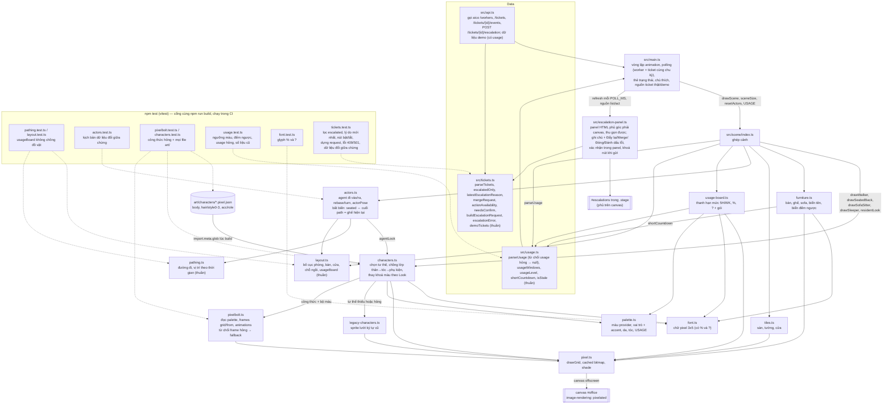

# T-87b2140f: GUI: bảng ticket escalated với nút retry_push / merge / close / fail

Lần code: 1. File do aico tạo, cập nhật mỗi lần code.

## Đầu việc

| Id | Việc | Vai trò | Được sửa | Chờ | Kết quả |
| --- | --- | --- | --- | --- | --- |
| W1 | Dữ liệu ticket escalated: kiểu, gọi API, logic thuần, demo và test | coder | `src/api.ts`, `src/tickets.ts`, `src/tickets.test.ts` | - | xong (claude) |
| W2 | Panel HTML ticket escalated phủ góc phải canvas và ghép vào polling | coder | `src/escalation-panel.ts`, `src/main.ts`, `index.html`, `src/style.css`, `README.md` | W1 | xong (codex) |

## Kế hoạch

# Kế hoạch T-87b2140f: bảng ticket escalated trên GUI

## Hiện trạng (đã đọc `AGENTS.md`, `docs/architecture.md`, `README.md`, `src/api.ts`, `src/main.ts`, `index.html`, `src/style.css`, `src/usage.test.ts`)

- `src/api.ts` chỉ gọi `GET /workers` và có dữ liệu demo cho worker. Chưa có gì về ticket.
- `src/main.ts` có `poll()` chạy mỗi `POLL_MS = 3000`, `renderCards` dựng lại toàn bộ thẻ mỗi giây bằng `replaceChildren`, và vòng `frame()` vẽ canvas.
- vitest chạy trong môi trường Node, không có DOM. Vì vậy mọi logic cần test phải nằm trong module thuần, không đụng `document`.
- Quy tắc cần theo: không framework UI; chữ giao diện bằng tiếng Việt; đọc dữ liệu API phòng thủ (dữ liệu sai kiểu thì từ chối và warn một lần, không chuẩn hoá thành "rỗng hợp lệ"); thêm file thì cập nhật bảng "Cấu trúc" trong README; `npm run build` và `npm test` phải qua.
- Không đổi `drawScene`, CSS của `#office` hay thanh hạn mức. Việc này không cần sprite nên không có đầu việc designer.

## Thiết kế

### 1. `src/api.ts`: kiểu dữ liệu và lời gọi mạng (W1)
- Thêm các kiểu: `TicketArtifact { kind: string; ref: string | null; url: string | null }`, `Ticket { id; title; status; project; artifacts: TicketArtifact[]; updated_at }`, `TicketEvent { to_status?: string | null; data?: unknown; created_at?: string }`, và `EscalationAction = "retry_push" | "merge" | "close" | "fail"`.
- `fetchTickets(config)`: gọi `GET /tickets` với header Bearer giống `fetchWorkers`. Kết quả đi qua `parseTickets` rồi `escalatedOnly`. Bắt 401 thành "Sai API token". Nếu cả danh sách hỏng (không phải mảng) thì ném lỗi để giữ danh sách cũ.
- `fetchEscalationReason(config, id)`: gọi `GET /tickets/{id}/events` rồi đưa qua `latestEscalationReason`.
- `escalationAction(config, ticketId, action, actor, comment)`: dựng request bằng `buildEscalationRequest`. Nếu `!resp.ok` thì ném `Error(escalationError(status, body))` để panel hiện trường `detail` khi gặp 409/501.

### 2. `src/tickets.ts`: hàm thuần, không dùng DOM, `fetch` hay thời gian thật (W1)
- `parseTickets(raw)`: nếu `raw` không phải mảng thì trả `null` và warn một lần. Phần tử thiếu `id`, `title` hoặc `status` dạng chuỗi thì bỏ riêng phần tử đó và warn một lần. Nếu `artifacts` không phải mảng thì không đoán MR (Merge tắt) và warn.
- `escalatedOnly(tickets)`: giữ ticket có `status === "escalated"`.
- `latestEscalationReason(events)`: lấy event mới nhất (theo `created_at`; không có thì theo thứ tự cuối mảng) có `to_status === "escalated"`, trả `data.reason` nếu là chuỗi, ngược lại `null`.
- `mergeRequest(ticket)`: trả `{ present, url }`. `url` chỉ nhận `http:` hoặc `https:` để chặn link `javascript:` lấy từ dữ liệu API.
- `actionAvailability(reason, ticket)`:
  - `retry_push` bật khi `reason?.trimStart().startsWith("đẩy code lên Git lỗi")`.
  - `merge` bật khi `mergeRequest(ticket).present`.
  - `close` và `fail` luôn bật.
- `needsConfirm(action)`: trả true cho `merge`, `close`, `fail`.
- `buildEscalationRequest(config, id, action, actor, comment)`: trả `{ url, init }`. URL bỏ `/` ở cuối base và `encodeURIComponent(id)`. Method POST, header `Authorization` cùng `Content-Type: application/json`, body `{action, actor, comment}`.
- `escalationError(status, body)`:
  - 409/501 có `detail` dạng chuỗi thì trả `detail`.
  - 401 trả "Sai API token".
  - Các trường hợp khác, kể cả `detail` không phải chuỗi, trả `aico trả {status}`.
- Demo: `demoTickets()` trả 2 ticket giả. Ticket thứ nhất có lý do "đẩy code lên Git lỗi: …" và không có MR. Ticket thứ hai có artifact `merge_request` kèm url và lý do khác. `applyDemoAction(list, id, action)` đổi status giả (`retry_push → in_progress`, `merge → done`, `close → closed`, `fail → failed`) nên ticket rời danh sách escalated.

### 3. `src/escalation-panel.ts`: panel HTML (W2)
- `createEscalationPanel(root, source)` nhận nguồn được tiêm vào: `{ list(): Promise<…>, act(id, action, comment): Promise<void> }`. Main tạo nguồn thật hoặc nguồn demo.
- Panel phủ góc phải trên của canvas (bọc canvas trong `.stage { position: relative }`), có nút thu gọn kèm số ticket. Trạng thái thu gọn lưu trong localStorage `aico-office.escalations`.
- Mỗi dòng hiện mã ticket, tiêu đề, lý do (không có thì ghi "chưa rõ lý do"), link MR (`target=_blank rel="noopener noreferrer"`), ô ghi chú và 4 nút: Đẩy lại, Merge, Đóng, Đánh dấu lỗi. Mọi chữ lấy từ API đều gán bằng `textContent`.
- Merge, Đóng, Đánh dấu lỗi mở dòng xác nhận ngay trong panel ("Xác nhận" / "Huỷ"), không dùng `window.confirm`. `actor = "owner"`.
- Khi đang gửi: khoá cả 4 nút của ticket đó. Xong thì làm mới danh sách. Lỗi thì hiện thông báo trong dòng, mở khoá nút và giữ nguyên ghi chú.
- Cập nhật DOM theo khoá `id`, không `replaceChildren` cả panel mỗi lần poll. Như vậy ô ghi chú, focus và dòng xác nhận không bị mất.

### 4. Ghép nối trong `main.ts` (W2)
- `poll()` chạy `fetchWorkers` và `panel.refresh()` song song bằng `Promise.allSettled`, nên lỗi phía ticket không làm hỏng trạng thái worker và ngược lại. Hai thứ dùng cùng chu kỳ `POLL_MS`.
- Lý do escalate được cache theo `id + updated_at`, chỉ gọi lại `/events` khi `updated_at` đổi. Gọi `/events` lỗi thì lý do là `null` (nút Đẩy lại tắt), danh sách vẫn hiện.
- Demo lưu danh sách ticket trong bộ nhớ, không tính lại mỗi frame. Bấm nút Demo thì nạp lại `demoTickets()`.
- Khi đổi nguồn (Kết nối/Demo) thì tăng "thế hệ": kết quả của request cũ trả về muộn bị bỏ qua và trạng thái panel được xoá.

## Các bước
1. **W1**: viết `src/tickets.ts`, sửa `src/api.ts` và viết `src/tickets.test.ts` theo mẫu `usage.test.ts` (dùng `vi.spyOn(console, "warn")` để kiểm warn một lần).
2. **W2** (sau W1): viết `src/escalation-panel.ts`, sửa `index.html` (thêm `.stage` bọc `#office` và `#escalations`), sửa `src/style.css` (thêm style panel, không đổi rule `#office`), sửa `src/main.ts`. Thêm 3 file mới vào bảng "Cấu trúc" trong README và một đoạn ngắn mô tả panel trong mục Dữ liệu.

W2 cần kiểu và hàm của W1 để `tsc` qua, nên W2 phải chạy sau. `main.ts`, `index.html` và `style.css` gắn chặt với panel, nên tách thêm đầu việc cũng không chạy song song được.

## Kiểm tra
- `npm run build` và `npm test` phải qua. Test cũ (`usage`, `actors`, `pixelbolt`…) không đổi.
- `tickets.test.ts` cần có:
  - Lọc ticket: lọc escalated, `parseTickets` từ chối dữ liệu hỏng (không phải mảng, phần tử thiếu `id`, `status` là số, `artifacts` là object) và warn một lần.
  - Lý do: lấy lần escalate mới nhất khi có nhiều event; trường hợp `data` null, `reason` không phải chuỗi, không có event escalated.
  - Nút bật/tắt: lý do có tiền tố đúng, có khoảng trắng đầu, hoặc khác tiền tố; có MR kèm hoặc không kèm url; url `javascript:` bị loại.
  - Request: URL khi base có `/` cuối, id cần encode; body và header đúng.
  - Lỗi: 409/501 có `detail` chuỗi, `detail` là mảng, body rỗng, 401.
  - Demo: `applyDemoAction` cho từng action.
- Tự xem bằng `npm run dev`:
  - Demo: có 2 ticket; Đẩy lại chỉ bật ở ticket thứ nhất, Merge chỉ bật ở ticket thứ hai; xác nhận/huỷ hoạt động; thu gọn/mở được; panel không che thẻ trạng thái và canvas vẫn vẽ bình thường.
  - aico thật: cần thì giả 409 để xem thông báo `detail`.

## Kịch bản "dữ liệu đổi giữa chừng" bắt buộc test
- Ticket biến mất (bị xử lý ở chỗ khác) trong khi đang mở xác nhận hoặc đang gõ ghi chú: dòng bị gỡ, không lỗi. Ticket xuất hiện lại thì bắt đầu từ trạng thái sạch (không còn dòng xác nhận, ghi chú rỗng).
- Số ticket đổi 2 → 0 → 3: hiện "Không có ticket cần xử lý" và số trên nút thu gọn đổi theo.
- Artifact MR xuất hiện rồi mất: Merge bật rồi tắt, dòng xác nhận Merge đang mở bị huỷ.
- `updated_at` đổi kèm lý do mới (lỗi đẩy code ↔ lý do khác): lý do được tải lại và Đẩy lại bật/tắt theo.
- Đang gửi thì có lần poll mới: nút vẫn khoá, ghi chú không mất.
- Offline hoặc `/tickets` lỗi: giữ danh sách cũ và hiện dòng lỗi; thẻ worker vẫn cập nhật. `/events` lỗi: lý do `null`, Đẩy lại tắt. Có mạng lại thì hết dòng lỗi.
- Đổi config hoặc Demo khi request cũ chưa về: kết quả cũ bị bỏ qua.

```json
{"items": [
  {"id": "W1", "title": "Dữ liệu ticket escalated: kiểu, gọi API, logic thuần, demo và test", "role": "coder",
   "owns": ["src/api.ts", "src/tickets.ts", "src/tickets.test.ts"], "depends_on": [],
   "acceptance": "api.ts có Ticket/TicketArtifact/TicketEvent/EscalationAction, fetchTickets (GET /tickets, Bearer, lọc escalated), fetchEscalationReason (GET /tickets/{id}/events), escalationAction (POST /tickets/{id}/escalation body {action, actor, comment}; 409/501 ném Error mang detail). tickets.ts là hàm thuần: parseTickets từ chối dữ liệu hỏng (null hoặc bỏ phần tử, warn một lần), escalatedOnly, latestEscalationReason (event to_status escalated mới nhất, data.reason chuỗi), mergeRequest (chỉ nhận url http/https), actionAvailability (retry_push khi lý do bắt đầu bằng 'đẩy code lên Git lỗi', merge khi có artifact merge_request, close/fail luôn bật), needsConfirm, buildEscalationRequest, escalationError, demoTickets (2 ticket: một lỗi đẩy code không có MR, một có MR), applyDemoAction. tickets.test.ts có test cho lọc, bật/tắt nút, dựng request, lỗi 409/501/401 và các kịch bản dữ liệu đổi: MR xuất hiện rồi mất, lý do đổi khi updated_at đổi, số ticket 2→0→3, ticket mất rồi xuất hiện lại, nhiều lần escalate thì lấy lần mới nhất, dữ liệu hỏng giữa hai lần đọc rồi lành lại. fetchWorkers/demoWorkers giữ nguyên hành vi. npm run build và npm test qua."},
  {"id": "W2", "title": "Panel HTML ticket escalated phủ góc phải canvas và ghép vào polling", "role": "coder",
   "owns": ["src/escalation-panel.ts", "src/main.ts", "index.html", "src/style.css", "README.md"], "depends_on": ["W1"],
   "acceptance": "Panel phủ góc phải trên của canvas (bọc canvas trong .stage), thu gọn được và hiện số ticket; mỗi dòng có mã, tiêu đề, lý do, link MR (target _blank, rel noopener), ô ghi chú, 4 nút Đẩy lại/Merge/Đóng/Đánh dấu lỗi bật theo actionAvailability; Merge/Đóng/Đánh dấu lỗi xác nhận ngay trong panel, không dùng window.confirm; actor 'owner'; đang gửi thì khoá nút của ticket đó, xong thì làm mới danh sách, lỗi hiện detail và giữ ghi chú. Panel cập nhật theo id nên ghi chú, focus và dòng xác nhận không mất qua các lần poll. Làm mới cùng POLL_MS với worker bằng Promise.allSettled (lỗi ticket không làm hỏng worker); lý do cache theo id+updated_at. Demo dùng demoTickets/applyDemoAction, giữ trạng thái trong bộ nhớ. Đổi config/Demo thì bỏ qua kết quả của request cũ. Kiểm tay các kịch bản: ticket biến mất khi đang xác nhận hoặc gõ ghi chú rồi xuất hiện lại sạch, số ticket 2→0→3 (hiện trạng thái rỗng), MR xuất hiện/mất làm Merge bật/tắt và huỷ xác nhận, poll tới khi đang gửi, offline giữ danh sách cũ kèm dòng lỗi rồi hồi phục, /events lỗi thì lý do null. Không đổi drawScene, rule #office hay thanh hạn mức. README thêm src/tickets.ts, src/tickets.test.ts, src/escalation-panel.ts vào bảng Cấu trúc và mô tả panel. npm run build và npm test qua; tóm tắt ghi rõ đã xem demo trên trình duyệt hay chưa."}
]}
```


