# T-8d17b253: GUI: trang phục và nhãn cho vai trò BA, Tester, Researcher

Lần code: 2. File do aico tạo, cập nhật mỗi lần code.

## Đầu việc

| Id | Việc | Vai trò | Được sửa | Chờ | Kết quả |
| --- | --- | --- | --- | --- | --- |
| W1 | ROLE_STYLES cho ba, tester, researcher và test roleStyle | coder | `src/scene/palette.ts`, `src/scene/palette.test.ts` | - | chưa chạy |
| W2 | Sprite phụ kiện Pixelbolt: bảng kẹp hồ sơ, kính lúp, sổ tay | designer | `art/characters/acc/ba.pixel.json`, `art/characters/acc/tester.pixel.json`, `art/characters/acc/researcher.pixel.json` | - | chưa chạy |
| W3 | Phụ kiện ba/tester/researcher ở đường vẽ dự phòng và test | coder | `src/scene/legacy-characters.ts`, `src/scene/legacy-characters.test.ts` | W1 | chưa chạy |
| W4 | Demo thêm ba (read) và tester (review), test kịch bản demo | coder | `src/api.ts`, `src/api.test.ts`, `src/main.test.ts`, `src/activity.test.ts` | - | chưa chạy |
| W5 | Nhân vật trong cảnh đổi kiểu khi role đổi giữa chừng | coder | `src/scene/actors.ts`, `src/scene/actors.test.ts` | W1 | chưa chạy |
| W6 | Test thanh bên và avatar cho vai trò mới, cập nhật README | coder | `src/ui/sidebar.test.ts`, `src/ui/avatar.test.ts`, `README.md` | W1 | chưa chạy |
| FIX | Sửa theo góp ý: Researcher đổi màu áo sang ô liu: shirt #8c8f3a, shirtDark #686b2a (nâu #b0784a  | coder | `**` | - | xong |

## Kế hoạch

# Kế hoạch T-8d17b253: trang phục và nhãn cho BA, Tester, Researcher

## Những gì tìm thấy khi đọc code

- **`palette.ts`** chỉ có 4 kiểu vai trò. Ngoài ra, `roleStyle()` đã trả về kiểu fallback cho cả `"BA"` viết hoa, nên TC2 qua mà không cần sửa logic.
- **Chú thích ở thanh bên** (`sidebar.ts`) duyệt `Object.values(ROLE_STYLES)`. Chỉ cần thêm 3 mục sau `designer` là có 7 mục đúng thứ tự (TC9). Ô tìm, avatar fallback, ngăn chi tiết, feed và tooltip đều đọc qua `roleStyle()`, nên tự nhận nhãn và màu mới.
- **TC12 cần sửa thêm, ngoài phạm vi ticket ghi.** `actors.ts` chỉ tính `look: agentLook(agent)` một lần, lúc tạo nhân vật. Sau đó chỉ gán lại `a.agent = agent`. Hệ quả: khi cùng một `id` đổi role, thanh bên và avatar đổi theo (khoá avatar có role), nhưng nhân vật trong cảnh vẫn giữ áo cũ. Tôi chọn cách sửa nhỏ nhất: mỗi lần sync thì gán lại `a.look = agentLook(agent)`. Cách này không đụng ghế, đường đi hay chuyển pha, nên không đổi "logic actors" mà ticket cấm. Theo AGENTS.md, sửa `actors.ts` thì phải thêm kịch bản vào `actors.test.ts`.
- **Demo:** chỉ số vai trò được tính bằng `(cycle + i*2 + k) % DEMO_ROLES.length`. Khi nối thêm `ba` (read) và `tester` (review) thì danh sách có 6 vai trò. Mỗi chu kỳ dùng các chỉ số `{c … c+4}`, tức 5/6 vai trò, nên hai chu kỳ liền nhau luôn phủ đủ 6 (TC14). Số agent, số chỗ và trạng thái phòng không đổi. Những test đang dựa vào thứ tự vai trò trong demo phải sửa lại.
- **TC8 kiểm được bằng test**, không cần thêm hạ tầng. `legacySprite` vẽ qua `cached()`, tức `document.createElement("canvas")`, rồi `rect()`, tức `fillStyle` + `fillRect`. Chỉ cần stub `document` bằng một canvas giả ghi lại các lần `fillRect` (cách `sidebar.test.ts` đã làm với DOM giả).
- **Chưa đọc được hai chỗ:** `docs/plans/` (tool chỉ đọc file, không liệt kê được thư mục) và `src/main.test.ts` (quá dài so với giới hạn đọc). Đầu việc W4 phải tự tìm trong các test những chỗ dựa vào thứ tự vai trò của demo.

## Trả lời các câu hỏi mở của BA

1. **Phụ kiện:** BA dùng bảng kẹp hồ sơ, Tester dùng kính lúp, Researcher dùng sổ tay. Cả ba đều cầm ở tay trước ngực hoặc bên hông, nên từ sau lưng không thấy. Vì vậy công thức không có `walk_up`, `sit_back`, `lie` (khi nằm thì chăn che tay), và đường vẽ dự phòng cũng không vẽ ở hướng `back`, đúng theo TC6 và TC8.
2. **Màu áo**, chốt sẵn để W1 và W2 làm song song:

   | Vai trò | Nhãn | Áo `shirt` | Áo sẫm `shirtDark` | Phụ kiện | `accent` |
   |---|---|---|---|---|---|
   | `ba` | `BA` | `#d9a43a` (vàng mù tạt) | `#a87b25` | bảng kẹp hồ sơ | `#8a5a32` (bìa nâu) |
   | `tester` | `Tester` | `#3bb5c8` (xanh lơ) | `#2a8797` | kính lúp | `#c9a14f` (vành đồng) |
   | `researcher` | `Researcher` | `#b0784a` (nâu đất) | `#83573a` | sổ tay | `#3f6fbf` (bìa xanh) |

   Áo sẫm bằng khoảng 0,75–0,8 lần áo sáng, giống 4 vai trò cũ. Nâu của Researcher có nguy cơ gần màu cam của Claude (`#d97757`). Nếu xem demo hoặc Tester thấy lẫn thì đổi sang ô liu `#8c8f3a` / `#686b2a`, kèm sửa khoá `"a"` nếu `accent` cũng đổi.
3. **Researcher không vào demo.** Vai trò này được kiểm bằng test (TC1, TC5, TC8, TC13).
4. **Thứ tự:** nối sau `designer` theo thứ tự ba, tester, researcher, cả trong `ROLE_STYLES` lẫn `DEMO_ROLES` (`ba` rồi `tester`).
5. **Avatar fallback** giữ chữ cái đầu của nhãn. Tester mang chữ "T", trùng với Tech lead, và chỉ phân biệt bằng màu nền.
6. **TC8 có test tự động** bằng canvas giả (xem W3).

## Các bước và file cần sửa

1. **W1, `src/scene/palette.ts`:** thêm 3 mục `ROLE_STYLES` theo bảng trên, không đổi thứ tự 4 mục cũ. Tạo mới `src/scene/palette.test.ts` để kiểm:
   - TC1: nhãn của 3 vai trò mới, `accessory` và `accent` khác rỗng.
   - TC2: `"foo"`, `null`, `undefined`, `""`, `"BA"` trả kiểu fallback với áo `#8a8f98`/`#62666d`; nhãn là role thô, hoặc `"?"` khi role rỗng hay null.
   - TC3: 7 màu áo vai trò, 3 màu provider và màu xám fallback không trùng nhau.
   - TC4: độ sáng `shirtDark` nằm trong khoảng 0,7–0,85 lần `shirt`, so với 4 vai trò cũ.
   - TC6, phần mã màu: khoá `"a"` trong mỗi `acc/<role>.pixel.json` khớp `accent` của vai trò đó. Test này sẽ fail cho tới khi W2 xong, và đó là chủ ý.
2. **W2, designer:** vẽ `art/characters/acc/{ba,tester,researcher}.pixel.json` theo mẫu `acc/coder.pixel.json`:
   - Khung 16×22, chỉ dùng op `grid`; `palette` có `"a"` bằng accent, `"o"` là `#21181f`, cộng thêm màu cố định nếu cần (giấy `#f4efe4`, kính `#d5ecf6`).
   - Có các frame `front`, `side`, `left` và các animation `walk_down`, `walk_left`, `walk_right`, `sit_side`.
   - Đặt phụ kiện ở vùng thân (y 12–17, tay ở x 2–4 hoặc 11–13). Không đè lên đầu (y 2–11). Ở `sit_side`, tránh tay cầm cốc (x 10–14, y 11–15): sổ hoặc bảng kẹp đặt trên đùi, kính lúp đặt cạnh hông.
   - Tự kiểm bằng `pixel_validate`/`pixel_inspect`, sau đó `npm test`.
3. **W3, `src/scene/legacy-characters.ts`:** thêm các nhánh `ba`, `tester`, `researcher` trong `drawAccessory`, vẽ ở hướng `front` và `side`, bỏ qua `back` và `lie`. Màu lấy `ROLE_STYLES[role].accent` và màu chung trong `palette.ts` (`C.paper`), không rải mã màu mới. Tạo mới `src/scene/legacy-characters.test.ts` dùng canvas giả, kiểm:
   - mỗi vai trò mới có pixel phụ kiện khác biệt ở `walk`/`front` và `walk`/`side`;
   - ở `back` thì giống hệt khi role là null;
   - coder có pixel phụ kiện khác biệt ở `back`, giữ hành vi cũ;
   - vai trò lạ không có phụ kiện.
4. **W4, demo:** trong `src/api.ts`, nối `{ role: "ba", mode: "read" }` và `{ role: "tester", mode: "review" }` vào `DEMO_ROLES`. Trong `src/api.test.ts`, thêm test TC14: lấy mẫu `demoWorkers` mỗi giây trên 96 giây, tính từ hai mốc chu kỳ khác nhau, rồi kiểm:
   - có `ba`/`read` và `tester`/`review`;
   - 4 vai trò cũ vẫn xuất hiện;
   - số agent mỗi phòng, `slots` và `state` theo thời gian khớp kịch bản cũ, tức chỉ role và mode được đổi.

   Thêm cả test TC13: `roomAgents` với chỉ `current: { role: "researcher" }` giữ nguyên role. Chạy `npm test` và sửa các test đang dựa vào thứ tự vai trò của demo (`main.test.ts`, `activity.test.ts`). Nếu test hỏng nằm ngoài `owns` thì ghi lại trong tóm tắt.
5. **W5, `src/scene/actors.ts`:** mỗi lần `syncActors` thì gán lại `a.look = agentLook(agent)`, ngay chỗ `a.agent = agent`. Không đổi ghế, đường đi hay pha. Trong `actors.test.ts`, thêm kịch bản cho cùng một `id`:
   - role lạ → `tester` → `null`, khi đang ngồi và khi đang đi vào: `look.shirt` và `look.role` đổi theo, còn `phase`, `seat`, `path` giữ nguyên;
   - mất rồi xuất hiện lại khi đang đi ra, mang role mới;
   - phòng offline rồi online lại với role đã đổi;
   - số agent thay đổi khi role đổi.
6. **W6, giao diện và README:**
   - `src/ui/sidebar.test.ts`:
     - chú thích có đúng 7 mục, đúng thứ tự, không có `()` rỗng (TC9);
     - dòng agent `ba`/`tester`/`researcher` có nhãn và màu áo mới (TC10);
     - gõ `ba`, `TESTER`, `Research` thì khớp đúng agent (TC11);
     - dữ liệu đổi giữa chừng, cùng node dòng: role lạ → `tester` → lạ/`null` thì nhãn và màu đổi theo, `createAvatar` được gọi lại; agent tester mất rồi xuất hiện lại khi đang lọc `tester`; phòng offline giữ dòng mờ đúng nhãn (TC12).
   - Tạo mới `src/ui/avatar.test.ts` với `document` giả mà `getContext` trả `null`: avatar fallback có nền màu áo mới và chữ "B", "T", "R".
   - `README.md`: thêm 3 vai trò vào câu mô tả trang phục, và sửa dòng `acc/<role>.pixel.json` trong bảng Cấu trúc thành 7 vai trò. Thêm vào bảng 3 file test mới: `palette.test.ts`, `legacy-characters.test.ts`, `avatar.test.ts` (TC17).

## Kiểm tra

- `npm run build` và `npm test` đều qua (TC16). Nhóm "mọi file art/characters" phải liệt kê cả 3 file phụ kiện mới (TC5).
- `npm run dev`, không nhập token, xem demo ít nhất 96 giây:
  - BA hoặc Tester đi vào bàn, gõ phím, rồi về phòng nghỉ;
  - phụ kiện đúng chỗ ở các hướng xuống, trái, phải, không nhấp nháy;
  - Console không có `console.warn` về công thức (TC7);
  - màn hình của BA hiện màu xanh lá (mode read), của Tester màu tím (mode review) (TC15);
  - chú thích có 7 mục, màu áo không lẫn với vai trò hay provider khác (TC3, TC4).
- Ngoài demo, Researcher được kiểm qua test.

```json
{"items": [
  {"id": "W1", "title": "ROLE_STYLES cho ba, tester, researcher và test roleStyle", "role": "coder",
   "owns": ["src/scene/palette.ts", "src/scene/palette.test.ts"], "depends_on": [],
   "acceptance": "TC1–TC4: ROLE_STYLES có thêm ba {BA, #d9a43a/#a87b25, 'bảng kẹp hồ sơ', accent #8a5a32}, tester {Tester, #3bb5c8/#2a8797, 'kính lúp', #c9a14f}, researcher {Researcher, #b0784a/#83573a, 'sổ tay', #3f6fbf}, nối sau designer; 4 mục cũ, provider và fallback giữ nguyên. palette.test.ts kiểm: nhãn và accessory/accent khác rỗng của 3 vai trò mới; fallback cho 'foo', null, undefined, '', 'BA' (áo #8a8f98/#62666d, phụ kiện rỗng, nhãn là role thô hoặc '?'); 7 màu áo vai trò, 3 provider và fallback không trùng nhau; shirtDark/shirt trong khoảng 0,7–0,85 về độ sáng; TC6: khoá 'a' của từng acc/<role>.pixel.json bằng accent (đỏ cho tới khi W2 xong là chấp nhận). npm run build qua."},
  {"id": "W2", "title": "Sprite phụ kiện Pixelbolt: bảng kẹp hồ sơ, kính lúp, sổ tay", "role": "designer",
   "owns": ["art/characters/acc/ba.pixel.json", "art/characters/acc/tester.pixel.json", "art/characters/acc/researcher.pixel.json"], "depends_on": [],
   "acceptance": "TC5, TC6, TC7: 3 file 16×22, chỉ dùng op grid, palette có 'a' = #8a5a32 (ba), #c9a14f (tester), #3f6fbf (researcher), 'o' = #21181f, màu cố định khác dùng khoá riêng. Frame front/side/left; animation chỉ có walk_down, walk_left, walk_right, sit_side (không có walk_up/sit_back/lie vì từ sau lưng không thấy phụ kiện). Phụ kiện ở tay hoặc thân (y 12–17), không đè lên đầu; ở sit_side không che tay cầm cốc. pixel_validate qua và npm test nhóm 'mọi file art/characters' qua cho cả 3 file; xem demo không có console.warn và phụ kiện không lệch, không nhấp nháy."},
  {"id": "W3", "title": "Phụ kiện ba/tester/researcher ở đường vẽ dự phòng và test", "role": "coder",
   "owns": ["src/scene/legacy-characters.ts", "src/scene/legacy-characters.test.ts"], "depends_on": ["W1"],
   "acceptance": "TC8: drawAccessory có nhánh ba (bảng kẹp), tester (kính lúp), researcher (sổ tay) cho view front và side, không vẽ ở back và lie; màu lấy từ ROLE_STYLES[role].accent và màu trong palette.ts, không thêm mã màu mới vào file. legacy-characters.test.ts dùng document/canvas giả ghi fillRect, kiểm: mỗi vai trò mới ở walk/front và walk/side có pixel khác với role null; ở walk/back giống role null; coder ở back vẫn có pixel phụ kiện; role 'foo' giống null. npm run build và npm test qua."},
  {"id": "W4", "title": "Demo thêm ba (read) và tester (review), test kịch bản demo", "role": "coder",
   "owns": ["src/api.ts", "src/api.test.ts", "src/main.test.ts", "src/activity.test.ts"], "depends_on": [],
   "acceptance": "TC14, TC13, TC16: DEMO_ROLES nối {ba, read} rồi {tester, review}; không đổi roles của phòng, chu kỳ 48 giây, slots và trạng thái phòng. api.test.ts: lấy mẫu demoWorkers mỗi giây trong 96 giây, tính từ ít nhất hai mốc chu kỳ khác nhau, có ba/read, tester/review và đủ 4 vai trò cũ; số agent mỗi phòng, slots và state theo từng giây khớp kịch bản cũ; roomAgents với chỉ current role 'researcher' giữ role. Các test dựa vào thứ tự vai trò demo được sửa; test hỏng nằm ngoài owns thì ghi rõ trong tóm tắt. npm run build và npm test qua."},
  {"id": "W5", "title": "Nhân vật trong cảnh đổi kiểu khi role đổi giữa chừng", "role": "coder",
   "owns": ["src/scene/actors.ts", "src/scene/actors.test.ts"], "depends_on": ["W1"],
   "acceptance": "TC12, phần cảnh: syncActors gán lại a.look = agentLook(agent) mỗi lần sync, không đổi ghế, đường đi, phase hay bất biến seated. actors.test.ts thêm kịch bản cùng id: role lạ → tester → null khi đang ngồi và khi đang đi vào (look.shirt/look.role đổi; seat, phase, path giữ nguyên); agent mất rồi xuất hiện lại khi đang đi ra với role mới; phòng offline rồi online lại với role đã đổi; số agent đổi cùng lúc với role. Mọi kịch bản actors cũ vẫn qua; npm run build và npm test qua."},
  {"id": "W6", "title": "Test thanh bên và avatar cho vai trò mới, cập nhật README", "role": "coder",
   "owns": ["src/ui/sidebar.test.ts", "src/ui/avatar.test.ts", "README.md"], "depends_on": ["W1"],
   "acceptance": "TC9–TC12, TC17: sidebar.test.ts kiểm chú thích có đúng 7 mục theo thứ tự tech_lead, coder, reviewer, designer, BA, Tester, Researcher và không có '()'; dòng agent ba/tester/researcher ghi nhãn mới bằng màu áo mới; tìm 'ba', 'TESTER', 'Research' khớp đúng agent; dữ liệu đổi giữa chừng với cùng node dòng: role lạ → tester → lạ/null thì nhãn, màu đổi và createAvatar được gọi lại, agent tester mất rồi xuất hiện lại khi đang lọc, phòng offline giữ dòng mờ đúng nhãn. avatar.test.ts: avatar fallback có nền màu áo và chữ 'B', 'T', 'R'. README: câu trang phục có thêm 3 vai trò, dòng acc/<role>.pixel.json liệt kê đủ 7 vai trò, bảng Cấu trúc có palette.test.ts, legacy-characters.test.ts, avatar.test.ts. npm test qua."}
]}
```

```mermaid
flowchart TD
  subgraph Data["Dữ liệu và logic thuần hiện có"]
    API["src/api.ts<br/>workers, snapshot tickets đầy đủ, actions<br/>demoWorkers 48 giây, DEMO_ROLES 6 vai trò<br/>(+ ba read, tester review)<br/>roomAgents: current cũ giữ role<br/>defaultBaseUrl: origin/api trên tên miền thật"]
    TK["src/tickets.ts<br/>parseTickets, needsYou, NEED_LABEL, actions, MR, preview<br/>latestScreenshots, demoNeedTickets kèm ảnh demo"]
    ACTV["src/activity.ts<br/>activity, screenFor, bubbles, progress"]
    USG["src/usage.ts"]
    TIME["src/time.ts"]
    LATEST["src/latest.ts<br/>createLatestGate"]
    ATT["src/attention.ts"]
  end
  API --> TK
  ACTV --> USG

  SHOTS["public/demo-shots/ + art/demo-shots/"]
  SHOTS -.->|url tuyệt đối theo BASE_URL| TK

  COL["src/needs-column.ts + CSS<br/>gate snapshot, lọc items, hàng ảnh"]
  VIEWER["src/shot-viewer.ts + CSS<br/>lightbox ←/→, Esc"]
  API -->|cùng request tickets| COL
  LATEST --> COL
  COL --> TK
  COL -->|mở ảnh| VIEWER
  COL -->|actions| API
  COL -->|snapshot, NeedItem đã lọc| MAIN

  LOC["window.location"]
  LS["localStorage aico-office.api"]
  FORM["#settings trong index.html"]

  MAIN["src/main.ts<br/>poll, nguồn, giờ, reduced motion, vòng animation<br/>chọn agent, showNeeds, update sidebar"]
  API --> MAIN
  LATEST --> MAIN
  ATT --> MAIN
  MAIN -->|demo assetBase| TK
  LS -->|loadConfig| MAIN
  MAIN -->|saveConfig khi submit| LS
  LOC -->|defaultBaseUrl| MAIN
  MAIN -->|value baseUrl| FORM

  subgraph UI["Khung UI"]
    VP["ui/viewport.ts<br/>computeInsets, fitScene, feedBox"]
    FM["ui/feed-model.ts"]
    SEL["ui/selection.ts"]
    FMT["ui/format.ts"]
    TOK["ui/tokens.css"]
    TOP["ui/topbar.ts + CSS"]
    SIDEM["ui/sidebar-model.ts<br/>agentMatches theo nhãn + role id"]
    SIDE["ui/sidebar.ts + CSS<br/>ô tìm, chip lọc, khối phòng, dòng agent<br/>chú thích 7 vai trò từ ROLE_STYLES"]
    LSH[("localStorage hiddenRooms")]
    AV["ui/avatar.ts<br/>khoá id+role, fallback màu áo + chữ đầu nhãn"]
    DRWM["ui/drawer-model.ts"]
    DRW["ui/drawer.ts + CSS"]
    FEED["ui/feed.ts + CSS"]
    NEEDS["#needs trong drawer"]
    TOAST["toasts.ts + CSS"]
  end
  FORM --> TOP
  MAIN --> VP
  MAIN --> FM
  MAIN --> SEL
  MAIN --> TOP
  MAIN -->|workers, needIds, selectedKey, now| SIDE
  SIDE -->|onSelect| MAIN
  MAIN -->|view, agent + needItems| DRW
  DRW -->|onTicket| MAIN
  MAIN -->|lines + workers| FEED
  FEED -->|onAgent, onTicket| MAIN
  MAIN --> TOAST
  TOAST -->|onOpen| MAIN
  TOP -->|submit, Demo| MAIN
  TOP --> FMT
  SIDE --> SIDEM
  SIDE --> FMT
  SIDE --> AV
  SIDE --> ACTV
  SIDE --> PAL
  SIDE <--> LSH
  FEED --> AV
  FEED --> FMT
  FEED --> PAL
  FMT --> USG
  FMT --> ACTV
  FM --> ACTV
  DRW --> DRWM
  DRW --> AV
  DRW --> FMT
  DRW --> PAL
  DRW --> TK
  DRWM --> ACTV
  DRWM --> TIME
  DRWM --> FMT
  DRWM --> TK
  DRW --> NEEDS
  COL --> NEEDS
  TOK -.-> TOP
  TOK -.-> SIDE
  TOK -.-> DRW
  TOK -.-> FEED
  TOK -.-> COL
  TOK -.-> VIEWER

  DEMO["scene/demo-events.ts"]
  EVENTS["scene/room-events.ts<br/>MR mới/done/escalated, TTL 10 giây"]
  DEMO --> MAIN
  MAIN -->|snapshot| EVENTS
  EVENTS -->|banner| MAIN

  IDX["scene/index.ts<br/>ghép cảnh, SceneFigure"]
  MAIN -->|workers, thời gian, reduced motion| IDX
  LAYOUT["scene/layout.ts<br/>thuần"]
  OUT["scene/outdoor.ts"]
  CACHE["Canvas cache nền tĩnh"]
  TILES["scene/tiles.ts"]
  ACT["scene/actors.ts<br/>seated chỉ khi cuối path đúng ghế<br/>look làm mới mỗi sync khi role đổi"]
  PATH["scene/pathing.ts<br/>thuần"]
  FURN["scene/furniture.ts<br/>màn hình màu code theo mode"]
  BOARD["scene/usage-board.ts"]
  CHAR["scene/characters.ts<br/>agentLook, lớp thân → tóc → acc/role"]
  PB["scene/pixelbolt.ts"]
  LEG["scene/legacy-characters.ts<br/>drawAccessory 7 vai trò<br/>ba/tester/researcher: front, side"]
  ART["art/characters/*.pixel.json<br/>acc/: tech_lead, coder, reviewer, designer,<br/>ba, tester, researcher"]
  PAL["scene/palette.ts<br/>ROLE_STYLES 7 vai trò + fallback xám<br/>màu provider, cảnh, ánh sáng, banner"]
  PIX["scene/pixel.ts"]
  LIGHT["scene/lighting.ts"]

  IDX --> LAYOUT
  IDX --> OUT
  IDX --> CACHE
  CACHE --> OUT
  CACHE --> TILES
  IDX --> ACT
  ACT --> LAYOUT
  ACT --> PATH
  ACT -->|agentLook| CHAR
  IDX --> FURN
  IDX --> BOARD
  BOARD --> USG
  IDX --> ACTV
  IDX --> CHAR
  AV --> CHAR
  AV --> PAL
  ART --> CHAR
  CHAR --> PB
  CHAR --> LEG
  CHAR --> PAL
  LEG --> PAL
  OUT --> PAL
  LIGHT --> PAL
  FURN --> PAL
  TILES --> PIX
  OUT --> PIX
  FURN --> PIX
  PB --> PIX
  LEG --> PIX
  IDX --> LIGHT

  CANVAS["canvas #office<br/>nền cache → phần động → lightmap"]
  CACHE --> CANVAS
  IDX -->|đồ đạc, nhân vật, xe| CANVAS
  LIGHT --> CANVAS
  VP --> MAIN

  OVL["src/overlay.ts"]
  TIP["src/agent-tooltip.ts + CSS<br/>vai trò qua roleStyle"]
  MAIN --> OVL
  MAIN --> TIP
  OVL --> ACTV
  OVL --> PAL
  TIP --> ACTV
  TIP --> FMT
  TIP --> PAL
  OVL --> SCREEN["Lớp chữ trên cảnh"]
  CANVAS --> SCREEN

  TEST["Vitest<br/>palette: nhãn 3 vai trò mới, fallback, màu không trùng, khoá a = accent<br/>legacy-characters: canvas giả, phụ kiện front/side, không ở back<br/>art/characters: 7 file acc 16×22<br/>api: demo 96 giây có ba/read, tester/review, kịch bản giữ nguyên<br/>actors: role đổi giữa chừng, mất rồi xuất hiện lại, offline<br/>sidebar: chú thích 7 mục, tìm ba/tester/research, role đổi khi đang lọc<br/>avatar: fallback màu áo + chữ B/T/R<br/>giữ mọi test cũ"]
  TEST -.-> API
  TEST -.-> PAL
  TEST -.-> LEG
  TEST -.-> ART
  TEST -.-> ACT
  TEST -.-> SIDE
  TEST -.-> AV
  TEST -.-> MAIN
  TEST -.-> IDX
  TEST -.-> DRW
  TEST -.-> FEED
```


