# T-b9a40abf: GUI: hiện ảnh giao diện Reviewer chụp trong thẻ Cần bạn

Lần code: 1. File do aico tạo, cập nhật mỗi lần code.

## Đầu việc

| Id | Việc | Vai trò | Được sửa | Chờ | Kết quả |
| --- | --- | --- | --- | --- | --- |
| W1 | latestScreenshots và dữ liệu demo ảnh trong tickets.ts | coder | `src/tickets.ts`, `src/tickets.test.ts`, `src/main.ts` | - | xong (claude) |
| W2 | Ảnh pixel art demo cho hàng ảnh review | designer | `art/demo-shots/`, `public/demo-shots/` | - | xong (codex) |
| W3 | Lightbox xem ảnh lớn src/shot-viewer.ts | coder | `src/shot-viewer.ts`, `src/shot-viewer.css`, `src/shot-viewer.test.ts` | - | xong (claude) |
| W4 | Hàng ảnh thu nhỏ trong thẻ Cần bạn và ghép lightbox | coder | `src/needs-column.ts`, `src/needs-column.css`, `src/needs-column.test.ts`, `README.md` | W1, W3 | xong (claude) |

## Kế hoạch

Đã đọc xong các file chính, giờ viết kế hoạch.

# Kế hoạch T-b9a40abf: ảnh Reviewer chụp trong thẻ Cần bạn

## Hiện trạng

- `src/tickets.ts` đã đọc artifact phòng thủ (`parseArtifact`), lọc url bằng `safeUrl` (chỉ nhận http/https), có `previewLink` và `mergeRequest`. Demo nằm ở `demoNeedTickets(now)`, được gọi trong `main.ts` → `ticketSource()`.
- `src/needs-column.ts`: mỗi lần poll gọi `card.update()` → `render()`. Thẻ được giữ theo `id|kind`; khi tải lỗi thì giữ thẻ cũ; `setSource` xoá mọi thẻ.
- Esc đang có hai listener `keydown` trên `document`: một ở `main.ts` (`closeDrawer`, dùng `stopImmediatePropagation`), một ở `drawer.ts`. Vì vậy lightbox phải nghe phím trên chính nó và gọi `stopPropagation`, nếu không Esc sẽ đóng cả ngăn chi tiết.
- Ngăn chi tiết dùng `.glass`, tức có `backdrop-filter`. Thuộc tính này biến ngăn thành khối chứa cho `position: fixed`, nên lightbox phải gắn vào `document.body`, không đặt trong drawer.
- Vitest chạy môi trường Node, không có jsdom. Test DOM dùng DOM giả tự viết như `needs-column.test.ts`. Không thêm dependency.

## Các bước

1. **`latestScreenshots(ticket)`** trong `src/tickets.ts`, xuất ra kiểu `Screenshot { url: string; label: string }`.
   - Chỉ lấy `kind === "screenshot"`. `ref` phải khớp `^(\d{8}-\d{6})/([A-Za-z0-9._-]+\.png)$`; `url` phải qua `safeUrl`. Thiếu `ref`/`url`, sai dạng, hoặc `javascript:`/`data:` thì bỏ.
   - Chọn thời điểm lớn nhất (so chuỗi) **trong số artifact hợp lệ**. Trong bộ đó, tên file trùng nhau thì giữ cái sau. Sắp xếp theo tên file bằng `<` (không dùng `localeCompare`, để thứ tự không đổi theo máy), cắt còn 16 ảnh. `label` là tên file bỏ đuôi `.png`.
   - Hàm thuần, không warn (parse đã warn rồi).
2. **Demo**:
   - `demoNeedTickets(now?, assetBase?)`. `T-demo-review` có 2 bộ: bộ cũ `20261021-080000` có 1 ảnh, bộ mới `20261022-075400` có 3 ảnh. Như vậy demo vẫn đủ 2–4 ảnh và có một ticket 2 bộ để thấy chỉ bộ mới được hiện.
   - `T-demo-merge` (escalated) có 2 ảnh, trong đó một ảnh cố ý trỏ tới file không có, để demo hiện liên kết thay ảnh lỗi.
   - Url phải tuyệt đối thì mới qua `safeUrl`: `main.ts` truyền `new URL(import.meta.env.BASE_URL, location.href).href`. Thiếu `assetBase` (trong test) thì dùng `https://example.com/aico-office/`, đúng cách ticket demo đang làm với link MR.
   - Tên file cố định để W1 và W2 làm song song được:
     - `public/demo-shots/20261021-080000/1440x900-hour-11.png`
     - `public/demo-shots/20261022-075400/{1440x900-hour-11,1440x900-hour-21,390x844-hour-11}.png`
3. **Ảnh demo (designer)**: pixel art nhỏ, khoảng 180×112, cảnh văn phòng giờ 11 và 21, thêm một bản dọc 98×211 cho cỡ 390. Lưu công thức `.pixel.json` trong `art/demo-shots/` và PNG xuất ra đúng đường dẫn ở bước 2. Màu dùng bảng màu sẵn có. Ảnh tự vẽ nên không cần ghi CREDITS.
4. **Lightbox `src/shot-viewer.ts` + `.css`** (độc lập, nhận kiểu cấu trúc `{url, label}`):
   - API: `createShotViewer()` → `{ open(shots, index, returnFocus: () => HTMLElement | null), close(), isOpen() }`. Danh sách ảnh được chụp lại lúc mở.
   - Gắn vào `document.body`, `role="dialog"`, `aria-modal="true"`. Gồm nền (scrim `--scrim`), ảnh `object-fit: contain` vừa khung, tên ảnh và số thứ tự `2/3`, các nút Trước/Sau/Đóng (nhãn tiếng Việt).
   - Phím ←/→ chuyển ảnh, Esc đóng; nghe trên root và gọi `stopPropagation` + `preventDefault`. Tab chỉ chạy vòng trong dialog. Bấm nền thì đóng, bấm vào ảnh thì không.
   - Khi đóng: trả focus cho `returnFocus()` nếu phần tử đó còn `isConnected`. Khi mở: focus nút Đóng.
   - Ảnh lớn tải lỗi thì thay bằng link "Mở ảnh ↗" (`target=_blank`, `rel=noopener noreferrer`).
   - Có 1 ảnh thì ẩn Trước/Sau. Đến đầu/cuối thì dừng, không quay vòng.
   - z-index đặt trên drawer và toast (đọc `style.css` để chọn).
   - Không đặt `crossOrigin` cho ảnh, để cookie Cloudflare Access vẫn được gửi.
   - Có `prefers-reduced-motion`. Chỉ dùng token trong `tokens.css`.
5. **Hàng ảnh trong thẻ** (`needs-column.ts/.css`):
   - Đặt `div.need-shots` ngay sau `.need-links`. Mỗi ảnh là `<button>` (title = label) chứa ``.
   - Chỉ dựng lại hàng ảnh khi khoá (nối các url) đổi. Poll trả cùng bộ ảnh thì không tải lại, không mất focus, không mất trạng thái lỗi.
   - `img` lỗi thì thay ô đó bằng `<a target=_blank>` "label ↗".
   - Bấm ảnh gọi `viewer.open(shots, i, …)`. `returnFocus` trả nút vừa bấm, hoặc nếu nút đó đã bị gỡ thì trả ảnh đầu của thẻ hiện tại.
   - Thẻ của bộ ảnh đang xem bị gỡ hoặc `setSource` chạy thì `viewer.close()`.
   - CSS: `display:flex; gap; overflow-x:auto; overscroll-behavior-x: contain`, ảnh `flex:none` cỡ cố định (khoảng 96×60, `object-fit: cover`), `[hidden]{display:none}`. Ở 390px chỉ hàng ảnh cuộn, thẻ không bị tràn.
   - Không đổi bố cục khác.
6. **README**: bảng "Cấu trúc" thêm `src/shot-viewer.ts/.css/.test.ts`, `art/demo-shots/`, `public/demo-shots/`; đoạn tab "Cần bạn" thêm một câu về ảnh review.

## File cần sửa

| Đầu việc | File |
| --- | --- |
| W1 | `src/tickets.ts`, `src/tickets.test.ts`, `src/main.ts` (chỉ một dòng truyền `assetBase`) |
| W2 | `art/demo-shots/`, `public/demo-shots/` |
| W3 | `src/shot-viewer.ts`, `src/shot-viewer.css`, `src/shot-viewer.test.ts` |
| W4 | `src/needs-column.ts`, `src/needs-column.css`, `src/needs-column.test.ts`, `README.md` |

## Cách kiểm tra

- `npm run build` và `npm test` phải qua.
- `npm run dev` ở chế độ demo, mở tab Cần bạn:
  - `T-demo-review` hiện 3 ảnh, không thấy ảnh của bộ cũ.
  - `T-demo-merge` có một ảnh đã thành liên kết.
  - Lightbox: ←/→, Esc đóng mà ngăn chi tiết vẫn mở, focus về đúng ảnh, bấm nền thì đóng.
  - DevTools ở 390px: hàng ảnh cuộn ngang, thẻ không vỡ.
- Kịch bản dữ liệu đổi giữa chừng (có test tự động):
  - **Ảnh mất rồi xuất hiện lại**: poll trả ticket không còn screenshot thì hàng ảnh ẩn; poll sau có lại thì hàng ảnh hiện lại, còn ghi chú và xác nhận của thẻ vẫn giữ.
  - **Số lượng đổi**: có bộ mới (thời điểm lớn hơn, số ảnh khác) thì hàng ảnh dựng lại đúng bộ mới. Cùng bộ qua nhiều lần poll thì giữ nguyên các `img` cũ (cùng node), kể cả ô đã thành liên kết vì lỗi.
  - **Đang mở lightbox thì dữ liệu đổi**:
    - Có bộ mới: lightbox vẫn xem bộ đã mở; đóng thì focus về ảnh đầu của hàng mới vì nút cũ đã bị gỡ.
    - Ticket rời Cần bạn: lightbox đóng, không lỗi.
    - `setSource`: lightbox đóng.
  - **Offline**: `list()` lỗi thì giữ hàng ảnh và lightbox đang mở.
  - **Phím**: Esc trong lightbox không đóng drawer. ← ở ảnh đầu và → ở ảnh cuối không làm gì.

```json
{"items": [
  {"id": "W1", "title": "latestScreenshots và dữ liệu demo ảnh trong tickets.ts", "role": "coder",
   "owns": ["src/tickets.ts", "src/tickets.test.ts", "src/main.ts"], "depends_on": [],
   "acceptance": "Xuất type Screenshot {url,label} và hàm thuần latestScreenshots(ticket): chỉ kind 'screenshot', ref khớp ^\\d{8}-\\d{6}/[A-Za-z0-9._-]+\\.png$, url qua safeUrl (http/https). Chọn thời điểm lớn nhất trong các artifact hợp lệ, bỏ trùng tên file (giữ cái sau), sắp theo tên file bằng so sánh <, tối đa 16, label bỏ .png. demoNeedTickets(now?, assetBase?): T-demo-review có bộ 20261021-080000 (1 ảnh) và 20261022-075400 (3 ảnh: 1440x900-hour-11, 1440x900-hour-21, 390x844-hour-11) dưới demo-shots/; T-demo-merge có 2 ảnh, 1 ảnh trỏ file không tồn tại. Thiếu assetBase thì dùng https://example.com/aico-office/. main.ts chỉ sửa đúng lời gọi demoNeedTickets để truyền new URL(import.meta.env.BASE_URL, location.href).href. Test: chỉ lấy bộ mới nhất, thứ tự, url xấu/javascript:/data:/tương đối, thiếu ref/url, ref sai dạng, bộ mới nhất toàn url hỏng thì lùi về bộ hợp lệ, trần 16 (20 ảnh → 16 ảnh đầu theo tên), ticket không có screenshot trả [], demo đúng 3 ảnh mới nhất. npm run build và npm test qua."},
  {"id": "W2", "title": "Ảnh pixel art demo cho hàng ảnh review", "role": "designer",
   "owns": ["art/demo-shots/", "public/demo-shots/"], "depends_on": [],
   "acceptance": "Công thức .pixel.json trong art/demo-shots/ và PNG xuất ra đúng các đường dẫn public/demo-shots/20261021-080000/1440x900-hour-11.png, public/demo-shots/20261022-075400/1440x900-hour-11.png, 1440x900-hour-21.png, 390x844-hour-11.png. Ảnh nhỏ (ngang khoảng 180x112, dọc khoảng 98x211, mỗi file dưới 8 KB), cảnh văn phòng giờ 11 (sáng) và 21 (tối) dễ phân biệt; ảnh bộ cũ khác ảnh bộ mới để thấy bộ nào đang hiện. Tự vẽ, màu theo bảng màu repo; chạy pixel_validate nếu có, không có thì ghi rõ trong tóm tắt."},
  {"id": "W3", "title": "Lightbox xem ảnh lớn src/shot-viewer.ts", "role": "coder",
   "owns": ["src/shot-viewer.ts", "src/shot-viewer.css", "src/shot-viewer.test.ts"], "depends_on": [],
   "acceptance": "createShotViewer() -> {open(shots:{url,label}[], index, returnFocus:()=>HTMLElement|null), close(), isOpen()}; danh sách ảnh chụp lại lúc mở. Gắn vào document.body (không đặt trong drawer có backdrop-filter), role=dialog, aria-modal, ảnh vừa khung (object-fit contain), tên ảnh và vị trí i/n, nút Trước/Sau/Đóng; 1 ảnh thì ẩn Trước/Sau; đầu/cuối không quay vòng. Phím ←/→/Esc nghe trên root, gọi stopPropagation và preventDefault để Esc không đóng drawer; Tab chạy vòng trong dialog; bấm nền thì đóng, bấm ảnh thì không. Mở thì focus nút Đóng; đóng thì trả focus cho returnFocus() nếu isConnected. Ảnh lỗi thay bằng link mở tab mới (rel=noopener noreferrer); không đặt crossOrigin. Gọi open lại khi đang mở thì thay nội dung, không tạo dialog thứ hai. Chỉ dùng token tokens.css, có reduced motion. Test với DOM giả trong Node (không thêm jsdom): mở, ←/→ kể cả ở biên, Esc đóng và trả focus, Esc không lan lên document, bấm nền, ảnh lỗi thành link, returnFocus trả phần tử đã gỡ thì không lỗi. npm run build và npm test qua."},
  {"id": "W4", "title": "Hàng ảnh thu nhỏ trong thẻ Cần bạn và ghép lightbox", "role": "coder",
   "owns": ["src/needs-column.ts", "src/needs-column.css", "src/needs-column.test.ts", "README.md"], "depends_on": ["W1", "W3"],
   "acceptance": "Thẻ có ảnh (latestScreenshots không rỗng) thì hiện div.need-shots ngay dưới .need-links: mỗi ảnh là button (title=label) chứa img loading=lazy decoding=async alt=label title=label; không có ảnh thì hidden. Chỉ dựng lại hàng ảnh khi danh sách url đổi; poll cùng bộ thì giữ nguyên node img và ô đã thành link. img lỗi thay bằng <a target=_blank rel=noopener noreferrer> 'label ↗'. Bấm ảnh mở viewer tại đúng index; returnFocus trả nút đã bấm, hoặc ảnh đầu của thẻ hiện tại nếu nút đã bị gỡ. Thẻ bị gỡ hoặc setSource thì viewer.close(). CSS: hàng cuộn ngang (overflow-x auto, ảnh flex:none cỡ cố định), không tràn thẻ ở 390px, chỉ dùng token, không đổi bố cục khác. Test với DOM giả mở rộng (img, event onerror, keydown): hàng ảnh render đúng thứ tự/alt/title; ảnh lỗi thành link; bấm mở lightbox, ←/→, Esc trả focus về ảnh đã bấm; ảnh mất rồi xuất hiện lại (ghi chú và xác nhận vẫn giữ); số ảnh đổi khi có bộ mới; bộ mới tới khi lightbox đang mở (đóng thì focus ảnh đầu hàng mới); ticket rời danh sách khi lightbox mở thì lightbox đóng; list() lỗi (offline) giữ hàng ảnh và lightbox; đổi nguồn đóng lightbox. Mọi test cũ vẫn qua. README: bảng Cấu trúc thêm shot-viewer.*, art/demo-shots/, public/demo-shots/; mục Cần bạn thêm một câu về ảnh review. npm run build và npm test qua; xem demo ở 1440px và 390px."}
]}
```

```mermaid
flowchart TD
  subgraph Data["Dữ liệu và logic thuần hiện có"]
    API["src/api.ts<br/>workers, snapshot tickets đầy đủ, actions<br/>demoWorkers 48 giây"]
    TK["src/tickets.ts<br/>parseTickets, needsYou, actions, MR, preview<br/>latestScreenshots: bộ ảnh mới nhất, tối đa 16<br/>demoNeedTickets kèm ảnh demo"]
    ACTV["src/activity.ts<br/>activity, screenFor, bubbles, progress"]
    USG["src/usage.ts"]
    TIME["src/time.ts"]
    LATEST["src/latest.ts<br/>createLatestGate"]
    ATT["src/attention.ts"]
  end
  API --> TK
  ACTV --> USG

  SHOTS["public/demo-shots/ + art/demo-shots/<br/>ảnh pixel demo theo thời điểm/file.png"]
  SHOTS -.->|url tuyệt đối theo BASE_URL| TK

  COL["src/needs-column.ts + CSS<br/>gate chấp nhận snapshot<br/>lọc items cho panel, giữ xác nhận/ghi chú<br/>hàng ảnh thu nhỏ, ảnh lỗi thành link"]
  VIEWER["src/shot-viewer.ts + CSS<br/>lightbox trên body: ←/→, Esc, trả focus"]
  API -->|cùng request tickets| COL
  LATEST --> COL
  COL --> TK
  COL -->|mở ảnh, đóng khi thẻ mất/đổi nguồn| VIEWER
  COL -->|actions| API
  COL -->|snapshot đầy đủ đã chấp nhận| MAIN
  COL -->|NeedItem đã lọc| MAIN

  MAIN["src/main.ts<br/>poll, nguồn, giờ địa phương hoặc hour<br/>reduced motion, vòng animation, chọn agent"]
  API --> MAIN
  LATEST --> MAIN
  ATT --> MAIN
  MAIN -->|demo assetBase| TK

  subgraph UI["Khung UI hiện có"]
    VP["ui/viewport.ts<br/>insets và fitScene"]
    FM["ui/feed-model.ts"]
    SEL["ui/selection.ts"]
    FMT["ui/format.ts"]
    TOK["ui/tokens.css"]
    TOP["ui/topbar.ts + CSS"]
    SIDE["ui/sidebar.ts + avatar.ts + CSS"]
    DRW["ui/drawer.ts + CSS"]
    FEED["ui/feed.ts + CSS"]
    NEEDS["#needs trong drawer"]
    TOAST["toasts.ts + CSS"]
  end
  MAIN --> VP
  MAIN --> FM
  MAIN --> SEL
  MAIN --> TOP
  MAIN --> SIDE
  MAIN --> DRW
  MAIN --> FEED
  MAIN --> TOAST
  TOP --> FMT
  SIDE --> FMT
  FMT --> USG
  FMT --> ACTV
  FM --> ACTV
  DRW --> TK
  DRW --> ACTV
  DRW --> TIME
  DRW --> NEEDS
  COL --> NEEDS
  TOK -.-> TOP
  TOK -.-> SIDE
  TOK -.-> DRW
  TOK -.-> FEED
  TOK -.-> COL
  TOK -.-> VIEWER

  DEMO["scene/demo-events.ts<br/>snapshot định kỳ, cùng bộ phát hiện"]
  EVENTS["scene/room-events.ts<br/>so snapshot, MR mới/done/escalated<br/>nhớ ticket-provider, dedup, TTL 10 giây"]
  DEMO --> MAIN
  MAIN -->|snapshot và liên hệ agent.ticket_id| EVENTS
  EVENTS -->|banner đang sống| MAIN

  IDX["scene/index.ts<br/>ghép cảnh, SceneFigure và dữ liệu biển phòng"]
  MAIN -->|workers, thời gian, reduced motion| IDX
  LAYOUT["scene/layout.ts<br/>thuần: phòng/bàn/ghế, ngoại cảnh, sceneSize"]
  OUT["scene/outdoor.ts<br/>seed thuần, cây/đèn/lối đi/đường<br/>vẽ ngoại cảnh và xe"]
  CACHE["Canvas cache nền tĩnh<br/>khóa hình học, palette, seed"]
  TILES["scene/tiles.ts<br/>tường, sàn, cửa"]
  ACT["scene/actors.ts<br/>seated chỉ khi cuối path đúng ghế hiện tại"]
  PATH["scene/pathing.ts<br/>thuần"]
  FURN["scene/furniture.ts<br/>đồ đạc, đồng hồ, màn hình"]
  BOARD["scene/usage-board.ts"]
  CHAR["scene/characters.ts"]
  PB["scene/pixelbolt.ts"]
  LEG["scene/legacy-characters.ts"]
  ART["art/characters/*.pixel.json"]
  PAL["scene/palette.ts<br/>màu chung, ngoại cảnh, ánh sáng, banner"]
  PIX["scene/pixel.ts"]
  LIGHT["scene/lighting.ts<br/>độ sáng thuần và lightmap canvas cache<br/>bucket 5 phút, hình học, nguồn sáng"]

  IDX --> LAYOUT
  IDX --> OUT
  IDX --> CACHE
  CACHE --> OUT
  CACHE --> TILES
  IDX --> ACT
  ACT --> LAYOUT
  ACT --> PATH
  IDX --> FURN
  IDX --> BOARD
  BOARD --> USG
  IDX --> ACTV
  IDX --> CHAR
  SIDE --> CHAR
  ART --> CHAR
  CHAR --> PB
  CHAR --> LEG
  CHAR --> PAL
  OUT --> PAL
  LIGHT --> PAL
  FURN --> PAL
  TILES --> PIX
  OUT --> PIX
  FURN --> PIX
  PB --> PIX
  IDX -->|phút địa phương, layout, nguồn sáng| LIGHT

  CANVAS["canvas #office<br/>nền cache → phần động → lightmap multiply"]
  CACHE -->|drawImage mỗi frame| CANVAS
  IDX -->|đồ đạc, nhân vật, xe| CANVAS
  LIGHT -->|drawImage multiply mỗi frame| CANVAS
  VP -->|kích thước mới, vùng trống, focus| MAIN

  OVL["src/overlay.ts<br/>chữ DPR: hoạt động, progress<br/>biển phòng, banner và confetti hữu hạn"]
  TIP["src/agent-tooltip.ts + CSS<br/>hit-test và xem nhanh"]
  MAIN -->|figures, biển phòng, banner| OVL
  MAIN -->|figures và chọn agent| TIP
  OVL --> ACTV
  OVL --> PAL
  TIP --> ACTV
  OVL --> SCREEN["Lớp chữ trên cảnh"]
  CANVAS --> SCREEN

  TEST["Vitest<br/>outdoor, lighting, room-events, demo-events<br/>snapshot gate, overlay, renderer, main, viewport<br/>latestScreenshots, shot-viewer, hàng ảnh thẻ<br/>giữ actors và mọi test cũ"]
  TEST -.-> OUT
  TEST -.-> LIGHT
  TEST -.-> EVENTS
  TEST -.-> COL
  TEST -.-> TK
  TEST -.-> VIEWER
  TEST -.-> OVL
  TEST -.-> IDX
  TEST -.-> MAIN
  TEST -.-> ACT
```


