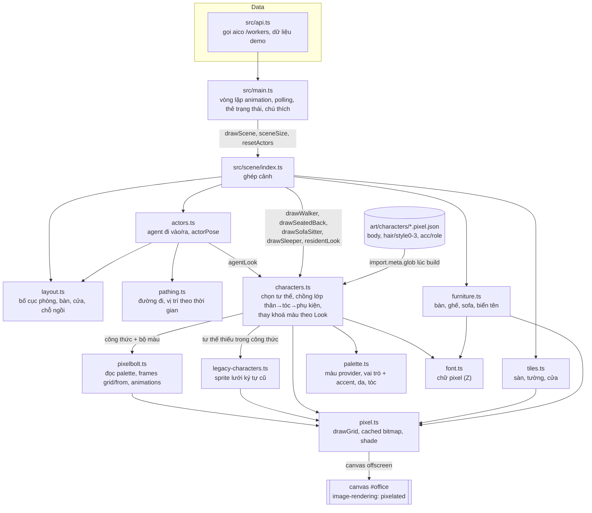

# T-cff2d329: Sprite nhân vật bằng Pixelbolt và bộ đọc công thức

Lần code: 2. File do aico tạo, cập nhật mỗi lần code.

## Đầu việc

| Id | Việc | Vai trò | Được sửa | Chờ | Kết quả |
| --- | --- | --- | --- | --- | --- |
| W1 | Vẽ công thức thân nhân vật và 4 lớp kiểu tóc bằng Pixelbolt | designer | `art/characters/body.pixel.json`, `art/characters/hair/` | - | chưa chạy |
| W2 | Vẽ công thức phụ kiện theo vai trò (cà vạt, tai nghe, kính, mũ nồi) | designer | `art/characters/acc/` | - | chưa chạy |
| W3 | Bộ đọc công thức Pixelbolt tối giản (src/scene/pixelbolt.ts) | coder | `src/scene/pixelbolt.ts` | - | chưa chạy |
| W4 | Ghép nối: characters.ts dùng công thức, fallback sprite cũ, README và docs/architecture.md | coder | `src/scene/characters.ts`, `src/scene/legacy-characters.ts`, `src/scene/palette.ts`, `README.md`, `docs/architecture.md` | W1, W2, W3 | chưa chạy |
| FIX | Sửa theo góp ý: [review bởi codex] | coder | `**` | - | xong |

## Kế hoạch

# Kế hoạch T-cff2d329: Sprite nhân vật bằng Pixelbolt và bộ đọc công thức

## Hiện trạng (đã đọc code)
- Repo chưa có `docs/architecture.md` và `docs/plans/`. Đầu việc ghép nối sẽ tạo `docs/architecture.md` theo sơ đồ cuối kế hoạch.
- `src/scene/characters.ts` vẽ nhân vật trên canvas 16×22 bằng lưới ký tự: đầu (`HEAD`), lớp tóc theo `style` 0–3 (`HAIR`), thân theo tư thế (`WALK`, `SIT_BACK`/`TYPING`, `SIT_SIDE`/`SIP`, `LIE`), phụ kiện vẽ bằng `rect` (`drawAccessory`). Bitmap được cache qua `cached()` trong `pixel.ts`, nhìn nghiêng quay trái thì lật ngang.
- Các hàm được dùng ở ngoài, phải giữ nguyên chữ ký:
  - `actors.ts` dùng `Look` và `agentLook`.
  - `index.ts` dùng `drawSeatedBack`, `drawSleeper`, `drawSofaSitter`, `drawWalker`, `drawZ` và `residentLook`.
- `#office` trong `src/style.css` đã có `image-rendering: pixelated`, chỉ cần giữ nguyên. `tsconfig` có `types: ["vite/client"]`, nên `import.meta.glob` gõ kiểu được mà không cần thêm thư viện.
- Quy ước màu của ticket ngược với code cũ: chữ thường là màu gốc, chữ HOA là màu sẫm. Ví dụ `h` là tóc, `H` là tóc sẫm. Code cũ thì `H` là tóc, `h` là tóc sẫm.

## Hợp đồng định dạng (chốt trước để designer và coder làm song song)
1. **Thư mục `art/characters/`**
   - `body.pixel.json`: nhân vật chưa có tóc riêng (đầu nhìn sau vẫn tô màu tóc `h`/`H` như `HEAD.back` cũ).
   - `hair/style0.pixel.json` … `hair/style3.pixel.json`: lớp tóc tương ứng `style` 0 ngắn, 1 mái, 2 dài, 3 búi.
   - `acc/tech_lead.pixel.json`, `acc/coder.pixel.json`, `acc/reviewer.pixel.json`, `acc/designer.pixel.json`: lớp phụ kiện.
2. **Kích thước và mốc đặt**
   - Mọi frame của mọi công thức là **16×22**. Đầu nằm trong vùng x 2–13, y 2–11. Thân bắt đầu từ y=12.
   - Tư thế đi: chân chạm hàng 21, giữa thân ở x=8.
   - `sit_back`: hàng 16 là mép dưới vai, vì code vẽ tại `bottom - 17`.
   - `sit_side`: quay phải, lưng sát mép trái.
   - `lie`: giữ vị trí như sprite `LIE` cũ.
   - Lấy sprite cũ làm mốc vị trí để không phải sửa toạ độ trong code.
3. **Tên animation:** `walk_down`, `walk_up`, `walk_left`, `walk_right` (mỗi hướng 2–4 frame), `sit_back` (2 frame gõ phím), `sit_side` (frame 0 cầm cốc, frame 1 nâng cốc), `lie` (1–2 frame).
   - Công thức tóc và phụ kiện dùng **cùng tên animation**. Thiếu animation nào thì tư thế đó không có lớp ấy (ví dụ kính khi nhìn từ sau).
4. **Khoá màu được thay theo agent:**

   | Khoá | Ý nghĩa |
   | --- | --- |
   | `h` / `H` | tóc / tóc sẫm |
   | `s` / `S` | da / da sẫm |
   | `t` / `T` | áo / áo sẫm |
   | `a` | phụ kiện |
   | `o` | viền |

   Các màu cố định khác (mắt, quần, giày, cốc, kim loại tai nghe…) dùng khoá riêng khai báo trong `palette` của công thức.
5. **Op được dùng:** chỉ `grid` (`rows` là chuỗi, `.` hoặc dấu cách là trong suốt), cộng thêm `from` để kế thừa frame và `palette`. Không dùng symbols, tilemap, text, compile, scene.
   - Nghĩa của `from`: chép lưới của frame gốc, sau đó các ô không trong suốt của `rows` đè lên.

## Các bước
1. **W1, designer: thân và tóc.** Vẽ `body.pixel.json` đủ 7 animation và 4 lớp tóc, theo phong cách cảnh: viền tối 1px, ít màu, tông ấm. Tự kiểm bằng `pixel_validate` và `pixel_inspect`, xem chồng lớp tóc lên thân ở từng tư thế.
2. **W2, designer: phụ kiện.** Vẽ 4 công thức trong `acc/` (cà vạt, tai nghe, kính, mũ nồi), bám mốc đầu và thân ở mục 2. Kiểm tra khi đặt chồng lên sprite cũ, vì vị trí giống nhau.
3. **W3, coder: bộ đọc `src/scene/pixelbolt.ts`.** Đây là file mới, không thêm thư viện:
   - kiểu `Recipe`;
   - `resolveFrame(recipe, name): string[]` xử lý `from` đệ quy, có chặn vòng lặp;
   - `animFrames(recipe, anim): string[] | null`;
   - `drawRecipeFrame(ctx, recipe, anim, frame, colors)`: trộn palette của công thức với `colors` rồi gọi `drawGrid`;
   - `bitmap(id, recipe, anim, frame, colors)` dùng `cached()` với khoá gồm (id công thức, anim, frame, bộ màu).

   Op lạ hoặc kích thước lệch thì `console.warn` một lần và coi như không có frame đó, không làm hỏng cảnh. Không sửa `pixel.ts`.
4. **W4, coder: ghép nối, phụ thuộc W1, W2, W3.**
   - Chuyển code lưới ký tự cũ sang `src/scene/legacy-characters.ts` (hàm `legacySprite(look, pose, view, frame, mirror)`).
   - Trong `characters.ts`:
     - nạp công thức bằng `import.meta.glob("../../art/characters/**/*.pixel.json", { eager: true, import: "default" })`;
     - dựng bộ màu từ `Look`: `h` = `look.hair`, `H` = `shade(hair, 0.72)`, `s`/`S` = `SKIN`/`SKIN_SHADE`, `t`/`T` = `shirt`/`shirtDark`, `o` = `OUTLINE`, `a` = màu phụ kiện theo vai trò;
     - chồng lớp theo thứ tự thân → `hair/style{look.style}` → `acc/{look.role}` vào canvas 16×22 qua `cached`;
     - chọn frame bằng `frame % frames.length`, với `sit_side` frame 1 là nâng cốc;
     - nếu `body` thiếu một animation thì dùng `legacySprite` cho tư thế đó. Riêng `walk_left` thiếu nhưng có `walk_right` thì lật ngang `walk_right`. `sit_side` cho sofa quay trái thì lật như cũ.
   - Thêm trường `accent` vào `RoleStyle` trong `palette.ts`: cà vạt `#d6454f`, tai nghe `#2b2f38`, kính `#21181f`, mũ `#c0392b`.
   - Giữ nguyên mọi export.
   - Cập nhật README (mục Cấu trúc thêm `art/characters/`, `pixelbolt.ts`, `legacy-characters.ts`; thêm mục "Thêm sprite mới") và tạo `docs/architecture.md`.

## File cần sửa
- Mới, phần vẽ: `art/characters/body.pixel.json`, `art/characters/hair/*.pixel.json`, `art/characters/acc/*.pixel.json`.
- Mới, phần code: `src/scene/pixelbolt.ts`, `src/scene/legacy-characters.ts`, `docs/architecture.md`.
- Sửa: `src/scene/characters.ts`, `src/scene/palette.ts`, `README.md`.
- Không sửa: `actors.ts`, `index.ts`, `pixel.ts`, `style.css`.

## Cách kiểm tra
1. `npm run build` qua, tức là cả `tsc --noEmit` lẫn `vite build`. Mở `dist/` và xác nhận JSON công thức đã nằm trong bundle.
2. Công thức: `pixel_validate` không lỗi; mọi frame 16×22; chỉ có op `grid`/`from`; đủ 7 animation trong `body`.
3. Chạy `npm run dev` ở chế độ demo, xem trọn kịch bản 48 giây:
   - đi 4 hướng, đúng chiều trái/phải;
   - ngồi bàn gõ phím 2 frame;
   - ngồi sofa nâng cốc, cả sofa quay trái lẫn quay phải;
   - phòng hết hạn mức thì nhân vật nằm ngủ, có chữ Z bay lên.
4. Các agent khác nhau có màu tóc và kiểu tóc khác nhau. Áo và phụ kiện đổi theo vai trò như bảng chú thích; vai trò lạ thì áo xám, không có phụ kiện. Nhân vật thường trực mang màu provider.
5. Kiểm tra fallback: tạm đổi tên animation `lie` trong `body.pixel.json` (không commit), cảnh phải hiện sprite ngủ cũ chứ không để trống.
6. Phóng to trình duyệt, ảnh vẫn sắc nét nhờ `image-rendering: pixelated`.

```json
{"items": [
  {"id": "W1", "title": "Vẽ công thức thân nhân vật và 4 lớp kiểu tóc bằng Pixelbolt", "role": "designer", "owns": ["art/characters/body.pixel.json", "art/characters/hair/"], "depends_on": [], "acceptance": "body.pixel.json có đủ walk_down/walk_up/walk_left/walk_right (2-4 frame), sit_back (2), sit_side (2, frame 1 nâng cốc), lie (1-2); hair/style0..3.pixel.json cùng tên animation. Mọi frame 16x22, chỉ op grid/from/palette, dùng khoá h/H (tóc, H sẫm), s/S, t/T, o; mốc đặt khớp sprite cũ (đầu x2-13 y2-11, chân chạm hàng 21). pixel_validate qua và đã xem lại bằng pixel_inspect."},
  {"id": "W2", "title": "Vẽ công thức phụ kiện theo vai trò (cà vạt, tai nghe, kính, mũ nồi)", "role": "designer", "owns": ["art/characters/acc/"], "depends_on": [], "acceptance": "acc/tech_lead, acc/coder, acc/reviewer, acc/designer .pixel.json; frame 16x22 trong suốt ngoài phụ kiện, cùng tên animation như body (thiếu animation = không hiện ở tư thế đó, ví dụ kính khi nhìn sau); màu chính dùng khoá a, viền o; chỉ op grid/from/palette; vị trí khớp đầu/thân theo mốc sprite cũ; pixel_validate qua."},
  {"id": "W3", "title": "Bộ đọc công thức Pixelbolt tối giản (src/scene/pixelbolt.ts)", "role": "coder", "owns": ["src/scene/pixelbolt.ts"], "depends_on": [], "acceptance": "Không thêm dependency. Export kiểu Recipe, resolveFrame (xử lý from đệ quy, chặn vòng lặp, ô trong suốt '.'/' ' không đè), animFrames, drawRecipeFrame (trộn palette công thức với bộ màu thay thế), bitmap cache qua cached() với khoá (id công thức, animation, frame, bộ màu). Op lạ hoặc kích thước lệch: warn một lần, trả null, không throw. tsc --noEmit qua."},
  {"id": "W4", "title": "Ghép nối: characters.ts dùng công thức, fallback sprite cũ, README và docs/architecture.md", "role": "coder", "owns": ["src/scene/characters.ts", "src/scene/legacy-characters.ts", "src/scene/palette.ts", "README.md", "docs/architecture.md"], "depends_on": ["W1", "W2", "W3"], "acceptance": "Nạp art/characters/**/*.pixel.json bằng import.meta.glob eager; mọi tư thế vẽ từ công thức (thân, tóc theo style, phụ kiện theo role), màu thay theo Look (tóc theo id, áo và accent phụ kiện theo vai trò, resident theo provider); tư thế thiếu trong công thức thì dùng sprite lưới cũ (chuyển sang legacy-characters.ts); walk_left thiếu thì lật walk_right. Giữ nguyên export Look, agentLook, residentLook, drawWalker, drawSeatedBack, drawSofaSitter, drawSleeper, drawZ, không sửa actors.ts/index.ts. npm run build qua; demo hiện đủ đi 4 hướng, gõ phím, nâng cốc, ngủ; README có mục cấu trúc mới và cách thêm sprite; docs/architecture.md chứa sơ đồ Mermaid khớp code."}
]}
```


