```mermaid
flowchart TD
  subgraph Data["Dữ liệu và logic thuần hiện có"]
    API["src/api.ts<br/>workers, snapshot tickets đầy đủ, actions<br/>demoWorkers 48 giây"]
    TK["src/tickets.ts<br/>parseTickets, needsYou, actions, MR, preview<br/>latestScreenshots: bộ ảnh mới nhất, tối đa 16<br/>demoNeedTickets kèm ảnh demo"]
    ACTV["src/activity.ts<br/>activity, screenFor, bubbles, progress"]
    USG["src/usage.ts"]
    TIME["src/time.ts"]
    LATEST["src/latest.ts<br/>createLatestGate"]
    ATT["src/attention.ts"]
  end
  API --> TK
  ACTV --> USG

  SHOTS["public/demo-shots/ + art/demo-shots/<br/>ảnh pixel demo theo thời điểm/file.png"]
  SHOTS -.->|url tuyệt đối theo BASE_URL| TK

  COL["src/needs-column.ts + CSS<br/>gate chấp nhận snapshot<br/>lọc items cho panel, giữ xác nhận/ghi chú<br/>hàng ảnh thu nhỏ, ảnh lỗi thành link"]
  VIEWER["src/shot-viewer.ts + CSS<br/>lightbox trên body: ←/→, Esc, trả focus"]
  API -->|cùng request tickets| COL
  LATEST --> COL
  COL --> TK
  COL -->|mở ảnh, đóng khi thẻ mất/đổi nguồn| VIEWER
  COL -->|actions| API
  COL -->|snapshot đầy đủ đã chấp nhận| MAIN
  COL -->|NeedItem đã lọc| MAIN

  MAIN["src/main.ts<br/>poll, nguồn, giờ địa phương hoặc hour<br/>reduced motion, vòng animation, chọn agent<br/>ghi --feed-left/--feed-room"]
  API --> MAIN
  LATEST --> MAIN
  ATT --> MAIN
  MAIN -->|demo assetBase| TK

  subgraph UI["Khung UI"]
    VP["ui/viewport.ts<br/>computeInsets, fitScene<br/>feedBox: left/bề rộng feed theo sidebar, drawer"]
    FM["ui/feed-model.ts<br/>FeedLine: ticket, tone<br/>dòng hết hạn mức theo chuyển trạng thái phòng"]
    SEL["ui/selection.ts"]
    FMT["ui/format.ts"]
    TOK["ui/tokens.css<br/>--feed-max"]
    TOP["ui/topbar.ts + CSS"]
    SIDE["ui/sidebar.ts + CSS"]
    AV["ui/avatar.ts"]
    DRW["ui/drawer.ts + CSS"]
    FEED["ui/feed.ts + CSS<br/>khung nổi góc dưới trái, ticker khi thu gọn<br/>dòng lưới: giờ, avatar, tên, chip phòng, ticket, icon, nội dung<br/>tự cuộn, viên N mới, phím ]"]
    NEEDS["#needs trong drawer"]
    TOAST["toasts.ts + CSS"]
  end
  MAIN --> VP
  MAIN --> FM
  MAIN --> SEL
  MAIN --> TOP
  MAIN --> SIDE
  MAIN --> DRW
  MAIN -->|lines + workers| FEED
  FEED -->|onAgent phòng+id → selectAgent<br/>onTicket → showNeeds| MAIN
  MAIN --> TOAST
  TOP --> FMT
  SIDE --> FMT
  SIDE --> AV
  FEED --> AV
  FEED --> FMT
  FEED --> PAL
  FMT --> USG
  FMT --> ACTV
  FM --> ACTV
  DRW --> TK
  DRW --> ACTV
  DRW --> TIME
  DRW --> NEEDS
  COL --> NEEDS
  TOK -.-> TOP
  TOK -.-> SIDE
  TOK -.-> DRW
  TOK -.-> FEED
  TOK -.-> COL
  TOK -.-> VIEWER

  DEMO["scene/demo-events.ts<br/>snapshot định kỳ, cùng bộ phát hiện"]
  EVENTS["scene/room-events.ts<br/>so snapshot, MR mới/done/escalated<br/>nhớ ticket-provider, dedup, TTL 10 giây"]
  DEMO --> MAIN
  MAIN -->|snapshot và liên hệ agent.ticket_id| EVENTS
  EVENTS -->|banner đang sống| MAIN

  IDX["scene/index.ts<br/>ghép cảnh, SceneFigure và dữ liệu biển phòng"]
  MAIN -->|workers, thời gian, reduced motion| IDX
  LAYOUT["scene/layout.ts<br/>thuần: phòng/bàn/ghế, ngoại cảnh, sceneSize"]
  OUT["scene/outdoor.ts<br/>seed thuần, cây/đèn/lối đi/đường<br/>vẽ ngoại cảnh và xe"]
  CACHE["Canvas cache nền tĩnh<br/>khóa hình học, palette, seed"]
  TILES["scene/tiles.ts<br/>tường, sàn, cửa"]
  ACT["scene/actors.ts<br/>seated chỉ khi cuối path đúng ghế hiện tại"]
  PATH["scene/pathing.ts<br/>thuần"]
  FURN["scene/furniture.ts<br/>đồ đạc, đồng hồ, màn hình"]
  BOARD["scene/usage-board.ts"]
  CHAR["scene/characters.ts"]
  PB["scene/pixelbolt.ts"]
  LEG["scene/legacy-characters.ts"]
  ART["art/characters/*.pixel.json"]
  PAL["scene/palette.ts<br/>màu chung, ngoại cảnh, ánh sáng, banner"]
  PIX["scene/pixel.ts"]
  LIGHT["scene/lighting.ts<br/>độ sáng thuần và lightmap canvas cache<br/>bucket 5 phút, hình học, nguồn sáng"]

  IDX --> LAYOUT
  IDX --> OUT
  IDX --> CACHE
  CACHE --> OUT
  CACHE --> TILES
  IDX --> ACT
  ACT --> LAYOUT
  ACT --> PATH
  IDX --> FURN
  IDX --> BOARD
  BOARD --> USG
  IDX --> ACTV
  IDX --> CHAR
  AV --> CHAR
  ART --> CHAR
  CHAR --> PB
  CHAR --> LEG
  CHAR --> PAL
  OUT --> PAL
  LIGHT --> PAL
  FURN --> PAL
  TILES --> PIX
  OUT --> PIX
  FURN --> PIX
  PB --> PIX
  IDX -->|phút địa phương, layout, nguồn sáng| LIGHT

  CANVAS["canvas #office<br/>nền cache → phần động → lightmap multiply"]
  CACHE -->|drawImage mỗi frame| CANVAS
  IDX -->|đồ đạc, nhân vật, xe| CANVAS
  LIGHT -->|drawImage multiply mỗi frame| CANVAS
  VP -->|vùng trống, focus, vị trí feed| MAIN

  OVL["src/overlay.ts<br/>chữ DPR: hoạt động, progress<br/>biển phòng, banner và confetti hữu hạn"]
  TIP["src/agent-tooltip.ts + CSS<br/>hit-test và xem nhanh"]
  MAIN -->|figures, biển phòng, banner| OVL
  MAIN -->|figures và chọn agent| TIP
  OVL --> ACTV
  OVL --> PAL
  TIP --> ACTV
  OVL --> SCREEN["Lớp chữ trên cảnh"]
  CANVAS --> SCREEN

  TEST["Vitest<br/>outdoor, lighting, room-events, demo-events<br/>snapshot gate, overlay, renderer, main, viewport + feedBox<br/>feed-model ticket/tone/hết hạn mức, feed DOM<br/>latestScreenshots, shot-viewer, hàng ảnh thẻ<br/>giữ actors và mọi test cũ"]
  TEST -.-> OUT
  TEST -.-> LIGHT
  TEST -.-> EVENTS
  TEST -.-> COL
  TEST -.-> TK
  TEST -.-> VIEWER
  TEST -.-> OVL
  TEST -.-> IDX
  TEST -.-> MAIN
  TEST -.-> ACT
  TEST -.-> VP
  TEST -.-> FM
  TEST -.-> FEED
```

# T-d36e23da: GUI: làm lại khung Hoạt động theo kiểu feed của Habblaud

Lần code: 3. File do aico tạo, cập nhật mỗi lần code.

## Đầu việc

| Id | Việc | Vai trò | Được sửa | Chờ | Kết quả |
| --- | --- | --- | --- | --- | --- |
| W1 | feed-model: thêm trường ticket, tone và dòng hết hạn mức | coder | `src/ui/feed-model.ts`, `src/ui/feed-model.test.ts` | - | chưa chạy |
| W2 | feed.ts + feed.css: khung nổi, đầu khung, dòng lưới, cuộn, màn hẹp | coder | `src/ui/feed.ts`, `src/ui/feed.css`, `src/ui/feed.test.ts`, `src/ui/tokens.css` | - | chưa chạy |
| W3 | viewport: hàm thuần feedBox cho vị trí và bề rộng khung feed | coder | `src/ui/viewport.ts`, `src/ui/viewport.test.ts` | - | chưa chạy |
| W4 | Ghép nối main.ts, README (bố cục, cấu trúc, ghi công Habblaud), ảnh chụp | coder | `src/main.ts`, `src/main.test.ts`, `README.md` | W1, W2, W3 | chưa chạy |
| FIX | Sửa theo góp ý: [review bởi codex] | coder | `**` | - | xong |

## Kế hoạch

Mình đã đọc xong AGENTS.md, architecture.md, các file feed, main.ts, viewport.ts, tokens.css, avatar/topbar/selection/activity, giờ viết kế hoạch.

# Kế hoạch T-d36e23da: làm lại khung Hoạt động theo kiểu feed của Habblaud

## Những gì đọc được trong code

- **Vị trí khung:** `feed.css` đang ghim khung từ trái sang phải màn (`left/right: var(--gap)`). `drawer.css` cũng dừng ở `bottom: calc(var(--feed-h) + 2*gap)`. `sidebar.css` dừng ở `--free-bottom`. Nghĩa là cả thanh bên lẫn ngăn phải đều kết thúc **phía trên** dải feed. Vì vậy khung nổi mới có thể nằm ngang hàng với cột thanh bên và ngăn phải mà không chồng lên chúng theo chiều dọc. Không cần sửa `sidebar.css` hay `drawer.css`.
- **Viewport:** `computeInsets` chỉ dùng `feed.top` để tính `bottom` và không quan tâm bề ngang. Khung hẹp lại thì cảnh vẫn chừa đáy như cũ, tức không che cảnh hơn hiện nay. **Giữ nguyên `computeInsets`**, chỉ thêm một hàm thuần tính `left` và bề rộng còn trống cho khung.
- **Dữ liệu dòng:** `FeedLine` chưa có `ticket` và chưa có cờ lỗi. `reduceFeed` bỏ qua phòng `limited`, nên hiện không có dòng "hết hạn mức" nào. Ticket muốn tô đỏ loại dòng này, nên phải thêm nguồn ra dòng: phòng **chuyển sang** `limited`.
- **Phím `]`:** `main.ts` chặn phím `]` trước (`stopImmediatePropagation`). `feed.ts` có listener riêng để chạy độc lập. Giữ cả hai.
- **Font tiêu đề:** `tokens.css` ghi rõ Pixelify Sans không có dấu tiếng Việt, còn `.sidebar-title` thực ra dùng `--font-ui` 700. Nên "font như tiêu đề Phòng" sẽ là `--font-ui` đậm, cỡ 13.5px. **Không dùng `.title-pixel` cho chữ "Hoạt động"** vì chữ ộ sẽ vỡ.
- **Chip phòng:** dùng `providerLetter(name)` cùng màu nền `paletteOf(worker).shirt`, giống `topbar.ts`.
- **Agent "không còn trong phòng":** xác định giống `resolveSelection`: phòng offline/limited, hoặc `worker.agents` không có id đó. So theo phòng + id, bỏ qua `started_at`, để agent quay lại thì dòng cũ hết mờ. Như vậy dòng bị mờ đúng khi không chọn được agent đó.

## Hợp đồng chung (các đầu việc song song phải bám đúng)

```ts
// src/ui/feed-model.ts
export interface FeedLine {
  key: string; at: string; room: string; agentId: string | null; name: string; icon: string; text: string;
  ticket: string | null;                       // agent.ticket_id (chuỗi khác rỗng) | id ticket của dòng ticket | null
  tone: "need" | "done" | "error" | null;      // need: '!' cần người; done: '✓'; error: escalated / hết hạn mức / activity.error
}
export interface FeedState { /* như cũ */ rooms: ReadonlyMap<string, WorkerStatus["state"]> }

// src/ui/viewport.ts
export const FEED_MIN = 320;
export function feedBox(view: Size, panels: { sidebar?: Rect | null; drawer?: Rect | null },
  opts: { gap: number; narrow: boolean }): { left: number; room: number };

// src/ui/feed.ts
createFeed(root, { onAgent?(room: string, agentId: string): void; onTicket?(id: string): void })
  → { setCollapsed, onLayout, render(lines, workers?: readonly WorkerStatus[]), destroy }
```

Biến CSS do `main.ts` ghi: `--feed-left` và `--feed-room` (đơn vị px). `feed.css` dùng `left: var(--feed-left, var(--gap)); width: min(var(--feed-max), var(--feed-room, …))`.

## Các bước

**1. Model (W1): `feed-model.ts`**
- Dòng agent: `ticket = agent.ticket_id` nếu là chuỗi khác rỗng, không thì `null`. `tone = "error"` nếu `a.error`.
- Dòng ticket: `ticket = item.ticket.id`. `tone` là `"done"` khi đã xử lý, `"error"` khi `kind === "escalated"`, còn lại `"need"`.
- Thêm `rooms` vào state. Khi phòng chuyển **sang** `limited` (kể cả lần đầu thấy đã `limited`; giữ trí nhớ khi phòng tạm vắng khỏi danh sách), thêm dòng:
  `{ key: "limit:<seq>", room, agentId: null, name: room, icon: "⏳", text: "hết hạn mức", ticket: null, tone: "error" }`.
  Chỉ thêm khi `now` hữu hạn.
- `createFeedState` và `resetFeed` tạo `rooms` rỗng. Không sửa state đầu vào.

**2. Hàm thuần bố cục (W3): `viewport.ts`**
- `feedBox`:
  - Màn hẹp: `{ left: gap, room: w - 2*gap }`.
  - Màn rộng: `left = sidebar ? sidebar.right + gap : gap` và `right = drawer ? drawer.left - gap : w - gap`.
  - Nếu `room < FEED_MIN` thì bỏ ràng buộc drawer trước, rồi tới sidebar. Làm được vì hai panel này không chồng khung theo chiều dọc.
  - Kẹp kết quả về ≥ 0, đầu vào NaN không làm hỏng kết quả.
- `computeInsets` giữ nguyên.

**3. Giao diện khung (W2): `feed.ts`, `feed.css`, `tokens.css`**
- **Token:** thêm `--feed-max: 700px` vào `tokens.css`.
- **Đầu khung:**
  - Nút tiêu đề `.feed-title` ("Hoạt động", `--font-ui` 700, 13.5px) và nút mũi tên `.feed-chevron` (▾/▴). Cả hai gọi `setCollapsed` và cùng giữ `aria-expanded`.
  - `.feed-ticker`: một dòng, màu `--text-dim`, cắt bằng `…`, nội dung `${name}: ${icon} ${text}` của dòng cuối. Chỉ hiện khi thu gọn và có dòng.
  - Viên `.feed-new` ("N mới"): bo tròn, nền accent nhạt (lấy từ token có sẵn: `--hover` cộng chữ `--accent`).
- **Dòng:** mỗi dòng là `<button class="feed-line">` cao 26px, lưới một hàng, `white-space: nowrap`. Thứ tự cột: `time.feed-time` (mono 11px, tabular-nums) | `.feed-avatar` (`createAvatar(agent)` nếu tìm thấy agent trong workers; dòng ticket hiện icon 🎫; còn lại để trống; cỡ avatar ép 18px trong `feed.css`) | `.feed-name` (650, cắt …) | `.feed-room` (chip chữ cái, nền inline `paletteOf(worker).shirt`; không có worker thì nền `--line-strong`) | `.feed-ticket` (mờ) | `.feed-icon` | `.feed-text` (cắt …).
  - `title` của dòng: `giờ · tên · phòng · ticket` (bỏ phần rỗng) + nội dung đầy đủ.
  - Lớp CSS: `.tone-need .feed-icon` dùng `--st-need`, `.tone-done .feed-icon` dùng `--lvl-ok`, `.tone-error` cho chữ màu đỏ nhạt (`--lvl-crit` + opacity hoặc `color-mix`), `.is-gone` có `opacity: .55`. Hover dùng nền `--hover`, bo 6px.
  - Chỉ dựng lại DOM khi chữ ký dòng (nội dung + có mặt + màu phòng + `avatarIdentity`) đổi.
- **Bấm dòng:** dòng có `agentId` gọi `onAgent(room, agentId)`. Dòng không có agent nhưng có `ticket` gọi `onTicket(ticket)`. Dòng hết hạn mức không làm gì.
- **Cuộn:**
  - `follow = atEnd() && !hovering`. `pointerenter`/`pointerleave` trên danh sách bật/tắt `hovering`. Sự kiện `scroll` về cuối thì xoá bộ đếm.
  - Khi `render` mà không follow: cộng số key mới vào `pending`, hiện viên `N mới`. Bấm viên thì cuộn xuống cuối và đặt `pending = 0`.
  - Rời chuột khi chưa tự cuộn lên thì nhảy xuống cuối.
  - Giữ nguyên thuật toán neo dòng hiện có.
  - `render([])` đặt `pending = 0`, ẩn ticker, hiện chữ rỗng.
- **Rỗng:** `.feed-empty` "Hoạt động của agent sẽ hiện ở đây." màu mờ.
- **Màn rộng (CSS):**
  - `left: var(--feed-left, var(--gap)); bottom: var(--gap); width: min(var(--feed-max), var(--feed-room, calc(100vw - 2*var(--gap))))`, cao `--feed-h`. Thu gọn thì cao `auto`, chỉ còn đầu khung.
  - `transition: left .3s var(--ease), width .3s var(--ease)`; tắt trong `@media (prefers-reduced-motion: reduce)`.
- **Màn hẹp (<900px):**
  - `left/right: var(--gap); width: auto`. Thu gọn chỉ còn tiêu đề, ticker và mũi tên. Mở ra cao `45vh`, ẩn `.feed-ticket` và `.feed-room`.
  - `max-width: calc(100vw - 2*gap)` và `min-width: 0` ở mọi cột để không cuộn ngang trang.
  - Màn hẹp lúc tạo thì khởi đầu ở trạng thái thu gọn.
- **Tiêu chí CSS:** chỉ dùng biến, không có mã màu mới ngoài `tokens.css`. Không đụng tới topbar, sidebar, drawer, cột Cần bạn.

**4. Ghép nối (W4, sau W1–W3): `main.ts`, `main.test.ts`, `README.md`**
- Tạo feed bằng `createFeed(feedRoot, { onAgent, onTicket: showNeeds })`.
  - `onAgent` tìm agent trong `workers` theo phòng + id (bỏ qua phòng offline/limited, giống `resolveSelection`), rồi gọi `selectAgent(agentKey(room, agent))`. Không tìm thấy thì không làm gì.
- `absorbFeed` và `changeSource` gọi `render(lines, workers)`.
- `relayout()` gọi `feedBox(...)` với `panelRect(sidebarRoot)` và `panelRect(drawerRoot)`, rồi ghi `--feed-left` và `--feed-room`. Phải gọi trước khi đo `panelRect(feedRoot)`.
  - Không có vòng lặp: vị trí ngang của feed chỉ phụ thuộc sidebar/drawer. `ResizeObserver` đã theo dõi `feedRoot` nên khi khung chạy transition xong thì relayout lại.
- `README.md`:
  - Đoạn "Bố cục": feed nổi góc dưới trái, rộng tối đa 700px; màn hẹp là thanh thu gọn, mở ra cao 45vh.
  - Bảng "Cấu trúc": thêm `src/ui/feed.test.ts`, sửa mô tả `feed.ts`.
  - Thêm mục **Ghi công**, một dòng: "Kiểu feed hoạt động học theo Habblaud (MIT, github.com/marmottajr/habblaud), không chép code."
- Chụp ảnh bằng `aico-shot` ở chế độ demo: 1440x900 và 390x844, mỗi cỡ một ảnh mở và một ảnh thu gọn.

## Cách kiểm tra

- `npm run build` và `npm test` phải qua (mỗi đầu việc tự chạy; W4 chạy toàn bộ).
- **`feed-model.test.ts`:**
  - Trường `ticket` của dòng agent (có, thiếu, sai kiểu hoặc rỗng thì `null`) và của dòng ticket.
  - `tone`: need, done, escalated thành error, activity lỗi thành error.
  - Dòng hết hạn mức theo các kịch bản dữ liệu đổi:
    - working → limited → limited → working → limited: đúng 2 dòng.
    - Lần đầu thấy đã `limited`: 1 dòng.
    - Phòng biến mất rồi xuất hiện lại vẫn `limited`: không thêm dòng.
    - offline → limited: thêm 1 dòng.
    - `now` NaN: không thêm.
    - `resetFeed` xoá `rooms`.
  - Mọi test cũ giữ nguyên.
- **`viewport.test.ts`:** `feedBox` với mọi tổ hợp sidebar mở/thu (44px)/ẩn và drawer mở/đóng ở 1440. Màn 1000px cả hai mở thì bỏ drawer trước. Màn hẹp 390 ra `{10, 370}`. NaN hoặc màn 30px không ra số âm. Test `computeInsets` cũ giữ nguyên.
- **`feed.test.ts` (mới, DOM giả kiểu `drawer.test.ts`):** đủ các cột, `title`, các lớp `tone-*` và `is-gone`, ticker khi thu gọn, viên "N mới" khi đã cuộn lên, bấm dòng agent/ticket, phím `]` cùng `aria-expanded`. Chi tiết nằm trong acceptance của W2.
- **`main.test.ts`:** bấm dòng agent mở ngăn Agent và chọn đúng key. Bấm dòng của agent đã đi không mở ngăn. Bấm dòng ticket gọi `showNeeds` và focus thẻ; ticket đã xử lý thì không lỗi. `relayout` ghi `--feed-left` theo sidebar mở/thu và drawer mở/đóng. Phím `]` vẫn thu/mở. Đổi nguồn làm feed rỗng và ẩn viên.
- **Xem tay ở demo 48 giây:** kiểm khung trượt theo sidebar `[` và drawer, tắt chuyển động khi bật reduced motion, cảnh không bị khung che. Ở 390px không có thanh cuộn ngang.

```json
{"items": [
  {"id": "W1", "title": "feed-model: thêm trường ticket, tone và dòng hết hạn mức", "role": "coder",
   "owns": ["src/ui/feed-model.ts", "src/ui/feed-model.test.ts"], "depends_on": [],
   "acceptance": "FeedLine thêm ticket: string|null (agent.ticket_id là chuỗi khác rỗng; dòng ticket là id ticket) và tone: 'need'|'done'|'error'|null theo đúng hợp đồng trong kế hoạch; FeedState thêm rooms. Test dữ liệu đổi giữa chừng: ticket_id thiếu, sai kiểu hoặc rỗng thì null; escalated ra tone error, activity.error ra error, ticket đã xử lý ra done; phòng working→limited→limited→working→limited ra đúng 2 dòng hết hạn mức; lần đầu đã limited ra 1 dòng; phòng biến mất rồi xuất hiện lại vẫn limited thì không lặp; offline→limited ra 1 dòng; now NaN không thêm; resetFeed() bằng createFeedState() và không sửa state đầu vào; mọi test cũ vẫn qua. npm run build và npm test qua."},
  {"id": "W2", "title": "feed.ts + feed.css: khung nổi, đầu khung, dòng lưới, cuộn, màn hẹp", "role": "coder",
   "owns": ["src/ui/feed.ts", "src/ui/feed.css", "src/ui/feed.test.ts", "src/ui/tokens.css"], "depends_on": [],
   "acceptance": "Theo bước 3 và hợp đồng createFeed(root, {onAgent, onTicket}) và render(lines, workers). Token --feed-max: 700px; chỉ dùng biến màu có sẵn. Tiêu đề dùng --font-ui 700 13.5px (Pixelify không có dấu tiếng Việt), mũi tên ▾/▴, aria-expanded đúng, phím ] chạy và bỏ qua khi đang gõ chữ. Test feed.test.ts (DOM giả): mỗi dòng đủ 7 cột theo thứ tự, title chứa giờ · tên · phòng · ticket + nội dung đầy đủ; tone-need, tone-done, tone-error và is-gone gán đúng; agent rời phòng thì dòng mờ, quay lại (cùng id) hết mờ; phòng offline/limited thì mờ; phòng mất khỏi workers thì chip vẫn có chữ cái và không lỗi; ticker hiện dòng mới nhất khi thu gọn và đổi theo khi có dòng mới; rỗng thì hiện chữ trống, không có ticker; đã cuộn lên mà thêm 3 dòng thì viên '3 mới', thêm 2 nữa thì '5 mới', bấm viên thì về cuối và ẩn viên; đang rê chuột thì không tự cuộn; feed cắt dòng đầu khi đang cuộn lên thì dòng neo giữ chỗ; render([]) đặt lại bộ đếm; bấm dòng agent gọi onAgent(room, id), dòng ticket gọi onTicket(id), dòng hết hạn mức không gọi gì. CSS: left/width chuyển 0.3s var(--ease), tắt khi prefers-reduced-motion; <900px là thanh nổi chỉ có tiêu đề + ticker + mũi tên, mở ra 45vh, ẩn cột ticket và chip phòng, không cuộn ngang ở 390px. npm run build và npm test qua."},
  {"id": "W3", "title": "viewport: hàm thuần feedBox cho vị trí và bề rộng khung feed", "role": "coder",
   "owns": ["src/ui/viewport.ts", "src/ui/viewport.test.ts"], "depends_on": [],
   "acceptance": "Thêm FEED_MIN và feedBox(view, {sidebar, drawer}, {gap, narrow}) đúng chữ ký trong kế hoạch, thuần, không DOM; computeInsets và fitScene giữ nguyên, test cũ qua. Test: 1440x900 với sidebar mở (left 324), thu gọn 44px (left 64), ẩn (left 10); drawer mở thì room = drawer.left - gap - left, drawer đóng thì tới w - gap; màn 1000px cả hai mở thì bỏ drawer trước, rồi bỏ sidebar nếu vẫn dưới FEED_MIN; màn hẹp 390 ra {left 10, room 370}; NaN hoặc màn 30px không ra số âm hay NaN. npm run build và npm test qua."},
  {"id": "W4", "title": "Ghép nối main.ts, README (bố cục, cấu trúc, ghi công Habblaud), ảnh chụp", "role": "coder",
   "owns": ["src/main.ts", "src/main.test.ts", "README.md"], "depends_on": ["W1", "W2", "W3"],
   "acceptance": "main tạo feed với onAgent (tìm agent theo phòng + id, bỏ phòng offline/limited, rồi selectAgent(agentKey)) và onTicket = showNeeds; absorbFeed và changeSource gọi render(lines, workers); relayout ghi --feed-left và --feed-room từ feedBox trước khi đo #feed, computeInsets vẫn nhận panelRect(#feed). main.test: bấm dòng agent mở tab Agent đúng key; agent đã đi hoặc phòng chuyển limited giữa chừng thì bấm không mở ngăn; bấm dòng ticket mở Cần bạn và focus thẻ, ticket đã xử lý thì không lỗi và không đổi focusedTicket; sidebar thu/mở và drawer mở/đóng làm đổi --feed-left/--feed-room; phím ] vẫn thu/mở đúng một lần; đổi nguồn (demo ↔ thật) làm feed rỗng và ẩn viên N mới; poll lỗi giữ nguyên feed. README: cập nhật đoạn Bố cục, bảng Cấu trúc (thêm feed.test.ts), mục Ghi công một dòng Habblaud (MIT). Chụp aico-shot 1440x900 và 390x844, mỗi cỡ cả mở và thu gọn, cảnh không bị khung che lệch. npm run build và npm test qua."}
]}
```


