# T-de61a515: GUI: dùng logo AX làm logo AICO Office (thanh trên, favicon)

Lần code: 2. File do aico tạo, cập nhật mỗi lần code.

## Đầu việc

| Id | Việc | Vai trò | Được sửa | Chờ | Kết quả |
| --- | --- | --- | --- | --- | --- |
| W1 | Tách nền sạch và xuất bộ logo AX tái lập được | coder | `scripts/export-brand.py`, `public/brand/` | - | chưa chạy |
| W2 | Gắn logo vào thanh trên, khai báo icon và kiểm hồi quy dữ liệu | coder | `src/ui/topbar.ts`, `src/ui/topbar.css`, `src/ui/topbar.test.ts`, `index.html` | - | chưa chạy |
| W3 | Ghép nối, kiểm nghiệm demo và hoàn tất tài liệu bàn giao | coder | `README.md`, `art/brand-review/` | W1, W2 | chưa chạy |
| FIX | Sửa theo góp ý: [review bởi codex] | coder | `**` | - | xong |

## Kế hoạch

Kế hoạch T-de61a515 dựa trên `AGENTS.md`, `docs/architecture.md`, kế hoạch trước `docs/plans/T-8d17b253.md`, README và code thanh trên hiện tại. Tool chỉ đọc file, không liệt kê được `docs/plans/`; đã đọc kế hoạch được kiến trúc hiện tại dẫn tới. Không sửa code trong lượt này.

Thanh trên tạo logo một lần trong `createTopbar()`; `update()` chỉ cập nhật bộ đếm và hạn mức. Đây là vị trí phù hợp để giữ logo độc lập với dữ liệu. CSS hiện dùng ô nền accent 34px, xuống 28px dưới 900px; cần bỏ kiểu ô này và thay bằng ảnh khoảng 20px. `index.html` hiện chưa khai báo icon; `image-rendering: pixelated` trong `src/style.css` chỉ áp dụng canvas.

**Các lựa chọn chốt**

- Xuất PNG: `logo-ax-{512,192,64,32,16}.png` và `apple-touch-icon.png` 180×180 trong `public/brand/`. Chưa cần ICO.
- Dùng bản 64px cho thanh trên, cao 20px, rộng tự động, không co méo; giữ hành vi ẩn `.brand-text` dưới 900px và `alt=""`.
- Dùng trực tiếp `import.meta.env.BASE_URL` trong TypeScript và `%BASE_URL%` trong HTML. Không tạo helper đường dẫn nếu phép nối đơn giản đủ dùng.
- Logo là ảnh mượt từ nguồn chủ sở hữu, không vẽ lại thành pixel art. Vì vậy không có đầu việc designer/`.pixel.json`; các phần xử lý ảnh và giao diện đều giao coder.
- Script Python với Pillow chạy riêng trong môi trường ảo, không đổi dependencies ứng dụng. Không thêm fallback, retry hoặc tính năng offline.

**Các bước và file**

1. **W1 — Chuẩn hoá ảnh, chạy song song với W2.**  
   Tạo `scripts/export-brand.py`, chỉ đọc `art/brand/logo-ax-source-black.png`. Tách vùng nền đen nối với biên ảnh, dựng mask phần logo, loại nhiễu ngoài hình; giữ ruột trắng và gradient đục. Xử lý mép để loại màu đen đã trộn với nền, không chỉ đổi độ sáng thành alpha vì sẽ làm viền màu bán trong suốt. Crop theo hình, đặt giữa khung vuông với lề đối xứng, rồi resize bằng bộ lọc chất lượng cao có xử lý alpha để tránh quầng. Xuất bộ PNG đã chốt. Kiểm tra trực quan trước khi chấp nhận kết quả; không coi thuật toán tách nền tự động là bằng chứng đủ cho TC1.

2. **W2 — Thanh trên, icon và test.**  
   Sửa `src/ui/topbar.ts`, `src/ui/topbar.css`, `index.html`, `src/ui/topbar.test.ts`. Thay `▣` bằng `` có `alt=""`, nguồn `${import.meta.env.BASE_URL}brand/logo-ax-64.png`; bỏ lớp/kiểu dành cho ký tự và nền accent. Đặt `image-rendering: auto`, giữ tỉ lệ và kích thước ở cả hai breakpoint. Thêm favicon PNG 16/32 với `sizes`, `type` và apple-touch-icon 180 dùng `%BASE_URL%brand/...`.  
   Mở rộng DOM giả hiện có vừa đủ để kiểm ảnh, thuộc tính, đường dẫn ở root/subpath và việc `update()` không thay node ảnh. Kiểm bộ đếm và điều khiển qua các snapshot dữ liệu đổi giữa chừng, không sửa logic poll hoặc scene.

3. **W3 — Ghép nối và bàn giao, chờ W1 và W2.**  
   Kiểm tên asset trùng với mọi tham chiếu, chạy kiểm chứng tổng thể và cập nhật `README.md`: bảng Cấu trúc có `art/brand/`, `public/brand/`, script và file test thay đổi; ghi lệnh tạo môi trường Python, phiên bản Pillow đã dùng, lệnh xuất lại và nguồn ảnh chính. Lưu ảnh bằng chứng trong `art/brand-review/`.  
   Hệ thống tự cập nhật `docs/plans/` và `docs/architecture.md` theo kế hoạch/sơ đồ cuối; không giao hai đường dẫn này cho agent. Khi nghiệm thu, đối chiếu sơ đồ với code thực tế, nhất là đường BASE_URL và việc pipeline ảnh chỉ chạy ngoài runtime.

**Kiểm tra và điều kiện hoàn tất**

- **TC1–TC2:** kiểm alpha, kích thước và bounding box bằng script; xem từng ảnh trên nền trắng, tối, caro. Ruột trắng/viền màu alpha 255, nền ngoài alpha 0; bán trong suốt chỉ ở mép. Xem 16/32 ở kích thước thật và phóng lớn để phát hiện nét bị cắt, nhiễu, quầng; hình AX vẫn nhận ra được.
- **TC3–TC4:** chạy demo không token, xem ở 1440px, 390px và đổi qua lại 899/900px. Logo khoảng 20px, sắc nét, không méo/chồng điều khiển; chữ tên ẩn đúng hành vi cũ. Kiểm computed style của ảnh không phải `pixelated`.
- **TC5–TC6:** chạy `npm ci`, `npm run build`, `npm test`; kiểm cả bản build root và `npm run build -- --base=/preview/T-de61a515/`. Phục vụ đúng base tương ứng, mở trực tiếp và reload; Network không có 404 cho ba loại ảnh. Xoá cache icon hoặc dùng hồ sơ trình duyệt sạch, xác nhận favicon thực trên tab; trên thiết bị hỗ trợ, thêm vào màn hình chính để kiểm apple-touch-icon. Chụp tab bằng công cụ chụp cửa sổ trình duyệt vì ảnh viewport thường không chứa thanh tab.
- **TC7 — dữ liệu đổi giữa chừng:** xem ít nhất một chu kỳ demo 48 giây và bổ sung snapshot test:
  - Số agent tăng/giảm, kể cả về 0: logo giữ node/src/kích thước, bộ đếm cập nhật đúng.
  - Agent mất rồi xuất hiện lại: logo giữ nguyên, trạng thái và bộ đếm phục hồi.
  - Phòng offline rồi online: logo đã tải vẫn hiện; hạn mức, trạng thái và điều khiển hoạt động như trước.
  - Lặp các chuyển đổi trên khi đổi màn rộng/hẹp; thử Cài đặt, đóng popover và Demo. Không bổ sung cơ chế tải logo khi mất mạng.
- **TC8:** hai lệnh build/test đều qua; không thêm dependency runtime. Có ảnh thanh trên rộng/hẹp, favicon trên tab và bằng chứng kiểm icon điện thoại. Bàn giao ghi rõ lệnh/kết quả, kiểm tra nào chưa chạy và lý do; thiếu kiểm tra thiết bị thì TC5 vẫn còn mở.

```json
{
  "items": [
    {
      "id": "W1",
      "title": "Tách nền sạch và xuất bộ logo AX tái lập được",
      "role": "coder",
      "owns": [
        "scripts/export-brand.py",
        "public/brand/"
      ],
      "depends_on": [],
      "acceptance": "TC1–TC2, phần script của TC8: chỉ dùng art/brand/logo-ax-source-black.png làm nguồn; xuất logo-ax-512.png, logo-ax-192.png, logo-ax-64.png, logo-ax-32.png, logo-ax-16.png và apple-touch-icon.png 180x180. Nền ngoài alpha 0, ruột trắng và viền gradient alpha 255, bán trong suốt chỉ ở mép; không nhiễu, viền đen hoặc quầng trên nền sáng/tối/caro. Crop sát, lề đối xứng, không méo/cắt nét; 16/32 vẫn nhận ra AX. Script nằm trong scripts/, chạy lại được với Pillow ngoài dependencies app; bàn giao lệnh, phiên bản thư viện và kết quả kiểm ảnh cho W3."
    },
    {
      "id": "W2",
      "title": "Gắn logo vào thanh trên, khai báo icon và kiểm hồi quy dữ liệu",
      "role": "coder",
      "owns": [
        "src/ui/topbar.ts",
        "src/ui/topbar.css",
        "src/ui/topbar.test.ts",
        "index.html"
      ],
      "depends_on": [],
      "acceptance": "TC3–TC4, phần code TC5–TC7 và test TC8: thay ký tự bằng img alt rỗng, dùng logo-ax-64.png theo import.meta.env.BASE_URL; ảnh cao khoảng 20px, giữ tỉ lệ, image-rendering auto, bỏ nền ô logo cũ và giữ hành vi ẩn chữ dưới 900px. HTML khai báo favicon PNG 16/32 và apple-touch-icon 180 với %BASE_URL%. Test root và /preview/T-de61a515/, alt/src, node logo giữ nguyên khi update; số agent tăng/giảm/về 0, agent mất rồi trở lại, phòng offline rồi hồi phục đều giữ logo và cập nhật bộ đếm/trạng thái đúng. Giữ test focus và điều khiển cũ. Không sửa canvas, nhân vật hoặc logic poll; kiểm ảnh hoàn chỉnh sau khi W1 xong."
    },
    {
      "id": "W3",
      "title": "Ghép nối, kiểm nghiệm demo và hoàn tất tài liệu bàn giao",
      "role": "coder",
      "owns": [
        "README.md",
        "art/brand-review/"
      ],
      "depends_on": [
        "W1",
        "W2"
      ],
      "acceptance": "TC1–TC8: đối chiếu toàn bộ asset/tham chiếu; npm ci, npm run build và npm test qua; build và phục vụ cả / lẫn /preview/T-de61a515/, mở trực tiếp/reload không có logo 404. Xem demo tối thiểu 48 giây, kiểm số lượng đổi, agent mất/trở lại, offline/hồi phục và đổi rộng/hẹp; logo ổn định, bộ đếm/trạng thái/Cài đặt/Demo giữ hành vi. Kiểm ảnh trên nền sáng/tối/caro, favicon sau xoá cache và apple-touch-icon trên thiết bị hỗ trợ. Lưu bằng chứng màn rộng, màn hẹp, tab có favicon và icon điện thoại vào art/brand-review/. README cập nhật Cấu trúc và hướng dẫn tái xuất bằng môi trường Pillow riêng; không thêm dependency runtime. Báo rõ kiểm tra chưa chạy cùng lý do, không đánh dấu tiêu chí đó đã đạt; lỗi ngoài owns chuyển lại đúng agent. Đối chiếu sơ đồ hệ thống tự ghi với code thực tế."
    }
  ]
}
```

```mermaid
flowchart TD
  SOURCE["art/brand/logo-ax-source-black.png<br/>Nguồn chính, chỉ đọc"]
  RAW["art/brand/logo-ax-source-alpha-raw.png<br/>Chỉ tham khảo"]
  EXPORT["scripts/export-brand.py<br/>Python + Pillow ngoài runtime<br/>mask, khử nền đen ở mép, crop, resize"]
  BRAND["public/brand/<br/>PNG 512, 192, 64, 32, 16<br/>apple-touch-icon 180"]
  BASE["Vite BASE_URL<br/>/ hoặc /preview/T-de61a515/"]
  HTML["index.html<br/>settings, canvas, vùng UI<br/>favicon và apple-touch-icon"]
  TAB["Tab trình duyệt / màn hình chính"]
  SOURCE --> EXPORT --> BRAND
  BASE -->|%BASE_URL%| HTML
  BRAND -->|icon PNG| HTML --> TAB

  API["src/api.ts<br/>workers, snapshot tickets, actions<br/>demoWorkers 48 giây, 6 vai trò demo"]
  TK["src/tickets.ts<br/>parse, needsYou, actions, MR, preview, screenshots"]
  LATEST["src/latest.ts<br/>chặn snapshot cũ"]
  ATT["src/attention.ts<br/>tiêu đề tab, phím tắt, toast"]
  ACTV["src/activity.ts"]
  USG["src/usage.ts"]
  TIME["src/time.ts"]
  API --> TK
  ACTV --> USG

  MAIN["src/main.ts<br/>poll, nguồn, thời gian, animation<br/>selection và cập nhật UI"]
  API --> MAIN
  LATEST --> MAIN
  ATT --> MAIN
  CONFIG["window.location + localStorage aico-office.api"]
  CONFIG --> MAIN
  MAIN -->|giá trị form| HTML
  HTML -->|submit| MAIN

  SHOTS["art/demo-shots/ + public/demo-shots/"]
  SHOTS -->|assetBase theo BASE_URL| TK
  MAIN -->|demo assetBase| TK
  COL["src/needs-column.ts + CSS<br/>snapshot gate, lọc items, ảnh review"]
  VIEWER["src/shot-viewer.ts + CSS<br/>lightbox, bàn phím"]
  API --> COL
  LATEST --> COL
  COL --> TK
  COL --> VIEWER
  COL -->|actions| API
  COL -->|snapshot và NeedItem| MAIN

  subgraph UI["Khung UI"]
    TOP["src/ui/topbar.ts + topbar.css<br/>ảnh AX tĩnh, alt rỗng, cao 20px<br/>bộ đếm, hạn mức, Cài đặt, Demo"]
    VP["ui/viewport.ts<br/>computeInsets, fitScene, feedBox"]
    FM["ui/feed-model.ts"]
    SEL["ui/selection.ts"]
    FMT["ui/format.ts"]
    TOK["ui/tokens.css"]
    SIDE["ui/sidebar.ts + CSS"]
    SIDEM["ui/sidebar-model.ts<br/>lọc nhãn và role"]
    HIDDEN["localStorage hiddenRooms"]
    AV["ui/avatar.ts<br/>khoá id và role, fallback"]
    DRW["ui/drawer.ts + CSS"]
    DRWM["ui/drawer-model.ts"]
    FEED["ui/feed.ts + CSS"]
    NEEDS["#needs trong drawer"]
    TOAST["src/toasts.ts + CSS"]
  end

  BASE -->|import.meta.env.BASE_URL| TOP
  BRAND -->|logo-ax-64.png| TOP
  HTML -->|settings form| TOP
  MAIN -->|workers, bộ đếm, thời gian| TOP
  TOP -->|submit, Demo| MAIN
  TOP --> FMT
  MAIN --> VP
  VP --> MAIN
  MAIN --> FM
  MAIN --> SEL
  MAIN --> SIDE
  SIDE -->|onSelect| MAIN
  SIDE --> SIDEM
  SIDE <--> HIDDEN
  SIDE --> AV
  SIDE --> FMT
  SIDE --> ACTV
  MAIN --> DRW
  DRW -->|onTicket| MAIN
  DRW --> DRWM
  DRW --> AV
  DRW --> FMT
  DRW --> TK
  DRWM --> ACTV
  DRWM --> TIME
  DRWM --> FMT
  DRWM --> TK
  DRW --> NEEDS
  COL --> NEEDS
  MAIN --> FEED
  FEED -->|onAgent, onTicket| MAIN
  FEED --> AV
  FEED --> FMT
  FM --> ACTV
  FMT --> USG
  FMT --> ACTV
  MAIN --> TOAST
  TOAST -->|onOpen| MAIN
  TOK -.-> TOP
  TOK -.-> SIDE
  TOK -.-> DRW
  TOK -.-> FEED
  TOK -.-> COL
  TOK -.-> VIEWER

  DEMO["scene/demo-events.ts"]
  EVENTS["scene/room-events.ts<br/>MR, done, escalated, TTL"]
  DEMO --> MAIN
  MAIN -->|snapshot| EVENTS
  EVENTS -->|banner| MAIN

  subgraph SCENE["Cảnh pixel hiện có"]
    IDX["scene/index.ts<br/>ghép cảnh, SceneFigure"]
    LAYOUT["scene/layout.ts<br/>thuần"]
    ACT["scene/actors.ts<br/>seated đúng ghế, look theo role"]
    PATH["scene/pathing.ts<br/>thuần"]
    OUT["scene/outdoor.ts"]
    CACHE["Cache nền tĩnh"]
    TILES["scene/tiles.ts"]
    FURN["scene/furniture.ts"]
    BOARD["scene/usage-board.ts"]
    CHAR["scene/characters.ts"]
    PB["scene/pixelbolt.ts"]
    LEG["scene/legacy-characters.ts"]
    ART["art/characters/*.pixel.json<br/>thân, tóc, phụ kiện 7 vai trò"]
    PAL["scene/palette.ts"]
    PIX["scene/pixel.ts"]
    LIGHT["scene/lighting.ts"]
  end
  MAIN -->|workers, thời gian, reduced motion| IDX
  IDX --> LAYOUT
  IDX --> ACT
  ACT --> LAYOUT
  ACT --> PATH
  ACT --> CHAR
  IDX --> OUT
  IDX --> CACHE
  CACHE --> OUT
  CACHE --> TILES
  IDX --> FURN
  IDX --> BOARD
  BOARD --> USG
  IDX --> ACTV
  IDX --> CHAR
  IDX --> LIGHT
  AV --> CHAR
  ART --> CHAR
  CHAR --> PB
  CHAR --> LEG
  CHAR --> PAL
  LEG --> PAL
  OUT --> PAL
  LIGHT --> PAL
  FURN --> PAL
  SIDE --> PAL
  AV --> PAL
  FEED --> PAL
  DRW --> PAL
  TILES --> PIX
  OUT --> PIX
  FURN --> PIX
  PB --> PIX
  LEG --> PIX
  CANVAS["canvas #office<br/>cache nền, phần động, lightmap"]
  CACHE --> CANVAS
  IDX --> CANVAS
  LIGHT --> CANVAS

  OVL["src/overlay.ts"]
  TIP["src/agent-tooltip.ts + CSS"]
  SCREEN["Lớp chữ trên cảnh"]
  MAIN --> OVL
  MAIN --> TIP
  OVL --> ACTV
  OVL --> PAL
  TIP --> ACTV
  TIP --> FMT
  TIP --> PAL
  OVL --> SCREEN
  CANVAS --> SCREEN

  TEST["Vitest hiện có + topbar.test.ts<br/>BASE_URL, ảnh tĩnh qua dữ liệu đổi<br/>giữ các test scene, role, UI và API"]
  TEST -.-> TOP
  TEST -.-> API
  TEST -.-> MAIN
  TEST -.-> ACT
  TEST -.-> SIDE
  TEST -.-> DRW
  TEST -.-> FEED
  TEST -.-> ART
  CHECK["Kiểm build root/subpath và demo<br/>alpha, kích thước, responsive, icon"]
  CHECK -.-> BRAND
  CHECK -.-> HTML
  CHECK -.-> TOP
  CHECK --> EVIDENCE["art/brand-review/<br/>ảnh bằng chứng"]
  README["README.md<br/>Cấu trúc và hướng dẫn tái xuất"]
  README -.-> EXPORT
  README -.-> BRAND
```



## Ghi chú của người duyệt (ưu tiên hơn kế hoạch khi mâu thuẫn)

Worker không có Pillow/pip. W1 chạy script qua aico-remote (pha setup cài Pillow) hoặc viết bằng Node với thư viện PNG cài tạm ngoài dependencies của app; ghi rõ cách chạy trong README. Bỏ art/brand-review/: ảnh bằng chứng đã gắn vào ticket, không commit vào repo. TC5 phần thiết bị điện thoại ghi 'không thử được' là chấp nhận.
