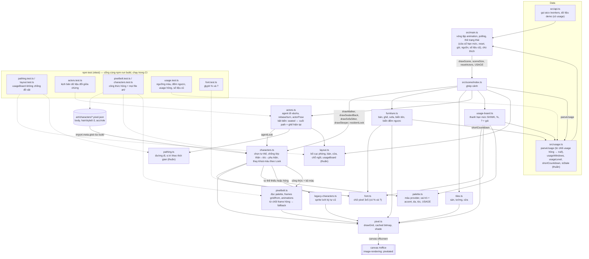

# T-deb535b0: Hiển thị hạn mức subscription của từng phòng

Lần code: 1. File do aico tạo, cập nhật mỗi lần code.

## Đầu việc

| Id | Việc | Vai trò | Được sửa | Chờ | Kết quả |
| --- | --- | --- | --- | --- | --- |
| W1 | Đọc usage phòng thủ, hàm thuần (màu theo mức, đếm ngược, số liệu cũ) và dữ liệu demo | coder | `src/usage.ts`, `src/usage.test.ts`, `src/api.ts` | - | xong (claude) |
| W2 | Bố cục: vị trí bảng hạn mức trên tường phòng | coder | `src/scene/layout.ts`, `src/scene/layout.test.ts`, `src/scene/actors.test.ts` | - | xong (codex) |
| W3 | Vẽ thanh hạn mức pixel trên canvas, màu USAGE, glyph % và ? | coder | `src/scene/usage-board.ts`, `src/scene/palette.ts`, `src/scene/font.ts`, `src/scene/font.test.ts`, `src/scene/furniture.ts`, `src/scene/index.ts` | W1, W2 | xong (claude) |
| W4 | Thẻ trạng thái: từng cửa sổ hạn mức, giờ reset, gói, nguồn, lỗi, số liệu cũ | coder | `src/main.ts`, `src/style.css` | W1, W3 | xong (codex) |
| W5 | CI chạy npm test, README mô tả usage và thanh hạn mức | coder | `.github/workflows/ci.yml`, `README.md` | - | xong (cursor) |

## Kế hoạch

# Kế hoạch T-deb535b0: hiển thị hạn mức subscription của từng phòng

Tôi đã đọc lại `AGENTS.md`, `docs/architecture.md` và code trên `main`. Code chưa đổi so với lúc duyệt kế hoạch T-e719a7ed: chưa có `src/usage.ts`, chưa có `usage` trong `WorkerStatus`, CI chưa chạy `npm test`. Vì vậy tôi giữ nguyên cách chia đầu việc, `owns` và `depends_on`. Trong `docs/plans/` tôi chưa tìm thấy kế hoạch nào khác liên quan.

## 1. Hiện trạng (đã đọc trên `main`)

- **`src/api.ts`**:
  - `WorkerStatus` chưa có trường `usage`.
  - `demoWorkers` chạy kịch bản 48 giây: claude có 0→1→2→1→0 agent; codex rảnh ↔ 1 agent ở giây 28–44; cursor ở trạng thái `limited` từ giây 0 tới 24, `offline` từ 24 tới 36, rồi `idle`.
- **`src/scene/layout.ts`**:
  - Tường cao 28px (`ROOM_WALL_H = 28`) và `ROOM_MIN_W = 92`.
  - Vị trí đồ trên tường: biển tên ở `plateY = y+2`, kệ sách ở `shelf = (x+8, y+13)`, đồng hồ ở `clock = (x+w-16, y+14)`.
  - Bàn bắt đầu từ `floorY+6`.
- **`src/scene/index.ts`**: biển đếm ngược của phòng `limited` được vẽ ở `drawCountdown(clock.x-3, clock.y+2, …)`. Nó nằm đúng vào khoảng tường trống giữa kệ và đồng hồ, nên bảng hạn mức cần một chỗ riêng.
- **Định dạng đếm ngược đang có hai kiểu**: `countdownLabel` trong `furniture.ts` cho ra `47M`/`1H05`, còn `fmtCountdown` trong `main.ts` cho ra `1g 5p`.
- **`src/scene/font.ts` thiếu glyph `%` và `?`**: `glyphChars` đổi ký tự lạ thành dấu cách.
- **`.github/workflows/ci.yml`** chỉ có `npm ci` và `npm run build`.

## 2. Các bước

**W1: dữ liệu và hàm thuần** (tạo `src/usage.ts`, `src/usage.test.ts`, sửa `src/api.ts`)
- Thêm `usage?: unknown` vào `WorkerStatus`. Dùng `unknown` để mọi chỗ đọc buộc phải đi qua `parseUsage`.
- Trong `usage.ts` khai báo kiểu `UsageWindow` và `WorkerUsage`, cùng các hàm sau:
  - **`parseUsage(raw): WorkerUsage | null`**:
    - Gặp `null` hoặc `undefined` thì trả `null` và không warn.
    - Dữ liệu sai kiểu thì trả `null` và warn một lần. Các trường hợp sai kiểu:
      - `raw` không phải object;
      - `checked_at` không phải chuỗi ISO đọc được;
      - `windows` không phải mảng;
      - một cửa sổ có `name` không phải chuỗi, `used_percent` không phải số hữu hạn hoặc âm, `window_minutes` sai kiểu, hoặc `resets_at` không phải ISO và cũng không phải null;
      - `plan`, `note`, `error` hoặc `source` có mặt nhưng sai kiểu.
    - `windows: []` là hợp lệ (trường hợp Cursor). Dữ liệu hỏng không được chuẩn hoá thành giá trị rỗng.
  - **`usageWindows(u)`**: lấy tối đa 2 cửa sổ, gồm cửa sổ ngắn nhất dưới 1 ngày (nhãn `5H`) và cửa sổ dài nhất từ 1 ngày trở lên (nhãn `WK`).
  - **`usageLevel(pct)`**: dưới 60 là `ok`, từ 60 tới dưới 80 là `warn`, từ 80 là `high`. Giá trị trên 100 được kẹp về 100.
  - **`shortCountdown(iso, now)`**: trả `47M` hoặc `1H05`; đã qua giờ reset thì trả `0M`; không có giờ thì trả `?`.
  - **`isStale(checked_at, now)`**: đúng khi số liệu cũ hơn 15 phút; đúng 15 phút thì chưa tính là cũ.
- Dữ liệu demo, vẫn theo chu kỳ 48 giây:
  - **claude**: `session` tăng từ 20 lên 70%, `week` 84%, gói `max`. Từ giây 40 tới 48, `checked_at` lùi 20 phút để hiện "số liệu cũ".
  - **codex**: `5h` tăng từ 40 lên 100% trong giây 0–36. Từ giây 36 tới 48, phòng chuyển `limited`, có `limit.resets_at`, agent đang ngồi phải rời bàn. `week` 35%, gói `plus`.
  - **cursor**: `windows: []`, gói `Pro`, có `note`. Ở pha offline thì `usage: null`.

**W2: bố cục** (`layout.ts`, `layout.test.ts`, `actors.test.ts`)
- Thêm `usageBoard: Rect` vào `RoomBox`, đặt trên tường giữa mép phải kệ sách (cách 3px) và đồng hồ, trong khoảng `y+13…y+28`.
- Bảng không được chồng lên biển tên, cửa, bàn, màn hình (`desk.y-5`) hay biển đếm ngược. Biển đếm ngược tính theo bề rộng lớn nhất của nhãn 5 ký tự (`71H05`).
- Tăng `ROOM_MIN_W` vừa đủ để bảng và biển đếm ngược cùng nằm bên trái đồng hồ, và sửa lại chú thích của hằng số này. `layout.ts` vẫn là hàm thuần.
- Test trong `layout.test.ts`: với `slots` từ 0 tới 4, `usageBoard` nằm trong tường phòng và không chồng lên đồ vật nào kể trên.
- Test trong `actors.test.ts` (bắt buộc theo AGENTS.md khi sửa `layout.ts`): phòng rộng ra làm bàn và cửa của các phòng phía sau dịch chỗ trong lúc agent đang đi hoặc đang ngồi, kể cả khi đổi `slots` và khi phòng chuyển `limited`/`offline`. Bất biến `seated` vẫn phải đúng.

**W3: vẽ trên canvas** (phụ thuộc W1 và W2)
- `palette.ts`: thêm `USAGE = { ok, warn, high, track, frame, board, text, unknown }`, dùng lại tông màu của `LAMP`.
- `font.ts`: thêm glyph `%` và `?`.
- `scene/usage-board.ts` (file mới) có `drawUsageBoard(ctx, rect, usage, t)`:
  - mỗi cửa sổ một hàng: nhãn, thanh có viền 1px tô màu theo mức, rồi phần trăm;
  - `windows` rỗng thì vẽ `?` kèm tên gói, cắt cho vừa bảng;
  - `usage` là `null` thì không vẽ gì.
- `furniture.ts`: `countdownLabel` gọi `shortCountdown`.
- `index.ts`: trong `drawRoomFurniture`, gọi `parseUsage(worker.usage)` rồi `drawUsageBoard`, bỏ qua phòng `offline`. Re-export `USAGE` cho `main.ts`.
- `scene/font.test.ts` (file mới): kiểm `textWidth("28%")`, kiểm `%` và `?` không còn bị đổi thành dấu cách, kiểm `glyphChars("? PRO")`.

**W4: thẻ trạng thái** (`main.ts`, `style.css`; phụ thuộc W1 và W3)
- Mỗi cửa sổ một hàng, ví dụ `5 giờ: 28% · reset sau 4H19`, kèm ô màu lấy từ `USAGE[usageLevel]`.
- Ghi thêm gói và nguồn số liệu. Có `note` thì hiện `note`. Có `error` thì hiện dòng lỗi. `isStale` đúng thì ghi "số liệu cũ (N phút trước)".
- `usage` là `null` hoặc hỏng thì bỏ mục hạn mức; các phần khác của thẻ vẫn hiện.
- `fmtCountdown` của hộp "Mở lại sau" chuyển sang dùng `shortCountdown`.

**W5: CI và README** (không phụ thuộc đầu việc nào)
- `ci.yml`: thêm `- run: npm test` ngay sau `npm run build`.
- README:
  - mục Dữ liệu: mô tả trường `usage` và ba trường hợp Claude, Codex, Cursor;
  - mục Trạng thái: thanh hạn mức, ba ngưỡng màu, ý nghĩa của `?`, thẻ trạng thái;
  - sửa đoạn "các CLI không công bố hạn mức" cho khớp dữ liệu mới;
  - mô tả demo: codex lên 100% rồi chuyển `limited`;
  - bảng Cấu trúc: thêm `src/usage.ts`, `src/usage.test.ts`, `src/scene/usage-board.ts`, `src/scene/font.test.ts`.

**Import giữa các đầu việc:**

| Đầu việc | Dùng thứ do đầu việc khác tạo | depends_on |
| --- | --- | --- |
| W1 | — | — |
| W2 | — | — |
| W3 | các hàm trong `usage.ts` (W1); `room.usageBoard` (W2) | W1, W2 |
| W4 | các hàm trong `usage.ts`, gồm cả `isStale` (W1); `USAGE` qua `scene/index` (W3) | W1, W3 |
| W5 | — (chỉ ghi tên file đã chốt ở trên) | — |

## 3. Cách kiểm tra

- `npm run build` và `npm test` phải cùng qua.
- `src/usage.test.ts`:
  - `usageLevel` ở các mốc 0, 59.9, 60, 79.9, 80, 100, 130;
  - `shortCountdown` cho `47M`, 60 phút → `1H00`, `1H05`, giờ đã qua → `0M`, `null` → `?`;
  - `parseUsage` với dữ liệu hỏng, tất cả phải trả `null` và chỉ warn một lần:
    - thiếu `windows`, hoặc `windows` là object hay chuỗi;
    - `used_percent` là `"28"`, `NaN` hoặc số âm;
    - `checked_at` hỏng, `plan` là số;
    - `raw` là số, chuỗi hoặc mảng;
  - dữ liệu đúng của Claude, Codex và Cursor (`windows: []`) được giữ nguyên;
  - `usageWindows` gặp 3 cửa sổ thì chỉ lấy 2, đúng nhãn `5H`/`WK`;
  - `isStale` ở 14:59, 15:00 và 15:01.
- Kịch bản "dữ liệu đổi giữa chừng" (unit test cho phần thuần, xem demo cho phần vẽ):
  - `usage` có, rồi `null`, rồi có lại;
  - số cửa sổ đổi 2 → 1 → 0 → 2;
  - phần trăm vượt từng ngưỡng giữa hai lần poll;
  - một cửa sổ chạm 100% đúng lúc agent đang ngồi, phòng chuyển `limited`;
  - phòng offline rồi online lại;
  - `usage` hỏng xen giữa hai lần dữ liệu đúng.
- Chạy `npm run dev` và xem demo trọn một chu kỳ 48 giây. Cần thấy:
  - đủ ba màu;
  - codex lên 100% rồi `limited`, bảng không chồng biển đếm ngược;
  - cursor hiện `? PRO`;
  - claude hiện "số liệu cũ";
  - thanh không che bàn, màn hình hay nhân vật;
  - console không có exception lặp lại.

```json
{"items": [
  {"id": "W1", "title": "Đọc usage phòng thủ, hàm thuần (màu theo mức, đếm ngược, số liệu cũ) và dữ liệu demo", "role": "coder", "owns": ["src/usage.ts", "src/usage.test.ts", "src/api.ts"], "depends_on": [], "acceptance": "WorkerStatus có usage?: unknown; src/usage.ts export parseUsage, usageWindows, usageLevel, shortCountdown, isStale. parseUsage trả null và warn một lần khi usage sai kiểu: không phải object, thiếu hoặc hỏng checked_at, windows không phải mảng, phần tử cửa sổ sai kiểu (used_percent không phải số hữu hạn hoặc âm), plan/note/error/source sai kiểu; windows: [] hợp lệ. usageLevel: <60 ok, 60..<80 warn, >=80 high, >100 kẹp về 100. shortCountdown cho 47M / 1H05 / 0M / ?. isStale đúng khi cũ hơn 15 phút. Demo 48 giây: claude session 20→70%, week 84%, pha 40-48s checked_at cũ 20 phút; codex 5h 40→100% trong 0-36s rồi limited kèm limit.resets_at tới 48s; cursor windows rỗng, plan Pro, có note, usage null ở pha offline. Test trong usage.test.ts phủ mọi mốc ngưỡng và mọi dạng usage hỏng, cùng kịch bản dữ liệu đổi giữa chừng: usage có → null → có lại, số cửa sổ 2→1→0→2, phần trăm vượt ngưỡng giữa hai lần đọc. npm run build và npm test qua."},
  {"id": "W2", "title": "Bố cục: vị trí bảng hạn mức trên tường phòng", "role": "coder", "owns": ["src/scene/layout.ts", "src/scene/layout.test.ts", "src/scene/actors.test.ts"], "depends_on": [], "acceptance": "RoomBox có usageBoard: Rect trên tường, giữa kệ sách và đồng hồ; ROOM_MIN_W tăng vừa đủ để bảng và biển đếm ngược (rộng tối đa 5 ký tự) cùng nằm bên trái đồng hồ; layout.ts vẫn là hàm thuần. layout.test.ts kiểm với slots 0..4 rằng usageBoard nằm trong tường phòng và không chồng kệ, đồng hồ, vùng biển đếm ngược, biển tên, cửa, bàn hay màn hình. actors.test.ts có kịch bản phòng rộng ra làm bàn và cửa phòng phía sau dịch chỗ khi agent đang đi hoặc đang ngồi, kể cả khi đổi slots và khi phòng chuyển limited/offline; bất biến seated ⇔ cuối path = ghế hiện tại vẫn đúng. npm run build và npm test qua."},
  {"id": "W3", "title": "Vẽ thanh hạn mức pixel trên canvas, màu USAGE, glyph % và ?", "role": "coder", "owns": ["src/scene/usage-board.ts", "src/scene/palette.ts", "src/scene/font.ts", "src/scene/font.test.ts", "src/scene/furniture.ts", "src/scene/index.ts"], "depends_on": ["W1", "W2"], "acceptance": "palette.ts có USAGE (ok, warn, high, track, frame, board, text, unknown), không có mã màu ở chỗ khác. font.ts có glyph % và ?. drawUsageBoard vẽ tối đa 2 hàng (nhãn 5H/WK, thanh viền 1px tô theo usageLevel, phần trăm như 28%/100%) trong room.usageBoard; windows rỗng thì vẽ ? kèm gói; usage null hoặc hỏng thì không vẽ gì và không ném lỗi; phòng offline không vẽ bảng. countdownLabel dùng shortCountdown của src/usage.ts. index.ts gọi parseUsage và drawUsageBoard trong drawRoomFurniture, re-export USAGE. font.test.ts kiểm textWidth('28%') và % / ? không bị đổi thành dấu cách. Xem demo một chu kỳ 48 giây: đủ ba màu, codex 100% rồi limited mà bảng không chồng biển đếm ngược, cursor hiện ? PRO, usage mất rồi xuất hiện lại không làm đứng vòng lặp vẽ, không có exception lặp trong console. npm run build và npm test qua."},
  {"id": "W4", "title": "Thẻ trạng thái: từng cửa sổ hạn mức, giờ reset, gói, nguồn, lỗi, số liệu cũ", "role": "coder", "owns": ["src/main.ts", "src/style.css"], "depends_on": ["W1", "W3"], "acceptance": "Thẻ của mỗi phòng ghi từng cửa sổ: tên, phần trăm, ô màu lấy từ USAGE[usageLevel] (import qua scene/index), giờ reset đếm ngược bằng shortCountdown (1H05, 47M); ghi gói, nguồn số liệu và note nếu có; có error thì hiện dòng lỗi; isStale thì ghi 'số liệu cũ' kèm số phút. usage null hoặc hỏng thì bỏ mục hạn mức, các phần khác của thẻ vẫn hiện. Hộp 'Mở lại sau' dùng cùng định dạng đếm ngược. Kịch bản dữ liệu đổi giữa chừng trong demo (usage mất rồi xuất hiện lại, số cửa sổ đổi, phòng chuyển limited rồi offline rồi online lại) không làm lỗi renderCards. npm run build và npm test qua."},
  {"id": "W5", "title": "CI chạy npm test, README mô tả usage và thanh hạn mức", "role": "coder", "owns": [".github/workflows/ci.yml", "README.md"], "depends_on": [], "acceptance": "ci.yml có bước '- run: npm test' ngay sau npm run build. README: mục Dữ liệu mô tả trường usage (checked_at, source, plan, windows, note, error, có thể null) cùng các trường hợp Claude/Codex/Cursor; mục Trạng thái mô tả thanh hạn mức trên tường (5H/WK, phần trăm, xanh <60, vàng 60-<80, đỏ >=80, ? cho phòng không công bố) và thẻ trạng thái (giờ reset, gói, nguồn, lỗi, số liệu cũ sau 15 phút); sửa đoạn 'các CLI không công bố hạn mức'; mô tả demo có codex lên 100% rồi limited; bảng Cấu trúc thêm src/usage.ts, src/usage.test.ts, src/scene/usage-board.ts, src/scene/font.test.ts."}
]}
```


