# T-e74ec7c8: GUI: tự điền sẵn địa chỉ aico khi chạy trên tên miền đã deploy

Lần code: 1. File do aico tạo, cập nhật mỗi lần code.

## Đầu việc

| Id | Việc | Vai trò | Được sửa | Chờ | Kết quả |
| --- | --- | --- | --- | --- | --- |
| W1 | Hàm thuần defaultBaseUrl và test | coder | `src/api.ts`, `src/api.test.ts` | - | xong (codex) |
| W2 | Popover cài đặt focus ô token khi địa chỉ đã có | coder | `src/ui/topbar.ts`, `src/ui/topbar.test.ts` | - | xong (codex) |
| W3 | Ghép điền sẵn địa chỉ vào main.ts, test ghép nối, README | coder | `src/main.ts`, `src/main.test.ts`, `README.md` | W1, W2 | xong (codex) |

## Kế hoạch

# Kế hoạch T-e74ec7c8: tự điền sẵn địa chỉ aico trên tên miền đã deploy

## Đã đọc
- `AGENTS.md`, `docs/architecture.md`, `README.md`, `index.html`, `src/api.ts`, `src/api.test.ts`, `src/main.ts`, `src/ui/topbar.ts`.
- `src/main.test.ts` chưa đọc được: file dài 53 nghìn ký tự, vượt giới hạn của tool, và tôi không có shell để đọc từng đoạn. Agent làm W3 phải tự đọc file này để dùng lại bộ DOM giả và cách import `main.ts` đang có.
- `docs/plans/` chưa đọc được: tool chỉ đọc từng file, không liệt kê được thư mục. Ticket này nhỏ và độc lập nên vẫn lập kế hoạch được.

## Hiện trạng
- `src/main.ts`: nếu có `config` đã lưu thì gán `baseUrl.value = config.baseUrl`. Nếu không có thì ô Địa chỉ để trống, chỉ có placeholder `http://localhost:8000`.
- `src/ui/topbar.ts` `setOpen(true)`: luôn focus input đầu tiên, tức ô `baseUrl`.
- `ticketSource` trong `main.ts` đã đọc `globalThis.location` theo kiểu "có thể vắng khi chạy test trong Node". Code mới cũng phải chịu được trường hợp `location` không có.

## Các bước

### 1. `defaultBaseUrl` (W1: `src/api.ts`, `src/api.test.ts`)
- Thêm hàm thuần:
  `export function defaultBaseUrl(loc: Pick<Location, "protocol" | "hostname" | "origin" | "pathname"> | null | undefined): string | null`
  - Trả `null` khi:
    - `loc` thiếu;
    - `protocol` khác `http:` hoặc `https:`;
    - hostname (viết thường) là `localhost`, `127.0.0.1`, `[::1]` hoặc `::1`, hoặc kết thúc bằng `.localhost`;
    - `pathname` là `/preview` hoặc bắt đầu bằng `/preview/`.
  - Trường hợp còn lại trả `` `${origin}/api` ``, không có `/` thừa.
  - Thêm một dòng chú thích tiếng Việt giải thích lý do: bản deploy gọi API cùng tên miền, còn bản xem trước không có `/api` riêng.
- Test trong `api.test.ts`, mỗi URL tạo bằng `new URL(...)` rồi truyền vào hàm:
  - `https://office.aico.io.vn/` → `https://office.aico.io.vn/api`
  - `https://office.aico.io.vn/x?y=1` → vẫn `…/api`
  - Các URL sau trả `null`: `http://localhost:5173`, `http://127.0.0.1:5173`, `http://[::1]:5173`, `http://app.localhost`, `file:///…/index.html`, `https://office.aico.io.vn/preview/T-1/`, `null`/`undefined`.

### 2. Focus khi mở popover (W2: `src/ui/topbar.ts`, file mới `src/ui/topbar.test.ts`)
- Tách hàm thuần `export function settingsFocus(baseUrl: string, token: string): "baseUrl" | "token"`: trả `"token"` khi `baseUrl.trim()` khác rỗng và `token` rỗng, ngược lại trả `"baseUrl"`.
- Trong `setOpen(true)`: đọc hai input `name=baseUrl` và `name=token` của form rồi focus ô theo `settingsFocus`. Thiếu input nào thì quay về cách cũ (focus input đầu).
- Không đổi bố cục, chữ hay CSS.
- `topbar.test.ts` kiểm tra:
  - Bảng giá trị của `settingsFocus`: địa chỉ có giá trị + token trống → token; địa chỉ trống → baseUrl; cả hai có giá trị → baseUrl; địa chỉ chỉ có khoảng trắng → baseUrl.
  - Nếu dựng được DOM giả kiểu `drawer.test.ts`/`feed.test.ts`: mở popover rồi kiểm `document.activeElement`.

### 3. Ghép nối và README (W3: `src/main.ts`, `src/main.test.ts`, `README.md`; chờ W1 và W2 xong)
- Thay dòng `if (config) (… "baseUrl").value = config.baseUrl;` bằng: lấy `config.baseUrl` nếu có, không thì `defaultBaseUrl(globalThis.location)`. Chỉ gán `value` khi giá trị khác null.
- Không đụng `config`, `savedConfig`, `saveConfig`, `syncDemoButton` hay `poll`. Như vậy không tự kết nối, không ghi localStorage, và demo vẫn chạy như cũ.
- Test trong `main.test.ts`, dùng bộ DOM giả có sẵn và stub `location` trước khi import `main.ts`:
  - Không có kết nối lưu, `location` là `https://office.aico.io.vn/` → ô địa chỉ có `value` `https://office.aico.io.vn/api`, `localStorage.setItem` không bị gọi, không có `fetch` tới `/workers`, `#conn` báo chế độ demo.
  - Có kết nối lưu → ô địa chỉ là địa chỉ đã lưu, kể cả khi đang ở tên miền deploy.
  - `location` là localhost, `/preview/T-1/` hoặc không có `location` → ô địa chỉ vẫn trống.
  - Mở popover bằng nút ⚙ khi địa chỉ đã được điền sẵn → ô token được focus.
- README:
  - Mục "Chạy": thêm một câu về việc tự điền sẵn địa chỉ trên tên miền deploy.
  - Bảng "Cấu trúc": thêm dòng `src/ui/topbar.test.ts`, cập nhật mô tả của `api.test.ts` và `main.test.ts`.

## Kịch bản dữ liệu đổi giữa chừng (bắt buộc test ở W3)
1. **Kết nối lưu có rồi mất:** đang có kết nối lưu, submit với token trống → `config` thành null (hành vi cũ). Ô địa chỉ giữ chữ người dùng đã gõ, không bị ghi đè bằng `defaultBaseUrl`.
2. **Bấm Demo rồi Thoát demo:** khi có kết nối lưu, ô địa chỉ không đổi và không có ghi localStorage mới. Khi không có kết nối lưu, nút vẫn ghi "Demo" và vẫn chạy demo.
3. **Nối thật bằng địa chỉ điền sẵn:** nhập token rồi submit → lưu `{baseUrl: …/api, token}`, poll gọi `https://office.aico.io.vn/api/workers`. Sau đó mở lại popover thì focus ô địa chỉ, vì token đã có.
4. **Người dùng xoá địa chỉ rồi mở lại popover:** focus ô địa chỉ.
5. **Không có kết nối:** localStorage bị chặn (`loadConfig` trả null) → vẫn điền sẵn và vẫn ở chế độ demo. `fetch` lỗi sau khi kết nối → giữ hành vi lỗi cũ (`#conn` báo lỗi).

## Kiểm tra
- `npm run build` và `npm test` phải qua.
- Thử bằng tay: `npm run dev` ở localhost thì ô địa chỉ trống như cũ. Bản build mở trên tên miền deploy thì ô địa chỉ được điền sẵn và ô token được focus. Nếu chưa xem được trên tên miền thật thì ghi rõ trong tóm tắt.

```json
{"items": [
  {"id": "W1", "title": "Hàm thuần defaultBaseUrl và test", "role": "coder", "owns": ["src/api.ts", "src/api.test.ts"], "depends_on": [], "acceptance": "defaultBaseUrl(https://office.aico.io.vn/) = https://office.aico.io.vn/api (cả khi có path/query khác /preview). Trả null cho http://localhost:5173, 127.0.0.1, [::1], *.localhost, file:, /preview/T-1/, null/undefined. Hàm thuần, không đọc global. npm run build và npm test qua."},
  {"id": "W2", "title": "Popover cài đặt focus ô token khi địa chỉ đã có", "role": "coder", "owns": ["src/ui/topbar.ts", "src/ui/topbar.test.ts"], "depends_on": [], "acceptance": "settingsFocus thuần: địa chỉ khác rỗng + token rỗng -> token; địa chỉ rỗng hoặc chỉ khoảng trắng -> baseUrl; cả hai có giá trị -> baseUrl. Mở popover focus đúng ô; thiếu input thì quay về cách cũ. Mở lại popover sau khi xoá địa chỉ hoặc đã nhập token thì focus ô địa chỉ. Không đổi bố cục/CSS. npm run build và npm test qua."},
  {"id": "W3", "title": "Ghép điền sẵn địa chỉ vào main.ts, test ghép nối, README", "role": "coder", "owns": ["src/main.ts", "src/main.test.ts", "README.md"], "depends_on": ["W1", "W2"], "acceptance": "Không có kết nối lưu trên tên miền deploy: ô baseUrl có value .../api, không ghi localStorage, không fetch /workers, vẫn ở chế độ demo. Có kết nối lưu: dùng địa chỉ đã lưu. Localhost, /preview/ hoặc không có location: ô trống. Mở ⚙ khi địa chỉ đã điền sẵn thì focus ô token. Dữ liệu đổi giữa chừng: (1) submit token trống khi đang có kết nối lưu -> demo, ô địa chỉ không bị ghi đè; (2) Demo/Thoát demo không đổi ô địa chỉ, không ghi localStorage; (3) nhập token với địa chỉ điền sẵn -> lưu và poll đúng .../api/workers, mở lại popover focus ô địa chỉ; (4) localStorage bị chặn -> vẫn điền sẵn và vẫn demo; (5) fetch lỗi sau khi kết nối -> #conn báo lỗi như cũ. README cập nhật mục Chạy và bảng Cấu trúc (thêm topbar.test.ts). npm run build và npm test qua."}
]}
```

```mermaid
flowchart TD
  subgraph Data["Dữ liệu và logic thuần hiện có"]
    API["src/api.ts<br/>workers, snapshot tickets đầy đủ, actions<br/>demoWorkers 48 giây<br/>defaultBaseUrl: origin/api trên tên miền thật<br/>null cho localhost, file:, /preview/"]
    TK["src/tickets.ts<br/>parseTickets, needsYou, NEED_LABEL, actions, MR, preview<br/>latestScreenshots: bộ ảnh mới nhất, tối đa 16<br/>demoNeedTickets kèm ảnh demo"]
    ACTV["src/activity.ts<br/>activity, screenFor, bubbles, progress"]
    USG["src/usage.ts"]
    TIME["src/time.ts"]
    LATEST["src/latest.ts<br/>createLatestGate"]
    ATT["src/attention.ts"]
  end
  API --> TK
  ACTV --> USG

  SHOTS["public/demo-shots/ + art/demo-shots/<br/>ảnh pixel demo theo thời điểm/file.png"]
  SHOTS -.->|url tuyệt đối theo BASE_URL| TK

  COL["src/needs-column.ts + CSS<br/>gate chấp nhận snapshot<br/>lọc items cho panel, giữ xác nhận/ghi chú<br/>hàng ảnh thu nhỏ, ảnh lỗi thành link"]
  VIEWER["src/shot-viewer.ts + CSS<br/>lightbox trên body: ←/→, Esc, trả focus"]
  API -->|cùng request tickets| COL
  LATEST --> COL
  COL --> TK
  COL -->|mở ảnh, đóng khi thẻ mất/đổi nguồn| VIEWER
  COL -->|actions| API
  COL -->|snapshot đầy đủ đã chấp nhận| MAIN
  COL -->|NeedItem đã lọc| MAIN

  LOC["window.location"]
  LS["localStorage aico-office.api"]
  FORM["#settings trong index.html<br/>baseUrl, token"]

  MAIN["src/main.ts<br/>poll, nguồn, giờ địa phương hoặc hour<br/>reduced motion, vòng animation, chọn agent<br/>showNeeds dùng chung cho feed, toast, drawer<br/>ghi --feed-left/--feed-room<br/>điền ô địa chỉ: kết nối lưu, không thì defaultBaseUrl"]
  API --> MAIN
  LATEST --> MAIN
  ATT --> MAIN
  MAIN -->|demo assetBase| TK
  LS -->|loadConfig| MAIN
  MAIN -->|saveConfig chỉ khi submit| LS
  LOC -->|defaultBaseUrl| MAIN
  MAIN -->|value baseUrl, không tự kết nối| FORM

  subgraph UI["Khung UI"]
    VP["ui/viewport.ts<br/>computeInsets, fitScene<br/>feedBox: left/bề rộng feed theo sidebar, drawer"]
    FM["ui/feed-model.ts<br/>FeedLine: ticket, tone<br/>dòng hết hạn mức theo chuyển trạng thái phòng"]
    SEL["ui/selection.ts"]
    FMT["ui/format.ts<br/>agentStatus, tokenStatsRows label/value/cache/level<br/>tokenStatsLines dựng từ rows cho tooltip"]
    TOK["ui/tokens.css<br/>--feed-max"]
    TOP["ui/topbar.ts + CSS<br/>popover cài đặt chứa #settings<br/>settingsFocus: địa chỉ có + token trống → focus token"]
    SIDE["ui/sidebar.ts + CSS"]
    AV["ui/avatar.ts"]
    DRWM["ui/drawer-model.ts<br/>thuần: statusView tone/nhãn/thời gian<br/>+ ticketId, needKind; nhãn 'Chờ bạn …' theo NEED_LABEL<br/>nowCardTitle theo tone<br/>roomStateLabel, taskChecklist, recentRows"]
    DRW["ui/drawer.ts + CSS<br/>tab Agent kiểu Habblaud: hero avatar 64px/48px<br/>chip phòng, ticket; hộp nhiệm vụ + MR/Xem trước<br/>dòng trạng thái: nhãn need là nút mở Cần bạn<br/>thẻ hoạt động: tiêu đề theo tone<br/>checklist task, timeline Gần đây, bảng số liệu"]
    FEED["ui/feed.ts + CSS<br/>khung nổi góc dưới trái, ticker khi thu gọn<br/>dòng lưới: giờ, avatar, tên, chip phòng, ticket, icon, nội dung<br/>dòng ticket is-ticket: ô ticket rỗng, title không lặp<br/>màn hẹp: cột tên fit-content, mã ticket đủ<br/>tự cuộn, viên N mới, phím ]"]
    NEEDS["#needs trong drawer"]
    TOAST["toasts.ts + CSS"]
  end
  FORM --> TOP
  MAIN --> VP
  MAIN --> FM
  MAIN --> SEL
  MAIN --> TOP
  MAIN --> SIDE
  MAIN -->|view, agent + needItems, now| DRW
  DRW -->|onTicket id → showNeeds| MAIN
  MAIN -->|lines + workers| FEED
  FEED -->|onAgent phòng+id → selectAgent<br/>onTicket → showNeeds| MAIN
  MAIN --> TOAST
  TOAST -->|onOpen → showNeeds| MAIN
  TOP -->|submit, Demo| MAIN
  TOP --> FMT
  SIDE --> FMT
  SIDE --> AV
  FEED --> AV
  FEED --> FMT
  FEED --> PAL
  FMT --> USG
  FMT --> ACTV
  FM --> ACTV
  DRW --> DRWM
  DRW --> AV
  DRW --> FMT
  DRW --> PAL
  DRW --> TK
  DRWM --> ACTV
  DRWM --> TIME
  DRWM --> FMT
  DRWM -->|NEED_LABEL, NeedKind| TK
  DRW --> NEEDS
  COL --> NEEDS
  TOK -.-> TOP
  TOK -.-> SIDE
  TOK -.-> DRW
  TOK -.-> FEED
  TOK -.-> COL
  TOK -.-> VIEWER

  DEMO["scene/demo-events.ts<br/>snapshot định kỳ, cùng bộ phát hiện"]
  EVENTS["scene/room-events.ts<br/>so snapshot, MR mới/done/escalated<br/>nhớ ticket-provider, dedup, TTL 10 giây"]
  DEMO --> MAIN
  MAIN -->|snapshot và liên hệ agent.ticket_id| EVENTS
  EVENTS -->|banner đang sống| MAIN

  IDX["scene/index.ts<br/>ghép cảnh, SceneFigure và dữ liệu biển phòng"]
  MAIN -->|workers, thời gian, reduced motion| IDX
  LAYOUT["scene/layout.ts<br/>thuần: phòng/bàn/ghế, ngoại cảnh, sceneSize"]
  OUT["scene/outdoor.ts<br/>seed thuần, cây/đèn/lối đi/đường<br/>vẽ ngoại cảnh và xe"]
  CACHE["Canvas cache nền tĩnh<br/>khóa hình học, palette, seed"]
  TILES["scene/tiles.ts<br/>tường, sàn, cửa"]
  ACT["scene/actors.ts<br/>seated chỉ khi cuối path đúng ghế hiện tại"]
  PATH["scene/pathing.ts<br/>thuần"]
  FURN["scene/furniture.ts<br/>đồ đạc, đồng hồ, màn hình"]
  BOARD["scene/usage-board.ts"]
  CHAR["scene/characters.ts"]
  PB["scene/pixelbolt.ts"]
  LEG["scene/legacy-characters.ts"]
  ART["art/characters/*.pixel.json"]
  PAL["scene/palette.ts<br/>màu chung, ngoại cảnh, ánh sáng, banner"]
  PIX["scene/pixel.ts"]
  LIGHT["scene/lighting.ts<br/>độ sáng thuần và lightmap canvas cache<br/>bucket 5 phút, hình học, nguồn sáng"]

  IDX --> LAYOUT
  IDX --> OUT
  IDX --> CACHE
  CACHE --> OUT
  CACHE --> TILES
  IDX --> ACT
  ACT --> LAYOUT
  ACT --> PATH
  IDX --> FURN
  IDX --> BOARD
  BOARD --> USG
  IDX --> ACTV
  IDX --> CHAR
  AV --> CHAR
  ART --> CHAR
  CHAR --> PB
  CHAR --> LEG
  CHAR --> PAL
  OUT --> PAL
  LIGHT --> PAL
  FURN --> PAL
  TILES --> PIX
  OUT --> PIX
  FURN --> PIX
  PB --> PIX
  IDX -->|phút địa phương, layout, nguồn sáng| LIGHT

  CANVAS["canvas #office<br/>nền cache → phần động → lightmap multiply"]
  CACHE -->|drawImage mỗi frame| CANVAS
  IDX -->|đồ đạc, nhân vật, xe| CANVAS
  LIGHT -->|drawImage multiply mỗi frame| CANVAS
  VP -->|vùng trống, focus, vị trí feed| MAIN

  OVL["src/overlay.ts<br/>chữ DPR: hoạt động, progress<br/>biển phòng, banner và confetti hữu hạn"]
  TIP["src/agent-tooltip.ts + CSS<br/>hit-test và xem nhanh<br/>tokenStatsLines"]
  MAIN -->|figures, biển phòng, banner| OVL
  MAIN -->|figures và chọn agent| TIP
  OVL --> ACTV
  OVL --> PAL
  TIP --> ACTV
  TIP --> FMT
  OVL --> SCREEN["Lớp chữ trên cảnh"]
  CANVAS --> SCREEN

  TEST["Vitest<br/>outdoor, lighting, room-events, demo-events<br/>snapshot gate, overlay, renderer, main, viewport + feedBox<br/>feed-model ticket/tone/hết hạn mức, feed DOM<br/>latestScreenshots, shot-viewer, hàng ảnh thẻ<br/>format: tokenStatsRows + tokenStatsLines cũ<br/>drawer-model, drawer DOM<br/>api: defaultBaseUrl deploy/localhost/[::1]/file:/preview<br/>topbar: settingsFocus, focus ô token<br/>main: điền sẵn địa chỉ, kết nối lưu thắng, không tự lưu/kết nối<br/>dữ liệu đổi giữa chừng: kết nối lưu mất, Demo/Thoát demo, offline<br/>giữ actors và mọi test cũ"]
  TEST -.-> API
  TEST -.-> TOP
  TEST -.-> OUT
  TEST -.-> LIGHT
  TEST -.-> EVENTS
  TEST -.-> COL
  TEST -.-> TK
  TEST -.-> VIEWER
  TEST -.-> OVL
  TEST -.-> IDX
  TEST -.-> MAIN
  TEST -.-> ACT
  TEST -.-> VP
  TEST -.-> FM
  TEST -.-> FEED
  TEST -.-> FMT
  TEST -.-> DRWM
  TEST -.-> DRW
```


