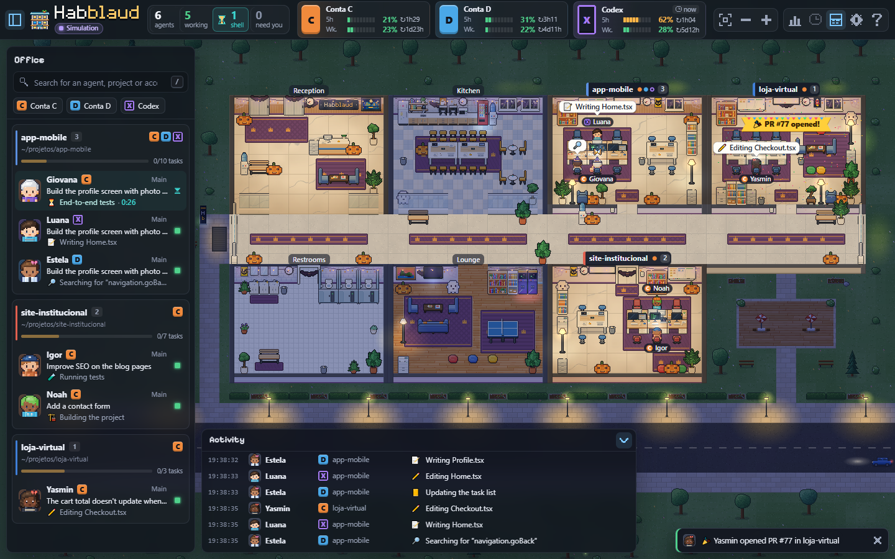
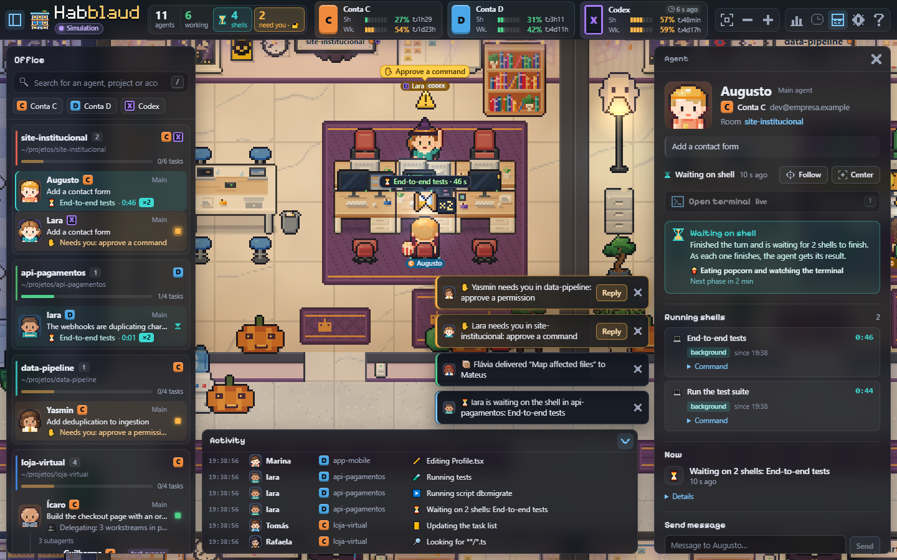
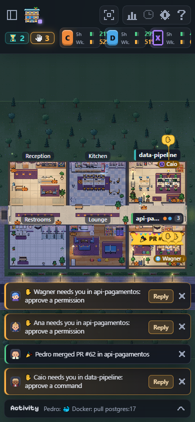

# Tham khảo: Habblaud

Ghi chép sau khi đọc mã nguồn [marmottajr/habblaud](https://github.com/marmottajr/habblaud) để học cách làm
văn phòng pixel art cho agent. Bản đã đọc: v1.0.3, commit `faa1a01` (16/10/2026), giấy phép MIT.

Tóm tắt một câu: Habblaud là "văn phòng ảo" cho Claude Code và Codex. Mỗi project là một phòng, mỗi agent là một
nhân vật pixel art. Nhân vật làm việc, giơ tay khi cần người, đi pha cà phê khi rảnh, và đi thang máy về khi phiên
kết thúc. Mục tiêu giống hệt aico-office, nhưng Habblaud đã đi xa hơn nhiều: khoảng 134 nghìn dòng TypeScript,
có test, i18n và changelog.

## 1. Thông tin chung

| Mục | Giá trị |
| --- | --- |
| Ngôn ngữ, công cụ | TypeScript 7, Vite 8, Vitest 5, Node 22.12+ |
| Phụ thuộc lúc chạy | Không có. Server chỉ dùng module có sẵn của Node; `node-pty` và `xterm` là tuỳ chọn |
| Cấu trúc | `server/` (Node, HTTP + SSE), `client/` (canvas + DOM), `shared/` (giao thức, code thuần), `mod/` (plugin Claude Code), `scripts/` |
| Quy mô | Khoảng 134 nghìn dòng TS. Riêng mỗi file bản dịch khoảng 3,3 nghìn dòng |
| Chạy | `npm run docker:up` (cổng 4747, chỉ localhost) hoặc `npm run build && npm start` |
| Ngôn ngữ giao diện | PT-BR (gốc), EN, ES, FR. Mọi chuỗi đi qua `tr('...')` |
| Giấy phép | MIT. Ảnh trong `client/public/assets` (logo, tranh, poster) do tác giả tạo bằng AI |

## 2. Tính năng chính

| Nhóm | Nội dung |
| --- | --- |
| Toà nhà | Sảnh có thang máy, bếp, nhà vệ sinh và phòng giải trí cố định. Mỗi project có phiên đang mở được một phòng dọc hành lang |
| Vòng đời phòng | Phòng được dựng lên (đồ đạc hiện dần, đèn còn tắt) → có người bật đèn → người cuối cùng tắt đèn đi về → phòng thành vườn. Nếu có chỗ trống giữa hai phòng, phòng xa nhất dọn đến đó để toà nhà không có khoảng hở |
| Trạng thái nhân vật | `working` (ngồi gõ phím, màn hình hiện loại việc), `waiting` (chạy về bàn giơ tay, nhấp nháy), `shell` (chờ lệnh dài: ăn bỏng ngô → khoanh tay → mạng nhện → ngủ gật, xong thì tung confetti hoặc mây mưa), `idle` (đi lại: cà phê, cây nước, gương...), `done` (subagent mang kết quả 📦 đến agent cha rồi về), `offline` (đi về, tắt đèn) |
| Subagent | Là "đồng nghiệp" có tên và huy hiệu riêng, đi thang máy đến, làm trong phòng của project |
| Bong bóng hoạt động | Icon theo loại việc: 📖 đọc, ✏️ sửa, 💻 terminal, 🧪 test, 🌐 web... Màn hình trên bàn đổi theo loại (code, terminal, browser, search) |
| GitHub | Phân tích transcript, không cần token: mở hoặc merge PR thì tung confetti và hiện banner; CI đỏ thì đèn xoay, sàn ửng đỏ |
| Hạn mức | Thẻ % phiên 5 giờ và % tuần cho từng tài khoản, kèm giờ reset |
| Trả lời từ văn phòng | Duyệt hoặc từ chối permission, trả lời `AskUserQuestion`, gửi tin nhắn vào phiên |
| Ngày/đêm, mùa | Ánh sáng theo giờ địa phương (đèn đường, quầng sáng màn hình, đom đóm); chủ đề Halloween và Giáng sinh |
| Đời sống xã hội | Khi từ 2 agent rảnh trở lên, chúng tụ lại xem TV, chơi game, bóng bàn, tán gẫu, oẳn tù tì ăn xu. Mỗi agent có tính cách sinh từ seed. Chỉ là mô phỏng trên trình duyệt |
| Công cụ khác | Timelapse cả ngày (60×/180×/600×), "My day" (thời gian agent phải chờ người), terminal xem hội thoại, chỉnh nhân vật, chế độ demo `?mock=1` |
| Habblaud World | Thành phố online: mỗi Habblaud là một toà nhà. **Gửi dữ liệu ra `server.habblaud.com`** sau khi tạo tài khoản; tắt bằng `HABBLAUD_WORLD=0` |

## 3. Kiến trúc

```text
~/.claude*/sessions/<pid>.json         ─┐
~/.claude*/projects/<cwd>/<sid>.jsonl  ─┼─▶ server Node ─▶ mô hình văn phòng ─▶ SSE ─▶ trình duyệt
.../<sid>/subagents/**/agent-*.jsonl   ─┘   (poll 1 s)                              (canvas + DOM)
~/.codex/sessions, hook Codex          ─┘
```

- **Nguồn dữ liệu chỉ đọc.** Phiên đang mở và trạng thái của nó lấy từ `sessions/<pid>.json` mà Claude Code tự ghi.
  Hoạt động, task, model, branch và thống kê lấy từ đuôi transcript `.jsonl`. Mỗi lời gọi tool được dịch thành một
  `Activity` có icon và câu ngắn.
- **Mod Claude Code** (`mod/habblaud`): hook TypeScript chạy trong mỗi phiên. Nó đọc `$.session.usage().rateLimits`
  rồi ghi % 5 giờ và % tuần vào `~/.habblaud/usage/<tài khoản>.json`, chỉ gọi `127.0.0.1`. Hai plugin riêng lo việc
  trả lời permission (hook `PermissionRequest`) và gửi tin nhắn.
- **Giao thức** (`shared/types.ts`): `OfficeSnapshot` gồm `rooms`, `agents`, `accounts`, `feed` và `notice`, đẩy qua
  SSE `/api/stream`. Quy tắc tiến hoá: **chỉ thêm trường tuỳ chọn**, không đổi tên và không xoá trường.
- **Client** chia hai lớp:
  - `world/`: canvas, gồm mô phỏng, render, layout, tìm đường và đời sống xã hội;
  - `ui/`: các panel DOM phủ lên canvas, gồm thanh trên, thanh bên, ngăn chi tiết, feed, toast và cài đặt.

### 3.1 Mô hình dữ liệu đáng học

- `AgentStatus = working | waiting | idle | shell | done | offline`. Đây là **trạng thái cấp cao điều khiển hành vi
  nhân vật**. Phần mô phỏng (`sim/behavior.ts`) map nó sang `Mode = work | wait | idle | shell | deliver | leave`
  bằng các hàm thuần.
- `ActivityKind` có 23 loại (`read`, `edit`, `run`, `test`, `git`, `web`, `delegate`, `ask`, `error`...). Kèm theo là
  `screenModeFor(kind)`, quyết định màn hình trên bàn hiện code, terminal, browser hay search.
- `AgentInfo`: `id` ổn định; `kind` (main hoặc sub, có `parentId`); `roomId`; `name` (tên người, duy nhất);
  `seed` (32 bit, sinh ngoại hình); `status` và `statusSince`; `activity` cùng `recent[]`; `tasks[]`; `shells[]`;
  `stats`; `permission` (yêu cầu đang chờ trả lời).
- `RoomInfo`: `id` là đường dẫn project. Có `slot`, là thứ tự đến do server cấp và ổn định, để phòng không nhảy chỗ.

## 4. Phần đồ hoạ (client/src/art, world/render)

- **Toàn bộ pixel art được sinh bằng code.** Nhân vật, đồ đạc, sàn và tường được vẽ vào `PixelBuf`, một buffer RGBA
  thuần không dùng DOM, nên chạy và test được trên Node. Mỗi tổ hợp tham số chỉ chuyển thành canvas **một lần**
  rồi lưu cache. Mỗi frame chỉ còn `drawImage`.
- **Lưới:** `TILE = 16` px. Một cột toà nhà rộng 16 tile (một phòng phía bắc, một phòng phía nam). Phòng cao 12 tile:
  2 hàng mặt tường, 9 hàng sàn, 1 hàng tường nam. Hành lang cao 5 tile; lõi toà nhà chiếm 2 cột.
- **Nhân vật:** sprite 24×34, neo ở chân `(12, 31)`, phong cách chibi. Có 20 tư thế (`walk`, `run`, `type`, `sleep`,
  `raise_hand`, `drink`, `cheer`, `rps`...), mỗi tư thế 2–4 frame với thời lượng riêng. Có đồ cầm tay
  (cà phê, sách, tay chơi oẳn tù tì). Ngoại hình (da, tóc, râu, mắt, áo, quần, giày, phụ kiện) sinh từ `seed`, ghi
  đè được bằng trình chỉnh nhân vật.
- **Đồ đạc:** khai báo trong `FURNITURE` (kích thước chân đế, có chặn đường không, có phải chỗ ngồi không, các biến
  thể). Bộ vẽ chung trong `furniture/kit.ts` dùng phối cảnh 3/4: mặt trên sáng có cạnh trước bóng, mặt trước tối,
  sáng từ trên-trái, cùng bảng vật liệu (gỗ sồi, thép, nhựa...).
- **Chủ đề phòng:** 10 bảng màu (thảm, tường, màu nhấn, kiểu bàn ghế). Các slot cạnh nhau luôn khác chủ đề. `seed`
  của phòng chọn biến thể: lật trái/phải, kiểu góc họp, góc dưới (nghỉ, máy in, cây xanh, bàn đứng).
- **Thứ tự vẽ mỗi frame** (`renderer.ts`): bên ngoài → sàn → tường và đồ treo tường → đồ đạc và nhân vật sắp theo
  `y` → ánh sáng/bóng tối (lightmap nhân `multiply`, chỉ vẽ lại khi giờ hoặc đèn đổi) → icon. Chữ nằm ở một lượt
  vẽ riêng trong toạ độ màn hình (`overlay.ts`) để luôn sắc nét.
- **Camera:** chỉ dùng mức zoom "nét" (zoom × devicePixelRatio là số nguyên), dịch theo đúng pixel. `overviewFrame`
  chỉ lấy khung ở **vùng trống không bị panel UI che**.

## 5. Mô phỏng (client/src/world/sim, layout, path)

- `Sim` đối chiếu snapshot từ server với các nhân vật trên canvas. Agent biến mất khỏi snapshot thì chờ 3 giây
  (debounce) rồi mới cho rời đi.
- Mỗi nhân vật có **hàng đợi `Step`**: `go` (đi hoặc chạy tới tile), `enter`/`exit` (vào hoặc rời chỗ ngồi), `act`
  (giữ tư thế trong N ms), `until` (chờ điều kiện), `elevIn`/`elevOut`, `stall` (vào buồng vệ sinh), `switch`
  (bật/tắt đèn), `gather` (tham gia nhóm), `do`, `remove`. Hàng đợi được lập lúc ra quyết định, không lập mỗi frame.
- **Tìm đường:** A* 4 hướng trên `WalkGrid` (FREE/BLOCKED/SEAT), có phạt khi rẽ để đường đi thành hình chữ L tự
  nhiên. Buffer được dùng lại, không cấp phát mỗi lần tìm.
- **Spot:** chỗ ngồi và điểm dùng đồ (máy cà phê, gương...) do layout khai báo. `SpotRegistry` giữ chỗ để hai nhân
  vật không tranh nhau một ghế.
- Phần quyết định hành vi viết thành **hàm thuần** (`modeFor`, `chooseSeat`, `pickIdleActivity`, `isLastInRoom`,
  `canDismantle`) và có test riêng (`sim-pure.test.ts`).

## 6. Lớp giao diện (client/src/ui) và bài học trực tiếp cho aico-office

- **Vùng trống (`ui/viewport.ts`, `FreeArea`).** Đo thanh trên, thanh bên, ngăn chi tiết và feed để tính
  `ViewInsets`, rồi báo cho canvas (`world.setViewInsets`) và xuất thành biến CSS `--free-top/right/bottom/left`.
  Nhờ vậy camera chỉ lấy khung trong phần không bị che, còn toast và trạng thái rỗng được đặt trong vùng trống. Panel
  **không bao giờ che phần quan trọng của cảnh**: cảnh tự dịch ra chỗ khác. Đây đúng là lỗi bảng "Ticket cần xử lý"
  của mình đang gặp (che biển tên và thanh hạn mức phòng Cursor).
- **Mẫu "cần bạn".** Nhân vật giơ tay, có toast cấp `alert` với nút "Trả lời" (không tự tắt), bộ đếm "precisam de
  você" trên thanh trên, phím `P` để tới yêu cầu kế tiếp, và thẻ hành động ngay trong ngăn chi tiết của agent (Duyệt,
  Từ chối kèm lý do, Trả lời trong terminal). Ticket escalated của aico nên đi theo đúng mẫu này, thay cho một bảng
  nổi riêng.
- **DOM tăng dần.** Snapshot (tối đa khoảng 5 lần/giây) chỉ đánh dấu UI là "bẩn"; mỗi frame đối chiếu lại một lần.
- **Toast:** tối đa 4 cái, gộp thông báo trùng trong 20 giây, thời gian sống theo cấp (`alert` sống đến khi được xử lý).
- **Điều khiển:** kéo để di chuyển, cuộn để zoom, nhấp đúp để theo dõi nhân vật. Phím tắt `/` tìm, `F` theo dõi,
  `T` terminal, `P` yêu cầu kế tiếp, `O` tổng quan, `[` `]` bật tắt panel.
- **Mobile:** thanh bên thành ngăn kéo, ngăn chi tiết thành sheet từ dưới lên.

## 6b. Giao diện đo từ bản demo (21/10/2026)

Chạy thử v1.0.3 trên PC ở chế độ demo (`?mock=1`, dữ liệu giả; tắt World, kiểm tra bản mới, Codex và
timelapse). Tháng 10 nên chủ đề Halloween (bí ngô) tự bật. Ảnh chụp lưu trong `habblaud-ui/`.

| Tổng quan | Chọn một agent | Điện thoại |
| --- | --- | --- |
|  |  |  |

**Vì sao trông đẹp: những quyết định cụ thể**

1. **Canvas chiếm toàn màn hình, UI là panel kính nổi trên cảnh** (không chia cột cứng). Panel dùng nền tối bán
   trong suốt, `backdrop-filter: blur(14px) saturate(1.25)`, viền mảnh rất nhạt, bóng đổ mềm lớn. Cảnh phía sau vẫn
   nhìn thấy qua panel nên cả trang liền một khối. Vùng trống (mục 6) giúp camera không đặt thứ quan trọng dưới panel.
2. **Bố cục cố định 4 vùng:**
   - thanh trên cao 64px;
   - thanh bên trái rộng 304px (danh sách phòng và agent);
   - ngăn chi tiết bên phải rộng 380px (chỉ mở khi chọn);
   - feed hoạt động dưới đáy, cao 200px, thu gọn còn 38px.

   Toast xếp chồng ở góc dưới phải vùng trống, mỗi toast có nút "Reply".
3. **Thanh trên gồm các "ô số" gọn:**
   - bộ đếm số to, nhãn nhỏ bên dưới (agents, working, shells, need you);
   - thẻ hạn mức theo từng tài khoản: ô chữ cái màu (C/D/X), hai dòng 5h/Wk, thanh pixel, % và giờ reset;
   - nút icon bên phải (khung hình, zoom, thống kê, timelapse, cài đặt, trợ giúp).
4. **Hai font, dùng có chủ đích:** `Pixelify Sans` (font pixel) cho logo và tiêu đề panel ("Office", "Activity",
   "Agent"); font hệ thống cho mọi chữ đọc nhiều. Monospace cho giờ và lệnh.
5. **Màu theo trạng thái, nhất quán khắp nơi:**
   - working `#4fd18b`
   - waiting (cần bạn) `#ffb547`
   - shell `#3cd8d2`
   - idle `#8b98b3`
   - done `#6aa8ff`
   - offline `#6b7280`

   Mức hạn mức: ok `#4fd18b`, warn `#ffb547`, crit `#ff6b6b`. Màu nhấn `#7cc8ff`.

   Cùng một màu xuất hiện ở chấm trạng thái trong danh sách, viền trái của toast (`inset 3px 0 0`), chip trên thanh
   trên và bóng nhấn trong cảnh.
6. **Nền và chữ:**
   - nền panel `rgba(18,21,29,.85)`, nền đặc `rgba(20,24,33,.97)`;
   - chữ `#e8ecf5`, chữ phụ `#9aa4b8`;
   - đường kẻ `rgba(160,176,210,.13)`;
   - bo góc 10px (nhỏ 7px), khoảng cách 10px;
   - easing `cubic-bezier(.22,.8,.24,1)` cho mọi chuyển động.
7. **Cảnh có chiều sâu:**
   - **Toà nhà:** đặt giữa bãi cỏ có cây, đèn đường, đường nhựa và xe chạy. Phòng có biển tên nổi phía trên ("app-mobile •••
     3"), sàn và tường mỗi phòng một bảng màu.
   - **Ánh sáng:** đèn bàn và đèn đường toả quầng sáng.
   - **Nhân vật:** có bảng tên nhỏ kèm chip tài khoản. Bong bóng trắng bo tròn có icon, đặt trên đầu.
   - **Sự kiện:** banner nổi, ví dụ "PR #77 opened!" màu vàng, "CI failed" màu đỏ.
8. **Danh sách bên trái:**
   - mỗi phòng là một khối: tên, đường dẫn, chip tài khoản, thanh tiến độ task "0/10";
   - mỗi agent là một dòng: avatar pixel lớn, tên, vai trò bên phải ("Main"/"Explore"), câu đang làm và chấm trạng thái;
   - subagent thụt vào dưới agent cha.
9. **Ngăn chi tiết agent:**
   - đầu ngăn: avatar to, tên, tài khoản, phòng;
   - dòng trạng thái kèm nút Follow/Center;
   - các khối "Now", "Running shells", "Social", "Tasks", "Subagents", mỗi khối có tiêu đề font pixel;
   - ô "Send message" ở đáy.
10. **Điện thoại:** thanh bên thành ngăn kéo; thanh trên chỉ giữ chip quan trọng (shell, cần bạn, hạn mức); toast
    chiếm bề ngang; feed thu thành một dòng ở đáy.

**So với aico-office hiện tại và việc nên làm (theo thứ tự)**

| Habblaud | aico-office hiện tại | Nên làm |
| --- | --- | --- |
| Canvas toàn màn hình, panel kính nổi | Canvas giữa trang, thẻ phòng nằm dưới | Chuyển sang canvas toàn màn hình + panel kính và vùng trống |
| Bộ token màu/bo góc/font thống nhất | Màu rải rác trong CSS | Tạo `src/ui/tokens.css` theo bảng trên, mọi panel dùng chung |
| Thanh bên: phòng → agent → subagent | Thẻ phòng cố định 3 cột | Thanh bên trái: phòng (provider) → agent con, có ticket và việc đang làm |
| Ngăn chi tiết khi chọn agent | Tooltip khi rê chuột | Ngăn phải với Now / recent / tasks / stats; tooltip giữ cho xem nhanh |
| Feed hoạt động dưới đáy | Chưa có | Feed từ `recent` của các agent và event ticket |
| Toast có viền màu theo mức, nút hành động | Toast đơn giản | Theo kiểu viền trái 3px, nút "Xử lý" |
| Font pixel cho tiêu đề | Font pixel 3x5 tự vẽ trên canvas | Dùng Pixelify Sans (OFL, có trong npm `@fontsource/pixelify-sans`) cho tiêu đề panel |
| Cảnh ngoài trời, ánh sáng, banner sự kiện | Ba phòng + sảnh | Để sau: cỏ, đèn, banner MR mở/merge |

## 7. Bảo mật (mô hình đáng tham khảo)

- Mặc định chỉ bind `127.0.0.1`. Từ chối Host không phải localhost/IP (chống DNS rebinding), từ chối POST khác
  origin (CSRF), không cho nhúng trang.
- Che secret trước khi gửi cho trình duyệt: `Bearer`, `TOKEN=`, `sk-…`, `ghp_…`, `AKIA…`, JWT, mật khẩu trong URL.
- Các tính năng có tác động (terminal, trả lời permission, gửi tin, chỉnh nhân vật) **chỉ bật khi truy cập cục bộ**.
  Mở cổng ra mạng thì chúng tự tắt, không có cách bật lại.
- Truy cập từ xa là một **cổng thứ hai** có login (hash scrypt, cookie HttpOnly/Strict/Secure) và HTTPS bằng CA
  riêng chỉ ký tên `.local` hoặc IP nội bộ. Quyền của cổng này được liệt kê rõ (`HABBLAUD_REMOTE_ALLOW`), và việc
  phân biệt dựa vào cổng mà kết nối đi vào, không bao giờ dựa vào header Host.
- Docker chạy `read_only`, `cap_drop: ALL`, `no-new-privileges`, giới hạn `tmpfs`. Chỉ mount `projects/` và
  `sessions/` dạng chỉ đọc, không bao giờ mount cả thư mục tài khoản (vì chứa credential).

## 8. Cách làm phần mềm

- Logic thuần tách khỏi DOM và canvas nên test bằng Vitest được hết, kể cả sinh sprite (`art.test.ts`).
- Mọi chuỗi đi qua `tr()`; `npm run i18n:check` kiểm bản dịch.
- Mọi thay đổi người dùng nhìn thấy được ghi vào mục "Não lançado" (chưa phát hành) của `CHANGELOG.md`. Test fail
  nếu phiên bản trong `package.json` không có mục changelog.
- Chế độ demo dùng `shared/demo/simulator.ts`, cùng code với timelapse, nên giao diện xem được mà không cần dữ liệu
  thật. Có cả script chụp ảnh headless (`scripts/shot.mjs`).

## 9. So sánh với aico-office

| | Habblaud | aico-office (hiện tại) |
| --- | --- | --- |
| Đơn vị hiển thị | Phòng = project; nhân vật = phiên Claude/Codex | Phòng = provider (Claude/Codex/Cursor); nhân vật = agent con của worker |
| Nguồn dữ liệu | Đọc file Claude/Codex trên máy, SSE | Poll `GET /workers` của aico, Bearer token |
| Trạng thái | 6 trạng thái và 23 loại hoạt động | `idle/working/limited/offline` cùng role và mode |
| Ticket / quy trình | Không có. Chỉ có permission và câu hỏi | Ticket, kế hoạch, review, duyệt merge, escalate |
| Đồ hoạ | Sinh bằng code, có cache, lightmap, hạt, chủ đề | Pixel art bằng code (`scene/pixel.ts`, `tiles.ts`, `furniture.ts`); nhân vật từ công thức Pixelbolt tự vẽ trong `art/` |
| UI | Panel DOM và vùng trống (insets), ngăn chi tiết, feed, toast | Thẻ trạng thái dưới canvas; bảng escalated nổi **đè lên canvas** |
| Quy mô | Khoảng 134 nghìn dòng | Khoảng 3,7 nghìn dòng |

## 10. Đề xuất áp dụng cho aico-office

Ưu tiên lấy **ý tưởng và cách tổ chức**, không fork nguyên repo (quá lớn, gắn chặt với transcript Claude Code).

**Nên làm sớm**
1. **Mô hình vùng trống.** Thanh trên chứa bộ đếm và nhãn "Escalated: N". Danh sách ticket cần xử lý chuyển thành
   panel bên hoặc ngăn chi tiết, không nổi trên canvas. Canvas lấy khung theo insets. Cách này sửa luôn lỗi che phòng
   Cursor.
2. **Mẫu "cần bạn" cho ticket.** Ticket `awaiting_plan_approval`, `awaiting_merge_approval` hoặc `escalated` khiến
   nhân vật liên quan giơ tay. Kèm toast `alert` có nút "Xử lý", bộ đếm trên thanh trên và phím `P`. Thẻ hành động
   đặt trong ngăn chi tiết: duyệt/sửa/từ chối kế hoạch, duyệt merge, `retry_push`/merge/close/fail cho ticket
   escalated.
3. **Trạng thái cấp cao, hành vi viết bằng hàm thuần.** Map `working → work`, `limited → wait` (hoặc ngủ gật),
   `idle → đi lại`, `offline → về`. Thêm `Activity` có `kind` để màn hình trên bàn và bong bóng đổi theo việc thật.

**Cần thêm API phía aico trước**
4. Stream sự kiện qua SSE (`/stream`: snapshot và feed) thay cho poll. Nguồn là event ticket, cộng với hoạt động của
   worker. Worker đã chạy CLI headless nên có thể rút `kind` từ output dạng stream-json của Claude/Codex/Cursor.
5. Feed hoạt động (ai làm gì, ticket nào) và thông báo khi ticket đổi trạng thái.
6. Hiệu ứng theo sự kiện thật của aico: MR mở hoặc merge thì confetti; build trên server đỏ thì đèn xoay; review yêu
   cầu sửa thì mây mưa.

**Để sau**
7. `PixelBuf` thuần cùng cache sprite theo tham số (mình đã có `pixel.ts`, nên chuẩn hoá theo hướng này). Thêm
   tư thế (`raise_hand`, `sleep`, `drink`), thang máy và vòng đời phòng.
8. Ngày/đêm bằng lightmap, chế độ demo dùng chung bộ mô phỏng, timelapse từ event ticket (aico đã lưu đầy đủ trong
   Postgres).

**Quyết định của chủ dự án (21/10/2026)**
- **Ảnh và asset:** được dùng ảnh trong `client/public/assets` và code MIT (dự án cá nhân, phi lợi nhuận). Ghi nguồn
  trong `public/assets/CREDITS.md`, gồm cả dòng "Copyright (c) 2026 Márcio Junior" nếu chép nguyên đoạn code.
- **Transcript:** không ngại lộ code, nên được đọc transcript của worker để lấy hoạt động chi tiết. Đọc qua aico
  (worker hoặc aico đọc rồi đẩy qua API) để UI vẫn chỉ có một nguồn; vẫn che secret trước khi hiển thị.
- **World:** chỉ gửi về server của mình, không gửi `server.habblaud.com`. Server World của Habblaud nằm ở repo
  private; phần mở chỉ có giao thức (`shared/world/protocol.ts`, `schema.json`, `city.ts`). Muốn có World thì phải tự
  viết server theo giao thức đó.

**Phương án nhanh:** chạy nguyên Habblaud cạnh stack, mount chỉ đọc `projects/` và `sessions/` trong volume của
`worker-claude` và `worker-codex`, để xem ngay hoạt động chi tiết của agent mà không phải viết gì. Thiếu Cursor và
không biết gì về ticket. Đặt `HABBLAUD_WORLD_URL` trỏ về server mình, hoặc `HABBLAUD_WORLD=0`.

## 11. Chỉ mục file để đọc lại

| Chủ đề | File |
| --- | --- |
| Giao thức | `shared/types.ts`, `shared/activity.ts` |
| Hành vi theo trạng thái | `client/src/world/sim/behavior.ts`, `sim/steps.ts`, `sim/sim.ts` |
| Layout toà nhà và phòng | `client/src/world/layout/{building,room,core,corridor}.ts`, `world/constants.ts` |
| Tìm đường | `client/src/world/path/{astar,grid}.ts` |
| Vẽ | `client/src/world/render/{renderer,scene,lighting,overlay}.ts` |
| Pixel art bằng code | `client/src/art/core/{pixbuf,sprite,color}.ts`, `art/character/render.ts`, `art/furniture/kit.ts`, `art/theme.ts` |
| Vùng trống của UI | `client/src/ui/viewport.ts` |
| Thẻ "cần bạn" | `client/src/ui/permission.ts`, `ui/toasts.ts`, `ui/topbar.ts` |
| Đời sống xã hội | `client/src/world/social/` |
| Mod đọc hạn mức | `mod/habblaud/hooks/register.ts`, `mod/README.md` |
| Bảo mật server | `server/http/guard.ts`, `server/http/remote.ts` |
